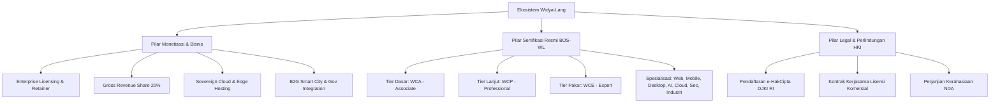

# MASTERPLAN DOKUMENTASI MONETISASI, KEMITRAAN LEGAL & SERTIFIKASI RESMI WIDYA-LANG
**Edisi Eksekutif & Standarisasi Nasional | Tahun Rilis: 2026**

---

## 1. PENDAHULUAN & VISI STRATEGIS
Bahasa Pemrograman **Widya-Lang** dirancang bukan hanya sebagai instrumen teknis berdaulat, melainkan sebagai ekosistem komersial dan industri mandiri berdaya saing global. Dokumen ini menjabarkan seluruh peta jalan monetisasi, skema kemitraan legal (HKI/Lisensi), serta arsitektur mesin sertifikasi otomatis berjenjang nasional.



---

## 2. SKEMA BISNIS & MODEL MONETISASI

### A. Lisensi Komersial & Retainer SLA
| Kategori Lisensi | Target Pengguna | Skema Biaya | Layanan & Fitur Utama |
| :--- | :--- | :--- | :--- |
| **Individu Pro / Freelance** | Pengembang mandiri & UMKM | Free Core / Rp 299.000 / bln (Cloud Pro) | Lisensi komersial bebas royalti hingga omzet Rp 500 Jt/thn, akses CLI exam. |
| **Enterprise Gold** | Mid-size Corp & Startup Seri-A | Rp 50.000.000 / thn + 20% Net Revenue | Modul Industri, Private Package Registry (WPM), SLA 8 Jam. |
| **Enterprise Platinum / B2G** | BUMN, Bank, Smart City, Pabrik | Rp 250.000.000+ / thn Retainer | On-Premise MicroVM, Full FFI Drivers, 24/7 Dedicated Support, Custom Agent Workflow. |

### B. Skema Biaya Ujian Sertifikasi & Diskon Pendidikan (70% OFF)
| Tingkat / Jalur Ujian | Biaya Normal (Komersial) | Biaya Promo Pendidikan (Diskon 70%)* | Target Peserta |
| :--- | :--- | :--- | :--- |
| **WCA (Associate)** | Rp 750.000 | **Rp 225.000** | Siswa SMK RPL, Mahasiswa S1/D3, Guru Informatika |
| **WCP (Professional)** | Rp 1.750.000 | **Rp 525.000** | Mahasiswa Tingkat Akhir, Dosen, Engineer |
| **WCE (Expert)** | Rp 3.500.000 | **Rp 1.050.000** | Peneliti, Dosen Senior, Principal Architect |
| **Spesialisasi (WCWD-WCEI)** | Rp 2.250.000 | **Rp 675.000** | Dosen Vokasi, Mahasiswa Spesialis, Praktisi |

> **🌟 Kebijakan Promo Pendidikan Widya Peduli Bangsa:**
> Seluruh siswa, mahasiswa, guru, dosen, dan tenaga kependidikan berhak memperoleh **diskon langsung 70%** untuk seluruh jenjang ujian sertifikasi resmi dengan mengunggah foto kartu identitas pelajar/mahasiswa/guru atau menggunakan alamat email instansi pendidikan (`.sch.id` / `.ac.id`).

### C. Skema Pembagian Pendapatan (Gross Revenue Share 20%)
Untuk produk komersial *turnkey* atau sistem SaaS yang dibangun di atas *Widya Core Ecosystem*, berlaku pembagian royalti standar **20% dari Gross Revenue** dengan pencatatan otomatis terintegrasi sistem telemetri WidyaAPM.

---

## 3. BADAN OTORITAS STANDARISASI & SERTIFIKASI (BOS-WL)

### Tingkatan Sertifikasi & Target Kemampuan Aplikasi Nyata (Deliverables)

1. **WCA (Widya Certified Associate)**:
   - *Target Peserta*: Siswa SMK Rekayasa Perangkat Lunak, Mahasiswa Ilmu Komputer/TI, Pengembang Pemula.
   - *Target Output Aplikasi Nyata*:
     - **Aplikasi Kasir / POS Konsol**: Mampu membuat aplikasi pencatatan transaksi toko, penghitungan diskon/PPN, dan cetak struk teks.
     - **Alat Otomasi & Parser Data**: Skrip pengolah file CSV/JSON nilai siswa atau rekap data penjualan.
     - **Game Interaktif & Alat Bantu**: Game tebak angka/kata atau kalkulator ilmiah berbasis logika kontrol alur.
   - *Materi*: Sintaks natural (`misal`, `biar`, `diketahui`, `diket`, `tetap`), logika percabangan, perulangan, fungsi dasar, array & map.
   - *Ambang Kelulusan*: 70%.

2. **WCP (Widya Certified Professional)**:
   - *Target Peserta*: Software Engineer, Backend Developer, Sistem Integrator.
   - *Target Output Aplikasi Nyata*:
     - **Aplikasi Web Backend REST API + Basis Data**: Membangun server API CRUD lengkap yang terhubung ke database **WidyaBase** dengan transaksi ACID.
     - **Aplikasi Kolaborasi Real-Time**: Membangun editor dokumen kolaboratif multi-pengguna berbasis **CRDT**.
     - **Engine Pelaporan Bisnis Otomatis**: Generator otomatis dokumen kantor resmi (**PDF**, **XLSX**, **DOCX**, **PPTX**) berbasis data dinamis.
     - **Sistem Pemrosesan Asinkron**: Pipeline pemrosesan data konkuren menggunakan **Actor Model & Worker Channels**.
   - *Materi*: OOP, Pemrograman Fungsional, Actor Model Concurrency, Channels, Error Handling `coba-tangkap`, WidyaBase SQL dwibahasa, Modul Office & Workspace.
   - *Ambang Kelulusan*: 75%.

3. **WCE (Widya Certified Expert)**:
   - *Target Peserta*: Principal Engineer, Solution & Enterprise Architect, R&D Tech Lead.
   - *Target Output Aplikasi Nyata*:
     - **Sistem Multi-Agent Cerdas Mandiri**: Membangun ekosistem agen AI otonom (seperti *Kantor Digital 10-Agen*) yang mampu berkoordinasi via Shared Blackboard Bus menyusun keputusan bisnis dan audit sistem.
     - **Engine Pemrosesan Berkecepatan Tinggi (Sub-Millisecond)**: Membangun sistem transaksi finansial / trading engine berkinerja tinggi dengan akselerasi **FFI C/Rust Zero-Copy** dan kompilasi biner **LLVM IR**.
     - **Custom Compiler Extension & Runtime**: Mengembangkan plugin dan optimasi kompiler native yang tervalidasi Full Self-Hosting.
   - *Materi*: Multi-Agent Orchestration, LLVM IR Optimizations, High-Performance FFI, Zero-Copy Memory Management, Self-Hosting Compiler Stages.
   - *Ambang Kelulusan*: 85%.

### Target Aplikasi Jalur Spesialisasi Industri (Horizontal Badges)
- **WCWD (Web Developer)**: Mampu membangun aplikasi SaaS Web Fullstack interaktif dengan Virtual DOM native dan serverless edge gateway (contoh: Portal Marketplace / LMS).
- **WCMD (Mobile Developer)**: Mampu memproduksi aplikasi Android (APK/AAB) dan iOS (IPA) native dengan sensor kamera/GPS dan offline storage.
- **WCDD (Desktop Developer)**: Mampu membuat software desktop GUI native ringan (<15MB RAM) berbasis GPU Canvas (contoh: Aplikasi Kasir Visual POS, Editor Teks).
- **WCSS (Security Specialist)**: Mampu memasang benteng WAF OWASP Top 10, mitigasi DDoS, autentikasi Zero-Trust SPIFFE mTLS, dan enklave Kriptografi Pasca-Kuantum (PQC).
- **WCDA (Data & AI Engineer)**: Mampu membangun pipeline telemetri IoT Smart City (perhitungan ISPU PM2.5 Permen LHK) dan komputasi tensor AI berbasis WebGPU WGSL compute shaders.
- **WCCD (Cloud & DevOps Architect)**: Mampu mengorkestrasi kluster kontainer mandiri (**WidyaBox & WidyaKube**) dan serverless Firecracker MicroVM dengan auto-scaling.
- **WCEI (Enterprise & Industrial Architect)**: Mampu mengintegrasikan sistem perbankan nasional (**QRIS, BI-FAST, SNAP OpenAPI, ISO 8583**) dan otomasi SCADA/Pabrik (**PLC Modbus TCP, OPC UA, HL7/FHIR**).

---

## 4. PENGGUNAAN CLI SERTIFIKASI (`widya ujian`)

```bash
# 1. Menampilkan daftar seluruh tingkatan dan spesialisasi
widya ujian daftar

# 2. Membuat template berkas latihan coding
widya ujian contoh --level WCA --output latihan_wca.wya

# 3. Menguji dan menilai berkas submission latihan
widya ujian nilai latihan_wca.wya --level WCA

# 4. Memulai sesi ujian interaktif resmi
widya ujian mulai WCA --nama "Budi Santoso" --id "3171012345670001"

# 5. Verifikasi keaslian sertifikat digital terbitan BOS-WL
widya ujian verifikasi WIDYA-WCA-1727700000-0017
```

---

## 5. DOKUMEN LEGAL TERKAIT
Seluruh draf perjanjian resmi telah disiapkan pada direktori [legal/](file:///c:/widya-lang/legal):
1. [SURAT_PERJANJIAN_KERJASAMA_LISENSI_HKI.md](file:///c:/widya-lang/legal/SURAT_PERJANJIAN_KERJASAMA_LISENSI_HKI.md)
2. [PERJANJIAN_KERAHASIAAN_NDA.md](file:///c:/widya-lang/legal/PERJANJIAN_KERAHASIAAN_NDA.md)
3. [PANDUAN_PENDAFTARAN_E_HAKCIPTA_DJKI.md](file:///c:/widya-lang/legal/PANDUAN_PENDAFTARAN_E_HAKCIPTA_DJKI.md)
