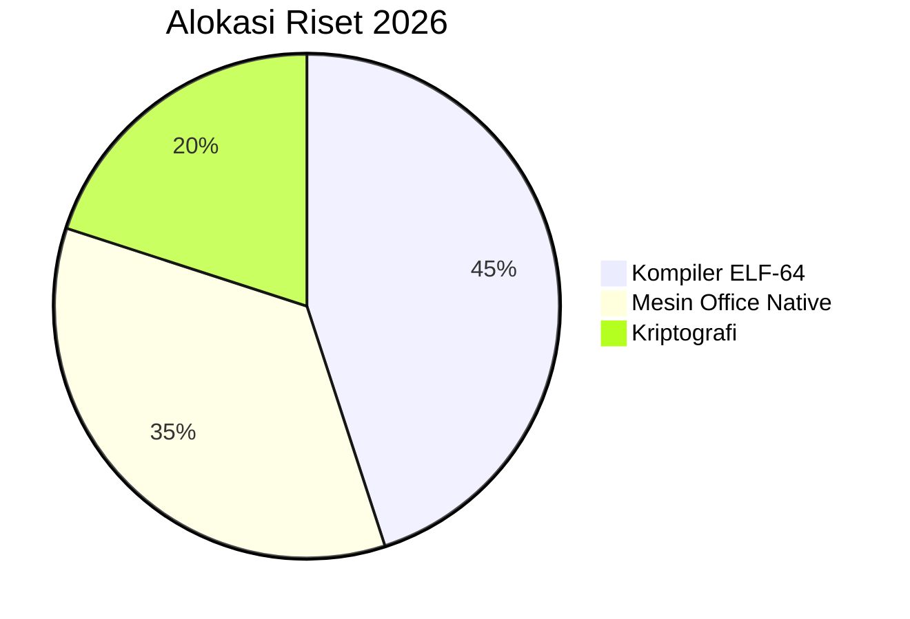
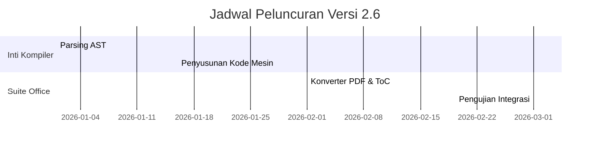

# 🏢 DOKUMENTASI RESMI WIDYAOFFICE ENTERPRISE SUITE (v2.6.0)

**WidyaOffice** adalah modul aplikasi pemrosesan dokumen produktivitas kantor berstandar industri internasional (ECMA-376 / OpenXML, ISO 32000-1 PDF, EPUB 3.2) yang terintegrasi secara *native* di dalam Widya-Lang. Seluruh fungsionalitas diimplementasikan menggunakan 100% kode murni Rust (*Zero External Cloud & Binary Dependency*) demi menjamin kedaulatan data dan kepatuhan penuh terhadap regulasi nasional.

---

## 📑 1. Modul Dokumen Microsoft Word (`.docx`) — `src/office/docx.rs`

Menyediakan pembuatan, templating, dan enkapsulasi dokumen OpenXML biner:
- **Heading & Paragraf Berjenjang**: Penataan hierarki dokumen (H1-H6) dan atribut tipografi (*Bold*, *Italic*, *Underline*, *Monospace*, *Font Size pt*, *Color Hex*, *Callout Box*).
- **Tabel Enterprise Multi-Kolom**: Pembuatan tabel data bergaris batas resmi dengan *header row* dan alignment kolom (kiri, tengah, kanan).
- **Daftar Isi Otomatis (*Table of Contents*)**: Penataan blok `DocxElement::TableOfContents` yang secara otomatis mengompilasi seluruh judul bab beserta nomor halamannya.
- **Template & Mail Merge Engine**: Pengisian otomatis placeholder `{{kunci_variabel}}` untuk penerbitan dokumen massal (Faktur, Slip Gaji, Ijazah, Surat Keputusan).
- **Watermarking & Cap Resmi**: Cap air dinamis (*"RAHASIA"*, *"DRAF"*, *"SALINAN"*) dengan sudut rotasi dan transparansi adaptif.
- **Tanda Tangan Elektronik (TTE)**: Penyematan sertifikat TTE berstandar BSrE / X.509 PKI berbasis ringkasan SHA-256 dan kunci rahasia HMAC.
- **Sensor Redaksi Otomatis UU PDP No. 27/2022**: Penyamaran otomatis nomor NIK, KK, rekening bank, nomor telepon, dan email sebelum dokumen dipublikasikan.
- **Ekspor Biner Asli (`.docx`) & Pratinjau Cetak**: Menghasilkan kontainer biner ZIP OpenXML (`.docx`) murni dan rendering HTML5 siap cetak (*Print-Ready / PDF Export*).

```bash
# Membuat berkas biner .docx asli
widya office buat-docx --nama "Surat Keputusan Direksi 2026" --output sk_direksi.docx --watermark "RAHASIA"

# Menandatangani dokumen secara elektronik (TTE)
widya office tte-docx sk_direksi.docx --penandatangan "Satriyo" --peran "Direktur Utama" --output sk_direksi_signed.html

# Sensor redaksi otomatis data pribadi sesuai UU PDP
widya office sensor-pdp data_pegawai.txt --output data_pegawai_terlindungi.txt
```

---

## 📊 2. Modul Spreadsheet Microsoft Excel (`.xlsx` & `.csv`) — `src/office/xlsx.rs`

Menyediakan lembar kerja multi-dimensi, format sel, dan mesin kalkulasi matematika komprehensif:
- **Format Sel & Tampilan Finansial**:
  - Format Mata Uang Rupiah: `Rp 150.000.000` (IDR)
  - Format Persentase: `15.5%`
  - Pengaturan presisi angka desimal
- **Pustaka Rumus Industri Komprehensif (15+ Rumus)**:
  - **Agregasi**: `=SUM(A1:A10)`, `=AVERAGE(B1:B5)`, `=MIN(A1:A5)`, `=MAX(A1:A5)`, `=COUNT(C1:C20)`
  - **Logika & Kondisional**: `=IF(B2>=100, "TARGET TERCAPAI", "EVALUASI")`
  - **Pencarian Data (Lookup)**: `=VLOOKUP("PRJ-01", A1:D10, 2)`
  - **Manipulasi Teks**: `=CONCAT(A1, " - ", B1)`, `=UPPER(C1)`, `=LOWER(C1)`, `=TRIM(D1)`, `=LEN(E1)`
  - **Matematika & Pembulatan**: `=ROUND(A1, 2)`, `=ABS(B1)`
  - **Finansial & Fintech**: `=PMT(rate, nper, pv)` (Kalkulasi cicilan pinjaman koperasi/kredit)
  - **Tanggal & Waktu**: `=TODAY()`, `=NOW()`
  - **Aritmatika Langsung**: `=A1 + B1 * C1`
- **Konversi Langsung ke PDF Laporan**: Konversi berkas `.xlsx` atau `.csv` menjadi dokumen tabel PDF resmi berpaginasi rapi.
- **Ekspor Biner Asli (`.xlsx`) & Impor/Ekspor CSV**: Menghasilkan biner ZIP OpenXML (`.xlsx`) murni yang kompatibel dengan Microsoft Excel, LibreOffice, atau Google Sheets.

```bash
# Membuat berkas biner .xlsx asli
widya office buat-xlsx --nama "Laporan Keuangan Q3" --output laporan_keuangan.xlsx

# Evaluasi rumus spreadsheet dari CLI
widya office hitung-rumus "=IF(A1>=1000000, 150000, 50000)" --data "1500000"
widya office hitung-rumus "=SUM(A1:A3)" --data "1000000\n2500000\n1500000"

# Konversi langsung spreadsheet / CSV ke PDF Laporan
widya office convert data_keuangan.xlsx laporan_keuangan.pdf
widya office convert data_proyek.csv laporan_proyek.pdf
```

---

## 📽️ 3. Modul Presentasi Microsoft PowerPoint (`.pptx`) — `src/office/pptx.rs`

Menyediakan perancangan tayangan slide eksekutif dan deck presentasi kelas korporasi:
- **Tema Visual Premium**:
  - `DarkModern`: Tema gelap futuristik biru neon
  - `ExecutiveNavy`: Tema biru safir formal eksekutif
  - `EmeraldFintech`: Tema hijau zamrud perbankan dan koperasi digital
  - `SovereignGold`: Tema emas mewah kenegaraan
- **Tata Letak Slide (*Layouts*)**:
  - `TitleSlide`: Judul utama dan subjudul presentasi
  - `TitleAndContent`: Judul slide dan poin-poin penjelasan
  - `TwoColumns`: Perbandingan dua kolom konten berdampingan
  - `KpiDashboard`: Grid kartu metrik KPI eksekutif (Nilai, Label, Tren MoM, Indikator Positif/Negatif)
- **Konversi Slide Lanskap ke PDF**: Konversi deck slide presentasi menjadi berkas PDF berorientasi lanskap (842 x 595 pt) lengkap dengan kartu KPI dan gaya tema aktif.
- **Ekspor Biner Asli (`.pptx`) & Web Deck HTML5**: Menghasilkan berkas biner PowerPoint OpenXML (`.pptx`) dan penampil slide HTML5 interaktif lengkap dengan navigasi keyboard (`Spasi` / `Panah Kanan` / `Panah Kiri`).

```bash
# Membuat berkas biner .pptx asli
widya office buat-pptx --nama "Briefing Transformasi Digital 2026" --output presentasi.pptx

# Mengonversi slide presentasi .pptx menjadi PDF Lanskap presentasi
widya office convert presentasi.pptx slide_deck.pdf
```

---

## 🎨 4. Mesin Diagram Vektor Asli (Mermaid Vector Engine) — `src/office/diagram.rs`

Merender diagram berbasis teks Mermaid langsung menjadi elemen grafis vektor PDF asli (tanpa browser headless, Chromium, atau pustaka eksternal):
- **Alur & Arsitektur (*Flowchart*)**: Subgraph, arah `TD` / `LR`, node persegi, rounded, dan belah ketupat keputusan.
- **Interaksi Layanan (*Sequence Diagram*)**: Partisipan, pesan sinkron/asinkron, lifeline, dan blok aktivasi.
- **Siklus Hidup (*State Diagram*)**: State, transisi berlabel, dan penanda start/end.
- **Desain Perangkat Lunak (*Class Diagram*)**: Kelas, method, tipe data, dan relasi pewarisan.
- **Basis Data (*Entity-Relationship / ER Diagram*)**: Entitas, atribut bertipe, kunci relasi (`PK`, `FK`, `UK`), dan kardinalitas.
- **Diagram Lingkaran (*Pie Chart*)**: Irisan proporsional (*pie slices*), persentase terhitung otomatis, legenda warna terkoordinasi, dan banner judul.
- **Linimasa Proyek (*Gantt Chart*)**: Balok jadwal tugas horizontal, status (`done`, `active`, normal), seksi proyek, dan grid waktu terukur (*H+0 s.d H+N*).

Contoh Mermaid dalam Markdown:
````markdown



````

---

## 📖 5. Format Buku Digital Standar EPUB 3.2 — `src/office/epub.rs`

Generator berkas buku elektronik `.epub` mandiri berstandar IDPF/W3C OCF 3.2:
- Struktur arsip ZIP murni: `mimetype` tanpa kompresi, `META-INF/container.xml`, `OEBPS/content.opf`, dan Navigation Document `OEBPS/toc.xhtml`.
- Dukungan sampul buku digital (*Cover Image* JPEG/PNG) via properti `cover-image`.
- Pemisahan bab otomatis berdasarkan Heading Level 1 (`#`) dokumen Markdown.
- Kompatibel dengan seluruh aplikasi e-reader modern (Apple Books, Calibre, Kobo, Thorium Reader).

---

## 🔄 6. Pipeline Konversi Dokumen Universal — `src/office/converter.rs`

Subkomando CLI `widya office convert` menyediakan konversi universal lintas format:
- `Markdown (.md) -> PDF`: Mendukung tipografi penuh, sintaks highlight kode, tabel aligned, catatan kaki, bookmark interaktif, dan diagram vektor.
- `Markdown (.md) -> DOCX`: Menghasilkan dokumen Word biner lengkap dengan heading, daftar bernomor, tabel, dan diagram.
- `Markdown (.md) -> EPUB`: Menghasilkan buku digital EPUB 3.2 multi-bab.
- `DOCX (.docx) -> PDF`: Konverter dokumen Word ke PDF asli.
- `XLSX / CSV -> PDF`: Laporan tabel spreadsheet berorientasi dokumen.
- `PPTX (.pptx) -> PDF`: Konversi deck slide ke PDF berorientasi lanskap.
- **Opsi `--toc`**: Otomatis menyisipkan halaman Daftar Isi (*Table of Contents*) bergaris titik (*dot leaders*) dan nomor halaman di awal dokumen PDF.

```bash
# Konversi Markdown ke PDF dengan Daftar Isi otomatis
widya office convert naskah_kebijakan.md naskah_kebijakan.pdf --toc

# Konversi Markdown ke Word (.docx)
widya office convert dokumen.md dokumen.docx

# Konversi Markdown ke Buku Digital EPUB
widya office convert buku.md buku.epub
```

---

## 🔒 7. Keamanan Siber & Kepatuhan Regulasi (UU PDP No. 27/2022) — `src/office/security.rs`

- **TTE Kriptografis (BSrE Ready)**: Setiap dokumen dapat disegel dengan tanda tangan digital SHA-256 berstempel waktu ISO 8601.
- **Redaksi Data Pribadi Otomatis**:
  - NIK & KK (16 digit) disensor menjadi `327101******8901`
  - Rekening Bank (10-14 digit) disensor menjadi `1234****90`
  - Nomor Telepon (+62 / 08xx) disensor menjadi `0812****7890`
  - Email disensor menjadi `b***o@kemdikbud.go.id`
- **Zero Cloud Leakage**: Seluruh dokumen diproses 100% pada mesin lokal (*air-gapped capable*).

---

## 🧪 8. Status Modul & Perintah CLI

```bash
widya office status
```

Output:
```text
============================================================
  🏢 STATUS WIDYAOFFICE ENTERPRISE SUITE v2.6.0
============================================================
  Microsoft Word (.docx)   : AKTIF (OpenXML ZIP, Template & TTE)
  Microsoft Excel (.xlsx)  : AKTIF (15+ Rumus, Grid, CSV & PDF)
  PowerPoint (.pptx)       : AKTIF (KPI Cards, Web Deck & PDF Lanskap)
  Buku Digital (EPUB 3.2)  : AKTIF (IDPF OCF, Cover Image & Navigation)
  Diagram Vektor (Mermaid) : AKTIF (Flow, Seq, State, Class, ER, Pie, Gantt)
  Daftar Isi Otomatis      : AKTIF ([TOC] & CLI --toc Dot Leaders)
  TTE & Kepatuhan UU PDP   : AKTIF (SHA-256 BSrE & Auto Redaction)
  Native ISO 32000-1 PDF   : AKTIF (%PDF-1.7 Vector, Outlines & Links)
  LaTeX / TeX Math Engine  : AKTIF (Equations, KaTeX Preview)
  GFM Markdown Transpiler  : AKTIF (AST, Checklists, Codeblock)
  Kedaulatan Data Dokumen  : 100% OFFLINE & ZERO CLOUD LEAK
============================================================
```
