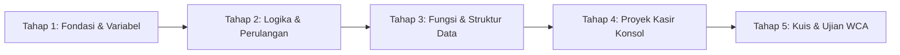

# BUKU PANDUAN KURIKULUM & MODUL PELATIHAN BERTAHAP WIDYA-LANG
**Badan Otoritas Standarisasi & Sertifikasi Widya-Lang (BOS-WL) | Edisi 2026**

---

## DAFTAR MODUL TAHAPAN BELAJAR
1. [Modul 1: WCA - Widya Certified Associate (Dasar & Logika Algoritma)](#1-modul-wca-widya-certified-associate)
2. [Modul 2: WCP - Widya Certified Professional (OOP, Concurrency & Database)](#2-modul-wcp-widya-certified-professional)
3. [Modul 3: WCE - Widya Certified Expert (Multi-Agent, LLVM & Performance)](#3-modul-wce-widya-certified-expert)
4. [Modul Spesialisasi Industri (WCWD, WCMD, WCDD, WCSS, WCDA, WCCD, WCEI)](#4-modul-spesialisasi-industri)

---

## 1. MODUL WCA: WIDYA CERTIFIED ASSOCIATE
**Target Output**: Mampu membuat Aplikasi Kasir POS Konsol, Skrip Parser Rekap Data CSV/JSON, dan Game Logika Interaktif.



### 📌 Tahap 1: Pengenalan Bahasa & Deklarasi Variabel
- **Konsep**: Memahami eksekusi kode program dan penyimpanan data ke memori.
- **Sintaks Natural**:
  ```widya
  diketahui nama_toko = "Toko Berkah Nusantara"
  diket nomor_struk = 1001
  misal total_belanja = 0
  tetap PPN = 0.11 // 11% pajak tidak dapat diubah
  ```
- **Latihan**: Deklarasikan harga barang, jumlah beli, dan hitung perkalian keduanya.

### 📌 Tahap 2: Logika Percabangan & Perulangan
- **Konsep**: Membuat program yang dapat mengambil keputusan dan mengulang proses.
- **Sintaks**:
  ```widya
  jika (total_belanja >= 100000) {
      tulis("Selamat! Anda mendapatkan diskon 10%")
      total_belanja = total_belanja * 0.9
  } selain_itu {
      tulis("Belanja di atas Rp 100.000 untuk dapat diskon!")
  }

  // Perulangan item belanja
  diketahui daftar_harga = [15000, 25000, 50000]
  untuk_setiap harga dalam daftar_harga {
      tulis("Item: Rp " + harga)
  }
  ```

### 📌 Tahap 3: Fungsi & Modularitas Kode
- **Konsep**: Membungkus logika bisnis ke dalam fungsi yang dapat dipanggil berulang kali.
- **Sintaks**:
  ```widya
  fungsi hitung_total_bayar(subtotal, persen_diskon) {
      diketahui nilai_diskon = subtotal * (persen_diskon / 100)
      diketahui setelah_diskon = subtotal - nilai_diskon
      diketahui pajak = setelah_diskon * 0.11
      kembalikan setelah_diskon + pajak
  }
  ```

### 📌 Tahap 4: Proyek Praktik Nyata - "Aplikasi Kasir POS Konsol"
- **Tujuan**: Menggabungkan seluruh materi Tahap 1-3 menjadi aplikasi terminal utuh.
- **Struktur Kode Proyek**:
  ```widya
  fungsi cetak_struk_kasir(nama_kasir, daftar_item) {
      tulis("========================================")
      tulis("      TOKO BERKAH DIGITAL NUSANTARA    ")
      tulis("  Kasir: " + nama_kasir)
      tulis("----------------------------------------")
      misal subtotal = 0
      untuk_setiap item dalam daftar_item {
          tulis(" - " + item["nama"] + " : Rp " + item["harga"])
          subtotal = subtotal + item["harga"]
      }
      tulis("----------------------------------------")
      diketahui total_akhir = hitung_total_bayar(subtotal, 5)
      tulis(" TOTAL BAYAR (Inc. PPN): Rp " + total_akhir)
      tulis("========================================")
  }
  ```

### 📌 Tahap 5: Evaluasi Mandiri (Kuis & Ujian WCA)
- Jalankan simulasi ujian: `widya ujian mulai WCA`
- Target Ambang Kelulusan: **70%**.

---

## 2. MODUL WCP: WIDYA CERTIFIED PROFESSIONAL
**Target Output**: Mampu membuat Backend REST API, Database ACID **WidyaBase**, Kolaborasi **CRDT**, dan Generator Dokumen Kantor.

### 📌 Tahap 1: Pemrograman Berorientasi Objek (OOP)
- Mendefinisikan `struktur` dan `implementasi` metode:
  ```widya
  struktur AkunBank {
      nomor_rekening,
      pemilik,
      saldo
  }

  implementasi AkunBank {
      fungsi setor(jumlah) {
          diri.saldo = diri.saldo + jumlah
          tulis("Setoran berhasil! Saldo baru: " + diri.saldo)
      }
  }
  ```

### 📌 Tahap 2: Integrasi Basis Data WidyaBase SQL Dwibahasa
- Melakukan operasi transaksi data ACID:
  ```sql
  BUAT_TABEL nasabah (
      id TEKS KUNCI_UTAMA,
      nama TEKS TIDAK_NULL,
      saldo ANGKA DEFAULT 0
  );

  SISIP_KE nasabah (id, nama, saldo) NILAI ('N-01', 'Budi Santoso', 5000000);
  PILIH * DARI nasabah DIMANA saldo >= 1000000;
  ```

### 📌 Tahap 3: Konkurensi Modern (Actor Model & Channels)
- Komunikasi asinkron tanpa *race condition*:
  ```widya
  diketahui antrean = saluran.buat()
  
  tugas_asinkron {
      antrean.kirim("Transaksi #001 Selesai")
  }
  
  diketahui laporan = antrean.terima()
  tulis("Pesan Diterima: " + laporan)
  ```

### 📌 Tahap 4: Proyek Nyata - "Generator Invoice & Laporan Bisnis PDF"
- Meng-generate invoice resmi berstandar ISO:
  ```widya
  fungsi buat_invoice_pdf(nama_klien, total) {
      diketahui pdf = kantor.pdf.buat("INVOICE PEMBAYARAN")
      pdf.tambah_teks("INVOICE RESMI", 40, 750, 16, benar)
      pdf.tambah_teks("Klien: " + nama_klien, 40, 720, 12, salah)
      pdf.tambah_teks("Total Tagihan: Rp " + total, 40, 700, 12, benar)
      pdf.simpan("invoice_" + nama_klien + ".pdf")
  }
  ```

### 📌 Tahap 5: Evaluasi Ujian WCP
- Jalankan: `widya ujian mulai WCP` (Ambang: **75%**).

---

## 3. MODUL WCE: WIDYA CERTIFIED EXPERT
**Target Output**: Mampu merancang Multi-Agent Digital Office, Optimasi LLVM IR, High-Speed Zero-Copy FFI, dan Self-Hosting Compiler.

### 📌 Tahap 1: Arsitektur Multi-Agent & Blackboard State Bus
- Koordinasi antar agen cerdas otonom:
  ```widya
  diketahui bus = runtime.buat_blackboard()
  bus.daftarkan_topik("analisa_keuangan")

  agen DirekturKeuangan {
      fungsi evaluasi(anggaran) {
          jika (anggaran < 1000000000) {
              bus.publikasikan("analisa_keuangan", "DISETUJUI")
          }
      }
  }
  ```

### 📌 Tahap 2: Akselerasi Native FFI C/Rust Zero-Copy
- Memanggil pustaka C/Rust native dengan nol overhead:
  ```widya
  eksternal_c {
      fungsi hitung_matriks_c(ptr: *const u8, len: u32) -> i32
  }
  ```

### 📌 Tahap 3: Kompilasi Native LLVM IR & WebAssembly
- Kompilasi biner langsung:
  ```bash
  widya llvm backend.wya --output backend.ll
  clang -O3 backend.ll -o backend.exe
  ```

### 📌 Tahap 4: Proyek Nyata - "Autonomous 10-Agent Digital Office"
- Mengorkestrasi 10 agen AI terdistribusi (CEO, CTO, Lead Dev, Finance, Security, dsb.) secara otomatis.

### 📌 Tahap 5: Evaluasi Ujian WCE
- Jalankan: `widya ujian mulai WCE` (Ambang: **85%**).

---

## 4. MODUL SPESIALISASI INDUSTRI (STEP-BY-STEP)

| Spesialisasi | Tahapan Belajar Inti | Proyek Nyata yang Dibangun |
| :--- | :--- | :--- |
| **WCWD (Web)** | 1. Virtual DOM -> 2. SSR Engine -> 3. Serverless API -> 4. Edge Routing | Portal Marketplace Fullstack Serverless Edge. |
| **WCMD (Mobile)** | 1. Widget Native -> 2. Sensor & GPS -> 3. Offline Cache -> 4. Build APK/IPA | Aplikasi Mobile Absensi & Pelayanan Publik GPS. |
| **WCDD (Desktop)** | 1. GPU Canvas -> 2. Window Lifecycle -> 3. Event Loop -> 4. Low-RAM GUI | Software Kasir Visual & Media Player (<15MB RAM). |
| **WCSS (Security)** | 1. OWASP WAF -> 2. SPIFFE mTLS -> 3. Anti-DDoS -> 4. Post-Quantum Crypto | Gateway Perimeter Pertahanan Siber Korporat. |
| **WCDA (Data/AI)** | 1. WGSL Shader -> 2. SIMD Tensor -> 3. ISPU PM2.5 -> 4. Model Prediksi | Dashboard Telemetri IoT Smart City Kemen LHK. |
| **WCCD (Cloud)** | 1. Linux Namespaces -> 2. Firecracker MicroVM -> 3. OCI Box -> 4. K8s Pods | Orkestrator Kluster Serverless Mandiri Auto-Scaling. |
| **WCEI (Industri)** | 1. Modbus PLC -> 2. OPC UA SCADA -> 3. QRIS & BI-FAST -> 4. ISO 8583 | Gateway Pembayaran Bank & Kontrol Pabrik Cerdas. |
