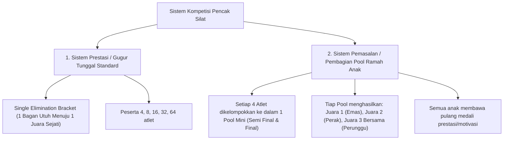
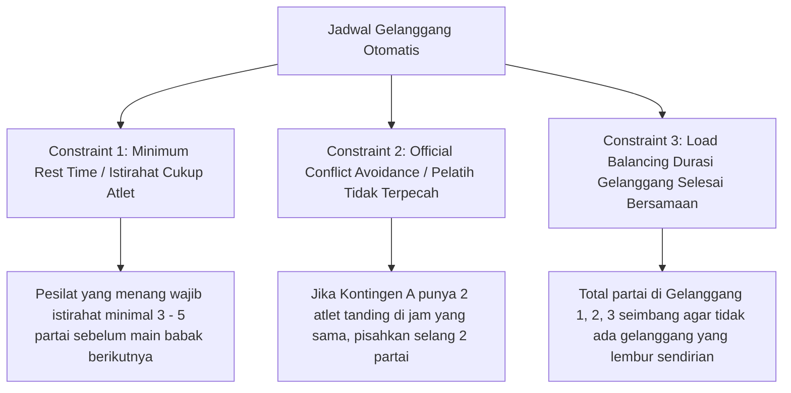

# Algoritma Pembuatan Bagan (Bracket Generator), Seeding & Penjadwalan Gelanggang (Arena Silat)

Dokumen ini menjelaskan rancangan komprehensif logika matematika dan algoritma otomasi untuk pembuatan bagan pertandingan (*Tournament Bracket Generation*), pembagian *pool* pemasalan, pemisahan kontingen (*Seeding Separation Logic*), penanganan peserta ganjil (*Bye System*), serta algoritma penjadwalan multi-gelanggang otomatis (*Fair Court Scheduler*).

---

## BAGIAN 1: Dua Model Sistem Pertandingan Silat

Di lapangan pencak silat, terdapat 2 sistem pengelompokan bagan utama:



---

## BAGIAN 2: Algoritma Bagan Gugur Tunggal & Sistem *BYE* (Single Elimination)

### 1. Perhitungan Ukuran Bagan Berbasis Eksponen $2^n$
Jika jumlah peserta dalam satu kelas pertandingan adalah $N$:
* **Ukuran Bagan Ideal ($S$)**: Angka perpangkatan dua terkecil yang $\ge N$.
  $$S = 2^{\lceil \log_2 N \rceil}$$
  *(Contoh: Jika $N = 11$, maka $S = 2^4 = 16$ slot bagan).*
* **Jumlah Peserta Mendapat Hak *BYE* ($B$)**:
  $$B = S - N$$
  *(Contoh: $16 - 11 = 5$ orang atlet otomatis lolos langsung ke babak kedua tanpa tanding di babak pertama).*

---

### 2. Algoritma Pemisahan Kontingen / Perguruan (*Seeding Separation*)
**Masalah Lapangan**: Pelatih sangat kecewa jika 2 atlet dari perguruan/sekolah yang sama harus langsung saling bunuh/berhadapan di babak penyisihan awal.

**Solusi Algoritma (Deterministic Spread Distribution)**:
1. Hitung total atlet per kontingen di kelas tersebut.
2. Tempatkan atlet dari kontingen terbesar pada kuadran yang saling berlawanan:
   - Atlet 1 Kontingen A $\rightarrow$ Slot **Bagan Paling Atas (Slot 1)**.
   - Atlet 2 Kontingen A $\rightarrow$ Slot **Bagan Paling Bawah (Slot S)**.
   - Atlet 3 Kontingen A $\rightarrow$ Slot **Tengah Bawah (Slot S/2 + 1)**.
   - Atlet 4 Kontingen A $\rightarrow$ Slot **Tengah Atas (Slot S/2)**.
3. Hak *BYE* dibagikan terlebih dahulu secara merata kepada peserta unggulan (*seeded athletes*) atau disebar selang-seling di bagan atas dan bagan bawah.

### 3. Implementasi Kode Algoritma Seeding & Bracket (TypeScript Engine)

Berikut adalah implementasi algoritma murni (*pure function*) yang digunakan oleh engine **Arena Silat**:

```typescript
export interface AthleteParticipant {
  id: string;
  name: string;
  contingentId: string;
  isSeeded?: boolean;
  seedRank?: number; // 1, 2, 3, 4 jika atlet unggulan juara bertahan
}

export interface BracketSlot {
  slotNumber: number; // 1 s.d. S
  athlete: AthleteParticipant | null; // null jika BYE
  isBye: boolean;
}

/**
 * Algoritma Penentuan Posisi Seeding Standar Olimpiade / PERSILAT
 * Mengembalikan urutan nomor slot untuk penempatan unggulan (1, 2, 3, 4.. S)
 */
function getSeedingOrder(bracketSize: number): number[] {
  let rounds = Math.log2(bracketSize) - 1;
  let pls = [1, 2];
  for (let i = 0; i < rounds; i++) {
    const nextPls: number[] = [];
    const length = pls.length * 2 + 1;
    for (const d of pls) {
      nextPls.push(d);
      nextPls.push(length - d);
    }
    pls = nextPls;
  }
  return pls;
}

/**
 * Main Generator: Menyusun Slot Bagan dengan Pemisahan Kontingen & Distribusi BYE
 */
export function generateSingleEliminationBracket(
  athletes: AthleteParticipant[]
): BracketSlot[] {
  const N = athletes.length;
  if (N < 2) throw new Error("Minimal butuh 2 atlet untuk membuat bagan!");

  // 1. Hitung Ukuran Bagan S = 2^n
  const S = Math.pow(2, Math.ceil(Math.log2(N)));
  const totalByes = S - N;

  // 2. Dapatkan urutan penempatan matematis (Contoh S=8: [1, 8, 4, 5, 2, 7, 3, 6])
  const seedingSlots = getSeedingOrder(S);

  // 3. Kelompokkan Atlet berdasarkan Kontingen (Group by Contingent)
  const contingentMap = new Map<string, AthleteParticipant[]>();
  for (const a of athletes) {
    if (!contingentMap.has(a.contingentId)) {
      contingentMap.set(a.contingentId, []);
    }
    contingentMap.get(a.contingentId)!.push(a);
  }

  // 4. Urutkan Kontingen dari yang memiliki atlet terbanyak ke tersedikit
  const sortedContingents = Array.from(contingentMap.entries()).sort(
    (a, b) => b[1].length - a[1].length
  );

  // 5. Interleave / Sebar atlet antar kontingen (Round-Robin Distribution)
  const orderedAthletes: AthleteParticipant[] = [];
  let hasMore = true;
  let roundIndex = 0;
  while (hasMore) {
    hasMore = false;
    for (const [, list] of sortedContingents) {
      if (roundIndex < list.length) {
        orderedAthletes.push(list[roundIndex]);
        hasMore = true;
      }
    }
    roundIndex++;
  }

  // 6. Buat Array Slot Kosong berukuran S
  const slots: BracketSlot[] = Array.from({ length: S }, (_, idx) => ({
    slotNumber: idx + 1,
    athlete: null,
    isBye: false,
  }));

  // 7. Tempatkan Atlet & BYE ke dalam Slot Bagan
  // Slot unggulan pertama diisi atlet, sisa slot terlemah diisi status BYE
  for (let i = 0; i < S; i++) {
    const targetSlotIndex = seedingSlots[i] - 1; // 0-indexed
    if (i < N) {
      slots[targetSlotIndex].athlete = orderedAthletes[i];
      slots[targetSlotIndex].isBye = false;
    } else {
      slots[targetSlotIndex].athlete = null;
      slots[targetSlotIndex].isBye = true;
    }
  }

  return slots;
}
```

---

## BAGIAN 3: Algoritma Bagan Pemasalan (Pool 4 / Pool 2)

Khusus kategori Usia Dini (SD) dan Pra-Remaja (SMP) festival pemasalan:
- Jika satu kelas ada 16 atlet, sistem otomatis memecah menjadi **4 Pool Mandiri**:
  - `Pool A (4 atlet)`: 2 partai semifinal $\rightarrow$ 1 partai final (Menghasilkan Emas, Perak, 2 Perunggu).
  - `Pool B (4 atlet)`: 2 partai semifinal $\rightarrow$ 1 partai final.
  - `Pool C (4 atlet)`: 2 partai semifinal $\rightarrow$ 1 partai final.
  - `Pool D (4 atlet)`: 2 partai semifinal $\rightarrow$ 1 partai final.
- Setiap pool menerapkan pemisahan kontingen agar tidak ada atlet satu kontingen yang bertemu di semifinal pool.

---

## BAGIAN 4: Algoritma Penjadwalan Multi-Gelanggang Cerdas (*Fair Court Scheduling*)

Setelah seluruh bagan terbentuk, partai pertandingan harus didistribusikan ke gelanggang (Gelanggang 1, 2, 3, dst). Algoritma penjadwalan harus memenuhi **3 Syarat Mutlak (Constraints)**:



### Logika Distribusi Partai Harian:
1. **Urutan Babak**: Babak Penyisihan (*Preliminary*) seluruh kelas diselesaikan terlebih dahulu $\rightarrow$ disusul Babak Perempat Final $\rightarrow$ Semi Final $\rightarrow$ Babak Final.
2. **Pengelompokan Gelanggang**:
   - Gelanggang 1: Khusus Usia Dini & Pra-Remaja Putra.
   - Gelanggang 2: Khusus Usia Dini & Pra-Remaja Putri.
   - Gelanggang 3: Khusus Remaja & Dewasa Putra.
   - Gelanggang 4: Khusus Remaja & Dewasa Putri + Nomor Seni TGR / Festival.

---

## BAGIAN 5: Skema Struktur Data Bagan & Node Pohon Turnamen

```sql
-- 1. Tabel Pool Pertandingan (Khusus Kategori Pemasalan)
CREATE TABLE category_pools (
    id UUID PRIMARY KEY DEFAULT gen_random_uuid(),
    category_id UUID NOT NULL REFERENCES categories(id) ON DELETE CASCADE,
    pool_name VARCHAR(50) NOT NULL, -- 'Pool A', 'Pool B', 'Pool 1', dst
    total_participants INT NOT NULL DEFAULT 4,
    created_at TIMESTAMP DEFAULT CURRENT_TIMESTAMP
);

-- 2. Tabel Struktur Node Pohon Bagan (Tournament Bracket Nodes)
CREATE TABLE bracket_nodes (
    id UUID PRIMARY KEY DEFAULT gen_random_uuid(),
    tournament_id UUID NOT NULL REFERENCES tournaments(id) ON DELETE CASCADE,
    category_id UUID NOT NULL REFERENCES categories(id) ON DELETE CASCADE,
    pool_id UUID REFERENCES category_pools(id) ON DELETE CASCADE, -- Nullable jika sistem prestasi utuh
    round_index INT NOT NULL, -- 1 = Babak 1, 2 = Perempat Final, 3 = Semi Final, 4 = Final
    node_index INT NOT NULL, -- Posisi slot vertikal (1 s.d. Total Slot / 2)
    match_id UUID REFERENCES matches(id) ON DELETE SET NULL, -- Relasi ke partai pertandingan riil
    red_source_node_id UUID REFERENCES bracket_nodes(id), -- Pemenang dari node mana yang jadi sudut merah
    blue_source_node_id UUID REFERENCES bracket_nodes(id), -- Pemenang dari node mana yang jadi sudut biru
    is_bye_node BOOLEAN DEFAULT FALSE,
    created_at TIMESTAMP DEFAULT CURRENT_TIMESTAMP
);

-- Indexing untuk render bagan pohon super cepat
CREATE INDEX idx_bracket_category_round ON bracket_nodes(category_id, round_index, node_index);
```
