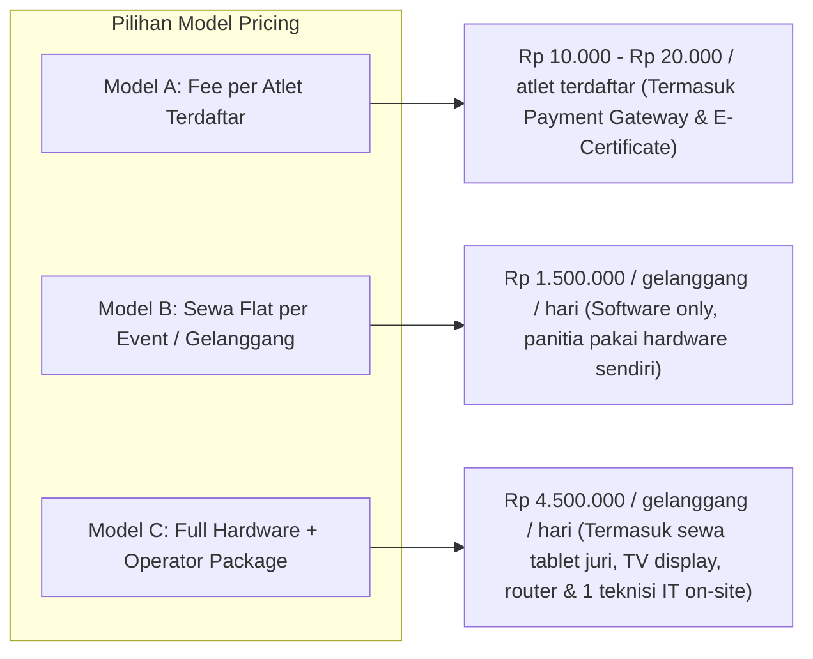

# Model Keuangan, Pendaftaran, Laporan Finansial & Skema Biaya Layanan Aplikasi (Arena Silat SaaS)

Dokumen ini memuat analisis struktur finansial penyelenggaraan turnamen pencak silat, simulasi arus kas (arus masuk & keluar), sistem *ticketing/registration gateway*, transparansi laporan keuangan kepanitiaan, hingga skema *pricing* dan pembagian hasil (*revenue share / platform fee*) aplikasi **Arena Silat SaaS**.

---

## BAGIAN 1: Peta Arus Kas Keuangan Turnamen (Financial Cash Flow)

```mermaid
graph TD
    subgraph Pemasukan (Revenue Stream Event)
        A1[Biaya Pendaftaran Kontingen & Atlet]
        A2[Sponsorship & Hibah Dispora/Kemenpora]
        A3[Tiket Masuk Penonton / HTM]
        A4[Tenant Bazar & Sewa Stand Merchandise]
        A5[Biaya Protes / Video Review Banding]
    end

    subgraph Platform SaaS Arena Silat
        GW[Payment Gateway: QRIS / VA / CC / E-Wallet]
        SPLIT[Split Payment & Settlement Engine]
    end

    subgraph Pengeluaran (Expenditure / Biaya Operasional)
        B1[Honorarium Wasit Juri, TD & Dewan Hakim IPSI]
        B2[Sewa Gedung Olahraga / GOR & Listrik/Kebersihan]
        B3[Medali, Trophy Juara Umum & Piagam/Sertifikat]
        B4[Tim Medis, Dokter, Ambulans & Premi BPJS Atlet]
        B5[Konsumsi, Akomodasi, Seragam & Publikasi/Dekorasi]
        B6[Biaya Layanan Aplikasi SaaS & Hardware Kit]
    end

    A1 --> GW
    A3 --> GW
    GW --> SPLIT
    SPLIT -->|Dana Bersih Panitia| B1
    SPLIT -->|Dana Bersih Panitia| B2
    SPLIT -->|Dana Bersih Panitia| B3
    SPLIT -->|Dana Bersih Panitia| B4
    SPLIT -->|Dana Bersih Panitia| B5
    SPLIT -->|Platform Fee SaaS| B6
```

---

## BAGIAN 2: Standar Struktur Biaya Pendaftaran di Lapangan

Berdasarkan praktik umum kejuaraan Silat di Indonesia (tingkat lokal s.d. nasional):

| Kategori Pendaftaran | Kisaran Tarif Umum | Keterangan & Komponen Biaya |
|---|---|---|
| **Pendaftaran Kontingen (Tim/Official)** | Rp 100.000 – Rp 250.000 / kontingen | Administrasi kontingen, manager/coach ID card, buku panduan laga. |
| **Kategori Tanding (Perorangan)** | Rp 250.000 – Rp 350.000 / atlet | Biaya tanding + jatah medali/piagam + subsidi premi BPJS Ketenagakerjaan. |
| **Kategori Seni Tunggal (Perorangan)** | Rp 250.000 – Rp 350.000 / atlet | Biaya tampil seni jurus baku perorangan. |
| **Kategori Seni Ganda (Berpasangan)** | Rp 400.000 – Rp 500.000 / pasangan (2 orang) | Biaya tampil seni ganda tangan kosong & senjata. |
| **Kategori Seni Regu (Tim 3 Orang)** | Rp 500.000 – Rp 650.000 / regu (3 orang) | Biaya tampil jurus baku regu serempak. |
| **Kategori Festival / Pasanggiri Tradisi** | Rp 350.000 – Rp 800.000 / tim | Biaya tampil garapan tradisi/berkelompok (tergantung jumlah anggota). |
| **Biaya Pengajuan Protes / Kartu VR** | Rp 2.000.000 – Rp 5.000.000 / protes | Uang jaminan protes resmi ke Dewan Hakim (kembali 50-100% jika protes diterima). |

---

## BAGIAN 3: Model Monetisasi & Biaya Layanan Aplikasi (SaaS Pricing Matrix)

Penyelenggara turnamen dapat memilih beberapa model penyewaan aplikasi **Arena Silat**:



### Rincian Paket Layanan Aplikasi:

1. **Model A: Pay-per-Athlete (Paling Populer untuk Kejuaraan Pelajar/Open)**:
   - **Biaya:** Rp 15.000 / atlet (ditagihkan saat pendaftaran online).
   - **Fitur Termasuk:**
     - Portal registrasi online + Payment Gateway multi-channel (QRIS, VA).
     - Validasi otomatis NIK / Paspor / NISN & Dokumen BPJS.
     - Auto-Bracket Generator (*seeding* anti-bentrok).
     - Akses Jury Digital Scoring (Tanding, TGR, Festival).
     - Live Score Screen & Live Stream Overlay (OBS).
     - E-Certificate ber-QR Code & Ekspor format SIMT Puspresnas.
2. **Model B: Enterprise Fixed License (Untuk Pengprov IPSI / Instansi Resmi)**:
   - **Biaya:** Rp 3.000.000 – Rp 7.500.000 / event (unlimited atlet).
   - **Fitur Termasuk:** Semua fitur Model A + Custom Domain (`kejurprov2026.com`) + Dedicated Cloud Instance.
3. **Add-on Services (Layanan Tambahan)**:
   - **Paket Sewa Hardware Gelanggang**: Rp 1.500.000 / gelanggang / hari (5 unit Tablet Juri, 1 Router Dual-Band, 1 Mini PC Operator).
   - **Teknisi / IT Support On-Site**: Rp 750.000 – Rp 1.000.000 / teknisi / hari.
   - **Live Streaming Production Multi-Camera**: Rp 2.500.000 / gelanggang / hari.

---

## BAGIAN 4: Laporan Keuangan Kepanitiaan Otomatis (Event Financial Accounting)

Aplikasi SaaS menyediakan **Dashboard Keuangan Terpadu (Financial Dashboard)** untuk akuntabilitas panitia kepada sponsor, instansi, dan peserta:

### 1. Rekap Pemasukan Real-Time (*Real-time Revenue Tracking*)
- Pemasukan bersih pendaftaran kontingen dan atlet (terpisah dari potongan platform fee & payment gateway fee).
- Status pembayaran kontingen: *Lunas*, *Kurang Bayar* (misal ganti kelas/tambah atlet), *Expired*.

### 2. Rekap Pengeluaran Operasional (*Expense Management*)
Panitia dapat mencatat pos pengeluaran secara digital dengan bukti struk/nota:
- Honorarium Wasit Juri (berdasarkan jumlah partai / hari tugas).
- Biaya konsumsi, timbangan, sewa gedung, dan medis.
- Biaya premi kolektif BPJS Ketenagakerjaan.

### 3. Laporan Laba/Rugi & Neraca Event (P&L Summary)
- Ekspor otomatis **Laporan Pertanggungjawaban Finansial (LPJ Keuangan)** dalam format PDF/Excel siap serah ke Ketua Panitia / Pengcab / Dispora.

---

## BAGIAN 5: Rancangan Skema Database Modul Keuangan & Billing

```sql
-- 1. Tabel Konfigurasi Tarif Pendaftaran Kategori (Registration Fees)
CREATE TABLE tournament_fee_rules (
    id UUID PRIMARY KEY DEFAULT gen_random_uuid(),
    tournament_id UUID NOT NULL REFERENCES tournaments(id) ON DELETE CASCADE,
    category_id UUID REFERENCES categories(id) ON DELETE SET NULL, -- NULL jika biaya kontingen/global
    fee_type VARCHAR(50) NOT NULL, -- 'contingent', 'tanding_individual', 'tgr_single', 'tgr_double', 'tgr_team', 'festival_team'
    amount DECIMAL(12,2) NOT NULL, -- misal: 250000.00
    early_bird_amount DECIMAL(12,2),
    early_bird_deadline DATE,
    currency VARCHAR(3) DEFAULT 'IDR',
    created_at TIMESTAMP DEFAULT CURRENT_TIMESTAMP
);

-- 2. Tabel Transaksi Pembayaran Registrasi (Payments & Split Billing)
CREATE TABLE payment_transactions (
    id UUID PRIMARY KEY DEFAULT gen_random_uuid(),
    tournament_id UUID NOT NULL REFERENCES tournaments(id) ON DELETE CASCADE,
    contingent_id UUID NOT NULL REFERENCES contingents(id) ON DELETE CASCADE,
    invoice_number VARCHAR(100) UNIQUE NOT NULL, -- misal: INV-AS-2026-00341
    gross_amount DECIMAL(12,2) NOT NULL, -- Total tagihan pendaftaran
    platform_fee DECIMAL(10,2) NOT NULL DEFAULT 0.00, -- Biaya layanan aplikasi Arena Silat
    payment_gateway_fee DECIMAL(10,2) NOT NULL DEFAULT 0.00, -- Biaya QRIS/VA (misal 1.5% atau Rp 3.000)
    net_organizer_amount DECIMAL(12,2) NOT NULL, -- Dana bersih yang masuk ke rekening panitia
    payment_method VARCHAR(50), -- 'qris', 'bca_va', 'mandiri_va', 'credit_card', 'bank_transfer_manual'
    payment_status VARCHAR(50) DEFAULT 'pending', -- 'pending', 'settled', 'expired', 'failed', 'refunded'
    settlement_status VARCHAR(50) DEFAULT 'unsettled', -- 'unsettled', 'transferred_to_eo'
    paid_at TIMESTAMP,
    created_at TIMESTAMP DEFAULT CURRENT_TIMESTAMP
);

-- 3. Tabel Detail Item Tagihan (Transaction Line Items)
CREATE TABLE payment_items (
    id UUID PRIMARY KEY DEFAULT gen_random_uuid(),
    transaction_id UUID NOT NULL REFERENCES payment_transactions(id) ON DELETE CASCADE,
    athlete_id UUID REFERENCES athletes(id) ON DELETE SET NULL,
    category_id UUID REFERENCES categories(id) ON DELETE SET NULL,
    item_description VARCHAR(255) NOT NULL,
    unit_price DECIMAL(12,2) NOT NULL,
    quantity INT DEFAULT 1,
    subtotal DECIMAL(12,2) NOT NULL
);

-- 4. Tabel Pengeluaran Operasional Panitia (Event Expenses / LPJ Kas Keluar)
CREATE TABLE event_expenses (
    id UUID PRIMARY KEY DEFAULT gen_random_uuid(),
    tournament_id UUID NOT NULL REFERENCES tournaments(id) ON DELETE CASCADE,
    expense_category VARCHAR(50) NOT NULL, -- 'referee_honor', 'venue_rental', 'medals_trophy', 'medical_bpjs', 'catering', 'app_hardware_rental', 'other'
    title VARCHAR(255) NOT NULL,
    amount DECIMAL(12,2) NOT NULL,
    receipt_doc_url VARCHAR(500), -- Link upload foto nota/kuitansi
    paid_to VARCHAR(255) NOT NULL, -- Penerima uang
    approved_by VARCHAR(100), -- Bendahara / Ketua Panitia
    spent_at DATE NOT NULL,
    notes TEXT,
    created_at TIMESTAMP DEFAULT CURRENT_TIMESTAMP
);

-- 5. Tabel Tagihan Biaya Sewa SaaS ke EO (App Platform Invoices)
CREATE TABLE app_subscription_billings (
    id UUID PRIMARY KEY DEFAULT gen_random_uuid(),
    tournament_id UUID NOT NULL REFERENCES tournaments(id) ON DELETE CASCADE,
    billing_type VARCHAR(50) NOT NULL, -- 'pay_per_athlete', 'flat_license', 'hardware_rental'
    total_athletes_billed INT DEFAULT 0,
    rate_per_athlete DECIMAL(10,2) DEFAULT 0.00,
    flat_fee DECIMAL(12,2) DEFAULT 0.00,
    hardware_fee DECIMAL(12,2) DEFAULT 0.00,
    total_app_fee DECIMAL(12,2) NOT NULL,
    payment_status VARCHAR(50) DEFAULT 'unpaid', -- 'unpaid', 'paid', 'deducted_from_payout'
    payout_transferred_at TIMESTAMP,
    created_at TIMESTAMP DEFAULT CURRENT_TIMESTAMP
);

-- Indexes for Fast Financial Aggregations
CREATE INDEX idx_pay_trans_tournament ON payment_transactions(tournament_id, payment_status);
CREATE INDEX idx_expenses_tournament ON event_expenses(tournament_id, expense_category);
```
