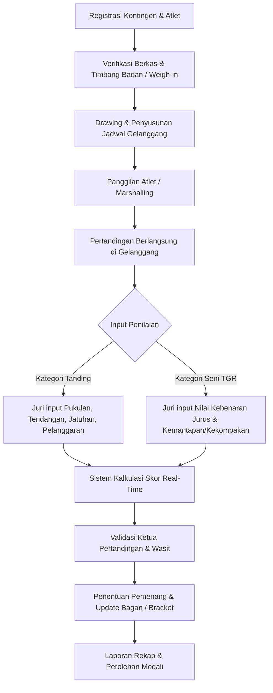
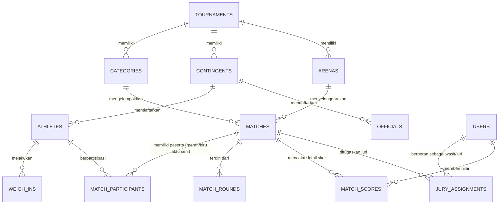

# Analisis Lapangan & Desain Database Sistem Manajemen Turnamen Pencak Silat (Arena Silat)

Dokumen ini berisi rangkuman analisis kebutuhan operasional di lapangan pertandingan Pencak Silat (berdasarkan regulasi standar seperti PERSILAT/IPSI) serta rancangan skema basis data relasional.

---

## BAGIAN 1: Analisis Kondisi & Alur Lapangan

### 1. Entitas & Peran di Lapangan
1. **Panitia / Administrator Turnamen**:
   - Registrasi kontingen, atlet/pesilat, dan ofisial.
   - Penentuan bagan pertandingan (drawing), jadwal gelanggang (arena), dan penimbangan berat badan (*weigh-in*).
2. **Dewan Juri / Wasit Juri**:
   - **Ketua Pertandingan (KP)**: Mengawasi jalannya laga di gelanggang, verifikasi skor, validasi permohonan juri/wasit.
   - **Dewan Pendekar / Dewan Hakim**: Menangani banding/protes resmi.
   - **Wasit Gelanggang**: Memimpin pertandingan di atas matras (aba-aba, teguran, peringatan, hukuman, jatuh/jatuhan).
   - **Juri (3 - 5 Juri per gelanggang)**: Memberikan penilaian real-time melalui sistem digital (tombol pukulan, tendangan, teknik bantingan/jatuhan, serta hukuman) atau form TGR (Tunggal, Ganda, Regu, Solo Kreatif).
3. **Ofisial & Pesilat (Sudut Merah & Sudut Biru)**:
   - Pesilat bertanding sesuai kategori tanding (berat badan, usia) atau kategori seni (TGR).
   - Ofisial mendampingi dan berhak mengajukan kartu protes/video review (jika diaktifkan sistem VR).
4. **Petugas Medis / Dokter Pertandingan**:
   - Melakukan cek kelayakan fisik dan rekam status cedera/diskualifikasi medis.
5. **Operator Gelanggang & Layar (Display Screen)**:
   - Mengoperasikan timer/ronde, bel, serta menampilkan papan skor digital (Live Scoreboard) yang dapat dilihat penonton dan ofisial.

---

### 2. Kategori Kompetisi (Tanding & Seni TGR)

Sistem mengakomodasi 4 nomor utama kompetisi resmi PERSILAT / IPSI:

#### A. Kategori TANDING (Sparring / Fight)
Pesilat bertanding satu lawan satu (Sudut Merah vs Sudut Biru) dalam 3 babak, dipisahkan berdasarkan rentang usia, jenis kelamin (Putra/Putri), dan berat badan (Weight Class):
* **Usia Dini / Pra-Usia Dini (5 – 11 Tahun)**: Kelas A (26-28 kg) s.d. Kelas Bebas/Open.
* **Pra-Remaja / SMP (12 – 14 Tahun)**: Kelas A (30-33 kg) s.d. Kelas N & Bebas.
* **Remaja / SMA (14 – 17 Tahun)**: Kelas A (39-43 kg) s.d. Kelas J (79-83 kg) & Bebas.
* **Dewasa / Mahasiswa / Umum (17 – 35 Tahun)**:
  * Putra: Kelas A (45-50 kg) s.d. Kelas J (90-95 kg) & Bebas Open 1 / 2.
  * Putri: Kelas A (45-50 kg) s.d. Kelas F (70-75 kg) & Bebas.
* **Master (35+ Tahun)**: Kategori kelas master khusus veteran.

#### B. Kategori SENI / TGR (Tunggal, Ganda, Regu)
1. **TUNGGAL (1 Pesilat)**:
   * Menampilkan Jurus Baku Tunggal (Tangan Kosong, Golok/Parang, Tongkat/Toya).
   * Durasi waktu standar: Tepat 3 menit (toleransi $\pm 5$ detik, selebihnya dikenakan potongan poin).
   * Penilaian: Nilai Kebenaran Gerak (100 gerak baku) + Nilai Kemantapan, Penjiwaan, dan Keserasian.
2. **GANDA (2 Pesilat / Pasangan)**:
   * Menampilkan Jurus Ganda bersenjata dan tangan kosong secara koreografi pertarungan terencana.
   * Durasi waktu standar: Tepat 3 menit.
   * Penilaian: Kualitas teknik serang bela, kemantapan, kekayaan teknik, penjiwaan, dan keserasian irama gerakan.
3. **REGU (3 Pesilat / Tim)**:
   * Menampilkan Jurus Baku Regu (100 gerakan tangan kosong beregu seragam dan kompak).
   * Durasi waktu standar: Tepat 3 menit.
   * Penilaian: Kebenaran gerakan baku secara serempak + kekompakan, soliditas, dan kemantapan gerak.

#### C. Kategori FESTIVAL & PASANGGIRI (Seni Tradisi / Garapan / Bercerita)
Berbeda dengan kejuaraan prestasi sistem gugur (Juara 1, 2, 3), pada **Festival Pencak Silat**:
* **Format Penampilan**: Perorangan, Berpasangan, atau Berkelompok/Kolosal (3 hingga 10+ pesilat) dengan iringan musik tradisional (Kendang Pencak / Karawitan).
* **Penentuan Pemenang Bukan Sistem Gugur**: Seluruh tim tampil 1 kali sesuai nomor urut undian (*performance order*).
* **Penetapan Pemenang Multi-Penampil Terbaik (Multi-Awards)**:
  * **Predikat Penampil Terbaik 1, 2, 3, 4, dst** (beberapa tim berhak meraih predikat Penampil Terbaik bersamaan / *Trophy of Excellence*).
  * **Kategori Penghargaan Tematik**:
    - *Penampil Terbaik I, II, III, Harapan I, II*
    - *Tata Gerak & Teknik Silat Terbaik*
    - *Koreografi & Komposisi Gerak Terbaik*
    - *Tata Busana / Kostum & Rias Terbaik*
    - *Iringan Musik / Karawitan Terfavorit*
    - *Penyaji Cerita / Garapan Tradisi Terbaik*
  * **Grading Berbasis Skor Ambang Batas (Standard Grade)**:
    - Nilai $\ge 85$: Predikat *Emas / Penampil Sangat Baik*
    - Nilai $75 - 84$: Predikat *Perak / Penampil Baik*
    - Nilai $65 - 74$: Predikat *Perunggu / Penampil Cukup*

---

### 3. Alur Operasional Pertandingan (Match Flow)



---

### 4. Matriks Permasalahan di Lapangan vs Solusi Desain Database

| No | Permasalahan Nyata di Lapangan | Dampak Operasional | Solusi Desain Database (Tabel & Kolom) | Mekanisme & Integritas Data |
|---|---|---|---|---|
| **1** | **Manipulasi / Ketidaksesuaian Usia & Berat Badan** (Pesilat bertanding tidak sesuai kelasnya) | Diskualifikasi telat, cedera atlet, protes keras antar kontingen | • `athletes.birth_date`<br>• `categories.min_weight`, `max_weight`, `age_group`<br>• Tabel `weigh_ins` (`actual_weight`, `status`) | Validasi otomatis saat drawing/weigh-in: status atlet hanya bisa `passed` jika berat aktual berada dalam rentang `[min_weight, max_weight]` kategori dan umur sesuai `age_group`. |
| **2** | **Bentrok Jadwal Atlet Satu Kontingen** (Pesilat dari kontingen sama bertemu di babak awal atau main bersamaan di 2 gelanggang berbeda) | Ofisial terpecah, partai terpaksa ditunda / WO sepihak | • `athletes.contingent_id`<br>• `matches.bracket_node_id`, `stage`<br>• `matches.arena_id`, `match_number` | Algoritma *seeding* memisahkan atlet dengan `contingent_id` yang sama ke bagan atas & bawah. Pengecekan relasi `arena_id` & jadwal mencegah duplikasi jadwal atlet di jam yang sama. |
| **3** | **Protes Keputusan Wasit / Juri (Banding Nilai)** (Ofisial meragukan apakah tendangan/jatuhan benar-benar dinilai juri) | Kericuhan gelanggang, pertandingan tertunda lama, tuduhan kecurangan | • Tabel `match_scores` (`round_number`, `jury_id`, `corner`, `action_type`, `points_awarded`, `is_verified`, `recorded_at`) | **Audit Trail Granular**: Setiap penekanan tombol juri dicatat *microsecond/timestamp*. Saat ada protes/VR, rekaman video dapat dicocokkan dengan log `recorded_at` dan `jury_id` terkait. |
| **4** | **Pemberian Poin Tanding Tidak Adil (Subjektif)** (Hanya 1 juri menekan tombol tanpa kesepakatan juri lain) | Poin siluman masuk ke papan skor | • `match_scores.is_verified`<br>• Kolom agregasi `match_participants.final_score` | Poin tidak langsung diakumulasikan ke `final_score` sebelum engine konsensus memvalidasi bahwa minimal $\ge 2$ juri menekan aksi identik dalam rentang waktu toleransi (1-2 detik) dan mengubah `is_verified = TRUE`. |
| **5** | **Jadwal Pertandingan Molor & Tertukar Antar Gelanggang** (Partai bergeser karena cedera/WMP, nomor partai kacau) | Penonton & atlet bingung menunggu panggilan (marshalling) | • `matches.status` (`scheduled`, `marshalling`, `ongoing`, `paused`, `finished`)<br>• `matches.arena_id`, `match_number`<br>• `matches.started_at`, `finished_at` | Status partai di-*update* secara *state-machine* real-time. Jika Gelanggang A tertunda, partai berikutnya dapat dipindahkan *arena_id*-nya secara fleksibel tanpa merusak struktur nomor bagan (`bracket_node_id`). |
| **6** | **Koneksi Jaringan Gelanggang Drop / Tidak Stabil** (Sinyal Wi-Fi terganggu oleh penonton/gedung tertutup) | Tombol juri macet, layar skor *freeze*, data pertandingan hilang | • Format `UUID` (Client-generated PK) pada `match_scores`<br>• Kolom `recorded_at` & status sinkronisasi lokal | Penggunaan `UUID` memungkinkan perangkat Juri (Jury Pad) mengenerate ID skor secara lokal (*offline-first*) dan melakukan batch-sync ke server saat koneksi pulih tanpa resiko *conflict ID*. |
| **7** | **Kesalahan Hitung Rumus Seni (TGR)** (Hukuman durasi waktu lebih/kurang, hukuman keluar matras, selisih poin juri) | Perhitungan manual lama, potensi salah juara karena *human error* hitung | • `categories.round_duration_sec`<br>• `match_scores.action_type` (`tgr_deduction`, `tgr_movement_score`)<br>• `match_participants.final_score` | Sistem menghitung deviasi waktu tampil vs `round_duration_sec` secara otomatis, menerapkan rumus penalti baku, dan membuang nilai ekstrim (tertinggi/terendah) jika regulasi mensyaratkan. |
| **8** | **Cedera Berat Atlet & Tuntutan Biaya RS** (Atlet mengalami patah tulang / gegar otak / cedera tanding tanpa proteksi jaminan) | Panitia dituntut hukum/finansial, rumah sakit rujukan menolak pasien darurat tanpa deposit | • `athletes.bpjs_type`<br>• `athletes.bpjs_number`<br>• `athletes.bpjs_card_url`<br>• `athletes.bpjs_is_active` | **Pre-Flight Medical Verification**: Atlet tidak bisa masuk daftar laga (*drawing*) sebelum status BPJS Ketenagakerjaan (BPU/Event) atau BPJS Kesehatan terverifikasi aktif oleh tim verifikator medis panitia. |

---

## BAGIAN 2: Desain Basis Data Relasional

### 1. Diagram Relasi Entitas (ERD)



---

### 2. Skema Tabel & Deskripsi Kolom

#### A. Tabel `tournaments` (Data Turnamen)
| Kolom | Tipe Data | Keterangan |
|---|---|---|
| `id` | `UUID` (PK) | Identifier unik turnamen |
| `name` | `VARCHAR(255)` | Nama turnamen (contoh: Kejuaraan Nasional Silat 2026) |
| `slug` | `VARCHAR(255)` | URL slug unik |
| `rule_version` | `VARCHAR(50)` | Versi aturan (misal: PERSILAT 2022 / IPSI 2024) |
| `start_date` | `DATE` | Tanggal mulai turnamen |
| `end_date` | `DATE` | Tanggal selesai turnamen |
| `venue` | `VARCHAR(255)` | Lokasi / Gedung Olahraga |
| `status` | `ENUM` | Status: `draft`, `registration`, `ongoing`, `completed`, `archived` |
| `created_at` | `TIMESTAMP` | Waktu pencatatan data |
| `updated_at` | `TIMESTAMP` | Waktu pembaharuan data |

#### B. Tabel `contingents` (Kontingen / Perguruan / Daerah)
| Kolom | Tipe Data | Keterangan |
|---|---|---|
| `id` | `UUID` (PK) | Identifier unik kontingen |
| `tournament_id` | `UUID` (FK) | Relasi ke turnamen |
| `name` | `VARCHAR(255)` | Nama kontingen / perguruan / kontingen daerah |
| `contingent_type` | `ENUM` | Tipe: `perguruan`, `sekolah`, `pengcab`, `pengprov`, `klub` |
| `contact_person` | `VARCHAR(100)` | Penanggung jawab / Manager kontingen |
| `phone` | `VARCHAR(20)` | Nomor kontak penanggung jawab |
| `created_at` | `TIMESTAMP` | Waktu dibuat |

#### C. Tabel `athletes` (Data Pesilat, Kewarganegaraan & Identitas Legal)
| Kolom | Tipe Data | Keterangan |
|---|---|---|
| `id` | `UUID` (PK) | Identifier unik atlet |
| `contingent_id` | `UUID` (FK) | Relasi ke kontingen |
| `full_name` | `VARCHAR(255)` | Nama lengkap pesilat |
| `gender` | `ENUM` | `male`, `female` |
| `birth_date` | `DATE` | Tanggal lahir untuk validasi batas usia kategori |
| `nationality` | `VARCHAR(3)` | Kode ISO 3166-1 alpha-3 (contoh: `IDN`, `MYS`, `SGP`, `VIE`, `NLD`, dll) |
| `nik` | `VARCHAR(20)` (Nullable) | **NIK** (Wajib jika `nationality = 'IDN'`, bersumber dari KTP/KIA/KK) |
| `passport_number` | `VARCHAR(50)` (Nullable) | **Nomor Paspor** (Wajib jika `nationality != 'IDN'` / Peserta Internasional) |
| `nisn` | `VARCHAR(20)` (Nullable) | **NISN** (Khusus kategori pelajar Indonesia / Integrasi Puspresnas) |
| `photo_url` | `VARCHAR(500)` | Link pas foto atlet |
| `registered_weight`| `DECIMAL(5,2)` | Berat badan awal saat pendaftaran (kg) |
| `bpjs_type` | `ENUM` | `bpjs_kesehatan`, `bpjs_ketenagakerjaan`, `international_travel_insurance`, `asuransi_swasta`, `kolektif_panitia`, `none` |
| `bpjs_number` | `VARCHAR(50)` | Nomor Kartu BPJS / Polis Asuransi Kesehatan Internasional |
| `bpjs_card_url` | `VARCHAR(500)` | Link scan kartu BPJS / Asuransi Perjalanan Atlet Internasional |
| `bpjs_is_active` | `BOOLEAN` | Status verifikasi keaktifan jaminan oleh panitia / medis |
| `medical_notes` | `TEXT` | Catatan riwayat medis/cedera/alergi |
| `created_at` | `TIMESTAMP` | Waktu dibuat |

#### D. Tabel `categories` (Kategori Usia, Kelas & Sistem Kompetisi)
| Kolom | Tipe Data | Keterangan |
|---|---|---|
| `id` | `UUID` (PK) | Identifier kategori |
| `tournament_id` | `UUID` (FK) | Relasi ke turnamen |
| `match_type` | `ENUM` | `tanding`, `tunggal`, `ganda`, `regu`, `festival_perorangan`, `festival_pasangan`, `festival_berkelompok` |
| `competition_system`| `ENUM` | `single_elimination` (gugur), `pool_bracket` (pemasalan), `performance_ranking` (skor tertinggi), `festival_multi_awards` (penampil terbaik masal) |
| `age_group` | `ENUM` | `usia_dini`, `pra_remaja`, `remaja`, `dewasa`, `master`, `umum_campuran` |
| `gender` | `ENUM` | `male`, `female`, `mixed` |
| `class_name` | `VARCHAR(50)` | Nama kelas, contoh: `Kelas A`, `Jurus Baku Regu`, `Festival Cerita Tradisi` |
| `min_weight` | `DECIMAL(5,2)` (Nullable) | Berat badan minimum (kg, khusus tanding) |
| `max_weight` | `DECIMAL(5,2)` (Nullable) | Berat badan maksimum (kg, khusus tanding) |
| `round_duration_sec` | `INT` | Durasi waktu tampil (misal: 180 detik) |
| `total_rounds` | `INT` | Jumlah ronde (1 untuk festival/TGR, 3 untuk tanding) |

#### E. Tabel `weigh_ins` (Sesi Timbang Badan Resmi)
| Kolom | Tipe Data | Keterangan |
|---|---|---|
| `id` | `UUID` (PK) | Identifier sesi timbang |
| `athlete_id` | `UUID` (FK) | Relasi ke atlet |
| `category_id` | `UUID` (FK) | Kategori target |
| `actual_weight` | `DECIMAL(5,2)` | Berat aktual timbangan (kg) |
| `status` | `ENUM` | `passed`, `failed_overweight`, `failed_underweight`, `medical_disqualified` |
| `weighed_by` | `VARCHAR(100)` | Nama petugas timbang |
| `weighed_at` | `TIMESTAMP` | Waktu penimbangan |

#### F. Tabel `arenas` (Gelanggang)
| Kolom | Tipe Data | Keterangan |
|---|---|---|
| `id` | `UUID` (PK) | Identifier gelanggang |
| `tournament_id` | `UUID` (FK) | Relasi ke turnamen |
| `arena_number` | `INT` | Nomor gelanggang (misal: Gelanggang 1, Gelanggang 2) |
| `name` | `VARCHAR(100)` | Nama label gelanggang |
| `is_active` | `BOOLEAN` | Status aktif/tidaknya gelanggang |

#### G. Tabel `matches` (Partai Pertandingan / Sesi Penampilan)
| Kolom | Tipe Data | Keterangan |
|---|---|---|
| `id` | `UUID` (PK) | Identifier partai / sesi |
| `category_id` | `UUID` (FK) | Relasi ke kategori kelas |
| `arena_id` | `UUID` (FK, Nullable) | Gelanggang yang ditugaskan |
| `match_number` | `INT` | Nomor partai / urutan tampil |
| `stage` | `ENUM` | `preliminary`, `quarterfinal`, `semifinal`, `third_place`, `final`, `festival_showcase` |
| `bracket_node_id` | `VARCHAR(50)`| Identifier node bagan pohon (Nullable jika festival) |
| `next_match_id` | `UUID` (FK, Nullable) | Partai berikutnya (Nullable jika festival) |
| `status` | `ENUM` | `scheduled`, `marshalling`, `ongoing`, `paused`, `finished`, `cancelled` |
| `winner_id` | `UUID` (FK, Nullable) | Pemenang utama (Nullable jika multi-awards) |
| `win_type` | `ENUM` | `point`, `wmp`, `walkover`, `disqualification`, `medical`, `adjudication_jury` |
| `started_at` | `TIMESTAMP` (Nullable) | Waktu mulai |
| `finished_at` | `TIMESTAMP` (Nullable) | Waktu selesai |

#### H. Tabel `match_participants` (Peserta Sudut Pertandingan / Tim Festival)
| Kolom | Tipe Data | Keterangan |
|---|---|---|
| `id` | `UUID` (PK) | Identifier peserta partai |
| `match_id` | `UUID` (FK) | Relasi ke partai/sesi |
| `athlete_id` | `UUID` (FK, Nullable) | Relasi ke atlet (untuk perorangan) |
| `team_name` | `VARCHAR(255)` (Nullable) | Nama tim/grup sanggar/kontingen festival |
| `corner` | `ENUM` | `red`, `blue`, atau `none` (untuk festival & seni antrean tampil) |
| `performance_order`| `INT` | Nomor urut tampil undian |
| `final_score` | `DECIMAL(6,2)` | Total akumulasi skor akhir dari dewan juri |
| `is_winner` | `BOOLEAN` | Menandai pemenang (pada sistem gugur) |
| `award_predicate` | `VARCHAR(100)` (Nullable) | Predikat penghargaan festival: `Penampil Terbaik I`, `Penampil Terbaik II`, `Penampil Terbaik III`, `Penampil Berbakat`, `Tata Gerak Terbaik`, `Predikat Emas` |

#### I. Tabel `team_members` (Anggota Tim Ganda, Regu & Festival Berkelompok)
| Kolom | Tipe Data | Keterangan |
|---|---|---|
| `id` | `UUID` (PK) | Identifier relasi anggota tim |
| `match_participant_id` | `UUID` (FK) | Relasi ke tim di `match_participants` |
| `athlete_id` | `UUID` (FK) | Relasi ke pesilat di `athletes` |
| `role_title` | `VARCHAR(100)` | Peran: `pesilat_1`, `pesilat_2`, `pemusik`, `tokoh_utama` |

#### I. Tabel `match_scores` (Detail Log Penilaian Wasit / Juri)
| Kolom | Tipe Data | Keterangan |
|---|---|---|
| `id` | `UUID` (PK) | Identifier event skor |
| `match_id` | `UUID` (FK) | Relasi ke partai |
| `round_number` | `INT` | Ronde ke- (1, 2, atau 3) |
| `jury_id` | `UUID` (FK) | Juri penilai |
| `corner` | `ENUM` | `red` atau `blue` |
| `action_type` | `ENUM` | `punch` (+1), `kick` (+2), `drop` (+3), `catch_drop` (+3), `warning_1` (-1), `warning_2` (-2), `warning_3` (-5), `reprimand` (-1/2), `tgr_deduction`, `tgr_movement_score` |
| `points_awarded` | `DECIMAL(5,2)` | Nilai angka (positif atau negatif) |
| `is_verified` | `BOOLEAN` | Apakah poin telah divalidasi oleh konsensus juri / Ketua Pertandingan |
| `recorded_at` | `TIMESTAMP` | Timestamp penekanan tombol / aksi juri |

---

### 3. Skrip DDL Database (PostgreSQL / SQLite Compatible)

```sql
-- Create Enum Types (PostgreSQL)
CREATE TYPE tournament_status AS ENUM ('draft', 'registration', 'ongoing', 'completed', 'archived');
CREATE TYPE match_category_type AS ENUM ('tanding', 'tunggal', 'ganda', 'regu');
CREATE TYPE age_group_type AS ENUM ('usia_dini', 'pra_remaja', 'remaja', 'dewasa', 'master');
CREATE TYPE gender_type AS ENUM ('male', 'female');
CREATE TYPE corner_color AS ENUM ('red', 'blue', 'none');
CREATE TYPE match_status AS ENUM ('scheduled', 'marshalling', 'ongoing', 'paused', 'finished', 'cancelled');
CREATE TYPE win_method AS ENUM ('point', 'wmp', 'walkover', 'disqualification', 'medical');

-- 1. Table Tournaments
CREATE TABLE tournaments (
    id UUID PRIMARY KEY DEFAULT gen_random_uuid(),
    name VARCHAR(255) NOT NULL,
    slug VARCHAR(255) UNIQUE NOT NULL,
    rule_version VARCHAR(50) DEFAULT 'PERSILAT-2022',
    start_date DATE NOT NULL,
    end_date DATE NOT NULL,
    venue VARCHAR(255),
    status tournament_status DEFAULT 'draft',
    created_at TIMESTAMP DEFAULT CURRENT_TIMESTAMP,
    updated_at TIMESTAMP DEFAULT CURRENT_TIMESTAMP
);

-- 2. Table Contingents
CREATE TABLE contingents (
    id UUID PRIMARY KEY DEFAULT gen_random_uuid(),
    tournament_id UUID NOT NULL REFERENCES tournaments(id) ON DELETE CASCADE,
    name VARCHAR(255) NOT NULL,
    contingent_type VARCHAR(50) DEFAULT 'klub',
    contact_person VARCHAR(100),
    phone VARCHAR(20),
    created_at TIMESTAMP DEFAULT CURRENT_TIMESTAMP
);

-- 3. Table Categories
CREATE TABLE categories (
    id UUID PRIMARY KEY DEFAULT gen_random_uuid(),
    tournament_id UUID NOT NULL REFERENCES tournaments(id) ON DELETE CASCADE,
    match_type match_category_type NOT NULL,
    age_group age_group_type NOT NULL,
    gender gender_type NOT NULL,
    class_name VARCHAR(50) NOT NULL,
    min_weight DECIMAL(5,2),
    max_weight DECIMAL(5,2),
    round_duration_sec INT DEFAULT 120,
    total_rounds INT DEFAULT 3,
    created_at TIMESTAMP DEFAULT CURRENT_TIMESTAMP
);

-- 4. Table Athletes
CREATE TABLE athletes (
    id UUID PRIMARY KEY DEFAULT gen_random_uuid(),
    contingent_id UUID NOT NULL REFERENCES contingents(id) ON DELETE CASCADE,
    full_name VARCHAR(255) NOT NULL,
    gender gender_type NOT NULL,
    birth_date DATE NOT NULL,
    nationality VARCHAR(3) DEFAULT 'IDN', -- ISO 3166-1 alpha-3: IDN, MYS, SGP, VIE, AUS, dll
    nik VARCHAR(20), -- NIK KTP / KIA / KK (Wajib untuk WNI)
    passport_number VARCHAR(50), -- Nomor Paspor (Wajib untuk WNA / Internasional)
    nisn VARCHAR(20), -- Khusus Pelajar Indonesia (SIMT Puspresnas)
    photo_url VARCHAR(500),
    registered_weight DECIMAL(5,2),
    bpjs_type VARCHAR(50) DEFAULT 'bpjs_ketenagakerjaan', -- 'bpjs_kesehatan', 'bpjs_ketenagakerjaan', 'international_travel_insurance', dll
    bpjs_number VARCHAR(50),
    bpjs_card_url VARCHAR(500),
    bpjs_is_active BOOLEAN DEFAULT FALSE,
    medical_notes TEXT,
    created_at TIMESTAMP DEFAULT CURRENT_TIMESTAMP,
    
    -- Constraint Integritas Kewarganegaraan:
    -- Jika WNI (IDN) maka NIK wajib diisi. Jika WNA maka passport_number wajib diisi.
    CONSTRAINT chk_athlete_identity CHECK (
        (nationality = 'IDN' AND nik IS NOT NULL) OR
        (nationality != 'IDN' AND passport_number IS NOT NULL)
    )
);

-- 5. Table Arenas
CREATE TABLE arenas (
    id UUID PRIMARY KEY DEFAULT gen_random_uuid(),
    tournament_id UUID NOT NULL REFERENCES tournaments(id) ON DELETE CASCADE,
    arena_number INT NOT NULL,
    name VARCHAR(100) NOT NULL,
    is_active BOOLEAN DEFAULT TRUE,
    created_at TIMESTAMP DEFAULT CURRENT_TIMESTAMP
);

-- 6. Table Matches
CREATE TABLE matches (
    id UUID PRIMARY KEY DEFAULT gen_random_uuid(),
    category_id UUID NOT NULL REFERENCES categories(id) ON DELETE RESTRICT,
    arena_id UUID REFERENCES arenas(id) ON DELETE SET NULL,
    match_number INT NOT NULL,
    stage VARCHAR(50) DEFAULT 'preliminary',
    bracket_node_id VARCHAR(50),
    next_match_id UUID REFERENCES matches(id) ON DELETE SET NULL,
    status match_status DEFAULT 'scheduled',
    winner_id UUID,
    win_type win_method,
    started_at TIMESTAMP,
    finished_at TIMESTAMP,
    created_at TIMESTAMP DEFAULT CURRENT_TIMESTAMP
);

-- 7. Table Match Participants
CREATE TABLE match_participants (
    id UUID PRIMARY KEY DEFAULT gen_random_uuid(),
    match_id UUID NOT NULL REFERENCES matches(id) ON DELETE CASCADE,
    athlete_id UUID REFERENCES athletes(id) ON DELETE RESTRICT,
    team_name VARCHAR(255),
    corner corner_color NOT NULL,
    final_score DECIMAL(6,2) DEFAULT 0.00,
    is_winner BOOLEAN DEFAULT FALSE,
    created_at TIMESTAMP DEFAULT CURRENT_TIMESTAMP
);

-- 8. Table Match Scores
CREATE TABLE match_scores (
    id UUID PRIMARY KEY DEFAULT gen_random_uuid(),
    match_id UUID NOT NULL REFERENCES matches(id) ON DELETE CASCADE,
    round_number INT NOT NULL,
    jury_id UUID NOT NULL,
    corner corner_color NOT NULL,
    action_type VARCHAR(50) NOT NULL,
    points_awarded DECIMAL(5,2) NOT NULL,
    is_verified BOOLEAN DEFAULT TRUE,
    recorded_at TIMESTAMP DEFAULT CURRENT_TIMESTAMP
);

-- Indexes for Fast Scoring & Bracket Lookups
CREATE INDEX idx_matches_category ON matches(category_id);
CREATE INDEX idx_matches_arena_status ON matches(arena_id, status);
CREATE INDEX idx_scores_match_round ON match_scores(match_id, round_number);
```

---

## BAGIAN 3: Rekomendasi Fitur Sistem

1. **Digital Scoring System (Jury Pad)**: Antarmuka berbasis web/mobile sederhana dengan input cepat (*tap-to-score*) untuk meminimalkan delay respons juri.
2. **Consensus Aggregator Engine**: Algoritma penghitung kesepakatan juri (*scoring consensus window*) 1.5 - 2 detik untuk pukulan, tendangan, dan jatuhan pada kategori tanding.
3. **Live Screen / Arena Display**: Tampilan layar penuh (*full screen scoreboard*) yang memperlihatkan sisa waktu, ronde, sudut merah/biru, status hukuman/binaan, dan total skor langsung.
4. **Drawing & Bracket Generator**: Penjadwalan otomatis bagan pohon eliminasi tunggal (*single elimination*) dengan aturan pemisahan atlet dari kontingen yang sama di bagan awal (*seeding separation*).
