# Analisis Komprehensif Antarmuka, Tanggung Jawab & Alur Kerja per Peran (Role-by-Role Analysis)

Dokumen ini memuat analisis mendalam untuk setiap peran pengguna (*user roles*) pada ekosistem **Arena Silat SaaS**, merinci: **Tanggung Jawab Utama di Lapangan**, **Kebutuhan Antarmuka (UI/UX Requirement)**, **Aksi Fungsional Kunci**, **Batasan Akses Keamanan**, serta **Alur Kerja Harian (Daily Workflow)**.

---

## 1. Peta 9 Peran Pengguna (User Roles Ecosystem)

```mermaid
graph TD
    SUPER[1. Super Admin Platform]
    EO[2. Event Organizer / Ketua Panitia]
    TD[3. Technical Delegate / Dewan Hakim IPSI]
    KP[4. Ketua Pertandingan / Wasit Gelanggang]
    JURY[5. Wasit Juri 1..5]
    MED[6. Dokter Pertandingan & Tim Medis]
    MARSHAL[7. Petugas Marshalling & Timbang Badan]
    MGR[8. Manager Kontingen / Pelatih]
    PUB[9. Publik, Atlet & Orang Tua Murid]
```

---

## 2. Rincian Analisis Fungsional & UI/UX per Peran

### 1. Super Admin Platform (Platform Owner)
* **Tanggung Jawab**: Menjaga kestabilan infrastruktur cloud SaaS, mengelola langganan tenant EO, dan memantau billing/pembayaran platform global.
* **Kebutuhan Antarmuka (UI/UX)**:
  - Dashboard analitik multi-tenant (total event aktif, volume transaksi gateway, total server CPU/Memory usage).
  - Modul aktivasi/suspend akun EO & konfigurasi fee platform per atlet.
  - Global Security Audit Trail & Database Backup Console.
* **Alur Kerja Harian**:
  1. Memantau kesehatan server WebSocket dan Media Server WebRTC saat akhir pekan (jam sibuk tanding).
  2. Menerima notifikasi pendaftaran EO baru dan verifikasi legalitas organisasi penyelenggara.
  3. Melakukan settlement transfer dana pendaftaran bersih ke rekening bank EO.

---

### 2. Event Organizer / Admin Panitia (EO Admin)
* **Tanggung Jawab**: Penanggung jawab operasional penuh kejuaraan dari fase pra-event hingga pasca-event.
* **Kebutuhan Antarmuka (UI/UX)**:
  - Form Wizard Setup Turnamen (Nama event, tanggal, GOR, upload logo, aturan IPSI/Puspresnas).
  - Manajemen Kategori Kelas & Tarif Pendaftaran.
  - Monitor Pembayaran Kontingen (Status Lunas/Pending) + Rekapitulasi Keuangan Kas Masuk/Keluar (LPJ).
  - Generator Bagan Otomatis (*Auto-Bracket & Seeding Generator*) & Jadwal Gelanggang.
  - Batch Printing Tool: Cetak massal ID Card panitia/pesilat (A4 PDF) dan e-piagam ber-QR Code.
* **Alur Kerja Harian**:
  1. *Pra-Event*: Buka registrasi online, verifikasi berkas, generate bagan drawing saat Technical Meeting.
  2. *Hari H*: Memantau progress partai tiap gelanggang, re-balance jadwal jika molor, tangani komplain admin kontingen.
  3. *Pasca-Event*: Cetak piagam pemenang, generate LPJ keuangan panitia, ekspor data SIMT Puspresnas.

---

### 3. Technical Delegate (TD) / Dewan Hakim IPSI
* **Tanggung Jawab**: Pengawas tertinggi teknis pertandingan dari Pengurus IPSI, menjamin aturan ditegakkan secara sah dan adil.
* **Kebutuhan Antarmuka (UI/UX)**:
  - Dashboard Validasi & Otorisasi: Tombol **`[ APPROVE BRACKET DRAWING ]`** sebelum laga dimulai.
  - Modul Sidang Banding Sengketa: Melihat rekaman log scoring dan putar ulang video review untuk memutuskan protes resmi kontingen.
  - Emergency Rules Controller: Otorisasi pemadatan waktu tanding jika jadwal molor darurat.
* **Alur Kerja Harian**:
  1. Memeriksa keabsahan bagan drawing dan kesiapan sertifikasi lisensi Wasit Juri.
  2. Mengawasi jalannya laga dari meja kehormatan.
  3. Memimpin sidang tertutup jika ada kontingen yang menyerahkan formulir protes resmi dan uang jaminan.
  4. Menandatangani berita acara hasil akhir kejuaraan.

---

### 4. Ketua Pertandingan (KP) & Operator Meja Gelanggang
* **Tanggung Jawab**: Mengendalikan jalannya setiap partai di gelanggang spesifik, mengontrol ronde, memvalidasi poin jatuhan/hukuman wasit, dan memutus Video Review (VR).
* **Kebutuhan Antarmuka (UI/UX)**:
  - **Match Control Console**:
    - Tombol kendali waktu: `START TIMER`, `PAUSE TIMER`, `NEXT ROUND`, `END MATCH`.
    - Tombol validasi hukuman wasit matras: `TEGURAN 1`, `TEGURAN 2`, `PERINGATAN 1 (-5)`, `PERINGATAN 2 (-10)`, `BINAAN`.
    - Tombol jatuhan sah sudut merah/biru (`+3 SAH`).
    - Tombol pembatalan poin salah juri: **`[ UNDO SCORE ]`**.
    - Tombol Video Review (VR) & Web Video Replay Player (Slow-Motion 0.5x / 0.25x).
* **Alur Kerja Harian**:
  1. Membuka partai sesuai urutan jadwal gelanggang.
  2. Menginstruksikan wasit matras untuk memulai laga dan memencet timer start.
  3. Mengamati kesepakatan juri di layar monitor kontrol; jika ada bantingan sah atau pelanggaran wasit, KP menekan tombol pengesahan.
  4. Memutuskan hasil Video Review saat pelatih mengangkat kartu protes.
  5. Mengesahkan pemenang partai (Merah/Biru) dan menutup partai.

---

### 5. Wasit Juri (Jury 1 s.d. 5)
* **Tanggung Jawab**: Memberikan penilaian pukulan, tendangan, teknik jatuhan, dan form seni secara independen, objektif, dan real-time.
* **Kebutuhan Antarmuka (UI/UX - Jury Pad Mobile/Tablet)**:
  - **Ultra-Simple Thumb-Friendly UI**: Layar terbagi 2 sisi warna kontras: **SUDUT MERAH (Kiri)** dan **SUDUT BIRU (Kanan)**.
  - Tombol sentuh ekstra besar: `PUKULAN (+1)`, `TENDANGAN (+2)`, `JATUHAN (+3)`.
  - Dukungan respon sentuhan cepat (*Haptic Vibration Feedback* & animasi tombol menyala saat ditekan).
  - **Blind Scoring Mode**: Total angka skor sengaja disembunyikan dari juri.
* **Alur Kerja Harian**:
  1. Duduk di kursi juri sudut matras memegang tablet/smartphone Jury Pad.
  2. Scan QR Code sesi dari meja KP di awal tugas.
  3. Menekan tombol teknik saat melihat serangan masuk yang sah.
  4. Mengisi lembar penilaian kebenaran gerak & kemantapan saat nomor Seni TGR / Festival.

---

### 6. Dokter Pertandingan & Tim Medis
* **Tanggung Jawab**: Menjaga keselamatan fisik atlet, menangani cedera darurat di atas matras, dan mengevaluasi kelayakan tanding atlet pasca benturan.
* **Kebutuhan Antarmuka (UI/UX - Medical Mobile App/Tablet)**:
  - **Medical Incident Logger**: Form cepat tap bagian tubuh yang cedera (*Head, Clavicle, Knee, Ankle*) dan kategori diagnosis (*Sprain, Fracture, Concussion*).
  - Countdown Recovery Timer (Maksimal 3 Menit).
  - Tombol Keputusan Medis: `FIT TO CONTINUE`, `UNFIT (STOP MATCH/WMP)`, `RUJUK KE RSUD`.
  - Modul Rujukan RS & Klaim BPJS Ketenagakerjaan: Generate otomatis berkas SJP kecelakaan kerja atlet ke RSUD terdekat.
* **Alur Kerja Harian**:
  1. Siaga di sisi gelanggang bersama tandu, perban, dan tas medis darurat.
  2. Masuk ke matras saat wasit menyilangkan tangan memanggil medis.
  3. Melakukan tindakan P3K di matras dalam batas waktu 3 menit.
  4. Mengambil keputusan apakah atlet boleh melanjutkan laga atau harus dievakuasi ambulans.
  5. Memberikan status *Medical Suspension* (skorsing 30 hari) jika atlet mengalami K.O benturan kepala.

---

### 7. Petugas Marshalling & Timbang Badan (Call Room Officer)
* **Tanggung Jawab**: Memastikan pesilat hadir tepat waktu, memeriksa berat badan timbangan, memeriksa berkas identitas, dan memverifikasi kelengkapan pelindung tubuh.
* **Kebutuhan Antarmuka (UI/UX)**:
  - **Weigh-in Terminal**: Form input berat badan aktual atlet dengan indikator otomatis: `PASSED (HIJAU)` atau `OVERWEIGHT/UNDERWEIGHT (MERAH)`.
  - **Marshalling Queue Screen**: Daftar antrean atlet H-3, H-2, H-1 partai lengkap dengan status checklist kelengkapan (*Body protector, Cap/Pelindung Kemaluan, Kuku, Deker*).
  - Tombol Panggilan Suara & Pemicu Notifikasi WhatsApp ke Pelatih.
  - Tombol Laporkan Atlet Tidak Hadir (*Mark as Walkover / WO Candidate*).
* **Alur Kerja Harian**:
  1. Melaksanakan sesi timbang badan pagi hari (uji timbang resmi).
  2. Memanggil atlet yang akan bertanding 3 partai sebelumnya ke ruang tunggu (*call room*).
  3. Memeriksa kuku pesilat dan sabuk/pelindung tubuh sebelum mengantar pesilat ke pintu masuk matras gelanggang.

---

### 8. Manager Kontingen / Pelatih (Coach)
* **Tanggung Jawab**: Mendaftarkan kontingen, mendampingi atlet saat tanding di sudut matras, dan memperjuangkan hak atlet melalui saluran resmi.
* **Kebutuhan Antarmuka (UI/UX - Contingent Portal Mobile Web)**:
  - Dashboard Kontingen: Status berkas atlet (NIK, BPJS, Surat Sehat) & status tagihan invoice pendaftaran.
  - **Live Match Tracker**: Jadwal jam tanding dinamis seluruh atlet kontingennya di tiap gelanggang lengkap dengan notifikasi WhatsApp.
  - Modul Unduh Dokumen: Download ID Card ofisial/atlet dan download e-piagam juara ber-QR Code resmi.
* **Alur Kerja Harian**:
  1. Mendaftarkan atlet & bayar biaya pendaftaran via QRIS/VA Bank.
  2. Memantau status timbangan atlet di pagi hari.
  3. Mendampingi pesilat di sudut matras saat bertanding, mengangkat kartu Video Review (VR) jika melihat poin sah terlewat oleh wasit juri.
  4. Mengunduh e-piagam prestasi atlet pasca kejuaraan selesai.

---

### 9. Publik, Atlet & Orang Tua Murid (Public Viewer)
* **Tanggung Jawab**: Menonton, memantau live score, dan memverifikasi keaslian prestasi atlet.
* **Kebutuhan Antarmuka (UI/UX - Public Portal)**:
  - **Live Multi-Court Scoreboard & Live Stream**: Menonton siaran pertandingan langsung dengan overlay skor transparan.
  - **Live Bracket Tree**: Bagan pertandingan interaktif yang ter-update otomatis saat pemenang disahkan.
  - **Live Medal Standings**: Klasemen perolehan medali kontingen secara real-time.
  - **QR Code Certificate Verification Page**: Memindai QR Code di piagam untuk melihat detail bukti kemenangan atlet.
* **Alur Kerja**:
  1. Membuka link `arenasilat.com/[nama-event]` dari smartphone tanpa perlu login.
  2. Memilih gelanggang untuk menonton live stream dan skor anak/rekan bertanding.
  3. Membagikan tautan prestasi atau e-sertifikat ke media sosial.

---

## 3. Matriks Perbandingan Kebutuhan Perangkat & Tipe Layar per Peran

| Peran Pengguna | Perangkat Keras yang Digunakan | Tipe Antarmuka Aplikasi | Karakteristik Desain UI/UX |
|---|---|---|---|
| **Super Admin** | Laptop / PC Desktop | Web Dashboard Responsive | Data-dense tables, analitik chart, audit log viewer. |
| **EO Admin** | Laptop / PC Desktop | Web Management Console | Multi-step form wizards, file batch exporter, financial summary. |
| **Technical Delegate** | Tablet 10-12" / Laptop | Web Approval Console | High-clarity video review player, dispute management dialogs. |
| **Ketua Pertandingan** | Laptop 14-15" + Monitor Eksternal | Dedicated Court Console | Big action buttons, stop-timer hotkeys, real-time sync monitor. |
| **Wasit Juri** | Smartphone 6-7" / Tablet 8-10" | Mobile PWA (Kiosk Mode) | Extra-large touch pads, high-contrast red vs blue, blind scoring. |
| **Tim Medis** | Tablet 8-10" / Smartphone | Mobile Web Form | Fast-tap human body injury map, 3-min countdown timer. |
| **Petugas Marshalling** | Smartphone / Tablet | Mobile Scanning Web | Queue list checklist, QR scanner, audio chime trigger. |
| **Manager Kontingen** | Smartphone (Mobile Browser) | Mobile Portal Web | Simple navigation, WhatsApp notification integration, invoice tracking. |
| **Publik / Penonton** | Smartphone / Smart TV / PC | Public Web App (SPA) | High-contrast broadcast scoreboard, responsive video player, tree bracket. |
