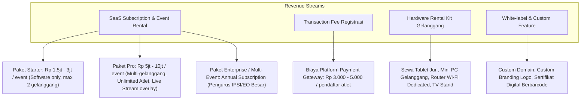
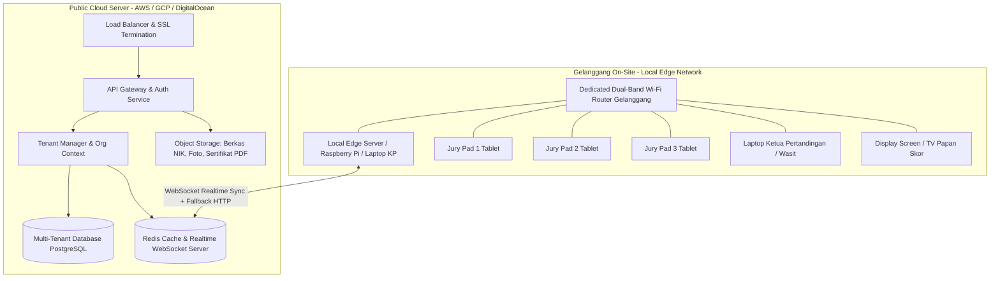
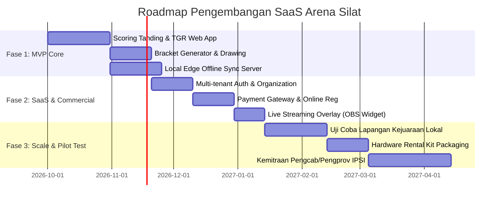

# Analisis Bisnis, Produk & Arsitektur SaaS Turnamen Pencak Silat (Arena Silat SaaS)

Dokumen ini memuat analisis komprehensif rancangan produk **Software-as-a-Service (SaaS) Multi-Tenant** untuk sistem manajemen dan digital scoring turnamen Pencak Silat yang disewakan ke berbagai tingkatan event organizer (EO), perguruan silat, pengcab/pengprov IPSI, sekolah/kampus, hingga kejuaraan internasional (PERSILAT).

---

## BAGIAN 1: Analisis Segmen Pasar & Tingkatan Kejuaraan (Market Segmentation)

| Level Kejuaraan | Karakteristik & Skala | Kebutuhan Utama & Pain Points | Sensitivitas Harga & Model Monetisasi |
|---|---|---|---|
| **Tier 1: Grassroot / Antar Ranting / Kejuaraan Terbuka Pelajar (Open Tournament)** | • 300 – 1.000+ peserta (volume besar)<br>• 1 – 3 gelanggang<br>• Panitia independen / klub silat / sekolah | • Registrasi online cepat & verifikasi pembayaran via gateway.<br>• Pembuatan bagan otomatis (bagan prestasi & bagan pemasalan).<br>• Cetak ID Card, piagam/sertifikat massal. | • Budget terbatas namun butuh sistem siap pakai (*plug & play*).<br>• **Model:** *Pay-per-Event* atau *Pay-per-Athlete* (misal Rp 10.000 - Rp 25.000 / atlet terdaftar). |
| **Tier 2: Kejuaraan Wilayah / Daerah (Kejurcab / Kejurprov / POMDA / PORPROV)** | • 500 – 2.000 peserta<br>• 3 – 6 gelanggang<br>• Dikelola Pengcab/Pengprov IPSI | • Standarisasi aturan resmi IPSI terbaru.<br>• Perangkat wasit juri terintegrasi (Jury Digital Scoring).<br>• Live Stream Scoreboard & Multi-Display TV.<br>• Rekap perolehan medali kontingen otomatis. | • Anggaran resmi instansi/organisasi.<br>• **Model:** Paket Sewa Gelanggang (Software + Hardware Kit opsi sewa) per hari/event. |
| **Tier 3: Kejuaraan Nasional & Internasional (Kejurnas / PON / Kejuaraan Dunia / SEA Games)** | • 1.000 – 3.000+ peserta elit<br>• 4 – 8+ gelanggang<br>• Regulasi ketat PERSILAT | • Video Assistant Referee (VAR) / Video Review terintegrasi tombol kartu ofisial.<br>• High-Availability, Redundant Offline Local Edge Server.<br>• Integrasi Broadcaster TV Graphics (Score Bug). | • Enterprise SLA, on-site technical support.<br>• **Model:** Enterprise Contract / License + Full Managed On-Site Support. |

---

## BAGIAN 2: Model Bisnis & Skema Harga (Monetization Strategy)



---

## BAGIAN 3: Arsitektur Multi-Tenancy & Skalabilitas Sistem

Untuk melayani banyak penyelenggara secara simultan tanpa tercampurnya data pertandingan, arsitektur yang direkomendasikan adalah **Multi-Tenant Hybrid**:



### Keunggulan Desain Hybrid On-Site + Cloud:
1. **Zero-Lag Scoring di Lapangan**: Juri menekan tombol via jaringan lokal router gelanggang ke Edge Server lokal (latensi < 20ms).
2. **Cloud Auto-Sync**: Edge Server mengunggah data poin dan pemenang ke Cloud untuk broadcast live score ke publik dan penonton dari HP mereka.
3. **Internet Down Proof**: Jika koneksi internet venue terputus, pertandingan di gelanggang **tetap berjalan 100% normal** di jaringan lokal, dan data otomatis disinkronisasi ke cloud saat internet terhubung kembali.

---

## BAGIAN 4: Fitur Unggulan SaaS (Value Proposition)

### 1. Modul Manajemen Penyelenggara (EO Dashboard)
- **Multi-Event Manager**: 1 EO bisa mengelola beberapa kejuaraan sekaligus.
- **Form Registrasi & Pembayaran Terintegrasi**: Pendaftaran mandiri kontingen, upload berkas (akte, KK, surat sehat dokter), dan verifikasi pembayaran otomatis (QRIS, VA Bank).
- **Auto Weigh-In Validation**: Pencatatan timbang badan yang langsung menolak atau mengalihkan kelas jika *overweight/underweight*.
- **Smart Automatic Bracket & Schedule Generator**:
  - Bagan pertandingan sistem gugur tunggal / ganda / pool pemasalan.
  - Aturan *seeding*: Memisahkan atlet satu perguruan/kontingen agar tidak langsung saling berhadapan di babak awal.
  - Distribusi partai berimbang antar gelanggang.

### 2. Modul Pertandingan & Live Scoring (Match & Scoring Suite)
- **Web-based Jury Pad**: Berjalan di browser HP/Tablet tanpa perlu install aplikasi native (dukungan PWA / Progressive Web App).
- **Consensus Engine Realtime**: Menghitung konsensus poin juri (minimal 2 dari 3 juri) dengan toleransi waktu 1-2 detik.
- **Ketua Pertandingan (KP) Console**: Mengontrol babak/ronde, menyetujui poin bantingan/jatuhan, menjatuhkan hukuman (binaan, teguran, peringatan, diskualifikasi), dan membatalkan poin jika ada kesalahan juri.
- **Video Review (VR) Tracker**: Pencatatan pengajuan kartu protes/VR ofisial (kuota kartu merah & biru).
- **Live Arena Display & OBS Overlay**: Output tampilan HDMI untuk TV gelanggang dan link Browser Source untuk live stream YouTube/Twitch lengkap dengan animasi skor, waktu, dan nama pesilat.

### 3. Modul Pasca-Event & Rekapitulasi
- **Live Medal Tally (Klasemen Medali Kontingen)**: Update otomatis perolehan emas, perak, dan perunggu.
- **Piala Bergilir & Juara Umum Calculation**: Poin otomatis untuk juara umum 1, 2, 3 dan pesilat terbaik (putra/putri).
- **E-Certificate & ID Card Batch Generator**: Generate PDF ID Card peserta/ofisial dengan QR Code presensi serta piagam penghargaan ber-QR Code anti-pemalsuan.

---

## BAGIAN 5: Penambahan Skema Database untuk SaaS Multi-Tenancy

Untuk mentransformasikan database arena menjadi SaaS, tabel dasar perlu dilengkapi dengan modul Organisasi/Tenant, Pembayaran, dan Subscription:

```sql
-- 1. Tabel Organizations (Tenant)
CREATE TABLE organizations (
    id UUID PRIMARY KEY DEFAULT gen_random_uuid(),
    name VARCHAR(255) NOT NULL,
    slug VARCHAR(100) UNIQUE NOT NULL,
    owner_email VARCHAR(255) NOT NULL,
    phone VARCHAR(20),
    subscription_plan VARCHAR(50) DEFAULT 'free_tier', -- 'starter', 'pro', 'enterprise'
    subscription_expires_at TIMESTAMP,
    is_verified BOOLEAN DEFAULT FALSE,
    created_at TIMESTAMP DEFAULT CURRENT_TIMESTAMP
);

-- 2. Tambahkan organization_id ke tabel tournaments
ALTER TABLE tournaments ADD COLUMN organization_id UUID REFERENCES organizations(id) ON DELETE CASCADE;

-- 3. Tabel Invoices / Billing Event
CREATE TABLE billing_invoices (
    id UUID PRIMARY KEY DEFAULT gen_random_uuid(),
    organization_id UUID NOT NULL REFERENCES organizations(id) ON DELETE CASCADE,
    tournament_id UUID REFERENCES tournaments(id) ON DELETE SET NULL,
    amount DECIMAL(12,2) NOT NULL,
    invoice_number VARCHAR(100) UNIQUE NOT NULL,
    payment_status VARCHAR(50) DEFAULT 'pending', -- 'pending', 'paid', 'expired', 'refunded'
    payment_method VARCHAR(50),
    payment_gateway_ref VARCHAR(255),
    paid_at TIMESTAMP,
    created_at TIMESTAMP DEFAULT CURRENT_TIMESTAMP
);

-- 4. Tabel Registration Payments (Pendaftaran Kontingen/Atlet)
CREATE TABLE registration_payments (
    id UUID PRIMARY KEY DEFAULT gen_random_uuid(),
    tournament_id UUID NOT NULL REFERENCES tournaments(id) ON DELETE CASCADE,
    contingent_id UUID NOT NULL REFERENCES contingents(id) ON DELETE CASCADE,
    total_athletes INT NOT NULL,
    total_amount DECIMAL(12,2) NOT NULL,
    platform_fee DECIMAL(10,2) DEFAULT 0.00,
    payment_status VARCHAR(50) DEFAULT 'pending',
    payment_gateway_ref VARCHAR(255),
    paid_at TIMESTAMP,
    created_at TIMESTAMP DEFAULT CURRENT_TIMESTAMP
);
```

---

## BAGIAN 6: Roadmap Eksekusi Produk (Go-to-Market Strategy)



---

## BAGIAN 7: Analisis Risiko & Mitigasi Operasional

1. **Risiko Integritas Sinyal di Gedung Olahraga / GOR**:
   - *Mitigasi:* Selalu sediakan paket router Wi-Fi 5GHz/6GHz dengan bandwidth terisolasi khusus perangkat scoring (tanpa sharing password ke penonton) + fallback kabel LAN untuk laptop operator.
2. **Risiko Kerusakan Perangkat Scoring Saat Pertandingan Panas**:
   - *Mitigasi:* Sistem mendukung *hot-swap device* (jika tablet juri 2 baterainya habis, juri bisa langsung login di tablet cadangan atau HP cadangan dalam hitungan detik tanpa reset skor).
3. **Kepatuhan Aturan Regulasi IPSI / PERSILAT**:
   - *Mitigasi:* Desain rule engine modular berbasis parameter JSON/konfigurasi, sehingga jika ada revisi poin peraturan IPSI (misal: perubahan poin bantingan atau hukuman), sistem dapat diupdate via konfigurasi tanpa perombakan kode database inti.
