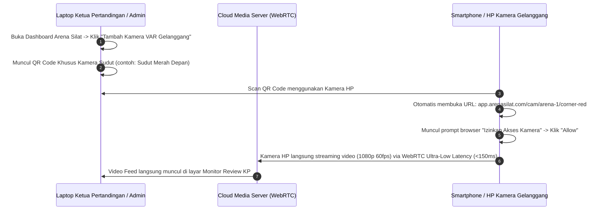

# Arsitektur Full-Online SaaS & Setup Kamera Berbasis Web (Cloud-Native Arena Silat)

Dokumen ini menjelaskan implementasi aplikasi **Arena Silat secara 100% Full-Online (Cloud-Native)** di mana penyelenggara turnamen **tidak memerlukan server lokal, router khusus yang rumit, ataupun instalasi software khusus**. Seluruh perangkat (Jury Pad, Layar Scoreboard, HP Kamera VAR, dan Live Streaming) beroperasi langsung melalui Web Browser via koneksi internet publik.

---

## BAGIAN 1: Peta Arsitektur Full-Online (Zero On-Site Server)

Dalam mode Full-Online, seluruh perangkat di venue cukup terhubung ke internet (Hotspot HP, Wi-Fi Gedung, atau Modem 4G/5G) dan membuka URL web sistem:

```mermaid
graph TB
    subgraph Gedung Olahraga / Venue GOR (Cukup Koneksi Internet)
        HP_CAM1[HP 1 - Kamera Sudut A (Buka Web Browser / Scan QR)]
        HP_CAM2[HP 2 - Kamera Sudut B (Buka Web Browser / Scan QR)]
        JURY_TAB[Tablet / HP Juri (Buka Web Jury Pad)]
        KP_LAPTOP[Laptop Ketua Pertandingan / Wasit]
        TV_SCREEN[Smart TV / TV Android (Buka Browser Layar Skor)]
        OBS_PC[Laptop Streaming (Opsional / Otomatis Cloud)]
    end

    subgraph Cloud Infrastructure (AWS / GCP / DigitalOcean)
        SFU[WebRTC SFU Media Server / LiveKit / Cloudflare Calls]
        WS[WebSocket Realtime Score Engine - Pusher / Socket.io]
        DVR[Cloud DVR Video Buffer (Menyimpan 60 Detik Terakhir untuk VAR)]
        REST[API Backend & PostgreSQL Multi-Tenant]
        CDN[CDN Live Stream - YouTube / HLS Web Player]
    end

    subgraph Publik / Penonton
        VIEWER[Penonton di Rumah / Tribun (Web Portal Live)]
    end

    HP_CAM1 -->|WebRTC Ingest via Browser| SFU
    HP_CAM2 -->|WebRTC Ingest via Browser| SFU
    JURY_TAB -->|WebSocket Instant Tap| WS
    TV_SCREEN <-->|WebSocket Realtime Display| WS
    KP_LAPTOP <-->|WebSocket + Replay Web Control| WS

    SFU --> DVR
    DVR -->|Instant Replay Web Player| KP_LAPTOP
    SFU -->|Cloud Composite Overlay| CDN
    CDN --> VIEWER
    WS --> REST
```

---

## BAGIAN 2: Cara Setting Kamera HP pada Mode Full Online (WebRTC Browser Ingest)

Pada mode Full-Online, panitia **tidak perlu menginstall aplikasi NDI, vMix, atau OBS**. Operator cukup menggunakan kamera bawaan browser HP:



---

## BAGIAN 3: Bagaimana VAR & Replay Bekerja Secara Full-Online?

Banyak orang khawatir jika full-online bagaimana melakukan *instant replay* gerak lambat? Berikut mekanismenya di cloud:

### 1. Rolling Cloud DVR Buffer (Perekaman Otomatis Berputar)
- Server Cloud (WebRTC Media Server) merekam video dari HP kamera secara terus-menerus ke dalam buffer RAM (*Cloud DVR*) selama **60 detik terakhir**.
- Setiap penekanan tombol poin atau saat wasit menjeda pertandingan, sistem otomatis menandai titik *timestamp* insiden.

### 2. Tampilan Web Replay di Laptop Ketua Pertandingan:
- Saat ofisial mengajukan kartu Video Review (VR):
  - Ketua Pertandingan cukup mengklik tombol **`[ REVIEW INSIDEN TERAKHIR ]`** di web browser.
  - Player web otomatis memutar rekaman 15–30 detik sebelum insiden terjadi.
  - Tersedia kontrol tombol di layar web:
    - **Speed Control**: `1.0x`, `0.5x`, `0.25x (Super Slow-Mo)`.
    - **Scrubbing Slider**: Geser maju-mundur detik demi detik (*frame-by-frame*).
    - **Multi-Angle Selector**: Beralih antara Kamera Sudut Merah, Sudut Biru, atau Sudut Netral hanya dengan 1 klik tab.

---

## BAGIAN 4: Bagaimana Live Streaming Multi-Gelanggang Secara Full-Online?

Dalam mode Full-Online, ada **2 metode live streaming**:

### Metode A: Cloud-Based Restreaming (Tanpa Butuh Laptop OBS di Lapangan)
1. Video yang dikirim oleh kamera HP ke Cloud Media Server akan **digabungkan secara otomatis di Cloud** (*Cloud Video Compositor*) dengan grafis overlay skor pertandingan.
2. Cloud server langsung meneruskan (*re-stream*) siaran tersebut ke **YouTube Live / Facebook Live / Portal Web Penonton** secara otomatis.
3. **Keuntungan**: Panitia **tidak perlu membawa laptop khusus streaming**. Cukup 1 HP kamera per gelanggang, siaran langsung YouTube sudah berjalan lengkap dengan papan skor otomatis!

### Metode B: Menggunakan Laptop OBS Lapangan (Jika Ingin Kontrol Audio Komentator Lokal)
- Laptop operator cukup memasukkan URL video WebRTC dan URL Overlay Browser Source ke OBS Studio, lalu menekan *"Start Streaming"*.

---

## BAGIAN 5: Kebutuhan & Manajemen Bandwidth Internet di Venue

| Jenis Perangkat di Lapangan | Jumlah Per Gelanggang | Kebutuhan Bandwidth Upload per Perangkat | Total Bandwidth per Gelanggang |
|---|---|---|---|
| **HP Kamera (Kualitas 1080p 60fps)** | 1 s.d. 2 Unit | 2.5 – 3.5 Mbps (H.264/WebRTC) | 5.0 – 7.0 Mbps Upload |
| **Tablet/HP Juri (Jury Pad Web)** | 3 s.d. 5 Unit | ~15 Kbps (Sangat Ringan, hanya teks JSON) | ~0.1 Mbps Upload/Download |
| **Layar Papan Skor TV Gelanggang** | 1 Unit | ~50 Kbps (Hanya menerima data skor) | ~0.1 Mbps Download |
| **Laptop Ketua Pertandingan (KP)** | 1 Unit | ~2.0 Mbps (Saat memutar video replay) | ~2.0 Mbps Download |
| **TOTAL KEBUTUHAN PER GELANGGANG** | - | - | **~8 – 10 Mbps Dedicated** |

### Rekomendasi Solusi Koneksi Internet Lapangan:
1. **Modem Router 4G / 5G Portable (Orbit / Telkomsel / Indosat)**: 1 unit modem 4G/5G dengan kuota internet sudah sangat cukup untuk menangani 1 hingga 2 gelanggang full-online.
2. **Koneksi Backup (Dual-SIM / Hotspot HP Operator)**: Jika salah satu jaringan lambat, sistem web otomatis melakukan *reconnect* tanpa memutus data skor pertandingan.
