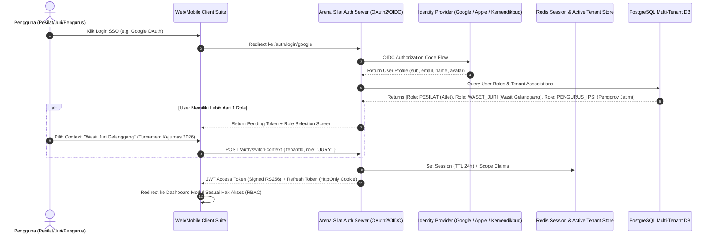

# Arsitektur Multi-Role Single Sign-On (SSO) & RBAC Berjenjang

Dokumen ini mendefinisikan arsitektur autentikasi, otorisasi, dan manajemen identitas tunggal (**Single Sign-On / SSO**) berbasis protokol standar industri (**OAuth 2.0 / OpenID Connect & SAML 2.0**) dengan dukungan multi-role dinamis untuk platform **Arena Silat Enterprise**.

---

## 1. Tantangan Lapangan & Kebutuhan Multi-Role Identitas

Dalam ekosistem pencak silat, satu individu sering kali memiliki lebih dari satu peran (*hybrid persona*), contohnya:
- Seorang **Pengurus Pengprov IPSI** juga merupakan **Wasit Juri Nasional (Waja 1)** di turnamen lain.
- Seorang **Pelatih Perguruan** juga berperan sebagai **Ofisial Kontingen** saat mendampingi atletnya.
- Seorang **Pesilat Dewasa** juga memiliki akun pelatih di ranting perguruannya.

Oleh karena itu, arsitektur SSO Arena Silat tidak boleh mengunci satu email hanya pada satu role statis, melainkan menggunakan pola **1 Identity -> Multi-Tenant / Multi-Role Context Switching**.

---

## 2. Diagram Alur Autentikasi Multi-Role SSO



---

## 3. Matriks Hak Akses Berjenjang (RBAC Matrix)

| Role Code | Nama Peran | Akses Modul Utama | Pembatasan / Keamanan Khusus |
| :--- | :--- | :--- | :--- |
| `SUPER_ADMIN` | Dewan Pengembang Sistem | Manajemen Tenant, Monitoring Server, Audit Logs | MFA (TOTP) Wajib, IP Whitelist |
| `FEDERATION_IPSI` | Pengurus PB / Pengprov / Pengkab | Rekomendasi Turnamen, Lisensi Wasit Juri, Talent Pool | Scope terbatas pada teritorial wilayah |
| `EO_ORGANIZER` | Panitia Pelaksana Turnamen | Bracket Draw, Jadwal Partai, Payment Gateway, Keuangan | Scope hanya pada Turnamen miliknya |
| `KETUA_PERTANDINGAN` | Dewan KP Gelanggang | Kontrol Timer, Verifikasi Jatuhan, Sanksi Wasit, VAR | Terikat pada Gelanggang Aktif (e.g. Gel A) |
| `JURY` | Juri Penilai Gelanggang | Touchpad Juri Wireless (Pukulan, Tendangan, Jatuhan) | Locked Screen PWA, Anti-Double Tap |
| `DOCTOR_MEDIC` | Dokter & Tim Medis Pertandingan | Form Diagnosa, Timer Cedera 3 Menit, BPJS PLKK | Enkripsi AES-256 berkas rekam medis |
| `COACH_OFFICIAL` | Pelatih / Manajer Kontingen | Registrasi Atlet, Kartu Protes VAR (2 Kuota), Jadwal | Hanya melihat data kontingen sendiri |
| `ATHLETE_USER` | Pesilat Mandiri | Kartu Atlet, Riwayat Laga, Download E-Sertifikat | UU PDP Masking NIK 10-Digit |
| `PUBLIC_GUEST` | Penonton / Masyarakat Umum | Kalender Event, Live Score, Jadwal, OBS Stream | Akses Read-Only (Edge Cache CDN) |

---

## 4. Struktur Payload JWT Claims (Multi-Tenant & Context)

```json
{
  "iss": "https://auth.arenasilat.id",
  "sub": "usr_94a3b8e1f02c",
  "email": "bagas.pradana@gmail.com",
  "name": "Bagas Arya Pradana",
  "avatar": "https://lh3.googleusercontent.com/a/...",
  "active_context": {
    "tenant_id": "tnt_kejurnas_2026",
    "tenant_type": "TOURNAMENT",
    "role": "JURY",
    "arena_assigned": "GELANGGANG_A",
    "jury_number": 2,
    "permissions": [
      "match:score_submit",
      "match:view_live"
    ]
  },
  "available_contexts": [
    {
      "tenant_id": "tnt_kejurnas_2026",
      "tenant_name": "Kejurnas PERSILAT 2026",
      "role": "JURY"
    },
    {
      "tenant_id": "org_tapak_suci_solo",
      "tenant_name": "Pimda Tapak Suci Solo",
      "role": "COACH_OFFICIAL"
    },
    {
      "tenant_id": "global_athlete_hub",
      "tenant_name": "Portal Atlet Nasional",
      "role": "ATHLETE_USER"
    }
  ],
  "iat": 1791216000,
  "exp": 1791302400
}
```

---

## 5. Fitur Switch Context (Tukar Peran 1-Klik)

Pengguna tidak perlu logout dan login ulang jika ingin berpindah peran:
1. Endpoint: `POST /api/auth/switch-context`
2. Payload: `{ "targetTenantId": "org_tapak_suci_solo", "targetRole": "COACH_OFFICIAL" }`
3. Sistem memverifikasi tabel `user_tenant_memberships`, lalu mengeluarkan JWT baru dengan permissions yang diperbarui seketika.
