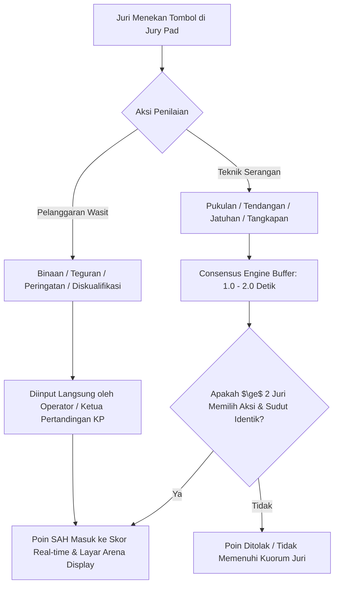
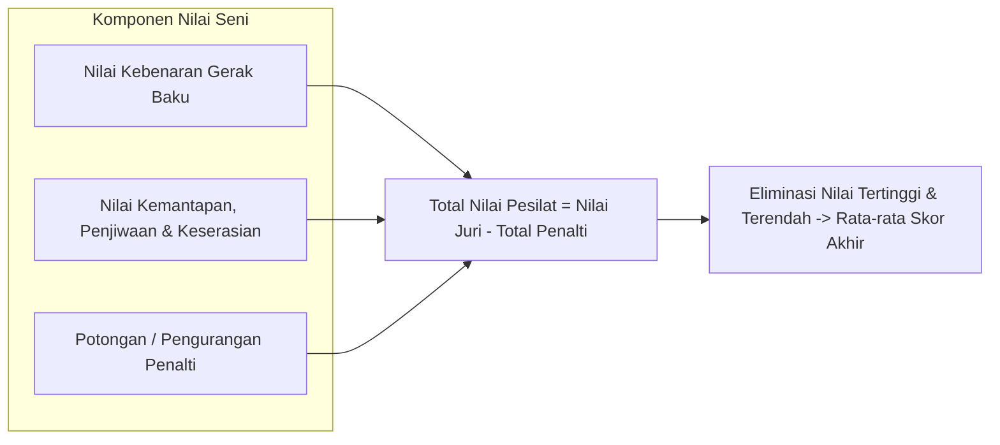

# Aturan, Rumus & Algoritma Penilaian Digital Skor Pertandingan Pencak Silat (Arena Silat)

Dokumen ini memuat standar teknis penilaian dan kalkulasi skor real-time untuk seluruh kategori pertandingan Pencak Silat: **Tanding (Sparring)**, **Seni TGR (Tunggal, Ganda, Regu)**, dan **Festival / Pasanggiri Seni Tradisi** berdasarkan regulasi resmi PERSILAT / IPSI terbaru, lengkap dengan logika komputasi dan implementasi basis data.

---

## BAGIAN 1: Penilaian Kategori TANDING (Sparring)

Kategori tanding menggunakan sistem **3 atau 5 Juri** dengan algoritma kesepakatan mayoritas (*Consensus Scoring Window*).



### 1. Tabel Nilai Positif (Teknik Serang & Bela Sah)
| Teknik / Aksi | Poin | Kriteria Penilaian Regulasi |
|---|---|---|
| **Pukulan Sah Masuk** | **+1** | Pukulan bertenaga dan terkontrol yang mengenai sasaran bidang tubuh (dada, perut, rusuk) tanpa terhalang tangkisan. |
| **Tendangan Sah Masuk** | **+2** | Tendangan tepat sasaran dengan kekuatan dan lintasan gerak yang jelas mengenai bidang sasaran sah. |
| **Teknik Jatuhan Sah (Bantingan/Guntingan/Sapuan)** | **+3** | Berhasil menjatuhkan lawan secara bersih hingga anggota badan lawan (selain telapak kaki) menyentuh matras, dan pesilat penyerang tetap berdiri kokoh atau mengontrol jatuhan. |
| **Tangkapan Dilanjutkan Jatuhan Sah** | **+3** | Berhasil menangkap tendangan/serangan lawan lalu mengeksekusi bantingan/jatuhan dalam batas toleransi 2-3 langkah/gerakan. |

---

### 2. Tabel Nilai Negatif (Hukuman & Pelanggaran)
Hukuman diputuskan oleh **Wasit Gelanggang** dan divalidasi oleh **Ketua Pertandingan (KP)**:

| Jenis Hukuman | Poin | Keterangan & Batas Toleransi |
|---|---|---|
| **Binaan I & II** | **0** | Teguran verbal tanpa pengurangan nilai (peringatan ringan misal keluar garis tanpa sengaja). |
| **Teguran I** | **-1** | Pelanggaran ringan pertama (misal: menahan lawan terlalu lama, keluar arena matras). |
| **Teguran II** | **-2** | Pelanggaran ringan berulang setelah teguran I. |
| **Peringatan I** | **-5** | Pelanggaran berat pertama (misal: memukul muka/leher/alat vital secara sengaja, mencederai lawan). |
| **Peringatan II** | **-10** | Pelanggaran berat kedua. |
| **Peringatan III / Diskualifikasi (Disq)** | **Langsung Kalah** | Otomatis kalah diskualifikasi (pesilat lawan langsung menang). |

---

### 3. Logika Penentuan Pemenang Laga Tanding
Pertandingan berlangsung 3 ronde. Pemenang ditentukan berdasarkan:
1. **Menang Angka (Point)**: Pesilat dengan total akumulasi skor tertinggi di akhir ronde 3.
2. **Kondisi Nilai Seri (Draw Resolving Mechanism)**:
   - *Tahap 1*: Dilihat pesilat yang memiliki nilai hukuman (pelanggaran) **paling sedikit**.
   - *Tahap 2*: Dilihat pesilat yang mengumpulkan **poin teknik jatuhan (+3) terbanyak**.
   - *Tahap 3*: Dilihat pesilat yang mengumpulkan **poin tendangan (+2) terbanyak**.
   - *Tahap 4*: Ditimbang ulang (pesilat dengan bobot badan **lebih ringan** menang).
   - *Tahap 5*: Koin tos / undian Ketua Pertandingan jika seluruh parameter identik.
3. **Menang Mutlak / K.O**: Lawan tidak mampu bangkit setelah hitungan ke-10 wasit.
4. **Menang WMP (Wasit Menghentikan Pertandingan)**: Wasit menghentikan laga demi keselamatan pesilat karena perbedaan kemampuan yang terlalu mencolok (*technical superiority*).
5. **Menang Diskualifikasi**: Lawan melanggar aturan berat (peringatan III) atau tidak lolos timbang badan ulang.

---

## BAGIAN 2: Penilaian Kategori SENI / TGR (Tunggal, Ganda, Regu)

Kategori Seni dinilai oleh **3 hingga 5 Juri** independen.



### 1. Seni TUNGGAL (1 Pesilat - Jurus Baku 100 Gerakan)
* **Nilai Dasar Kebenaran**: Dimulai dari angka **9.90** (atau sistem akumulasi 100 gerak).
  - Setiap salah arah, salah teknik, tertinggal gerak: **-0.01 per kesalahan**.
* **Nilai Kemantapan & Penjiwaan**: Rentang **0.01 s.d. 0.10** (stabilitas kaki, ekspresi, ketajaman mata).
* **Faktor Hukuman Waktu (Durasi Standar: 3 Menit 00 Detik)**:
  - Tampil $2'56'' - 3'04''$: **Toleransi 0 (Aman)**.
  - Kurang/Lebih 5 - 10 detik: **-0.05**.
  - Kurang/Lebih 11 - 15 detik: **-0.10**.
  - Kurang/Lebih $> 15$ detik: **-0.15**.
* **Hukuman Keluar Matras / Senjata Jatuh**:
  - Senjata lepas/jatuh tidak sesuai skenario: **-0.05 s.d. -0.10**.
  - Menginjak batas luar gelanggang $10m \times 10m$: **-0.05**.

---

### 2. Seni GANDA (2 Pesilat - Koreografi Serang Bela Bersenjata)
* **Nilai Kualitas Teknik**: Rentang skor **50 – 60** (kreativitas pertarungan, logika serang-bela, penggunaan senjata).
* **Nilai Kemantapan & Keserasian**: Rentang skor **30 – 40** (keberanian, penjiwaan, kekayaan ritme).
* **Total Nilai Maksimal**: **100 Poin**.

---

### 3. Seni REGU (3 Pesilat - Jurus Baku Tangan Kosong Beregu)
* **Nilai Kebenaran Gerak**: Skor dasar kebenaran gerak baku 100 jurus tangan kosong.
* **Nilai Kekompakan & Soliditas**: Keserempakan gerak, kesamaan sudut kaki, ketepatan hentakan tenaga antar 3 pesilat.

---

## BAGIAN 3: Penilaian Kategori FESTIVAL & PASANGGIRI TRADISI

Festival menilai pertunjukan silat seni garapan/tradisi bercerita dengan iringan musik:

### Format Lembar Nilai Juri Festival (Total 100 Poin):
| Unsur Penilaian | Bobot | Indikator yang Dinilai Juri |
|---|---|---|
| **1. Kualitas Teknik Silat (Gelar Gerak)** | **35 Poin** | Kerapian jurus, kemantapan kuda-kuda, logika beladiri, dan kaidah tradisi perguruan. |
| **2. Koreografi & Komposisi** | **25 Poin** | Kreativitas pola lantai, variasi dinamika gerak lambat/cepat, alur klimaks laga. |
| **3. Penjiwaan & Karakter (Dramaturgi)** | **20 Poin** | Ekspresi, penghayatan cerita, keserasian tema pementasan, dan daya pikat panggung. |
| **4. Tata Busana & Iringan Musik** | **20 Poin** | Keselarasan gerak pesilat dengan ritme kendang/karawitan, estetika busana & rias tradisi. |

---

## BAGIAN 4: Desain Database & Relasi Penilaian Terperinci

```sql
-- 1. Tabel Log Tombol Penilaian Juri Realtime (Scoring Raw Input Stream)
CREATE TABLE jury_scoring_logs (
    id UUID PRIMARY KEY DEFAULT gen_random_uuid(),
    match_id UUID NOT NULL REFERENCES matches(id) ON DELETE CASCADE,
    jury_id UUID NOT NULL, -- ID Juri yang menekan tombol
    jury_number INT NOT NULL, -- Juri 1, 2, 3, 4, 5
    round_number INT NOT NULL, -- Ronde 1, 2, 3 (atau 1 untuk Seni/Festival)
    corner VARCHAR(10) NOT NULL, -- 'red', 'blue', 'performance'
    action_type VARCHAR(50) NOT NULL, -- 'punch', 'kick', 'drop', 'sweep', 'tgr_movement_deduction', 'festival_score'
    raw_points DECIMAL(5,2) NOT NULL,
    press_timestamp TIMESTAMP NOT NULL DEFAULT CURRENT_TIMESTAMP, -- Waktu mikrodetik saat ditekan
    is_consensus_approved BOOLEAN DEFAULT FALSE, -- Hasil komputasi consensus engine
    consensus_batch_id UUID -- ID kelompok kesepakatan juri
);

-- 2. Tabel Poin Sah Terverifikasi (Match Valid Points)
CREATE TABLE match_verified_points (
    id UUID PRIMARY KEY DEFAULT gen_random_uuid(),
    match_id UUID NOT NULL REFERENCES matches(id) ON DELETE CASCADE,
    round_number INT NOT NULL,
    corner VARCHAR(10) NOT NULL, -- 'red', 'blue'
    action_type VARCHAR(50) NOT NULL,
    points_awarded DECIMAL(5,2) NOT NULL, -- +1, +2, +3, -1, -2, -5, -10
    approving_juries JSONB, -- Array ID Juri yang menyetujui, contoh: ["Juri-1", "Juri-3"]
    authorized_by_kp BOOLEAN DEFAULT TRUE,
    created_at TIMESTAMP DEFAULT CURRENT_TIMESTAMP
);

-- 3. Tabel Rekap Penilaian Juri Kategori Seni / TGR & Festival (Artistic Jury Sheets)
CREATE TABLE artistic_jury_evaluations (
    id UUID PRIMARY KEY DEFAULT gen_random_uuid(),
    match_id UUID NOT NULL REFERENCES matches(id) ON DELETE CASCADE,
    match_participant_id UUID NOT NULL REFERENCES match_participants(id) ON DELETE CASCADE,
    jury_id UUID NOT NULL,
    jury_number INT NOT NULL,
    
    -- Sub-skor TGR / Seni
    movement_correctness_score DECIMAL(5,2) DEFAULT 0.00,
    firmness_soul_score DECIMAL(5,2) DEFAULT 0.00,
    
    -- Sub-skor Festival Tradisi
    technique_quality_score DECIMAL(5,2) DEFAULT 0.00, -- max 35
    choreography_score DECIMAL(5,2) DEFAULT 0.00,      -- max 25
    expression_soul_score DECIMAL(5,2) DEFAULT 0.00,   -- max 20
    costume_music_score DECIMAL(5,2) DEFAULT 0.00,     -- max 20
    
    -- Total per Juri
    total_raw_score DECIMAL(6,2) NOT NULL,
    created_at TIMESTAMP DEFAULT CURRENT_TIMESTAMP
);

-- 4. Tabel Hukuman & Penalti Waktu Seni / Festival (Artistic Penalties)
CREATE TABLE artistic_penalties (
    id UUID PRIMARY KEY DEFAULT gen_random_uuid(),
    match_participant_id UUID NOT NULL REFERENCES match_participants(id) ON DELETE CASCADE,
    actual_duration_sec INT NOT NULL, -- misal: 192 detik (3 menit 12 detik)
    time_penalty_points DECIMAL(5,2) DEFAULT 0.00, -- misal: -0.10
    weapon_drop_penalty DECIMAL(5,2) DEFAULT 0.00, -- misal: -0.05
    out_of_bounds_penalty DECIMAL(5,2) DEFAULT 0.00,
    costume_penalty DECIMAL(5,2) DEFAULT 0.00,
    total_deduction DECIMAL(5,2) NOT NULL DEFAULT 0.00
);

-- Indeks untuk pencarian dan kalkulasi instan di layar arena
CREATE INDEX idx_raw_scoring_stream ON jury_scoring_logs(match_id, round_number, press_timestamp);
CREATE INDEX idx_verified_points_match ON match_verified_points(match_id, corner);
```
