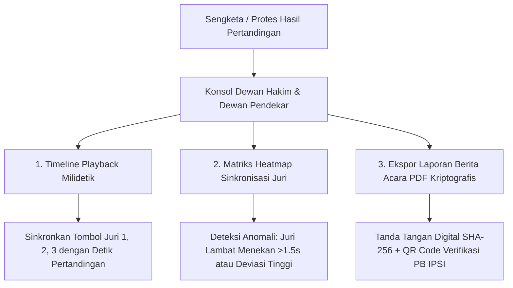

# Arsitektur Black-Box Audit Trail, Forensic Logger, & Sengketa Dewan Hakim

Dokumen ini menjelaskan spesifikasi sistem pencatatan kronologis milidetik (**Black-Box Forensic Audit Logger**) untuk merekam setiap interaksi digital pada turnamen **Arena Silat**. Sistem ini dirancang untuk menyelesaikan sengketa hasil pertandingan (*dispute resolution*), kepatuhan Dewan Hakim / Dewan Pendekar, dan integritas wasit juri sesuai regulasi **PERSILAT & IPSI 2026**.

---

## 1. Urgensi & Masalah Lapangan

Dalam pertandingan tensi tinggi:
1. **Tuduhan Kecurangan Juri**: Pelatih/kontingen sering menuduh juri memihak sudut tertentu atau sengaja tidak menekan tombol saat atletnya melancarkan tendangan/pukulan telak.
2. **Sengketa Kuorum & Debounce**: Pertanyaan apakah tombol ditekan dalam *sliding window 1.5 detik* atau terlambat.
3. **Audit Putusan VAR**: Rekaman keputusan apakah kartu protes manajer diterima atau ditolak, serta timestamp video yang ditinjau.

---

## 2. Struktur Data Black-Box Audit Trail

Setiap event di gelanggang disimpan dalam format *immutable append-only stream* yang ditandatangani secara kriptografis (HMAC SHA-256):

```json
{
  "event_id": "aud_1791216500123_89a",
  "match_id": "match-gel-A-01",
  "tournament_id": "tnt_kejurnas_2026",
  "court": "GELANGGANG_A",
  "round": 2,
  "round_time_sec": 84,
  "event_type": "JURY_RAW_PRESS",
  "actor": {
    "role": "JURY",
    "jury_number": 2,
    "user_id": "usr_waja_002",
    "client_ip": "192.168.1.102",
    "device_fingerprint": "iPad-Pro-Safari-PWA"
  },
  "action_payload": {
    "corner": "red",
    "action": "kick",
    "raw_points": 2,
    "press_timestamp_ms": 1791216500123
  },
  "consensus_result": {
    "is_quorum_reached": true,
    "participating_juries": [1, 2],
    "quorum_time_delta_ms": 320,
    "verified_score_id": "vsc_998124"
  },
  "cryptographic_hash": "e3b0c44298fc1c149afbf4c8996fb92427ae41e4649b934ca495991b7852b855"
}
```

---

## 3. Fitur Utama Forensic Audit Console



1. **Timeline Replay Milidetik**: Menampilkan grafik waktu penekanan masing-masing juri (Juri 1, Juri 2, Juri 3) saat insiden terjadi, membuktikan apakah kuorum 2 dari 3 juri tercapai secara objektif.
2. **Heatmap & Anomali Juri**: Memberikan analisis statistik keaktifan dan kecepatan respon juri untuk evaluasi komisi perwasitan IPSI (Waja).
3. **Ekspor Laporan Berita Acara Dewan Hakim (PDF)**: Dokumen resmi yang berisi rekaman kronologis lengkap sebagai bukti legal jika ada sengketa banding ke PB IPSI / Badan Arbitrase Olahraga Indonesia (BAORI).
