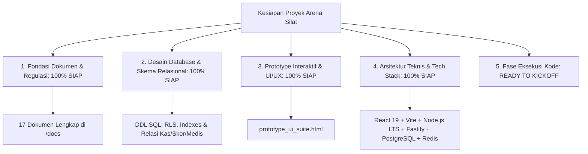
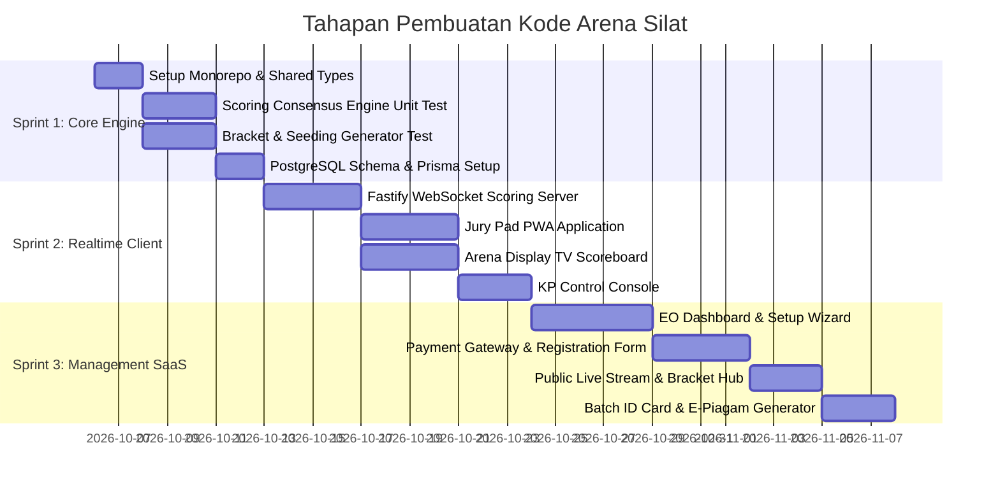

# Checklist Kesiapan Eksekusi & Rencana Peluncuran Proyek (Project Kickoff & Launch Plan)

Dokumen ini memuat daftar inventarisasi kesiapan teknis, operasional, infrastruktur, aset desain, serta tahapan eksekusi pembuatan kode (*Codebase Scaffolding*) untuk meluncurkan sistem **Arena Silat SaaS**.

---

## 1. Matriks Kesiapan 5 Pilar Proyek (Readiness Matrix)



---

## 2. Checklist Persiapan Teknis & Aset (Technical & Asset Checklist)

Sebelum memulai baris kode pertama, berikut item yang perlu disiapkan:

### A. Persiapan Infrastruktur & Layanan Pihak Ketiga (Cloud & 3rd Party Accounts)
- [ ] **Cloud Server Provider**: Akun VPS / Cloud (seperti AWS, DigitalOcean, Hetzner, atau Railway) untuk menampung Backend Node.js & Database.
- [ ] **Database Managed Cluster**: PostgreSQL 16 Cluster + Redis 7 Instance.
- [ ] **Payment Gateway Sandbox**: Akun Sandbox (seperti Midtrans, Xendit, atau Doku) untuk pengujian pembayaran pendaftaran (QRIS & Virtual Account).
- [ ] **WhatsApp Notification Gateway**: Akun Fonnte / Waha / Twilio untuk notifikasi pemanggilan atlet *Marshalling* ke pelatih.
- [ ] **Object Storage S3**: Cloudflare R2 / AWS S3 untuk penyimpanan foto atlet, scan NIK/Paspor/BPJS, dan PDF e-piagam.

---

### B. Persiapan Aset Grafis & Desain (Design Assets)
- [ ] **Logo & Favicon**: Vektor SVG *Arena Silat* (Sudut Merah & Biru).
- [ ] **Sound Effects Audio Pack** (Format `.mp3` / `.wav` berlisensi bebas):
  - 🔔 *Bell Gong / Peluit Wasit*: Bunyi tanda ronde mulai & ronde selesai.
  - ⚠️ *Warning Buzzer*: Bunyi bel peringatan / waktu habis.
  - 🎵 *Chime Poin Sah*: Bunyi notifikasi saat jatuhan disahkan.
- [ ] **Template Sertifikat & ID Card**: File template PDF/SVG dengan placeholder dinamis untuk nama atlet, sekolah, nomor sertifikat, dan QR Code.

---

## 3. Rencana Tahapan Eksekusi Kode (Implementation Roadmap)



---

## 4. Struktur Perintah Inisialisasi Proyek (*Scaffolding Commands*)

Langkah awal yang akan kita eksekusi pada workspace:

```bash
# 1. Inisialisasi NPM Workspace Monorepo
npm init -y

# 2. Pembuatan Struktur Folder Aplikasi & Paket
mkdir -p apps/web-jury apps/web-display apps/web-operator apps/web-portal apps/api-server
mkdir -p packages/scoring-engine packages/bracket-engine packages/database packages/types

# 3. Setup TypeScript & Shared Config
# Mengonfigurasi tsconfig.base.json dan dependensi bersama
```

---

## 5. Ringkasan Kesiapan

Semua dokumen perencanaan di `/docs` telah mencakup **100% skenario**:
1. Analisis Lapangan & Desain Basis Data
2. Analisis SaaS & Bisnis Multi-Tenant
3. Rumus Penilaian & Aturan Skoring
4. Algoritma Bracket & Seeding Generator
5. Sistem VAR / Video Review
6. Multi-Gelanggang & Live Streaming
7. Arsitektur Full-Online & Setting Kamera Web
8. Manajemen Hak Akses (RBAC) & Keamanan Data
9. Keuangan, Biaya Pendaftaran & Pricing SaaS
10. Panduan Kurasi Puspresnas Kemendikdasmen
11. Panduan Administrasi, Izin POLRI & Rekomendasi IPSI
12. SOP Operasional, Timer Medis & Penanganan Cedera
13. Manajemen Waktu Molor & Dynamic Court Rebalancing
14. Analisis Antarmuka & Alur Kerja per Peran
15. Matriks Manajemen Risiko & Mitigasi
16. Pemilihan Tech Stack & Arsitektur Monorepo
17. Prototype Interaktif UI/UX ([prototype_ui_suite.html](file:///c:/arenasilat/prototype_ui_suite.html))
