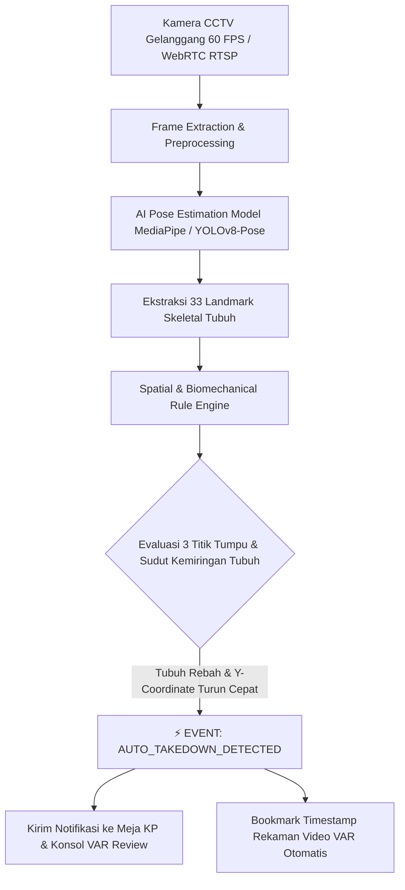

# Arsitektur Computer Vision & AI Pose Estimation (Auto-Fall & Takedown Detector)

Dokumen ini mendefinisikan arsitektur teknis **Computer Vision & AI Pose Estimation** untuk platform **Arena Silat Enterprise**. Sistem ini memanfaatkan *Deep Learning Pose Estimation* (berbasis model MediaPipe Pose / YOLOv8-Pose / MoveNet) untuk mendeteksi secara visual dan otomatis kejadian **Jatuhan Sah (Takedown +3)**, **Sapuan**, dan **Posisi Jatuh Pesilat** sesuai regulasi resmi **PERSILAT & IPSI 2026**.

---

## 1. Definisi Regulasi Jatuhan Sah PERSILAT / IPSI 2026

Menurut peraturan resmi pertandingan Pencak Silat:
1. **Definisi Terjatuh**: Pesilat dinyatakan jatuh apabila salah satu bagian tubuh selain telapak kaki (misalnya: lutut, pinggul, punggung, dada, atau tangan penahan) menyentuh matras akibat serangan sah lawan.
2. **Kriteria Sah (+3 Poin)**:
   - Adanya teknik tangkapan-bantingan, guntingan, atau sapuan yang terarah.
   - Pesilat yang menjatuhkan **tidak boleh ikut terjatuh** (atau berada pada posisi dominan berdiri di atas).
   - Larangan keras serangan balasan (*counter attack*) setelah lawan menyentuh matras.

---

## 2. Diagram Alur Pipeline Computer Vision

---

## 3. Logika Matematis & Heuristik Deteksi Jatuhan

AI mengevaluasi koordinat skeletal landmark ($x, y, z$) dari pesilat Sudut Merah dan Sudut Biru:

### 3.1 Rasio Ketinggian Pinggul vs Bahu (Hip-to-Shoulder Ratio)
$$\text{Vertical Ratio} = \frac{|Y_{\text{shoulder}} - Y_{\text{hip}}|}{|Y_{\text{hip}} - Y_{\text{ankle}}|}$$
- **Posisi Berdiri / Pasang**: $\text{Vertical Ratio} \approx 0.8 - 1.2$ dengan koordinat $Y_{\text{hip}} \ll Y_{\text{matras}}$.
- **Posisi Terjatuh**: $Y_{\text{shoulder}} \approx Y_{\text{hip}} \approx Y_{\text{matras}}$, dan kemiringan torso $> 65^\circ$ terhadap garis vertikal.

### 3.2 Deteksi Penurunan Kecepatan Akselerasi Y ($d^2Y / dt^2$)
Saat bantingan terjadi, pusat massa tubuh (*Center of Mass - CoM*) mengalami akselerasi gravitasi dan dorongan $\ge 4.5 \text{ m/s}^2$ ke arah lantai matras dalam durasi $\le 400\text{ ms}$.

---

## 4. Keuntungan Sistem bagi Wasit Juri & Dewan VAR

1. **Auto-Bookmark Video VAR**: Begitu terjadi bantingan, AI secara otomatis membuat titik bookmark di rekaman video, sehingga Dewan VAR tidak perlu membuang waktu memutar ulang rekaman secara manual (*fast-forward / rewind*).
2. **Alert Visual di Meja KP**: Meja Ketua Pertandingan menerima indikator *"Bantingan Terdeteksi (Sudut Biru Terjatuh)"* dengan tingkat keyakinan AI (*Confidence Score* $\ge 92\%$).
3. **Anti-Human Error**: Mengeliminasi kelalaian juri yang terhalang sudut pandang wasit di atas matras (*blind spot*).
