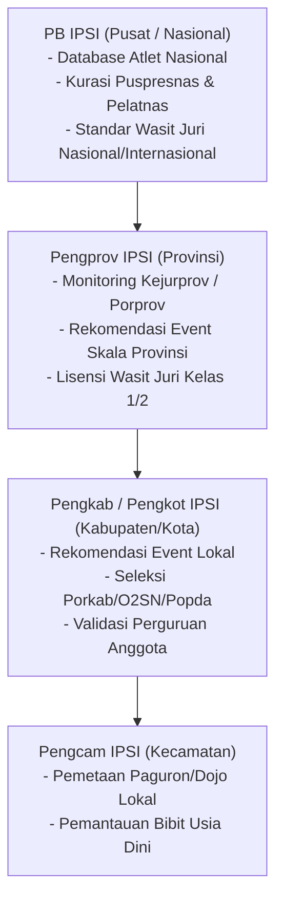

# Dashboard Federasi IPSI Berjenjang (PB, Pengprov, Pengkab/Pengkot, Pengcam)

Dokumen ini mendefinisikan arsitektur sistem, hierarki hak akses data, modul pengawasan kejuaraan resmi, sistem rekomendasi perizinan event, dan pemantauan talenta atlet (*talent scouting*) untuk Ikatan Pencak Silat Indonesia (IPSI) di seluruh tingkatan struktural.

---

## 1. Hierarki Struktural & Yurisdiksi Hak Akses Data

Platform **Arena Silat** menerapkan sistem multi-tier berbasis wilayah administrasi federasi silat:



| Tingkatan IPSI | Cakupan Yurisdiksi Data | Fitur Utama Dashboard |
| :--- | :--- | :--- |
| **PB IPSI (Pusat)** | Seluruh Indonesia (38 Provinsi) | Pangkalan data atlet Pelatnas, integrasi SIMT Puspresnas, kalender kejuaraan nasional, audit standardisasi aturan perwasitan PERSILAT. |
| **Pengprov IPSI** | 1 Provinsi tertentu | Monitoring Kejurprov, verifikasi penerbitan surat rekomendasi event provinsi, pemetaan atlet peraih medali di kabupaten/kota. |
| **Pengkab / Pengkot** | 1 Kota / Kabupaten | Penerbitan nomor surat rekomendasi turnamen lokal, monitoring penugasan Wasit Juri bersertifikat, validasi cabang perguruan silat historis. |
| **Pengcam IPSI** | 1 Kecamatan | Peta sebaran perguruan dan ranting latihan di kecamatan, pencatatan atlet pemula usia dini. |

---

## 2. Modul Utama Dashboard Federasi IPSI

### A. Modul Perizinan & Penerbitan Rekomendasi Kejuaraan (E-Rekomendasi)
Penyelenggara Event (EO) wajib mengajukan proposal izin kejuaraan melalui sistem:
1. **Pemeriksaan Administrasi Otomatis**:
   - Proposal teknis & bagan kategori usia/berat badan (patuh aturan IPSI 2022 / PERSILAT).
   - Sertifikasi Medis & Asuransi BPJS Ketenagakerjaan seluruh atlet.
   - Daftar nama Wasit Juri berlisensi resmi yang ditugaskan.
2. **Approval Digital & QR-Code Verification**:
   - Ketua Umum/Sekretaris IPSI menandatangani surat rekomendasi secara digital (e-Sign).
   - Sistem menghasilkan **Nomor Rekomendasi Resmi** yang langsung tertaut ke portal turnamen dan e-sertifikat juara.

### B. Modul Pangkalan Data & Talent Scouting Atlet (Pencarian Bakat)
Pengurus Bidang Pembinaan Prestasi (Binpres) IPSI dapat menyaring atlet potensial berdasarkan performa lapangan:
- **Radar Biomotorik & Agresivitas**: Melihat rasio pukulan masuk, keberhasilan bantingan/jatuhan, dan kedisiplinan (pelanggaran rendah).
- **Grafik Tren Juara**: Riwayat medali atlet dari tingkat Porkab, Popda, Porprov, hingga Kejurnas.
- **Filter Wilayah & Kelas Tanding**: Pencarian instan kandidat atlet untuk PON / SEA Games (misal: "Mencari atlet Kelas E Putra (65-70kg) usia 18-21 tahun di wilayah Jawa Tengah dengan minimal 3x Emas").

### C. Modul Tata Kelola & Evaluasi Wasit Juri (Waja)
Mencegah kecurangan dan meningkatkan integritas perwasitan:
- **Analisis Konsistensi Juri**: Menghitung deviasi input juri terhadap konsensus kuorum juri lain (akurasi penilaian real-time).
- **Log Jam Terbang Wasit**: Rekam jejak partai laga yang dipimpin oleh setiap Wasit Juri (Waja Kelas 3, 2, 1, atau Internasional).
- **Penilaian Indeks Netralitas**: Sistem otomatis memvalidasi bahwa juri tidak bertugas pada partai atlet yang berasal dari perguruan atau kontingen yang sama.

### D. Modul Verifikasi Keabsahan Sertifikat & Puspresnas
- Mencegah sertifikat palsu / abal-abal untuk jalur prestasi (Japres) sekolah/kuliah.
- Hanya sertifikat turnamen yang memegang **Nomor Rekomendasi Resmi IPSI** yang dapat diverifikasi status kurasinya di pangkalan data nasional.

---

## 3. Skema Basis Data Relasional Dashboard IPSI

```sql
-- 1. Master Tingkatan Organisasi IPSI
CREATE TABLE federasi_ipsi_level (
    id UUID PRIMARY KEY DEFAULT gen_random_uuid(),
    level_type VARCHAR(20) NOT NULL, -- 'pb', 'pengprov', 'pengkab_pengkot', 'pengcam'
    province_code VARCHAR(10),
    city_regency_code VARCHAR(10),
    district_code VARCHAR(10),
    name VARCHAR(150) NOT NULL, -- Contoh: 'Pengkab IPSI Sukoharjo'
    sk_number VARCHAR(100), -- Nomor SK Kepengurusan
    period_start DATE,
    period_end DATE,
    chairman_name VARCHAR(120),
    secretary_name VARCHAR(120),
    official_stamp_url TEXT,
    created_at TIMESTAMPTZ DEFAULT NOW()
);

-- 2. Surat Rekomendasi & Izin Turnamen Resmi
CREATE TABLE event_rekomendasi_ipsi (
    id UUID PRIMARY KEY DEFAULT gen_random_uuid(),
    tournament_id UUID NOT NULL REFERENCES tournaments(id),
    ipsi_level_id UUID NOT NULL REFERENCES federasi_ipsi_level(id),
    recommendation_number VARCHAR(100) UNIQUE NOT NULL, -- Format: 045/REK-IPSI/SKH/IX/2026
    submission_date DATE NOT NULL,
    status VARCHAR(30) DEFAULT 'pending', -- 'pending', 'approved', 'rejected', 'revision'
    approved_by UUID REFERENCES users(id),
    approval_date TIMESTAMPTZ,
    digital_signature_hash TEXT,
    notes TEXT,
    created_at TIMESTAMPTZ DEFAULT NOW()
);

-- 3. Buku Besar Wasit Juri Terlisensi IPSI
CREATE TABLE master_wasit_juri (
    id UUID PRIMARY KEY DEFAULT gen_random_uuid(),
    user_id UUID REFERENCES users(id),
    nik VARCHAR(16) UNIQUE,
    full_name VARCHAR(120) NOT NULL,
    ipsi_level_id UUID REFERENCES federasi_ipsi_level(id),
    guild_origin_id UUID REFERENCES perguruan_silat(id), -- Asal Perguruan
    license_grade VARCHAR(20) NOT NULL, -- 'daerah_kelas_3', 'daerah_kelas_2', 'nasional_kelas_1', 'internasional_persilat'
    license_number VARCHAR(100) UNIQUE NOT NULL,
    license_valid_until DATE NOT NULL,
    is_active BOOLEAN DEFAULT TRUE,
    total_matches_judged INT DEFAULT 0,
    created_at TIMESTAMPTZ DEFAULT NOW()
);
```

---

## 4. Keuntungan Konkret untuk Pengurus IPSI di Lapangan
1. **Bebas Beban Rekapitulasi Manual**: Pengurus tidak perlu meminta laporan Excel manual dari setiap panitia; semua data laga, video review VAR, dan pemenang langsung tersinkronisasi.
2. **Pemberantasan Sertifikat Jalur Prestasi Fiktif**: Kepala Dinas Pendidikan dan universitas dapat memverifikasi QR Code sertifikat juara secara instan yang langsung divalidasi oleh database IPSI setempat.
3. **Pemberdayaan Dana Pembinaan yang Terukur**: Pengprov/Pengkab dapat melihat daerah mana yang aktif mengadakan kejuaraan dan memetakan persebaran pesilat secara transparan.
