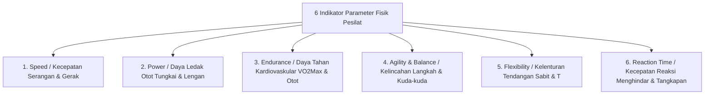
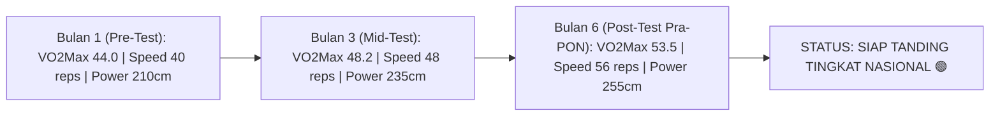

# Modul Tes Parameter Fisik & Indikator Biomotorik Latihan Atlet (Athletic Performance & Biomotor Testing Engine)

Dokumen ini memuat analisis dan rancangan fitur **Pengukuran Indikator Fisik & Biomotorik Atlet (Sport Science Biomotor Testing)** pada aplikasi **Arena Silat SaaS**, yang memungkinkan pelatih di ranting, cabang, maupun pemusatan latihan daerah (Pelatda) mengukur, mencatat, menganalisis secara ilmiah, dan memantau perkembangan fisik atlet silat pada 6 parameter kunci: **Speed (Kecepatan)**, **Power (Daya Ledak Otot)**, **Endurance (Daya Tahan VO2 Max)**, **Agility (Kelincahan)**, **Flexibility (Kelenturan)**, dan **Reaction Time (Waktu Reaksi)**.

---

## 1. Enam Pilar Indikator Biomotorik Pencak Silat (The 6 Biomotor Pillars)



---

## 2. Standar Uji Tes Lapangan & Protokol Pengukuran (Sport Science Testing Protocol)

Setiap indikator diukur menggunakan instrumen tes fisik standar olahraga beladiri (*IPSI & KONI Testing Standard*):

| Parameter Fisik | Nama Instrumen Tes Lapangan | Metode & Alat Ukur | Satuan / Tolok Ukur Keberhasilan | Kategori Nilai Standar Atlet Silat |
|---|---|---|---|---|
| **1. Speed (Kecepatan Tendangan/Pukulan)** | **30-Seconds Kick/Punch Speed Test** | Jumlah tendangan/pukulan lurus/sabit sah pada target pad selama 30 detik. | Repetisi / 30 Detik | • $> 55$ Reps = Istimewa (A)<br>• $45 - 54$ Reps = Baik (B)<br>• $< 35$ Reps = Kurang (D) |
| **2. Speed (Kecepatan Lari Sprint)** | **20-Meter Acceleration Sprint** | Sprint lari akselerasi dari posisi pasang silat (Stopwatch / Laser Gate). | Detik (s) | • $< 2.9\text{ s}$ = Sangat Cepat<br>• $3.0 - 3.2\text{ s}$ = Rata-rata |
| **3. Power (Daya Ledak Otot Tungkai)** | **Standing Broad Jump & Vertical Jump** | Lompat jauh tanpa awalan / Lompat tegak vertikal (Vertec / Sensor Mat). | Centimeter (cm) | • $> 250\text{ cm}$ (Broad Jump)<br>• $> 55\text{ cm}$ (Vertical Jump) |
| **4. Power (Daya Ledak Otot Lengan/Pukulan)** | **Medicine Ball Chest Pass (3 kg)** | Mendorong bola beban 3 kg dari dada sekuat tenaga ke depan. | Meter (m) | • $> 6.5\text{ meter}$ = Sangat Kuat |
| **5. Endurance (Daya Tahan Kardio / VO2 Max)** | **Bleep Test (Multi-Stage Fitness Test / Yo-Yo Intermittent Recovery Test)** | Lari bolak-balik 20 meter mengikuti ritme sinyal beep bertingkat. | Level & Shuttle ($\text{ml/kg/min}$) | • $\text{VO}_2\text{Max} > 52$ = Daya Tahan Ronde 3 Prima<br>• $\text{VO}_2\text{Max} < 42$ = Rentan Habis Nafas |
| **6. Muscular Endurance (Daya Tahan Otot)** | **1-Minute Sit-Up & Push-Up Test + Wall Sit** | Jumlah repetisi push-up/sit-up sempurna dalam 60 detik. | Repetisi / Menit | • $> 50$ Reps Push-Up = Prima |
| **7. Agility (Kelincahan Pola Langkah)** | **Illinois Agility Test & T-Test Silat** | Lari zig-zag meliuk melewati rintangan cone mengubah arah secara cepat. | Detik (s) | • $< 15.2\text{ s}$ = Sangat Lincah |
| **8. Flexibility (Kelenturan Tendangan)** | **Sit-and-Reach Test & Split Angle** | Rentang jangkauan ujung jari kaki dan sudut bukaan kaki split (Goniometer). | Centimeter / Derajat ($^\circ$) | • $> 160^\circ$ Split = Tendangan T/Sabit Tinggi Bebas Hambatan |
| **9. Reaction Time (Waktu Reaksi Tangkapan)** | **Ruler Drop Test / Smart Light Reactive Pods (Blazepod)** | Kecepatan tangan menangkap mistar jatuh atau mematikan lampu pod sensor. | Milidetik (ms) | • $< 180\text{ ms}$ = Refleks Tangkapan Kilat |

---

## 3. Fitur Smart Analytics & Grafik Radar Fisik di Aplikasi Arena Silat

### A. Fitur Input Cepat Pelatih (Mobile Test Logger)
- Pelatih cukup membuka menu **`[ INPUT TES FISIK ATLET ]`** di smartphone.
- Terdapat kalkulator Bleep Test otomatis: Pelatih hanya memilih *Level 10 Shuttle 4*, sistem otomatis mengonversi ke nilai **$\text{VO}_2\text{Max} = 48.5\text{ ml/kg/min}$** dan skor grade **85 (Grade A)**.

### B. Grafik Radar 6 Dimensi Fisik (Biomotor Radar Chart)
Di portal atlet dan pelatih, perkembangan fisik divisualisasikan dalam bentuk diagram laba-laba (*Radar Chart*):

```text
                     SPEED (92/100)
                          /\
                         /  \
      REACTION (85/100) /    \ POWER (88/100)
                       /      \
                      /   *    \
                      \        /
      AGILITY (80/100) \      / ENDURANCE / VO2MAX (62/100) ⚠️
                        \    /
                         \  /
                     FLEXIBILITY (90/100)
```

*Diagnosa Otomatis Sport Science*:
> 💡 *"Analisis Fisik Atlet: Memiliki Kecepatan (92) dan Daya Ledak Power (88) tingkat elit. Namun, Endurance/VO2 Max (62) berada di bawah standar kategori Tanding Dewasa. Atlet berisiko kehabisan stamina di ronde 3. Program Latihan yang Direkomendasikan: Latihan Interval Tabata 4x seminggu + Long Slow Distance (LSD) 5 km."*

---

## 4. Pelacakan Progres Latihan Berkelanjutan (Progressive Milestone Tracker)

Sistem menyimpan riwayat pengujian fisik berkala (**Tes Awal / Pre-Test**, **Tes Tengah / Mid-Test**, dan **Tes Akhir / Post-Test Menjelang Kejuaraan**):



---

## 5. Skema Database Pengukuran Indikator Fisik & Biomotorik

```sql
-- 1. Tabel Sesi Pengujian Tes Fisik Atlet (Physical Fitness Test Sessions)
CREATE TABLE athlete_fitness_test_sessions (
    id UUID PRIMARY KEY DEFAULT gen_random_uuid(),
    athlete_id UUID NOT NULL REFERENCES athletes(id) ON DELETE CASCADE,
    tested_by_coach_id UUID NOT NULL REFERENCES users(id) ON DELETE CASCADE,
    test_date DATE NOT NULL,
    session_phase VARCHAR(50) NOT NULL, -- 'pre_season', 'mid_season', 'pre_competition', 'periodic_ranting'
    athlete_body_weight DECIMAL(5,2) NOT NULL, -- Berat badan saat tes (kg)
    athlete_height_cm DECIMAL(5,2) NOT NULL,   -- Tinggi badan (cm)
    
    -- 1. SPEED METRICS
    kick_speed_30s_reps INT, -- Jumlah tendangan 30 detik
    punch_speed_30s_reps INT, -- Jumlah pukulan 30 detik
    sprint_20m_seconds DECIMAL(4,2), -- Waktu sprint 20m (detik)
    
    -- 2. POWER METRICS
    standing_broad_jump_cm DECIMAL(5,2), -- Lompat jauh (cm)
    vertical_jump_cm DECIMAL(5,2),        -- Lompat tegak (cm)
    medicine_ball_pass_m DECIMAL(4,2),   -- Lempar bola 3kg (meter)
    
    -- 3. ENDURANCE & VO2 MAX
    bleep_test_level INT, -- Level bleep test
    bleep_test_shuttle INT, -- Shuttle bleep test
    estimated_vo2max DECIMAL(4,1), -- ml/kg/min otomatis terhitung
    push_ups_1min_reps INT,
    sit_ups_1min_reps INT,
    
    -- 4. AGILITY & FLEXIBILITY
    illinois_agility_seconds DECIMAL(4,2),
    sit_and_reach_cm DECIMAL(4,2),
    split_angle_degrees INT, -- Sudut bukaan split kaki (derajat)
    
    -- 5. REACTION TIME
    reaction_time_ms INT, -- Kecepatan refleks (milidetik)
    
    -- Overall Scoring & Sport Science Recommendation
    overall_fitness_score DECIMAL(5,2), -- Nilai Komposit 1 - 100
    fitness_grade VARCHAR(10), -- 'A_EXCELLENT', 'B_GOOD', 'C_AVERAGE', 'D_POOR'
    coach_feedback_notes TEXT,
    system_ai_recommendation TEXT,
    created_at TIMESTAMP DEFAULT CURRENT_TIMESTAMP
);

-- 2. View Ringkasan Indikator Fisik Terkini Atlet
CREATE VIEW v_athlete_latest_biomotor AS
SELECT DISTINCT ON (athlete_id)
    athlete_id,
    test_date,
    estimated_vo2max,
    kick_speed_30s_reps,
    standing_broad_jump_cm,
    overall_fitness_score,
    fitness_grade
FROM athlete_fitness_test_sessions
ORDER BY athlete_id, test_date DESC;

-- Indeks Kecepatan Analisis Performa Fisik
CREATE INDEX idx_fitness_athlete_date ON athlete_fitness_test_sessions(athlete_id, test_date DESC);
```
