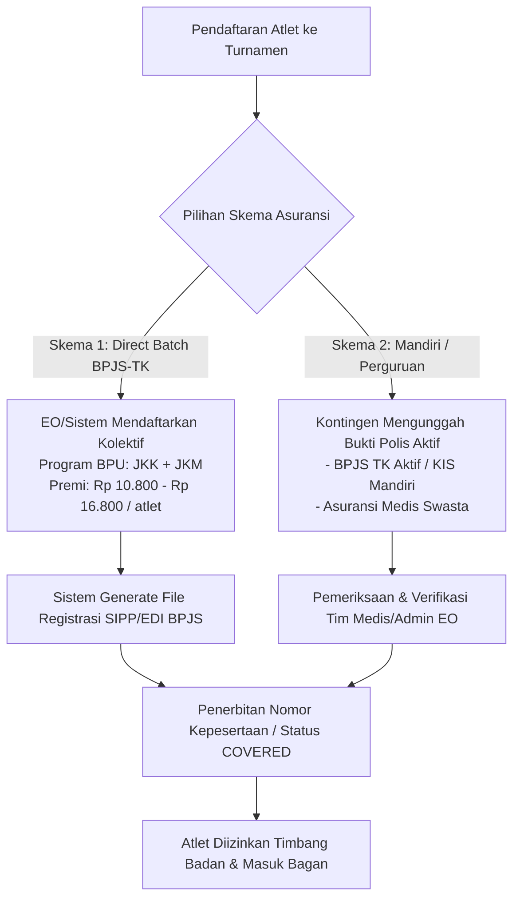
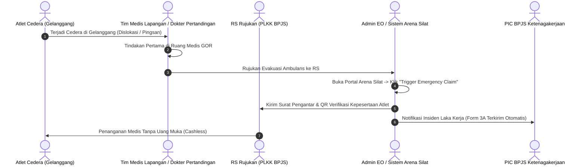

# Integrasi Asuransi Atlet & Perlindungan Medis Turnamen (BPJS Ketenagakerjaan / Asuransi Swasta)

Dokumen ini menjelaskan alur operasional, integrasi sistem data, skema premi, protokol klaim medis darurat di gelanggang, serta perlindungan hukum bagi atlet dan panitia turnamen pencak silat.

---

## 1. Landasan Hukum & Urgensi Perlindungan Atlet

Berdasarkan **UU No. 11 Tahun 2022 tentang Keolahragaan** (Pasal 55 & 100) dan ketentuan teknis keselamatan pertandingan IPSI / PERSILAT:
1. **Kewajiban Penyelenggara**: Setiap kejuaraan bela diri kontak fisik wajib menjamin perlindungan jaminan sosial kecelakaan kerja dan kematian bagi seluruh atlet dan ofisial.
2. **Mitigasi Tanggung Jawab Hukum EO**: Mencegah tuntutan pidana atau perdata terhadap panitia kejuaraan jika terjadi cedera berat (*fraktur*, gegar otak/dislokasi, henti napas, atau fatalitas) selama kejuaraan berlangsung.

---

## 2. Model Skema Asuransi yang Didukung Sistem

Platform **Arena Silat** mendukung 2 metode pengelolaan asuransi:



### A. Skema 1: Paket Kolektif BPJS Ketenagakerjaan (Bukan Penerima Upah / BPU)
- **Cakupan Jaminan**: 
  - **JKK (Jaminan Kecelakaan Kerja)**: Pengobatan & perawatan medis rumah sakit rujukan kelas 1/pemerintah **tanpa batasan biaya (sesuai indikasi medis)** sejak berangkat dari penginapan, bertanding di gelanggang, hingga pulang ke domisili.
  - **JKM (Jaminan Kematian)**: Santunan kematian bukan akibat kecelakaan kerja (Rp 42.000.000).
  - **Santunan Sementara Tidak Mampu Bekerja (STMB)** bagi atlet profesional/pelatih.
- **Biaya Premi**: Terjangkau (~Rp 10.800 – Rp 16.800 per atlet untuk proteksi 1 bulan kejuaraan).
- **Mekanisme Pembayaran**: Otomatis dimasukkan ke dalam rincian *entry fee* (biaya pendaftaran turnamen).

### B. Skema 2: Asuransi Cedera Olahraga Swasta (Event Insurance Rider)
- Khusus untuk kejuaraan open internasional dengan atlet mancanegara (WNA) yang tidak memiliki NIK Indonesia.
- Menggunakan provider asuransi rekanan (misal: Sompo, Sinarmas, Allianz, Zurich) dengan pertanggungan *Emergency Medical Evacuation* dan rawat inap.

---

## 3. Alur Verifikasi & Protokol Klaim Medis Cepat di Lapangan



1. **Gatekeeper Timbang Badan (No Insurance, No Fight)**:
   - Atlet yang belum terdaftar asuransinya atau polisnya ditolak tidak akan bisa lolos validasi timbang badan digital.
2. **Tombol "Emergency Claim" pada Konsol Medis**:
   - Dokter pertandingan cukup menekan tombol insiden pada dashboard medis.
   - Sistem secara otomatis mencetak **Formulir Laporan Kronologis Cedera (Form BPJS 3A)** yang memuat: nama atlet, NIK, nama lawan, gelanggang, babak, jam kejadian, dan diagnosis sementara dokter.
3. **Pusat Layanan Kecelakaan Kerja (PLKK)**:
   - Surat pengantar digital langsung terkirim ke IGD Rumah Sakit rekanan terdekat sehingga atlet ditangani segera secara *cashless* tanpa harus membayar uang muka pribadi.

---

## 4. Skema Basis Data Relasional Asuransi & Rekam Cedera

```sql
-- 1. Status Asuransi Atlet Turnamen
CREATE TABLE tournament_athlete_insurance (
    id UUID PRIMARY KEY DEFAULT gen_random_uuid(),
    tournament_id UUID NOT NULL REFERENCES tournaments(id),
    athlete_id UUID NOT NULL REFERENCES athletes(id),
    insurance_provider VARCHAR(50) NOT NULL, -- 'BPJS_KETENAGAKERJAAN', 'BPJS_KESEHATAN', 'SWASTA_PARTNER', 'MANDIRI'
    policy_number VARCHAR(100),
    membership_type VARCHAR(30), -- 'BPU_EVENT_1_MONTH', 'PERSONAL_MANDIRI', 'CORPORATE'
    premium_amount DECIMAL(12,2) DEFAULT 0,
    is_paid_by_eo BOOLEAN DEFAULT TRUE,
    coverage_status VARCHAR(20) DEFAULT 'unverified', -- 'unverified', 'active', 'expired', 'rejected'
    coverage_start_date DATE NOT NULL,
    coverage_end_date DATE NOT NULL,
    card_document_url TEXT,
    created_at TIMESTAMPTZ DEFAULT NOW()
);

-- 2. Rekam Medis & Klaim Asuransi di Gelanggang
CREATE TABLE medical_injury_claims (
    id UUID PRIMARY KEY DEFAULT gen_random_uuid(),
    match_id UUID NOT NULL REFERENCES matches(id),
    athlete_id UUID NOT NULL REFERENCES athletes(id),
    doctor_user_id UUID REFERENCES users(id),
    injury_time TIMESTAMPTZ DEFAULT NOW(),
    round_number INT,
    injury_location VARCHAR(100), -- 'kepala', 'tulang_rusuk', 'lutut', 'bahu', 'pergelangan_kaki'
    diagnosis_summary TEXT NOT NULL,
    treatment_type VARCHAR(50), -- 'p3k_ringan', 'rujuk_rs_plkk', 'evakuasi_darurat_ambulan'
    referred_hospital_name VARCHAR(150),
    claim_submission_status VARCHAR(30) DEFAULT 'submitted', -- 'submitted', 'processed_plkk', 'settled', 'rejected'
    claim_reference_number VARCHAR(100),
    medical_suspension_days INT DEFAULT 0, -- Masa istirahat medis dilarang tanding (misal: KO 30 hari)
    doctor_signature_url TEXT,
    created_at TIMESTAMPTZ DEFAULT NOW()
);
```

---

## 5. Fitur Otomasi Ekspor Data ke BPJS Ketenagakerjaan (SIPP Online)

Untuk menghemat waktu ribuan pendaftaran atlet, sistem **Arena Silat** menyediakan tombol:
- **`Export SIPP Template (Excel / CSV)`**: Otomatis menghasilkan format impor massal sesuai standar sistem BPJS Ketenagakerjaan (*Nama, NIK, Tanggal Lahir, Upah BPU dasar, Periode Pelaksanaan*).
- **`API Direct Webhook BPJS (Optional Partner Link)`**: Mengirimkan data pendaftaran instan saat peserta melunasi biaya pendaftaran turnamen.
