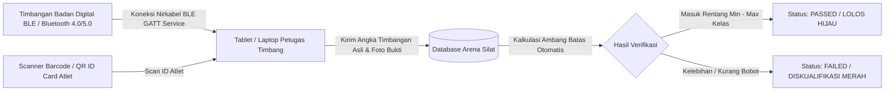
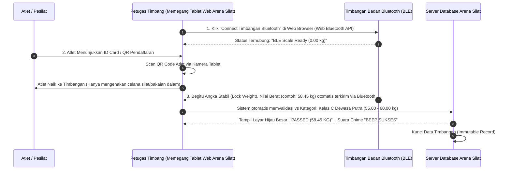

# Integrasi Timbangan Berat Badan Bluetooth (BLE Digital Scale Integration) Arena Silat

Dokumen ini memuat arsitektur teknis, alur operasional di ruang timbang (*weigh-in room*), protokol koneksi **Web Bluetooth API (BLE)**, mekanisme otomatisasi verifikasi kelas, serta pencegahan manipulasi timbangan berat badan atlet tanpa perlu ketik manual.

---

## 1. Mengapa Integrasi Timbangan Bluetooth Krusial di Lapangan?

### Masalah Penimbangan Manual:
1. **Human Error & Antrean Panjang**: Petugas timbang harus mengetik koma/angka dari ratusan atlet satu per satu sehingga sesi timbang pagi molor berjam-jam.
2. **Kecurangan / Kompromi Angka**: Potensi petugas timbang memanipulasi angka desimal berat badan demi meloloskan atlet dari perguruan/kontingen tertentu (*titipan atlet overweight*).
3. **Sengketa & Perdebatan**: Pelatih menuduh petugas salah catat saat atletnya didiskualifikasi karena kelebihan 0.1 kg.

### Solusi Timbangan Digital Bluetooth:


---

## 2. Cara Kerja Penimbangan Otomatis (3 Langkah Tanpa Ketik Manual)



---

## 3. Protokol Komunikasi Web Bluetooth API (Zero-Install Browser BLE)

Aplikasi **Arena Silat** memanfaatkan standar **W3C Web Bluetooth API** yang berjalan langsung di browser Google Chrome / Edge (Android, Windows, macOS, Chromebook) **tanpa perlu menginstall aplikasi native tambahan**:

### Implementasi Kode Integrasi Web Bluetooth (JavaScript):

```javascript
// Standar Bluetooth SIG Weight Scale Service & Custom BLE Scales
const WEIGHT_SCALE_SERVICE = 'weight_scale'; // 0x181D (Standar GATT SIG)
const WEIGHT_MEASUREMENT_CHAR = 'weight_measurement'; // 0x2A9D

let bluetoothDevice = null;
let weightCharacteristic = null;

/**
 * 1. Menghubungkan Browser ke Timbangan Bluetooth
 */
async function connectBluetoothScale() {
  try {
    console.log('Mencari perangkat timbangan bluetooth...');
    
    bluetoothDevice = await navigator.bluetooth.requestDevice({
      filters: [
        { services: [WEIGHT_SCALE_SERVICE] },
        { namePrefix: 'Scale' },
        { namePrefix: 'Mi Scale' },
        { namePrefix: 'Electronic' }
      ],
      optionalServices: ['generic_access', 'battery_service', 0x181D, 0xFFE0]
    });

    const server = await bluetoothDevice.gatt.connect();
    const service = await server.getPrimaryService(WEIGHT_SCALE_SERVICE);
    weightCharacteristic = await service.getCharacteristic(WEIGHT_MEASUREMENT_CHAR);

    // Aktifkan Real-Time Weight Notification
    await weightCharacteristic.startNotifications();
    weightCharacteristic.addEventListener('characteristicvaluechanged', handleWeightData);

    console.log('Timbangan Terkoneksi & Siap Digunakan!');
    updateScaleStatusUI('CONNECTED (Ready)');
  } catch (error) {
    console.error('Koneksi Bluetooth Gagal:', error);
    alert('Gagal menghubungkan timbangan: ' + error.message);
  }
}

/**
 * 2. Membaca & Mem-parsing Data Berat Badan Real-Time dari Sinyal BLE
 */
function handleWeightData(event) {
  const value = event.target.value;
  const flags = value.getUint8(0);
  
  // Deteksi Satuan: 0 = SI (kg), 1 = Imperial (lbs)
  const isLbs = (flags & 0x01) !== 0;
  
  // Baca angka desimal berat badan (Little Endian)
  let rawWeight = value.getUint16(1, true);
  let weightKg = isLbs ? (rawWeight * 0.005) * 0.453592 : rawWeight * 0.005;
  
  // Cek apakah angka sudah stabil (Stabilization Flag)
  const isWeightStabilized = (flags & 0x20) !== 0 || value.getUint8(0) === 0x22;

  // Tampilkan angka di layar tablet
  document.getElementById('live-weight-display').innerText = weightKg.toFixed(2) + ' kg';

  // Jika berat sudah stabil, otomatis submit verifikasi
  if (isWeightStabilized && weightKg > 15.0) {
    autoSubmitWeighIn(weightKg.toFixed(2));
  }
}

/**
 * 3. Validasi Otomatis Berat vs Rentang Kategori
 */
function autoSubmitWeighIn(actualWeight) {
  const currentCategoryMin = 55.00;
  const currentCategoryMax = 60.00;
  const weight = parseFloat(actualWeight);

  if (weight >= currentCategoryMin && weight <= currentCategoryMax) {
    playAudioSuccess();
    showWeighInResult('PASSED', 'green', weight);
    saveWeighInToDatabase(weight, 'passed');
  } else if (weight > currentCategoryMax) {
    playAudioFail();
    showWeighInResult('FAILED: OVERWEIGHT (+ ' + (weight - currentCategoryMax).toFixed(2) + ' kg)', 'red', weight);
    saveWeighInToDatabase(weight, 'failed_overweight');
  } else {
    playAudioFail();
    showWeighInResult('FAILED: UNDERWEIGHT (- ' + (currentCategoryMin - weight).toFixed(2) + ' kg)', 'red', weight);
    saveWeighInToDatabase(weight, 'failed_underweight');
  }
}
```

---

## 4. Tipe Timbangan Bluetooth yang Kompatibel (Hardware Recommendations)

Penyelenggara turnamen tidak perlu membeli timbangan laboratorium berharga belasan juta rupiah. Sistem mendukung timbangan digital komersial yang mudah dibeli di marketplace (Rp 150rb – Rp 500rb):

| Model Timbangan | Protokol / Konektivitas | Akurasi & Sensor | Kisaran Harga |
|---|---|---|---|
| **Xiaomi Mi Body Composition Scale 2** | Bluetooth 5.0 BLE (Standard Broadcast) | Akurasi 0.05 kg (G-shaped manganese steel sensor) | Rp 250.000 – Rp 350.000 |
| **Timbangan Digital Generic BLE / OKOK Scale** | Bluetooth 4.0 BLE (GATT 0xFFE0 / 0x181D) | Akurasi 0.05 – 0.1 kg (Kapasitas 180 kg) | Rp 120.000 – Rp 200.000 |
| **Tanita / Omron Smart Bluetooth Scale** | Standar Medis Bluetooth SIG GATT | Akurasi Medis 0.01 – 0.05 kg | Rp 800.000 – Rp 1.500.000 |
| **Industrial / Bench Platform Scale BLE** | RS-232 to Bluetooth Adapter (Untuk Kejurnas/PON) | Akurasi Tera Metrologi 0.01 kg | Rp 2.000.000+ |

---

## 5. Fitur Anti-Manipulasi & Audit Timbangan (Anti-Fraud Protection)

Untuk menjamin tidak ada manipulasi dari petugas timbang:
1. **Auto-Capture Foto Webcam Saat Timbang**:
   - Saat timbangan mengunci angka stabil (*locked weight*), kamera tablet otomatis mengambil 1 foto cepat (*snapshot*) yang memperlihatkan **wajah atlet dan angka di layar timbangan secara bersamaan**.
   - Foto tersimpan di database sebagai bukti otentik jika ada kontingen lawan yang mengajukan protes timbangan.
2. **Kunci Nilai (Read-Only)**: Kolom input berat badan di layar petugas **dinonaktifkan (disabled)** dari pengetikan manual saat mode *Bluetooth Scale Active*. Nilai hanya bisa masuk dari sinyal perangkat keras timbangan.
3. **Log Kalibrasi Timbangan**: Di awal sesi, petugas menaruh anak timbang standar (misal 5.00 kg atau 10.00 kg) untuk merekam log kalibrasi nol timbangan.

---

## 6. Penambahan Skema Database untuk Timbangan Bluetooth

```sql
-- Perbarui Tabel Sesi Timbang Badan Resmi (Weigh-Ins)
ALTER TABLE weigh_ins ADD COLUMN scale_device_mac VARCHAR(50); -- Alamat MAC / Nama Timbangan BLE
ALTER TABLE weigh_ins ADD COLUMN scale_device_name VARCHAR(100); -- contoh: 'Mi Scale 2 (Gelanggang A)'
ALTER TABLE weigh_ins ADD COLUMN is_bluetooth_synced BOOLEAN DEFAULT TRUE;
ALTER TABLE weigh_ins ADD COLUMN weigh_in_photo_url VARCHAR(500); -- Foto bukti saat berdiri di timbangan
ALTER TABLE weigh_ins ADD COLUMN tare_weight DECIMAL(5,2) DEFAULT 0.00; -- Potongan berat pakaian tanding resmi (standar toleransi pakaian 0.2 - 0.5 kg)
ALTER TABLE weigh_ins ADD COLUMN final_counted_weight DECIMAL(5,2); -- actual_weight - tare_weight
```
