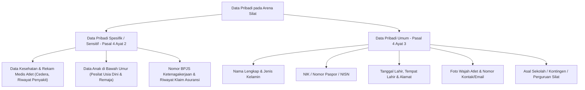
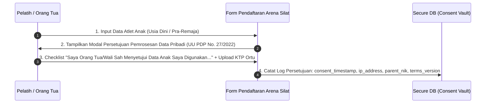

# Implementasi Kepatuhan UU Perlindungan Data Pribadi (UU PDP No. 27 Tahun 2022) pada Platform Arena Silat SaaS

Dokumen ini memuat arsitektur teknis, klasifikasi data pribadi, mekanisme persetujuan (*explicit consent*), masking data publik (NIK/Paspor/NISN/Medis), enkripsi at-rest & in-transit, retensi data, serta tata kelola kepatuhan hukum **Undang-Undang Republik Indonesia Nomor 27 Tahun 2022 tentang Perlindungan Data Pribadi (UU PDP)** pada sistem **Arena Silat**.

---

## 1. Klasifikasi Data Pribadi dalam Turnamen Pencak Silat

Berdasarkan Pasal 4 UU PDP, data pribadi dikelompokkan menjadi **Data Bersifat Spesifik (Sensitif)** dan **Data Bersifat Umum**:



---

## 2. Prinsip Pemrosesan & Mekanisme Persetujuan (*Explicit Consent*)

Berdasarkan Pasal 16 s.d. Pasal 25 UU PDP:

### A. Persetujuan Tertulis & Digital (Consent Gate)
1. **Persetujuan Peserta Dewasa ($\ge 18$ tahun)**: Menyetujui syarat pemrosesan data identitas dan medis khusus untuk keperluan verifikasi kejuaraan dan klaim asuransi saat registrasi online.
2. **Perlindungan Khusus Data Anak ($< 18$ tahun - Pasal 25 UU PDP)**:
   - Form pendaftaran **wajib menyertakan Persetujuan Orang Tua / Wali (Parental Consent Form)**.
   - Tanpa persetujuan orang tua/wali, data atlet anak tidak dapat diproses oleh sistem.



---

## 3. Aturan Masking Data pada Layar Publik & Halaman Verifikasi Piagam

Untuk mencegah penyalahgunaan data kependudukan (pencurian identitas / *identity theft*):

| Jenis Data | Tampilan di Dashboard Internal (Admin/Dokter) | Tampilan di Layar Publik, Scoreboard TV, Live Stream & Verifikasi QR |
|---|---|---|
| **NIK (16 Digit)** | `3201012308050001` | `3201**********0001` *(10 Digit Tengah Di-masking)* |
| **Nomor Paspor** | `A12345678` | `A1****678` *(Di-masking)* |
| **NISN (10 Digit)** | `0081234567` | `008*****67` *(Di-masking)* |
| **Nomor HP / WhatsApp** | `081234567890` | `0812******90` *(Di-masking)* |
| **Rekam Medis / Diagnosa** | Terbuka penuh untuk Dokter Laga | **RAHASIA / HIDDEN MUTLAK DARI PUBLIK** |
| **Nama, Foto & Kontingen** | Terbuka | Terbuka (Sebagai Informasi Prestasi Publik) |

---

## 4. Keamanan Teknis: Enkripsi at-Rest & in-Transit (Technical Safeguards)

```mermaid
graph LR
    subgraph Data in-Transit (Perjalanan Data)
        CLI[Browser Client / Jury Pad] -->|TLS 1.3 / HTTPS / WSS Enkripsi| API[API Gateway]
    end

    subgraph Data at-Rest (Penyimpanan Data)
        API -->|AES-256 GCM Encryption| SENSITIVE_DB[(Kolom Sensitif PostgreSQL: NIK, BPJS, Rekam Medis)]
        API -->|Time-Limited Signed URLs (15 Menit)| S3[(Object Storage Enkripsi: Scan KTP, KK, Akta)]
    end
```

### 1. Enkripsi Kolom Database (*Field-Level Encryption*):
- Kolom sensitif (`nik`, `passport_number`, `bpjs_number`, `medical_notes`) dienkripsi menggunakan algoritma **AES-256-GCM** dengan kunci enkripsi yang dikelola oleh *Key Management Service (KMS)* terpisah dari database.
- Jika database diretas atau dicuri, penyerang hanya melihat teks acak biner yang tidak dapat dibaca.

### 2. Time-Limited Signed URL untuk Dokumen Berkas:
- Dokumen KTP, Kartu Keluarga, dan Surat Sehat disimpan di private bucket (bukan public bucket).
- Link hanya digenerate saat panitia berwenang melakukan verifikasi berkas dan akan **kedaluwarsa otomatis dalam 15 menit**.

---

## 5. Hak Subjek Data Pribadi (Data Subject Rights - Pasal 5 s.d. Pasal 13)

Sistem SaaS menyediakan fitur pemenuhan hak pemilik data:
1. **Hak Akses & Perbaikan Data (Right to Rectification)**: Atlet/pelatih dapat memperbarui kesalahan ketik nama, NIK, atau foto profil sebelum batas akhir drawing.
2. **Hak Penghapusan / Anonimisasi Data (Right to Erasure / Anonymization)**:
   - Pasca kejuaraan selesai dan masa retensi hukum terlewati, atlet berhak mengajukan permohonan *"Hapus Akun & Berkas"*.
   - Sistem akan menghapus scan KTP/KK/Akta dari storage dan menganonimkan data pribadi, namun tetap mempertahankan rekor pertandingan dan skor sebagai arsip sejarah olahraga.

---

## 6. Penambahan Skema Database Kepatuhan UU PDP

```sql
-- 1. Tabel Log Persetujuan Pemrosesan Data Pribadi (Consent Logs - UU PDP)
CREATE TABLE data_privacy_consents (
    id UUID PRIMARY KEY DEFAULT gen_random_uuid(),
    athlete_id UUID NOT NULL REFERENCES athletes(id) ON DELETE CASCADE,
    consented_by_user_id UUID NOT NULL REFERENCES users(id) ON DELETE CASCADE,
    is_parent_or_guardian BOOLEAN NOT NULL DEFAULT FALSE,
    parent_guardian_name VARCHAR(255),
    parent_guardian_nik VARCHAR(20),
    consent_purpose VARCHAR(100) NOT NULL, -- 'tournament_registration', 'medical_insurance_bpjs', 'puspresnas_simt_sync'
    terms_version VARCHAR(20) NOT NULL, -- 'UU-PDP-2022-V1.0'
    ip_address VARCHAR(45) NOT NULL,
    user_agent TEXT,
    consented_at TIMESTAMP DEFAULT CURRENT_TIMESTAMP
);

-- 2. Modifikasi Tabel Athletes dengan Enkripsi Kolom & Masking Helpers
ALTER TABLE athletes ADD COLUMN nik_encrypted BYTEA; -- Data Asli Terenkripsi AES-256
ALTER TABLE athletes ADD COLUMN nik_masked VARCHAR(20); -- Contoh: '3201**********0001'
ALTER TABLE athletes ADD COLUMN nisn_masked VARCHAR(20); -- Contoh: '008*****67'
ALTER TABLE athletes ADD COLUMN passport_masked VARCHAR(50);
ALTER TABLE athletes ADD COLUMN bpjs_number_encrypted BYTEA;
ALTER TABLE athletes ADD COLUMN bpjs_number_masked VARCHAR(50);
ALTER TABLE athletes ADD COLUMN data_retention_until DATE; -- Masa Retensi Data Berkas

-- 3. Tabel Permohonan Hak Subjek Data (Data Subject Requests / DSR)
CREATE TABLE data_subject_requests (
    id UUID PRIMARY KEY DEFAULT gen_random_uuid(),
    user_id UUID NOT NULL REFERENCES users(id) ON DELETE CASCADE,
    athlete_id UUID REFERENCES athletes(id) ON DELETE SET NULL,
    request_type VARCHAR(50) NOT NULL, -- 'data_export', 'data_rectification', 'data_erasure'
    request_status VARCHAR(50) DEFAULT 'pending', -- 'pending', 'approved', 'rejected', 'completed'
    reason TEXT,
    requested_at TIMESTAMP DEFAULT CURRENT_TIMESTAMP,
    processed_by VARCHAR(100),
    processed_at TIMESTAMP
);

-- Indexing Kepatuhan Privasi
CREATE INDEX idx_consent_athlete ON data_privacy_consents(athlete_id, consent_purpose);
CREATE INDEX idx_dsr_user ON data_subject_requests(user_id, request_status);
```

---

## 7. Kebijakan Retensi Data (Data Retention Policy)

- **Berkas Sensitif (Scan KTP/KK/Akta/Surat Sehat)**: Dihapus permanen dari storage **6 bulan pasca kejuaraan selesai** (cukup waktu untuk audit LPJ dan sengketa).
- **Data Sertifikat & Prestasi (Nama, Juara, Asal Kontingen, QR Code Hash)**: Disimpan permanen sebagai catatan rekam jejak talenta olahraga nasional yang valid dan terverifikasi selamanya.
