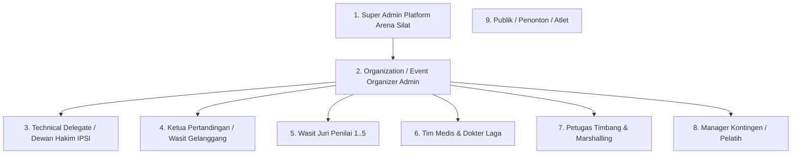
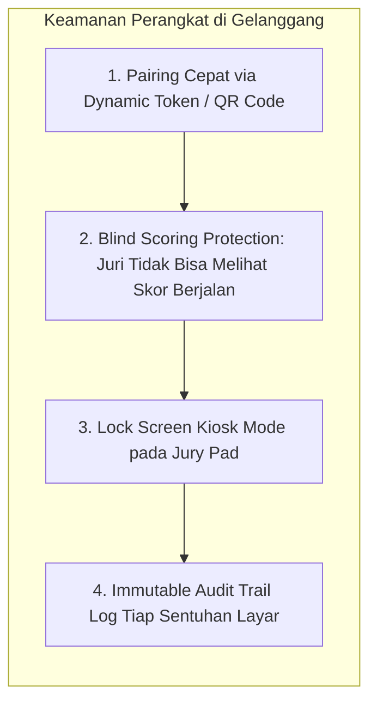
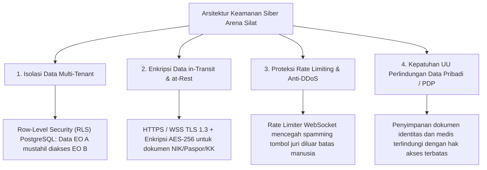

# Manajemen Hak Akses (RBAC) & Keamanan Sistem (Security Architecture) Arena Silat SaaS

Dokumen ini memuat analisis dan desain komprehensif mengenai **Role-Based Access Control (RBAC)**, isolasi multi-tenant data, mekanisme autentikasi perangkat pertandingan di lapangan, integritas data skoring anti-manipulasi, serta kepatuhan perlindungan data pribadi (UU PDP) pada platform **Arena Silat**.

---

## BAGIAN 1: Hirarki Peran Pengguna (Role-Based Access Control / RBAC)

Sistem membagi hak akses ke dalam 8 tingkatan peran (*roles*) dengan batasan fungsional yang ketat:



### Matriks Hak Akses & Kewenangan (Permissions Matrix):

| Peran (Role) | Ruang Lingkup Akses | Aksi yang Diizinkan (Allowed Actions) | Aksi yang DILARANG (Forbidden Actions) |
|---|---|---|---|
| **1. Super Admin (Platform Owner)** | Seluruh Sistem Multi-Tenant | Kelola tenant EO, billing langganan, audit keamanan global, backup database. | Mengubah skor pertandingan yang sedang berjalan di venue. |
| **2. Event Organizer (EO Admin)** | 1 Organisasi / Event Miliknya | Setup turnamen, manajemen kategori, verifikasi pembayaran kontingen, kelola gelanggang, cetak ID card/piagam massal, konfigurasi live streaming. | Mengintervensi tombol penilaian wasit juri secara langsung saat ronde aktif. |
| **3. Technical Delegate (TD) / Dewan Hakim** | Pengawasan Teknis Kejuaraan | Validasi bagan pertandingan (*drawing approval*), sidang banding protes resmi, verifikasi keputusan Video Review (VR), approval hasil akhir turnamen. | Menambah/menghapus atlet peserta tanpa izin EO. |
| **4. Ketua Pertandingan (KP)** | 1 Gelanggang Spesifik | Kontrol jalannya ronde (Start/Pause/Stop), sahkan poin jatuhan/hukuman wasit, panggil video review, batalkan poin salah tekan (*undo point*), sahkan pemenang laga. | Mengubah pengaturan sistem turnamen di luar gelanggang tugasnya. |
| **5. Juri (Jury 1 s.d. 5)** | 1 Gelanggang & 1 Perangkat Juri | Memberikan input poin teknik (Pukulan, Tendangan, Jatuhan, TGR) secara real-time melalui Jury Pad. | Melihat total skor lawan di layarnya sendiri (untuk menjaga netralitas juri tanpa bias), mengubah ronde, melihat rekap skor juri lain. |
| **6. Tim Medis / Dokter Laga** | Pemeriksaan Kesehatan & Timbang | Cek kelayakan fisik atlet, input rekam medis cedera, rekomendasi diskualifikasi medis (*medical WO*). | Mengubah nilai skor atau bagan laga. |
| **7. Petugas Marshalling & Timbang** | Sesi Timbang & Pemanggilan | Input berat badan aktual (*actual weight*), verifikasi berkas NIK/BPJS/Paspor, panggil pesilat sudut merah/biru. | Mengubah skor atau hasil pemenang. |
| **8. Manager Kontingen / Pelatih** | 1 Kontingen Miliknya | Pendaftaran atlet, upload berkas (surat sehat, BPJS, NIK), bayar tagihan kontingen, pantau jadwal tanding atletnya, download e-piagam kontingen. | Mengakses dashboard gelanggang atau console juri. |
| **9. Publik / Penonton** | Terbuka (Read-Only) | Melihat live scoreboard, nonton live stream, pantau bagan & jadwal, cek keaslian piagam via QR Code. | Mengirimkan input apa pun ke server pertandingan. |

---

## BAGIAN 2: Mekanisme Keamanan Operasional di Lapangan Gelanggang

Pertandingan silat di lapangan penuh tekanan dan tensi tinggi. Sistem menerapkan 4 lapisan proteksi khusus:



### 1. Device Pairing Tanpa Password Rumit (Dynamic Session Token)
- Juri tidak perlu repot mengetik username/password di tablet/HP.
- Ketua Pertandingan cukup menampilkan **QR Code Sesi Juri** (contoh: *Juri 3 - Gelanggang 2*).
- Tablet juri tinggal scan QR Code, dan perangkat langsung terkunci aman ke sesi juri tersebut menggunakan token JWT berbatas waktu (*time-limited session token*).

### 2. Proteksi Netralitas Juri (*Blind Scoring*)
- Pada layar Jury Pad juri, **TIDAK DITAMPILKAN total akumulasi skor merah atau biru**.
- Juri hanya melihat tombol input teknik (*Pukulan, Tendangan, Jatuhan*).
- **Tujuan**: Mencegah juri melakukan rekayasa skor (*match-fixing*) untuk mengejar ketertinggalan atlet tertentu menjelang akhir ronde.

### 3. Mode Kios / Anti-Salah Sentuh (PWA Kiosk Mode)
- Tampilan Jury Pad berjalan dalam mode layar penuh (*Full Screen PWA*).
- Tombol navigasi browser (Back, Refresh, URL bar) disembunyikan agar juri tidak sengaja keluar dari aplikasi saat laga berlangsung.
- Dukungan *Haptic Feedback* (getar) dan animasi visual saat tombol ditekan agar juri yakin inputnya sudah terkirim.

---

## BAGIAN 3: Keamanan Data & Pencegahan Serangan Siber (Application Security)



### 1. Isolasi Data Multi-Tenant (PostgreSQL Row-Level Security / RLS)
Setiap kueri database secara otomatis difilter berdasarkan `organization_id` dan `tournament_id`. Hal ini menjamin bahwa satu penyelenggara turnamen **mustahil dapat melihat atau mengubah data turnamen milik penyelenggara lain**.

### 2. Rate Limiting Penekanan Tombol (Anti-Spam Engine)
- Secara biologis, manusia tidak dapat menekan tombol lebih dari 5–7 kali per detik.
- Server menerapkan *Rate Limiting WebSocket*: Jika sebuah perangkat juri mengirimkan lebih dari 10 request dalam 1 detik, sistem akan menandainya sebagai anomali/malfungsi hardware tanpa merusak alur scoring utama.

### 3. Kepatuhan UU Perlindungan Data Pribadi (UU PDP No. 27/2022)
- Dokumen sensitif seperti **NIK, Akta Kelahiran, Paspor, Kartu BPJS, dan Rekam Medis** disimpan di Object Storage terenkripsi (Private Bucket) dengan URL bertanda tangan sementara (*Signed URL* berdurasi 15 menit).
- Publik atau pihak luar yang tidak berhak dilarang keras mengakses berkas identitas atlet.

---

## BAGIAN 4: Skema Database Hak Akses, Pengguna & Log Audit

```sql
-- 1. Tabel Master Pengguna (Users)
CREATE TABLE users (
    id UUID PRIMARY KEY DEFAULT gen_random_uuid(),
    organization_id UUID REFERENCES organizations(id) ON DELETE CASCADE,
    email VARCHAR(255) UNIQUE NOT NULL,
    password_hash VARCHAR(255) NOT NULL,
    full_name VARCHAR(255) NOT NULL,
    phone VARCHAR(20),
    role VARCHAR(50) NOT NULL DEFAULT 'manager_contingent', 
    -- 'super_admin', 'eo_admin', 'technical_delegate', 'head_referee', 'jury', 'medical_officer', 'marshalling_officer', 'manager_contingent'
    is_active BOOLEAN DEFAULT TRUE,
    last_login_at TIMESTAMP,
    created_at TIMESTAMP DEFAULT CURRENT_TIMESTAMP
);

-- 2. Tabel Penugasan Wasit Juri ke Gelanggang (Arena Jury Assignments)
CREATE TABLE arena_jury_sessions (
    id UUID PRIMARY KEY DEFAULT gen_random_uuid(),
    tournament_id UUID NOT NULL REFERENCES tournaments(id) ON DELETE CASCADE,
    arena_id UUID NOT NULL REFERENCES arenas(id) ON DELETE CASCADE,
    jury_user_id UUID NOT NULL REFERENCES users(id) ON DELETE CASCADE,
    jury_slot_number INT NOT NULL, -- Juri 1, 2, 3, 4, 5 atau Ketua Pertandingan (slot 0)
    device_fingerprint VARCHAR(255),
    session_token VARCHAR(255) UNIQUE NOT NULL, -- Token dinamis hasil scan QR pairing
    is_session_active BOOLEAN DEFAULT TRUE,
    paired_at TIMESTAMP DEFAULT CURRENT_TIMESTAMP,
    expires_at TIMESTAMP NOT NULL
);

-- 3. Tabel Log Audit Aktivitas Kritis (Immutable Security Audit Trail)
CREATE TABLE security_audit_logs (
    id UUID PRIMARY KEY DEFAULT gen_random_uuid(),
    tournament_id UUID REFERENCES tournaments(id) ON DELETE CASCADE,
    user_id UUID REFERENCES users(id) ON DELETE SET NULL,
    action_name VARCHAR(100) NOT NULL, -- 'LOGIN_SUCCESS', 'OVERRIDE_SCORE', 'APPROVE_VR', 'GENERATE_BRACKET', 'CHANGE_WEIGHT'
    ip_address VARCHAR(45),
    user_agent TEXT,
    payload_before JSONB,
    payload_after JSONB,
    created_at TIMESTAMP DEFAULT CURRENT_TIMESTAMP
);

-- Indeks Keamanan & Audit
CREATE INDEX idx_users_org_role ON users(organization_id, role);
CREATE INDEX idx_audit_tournament_action ON security_audit_logs(tournament_id, action_name, created_at);
```
