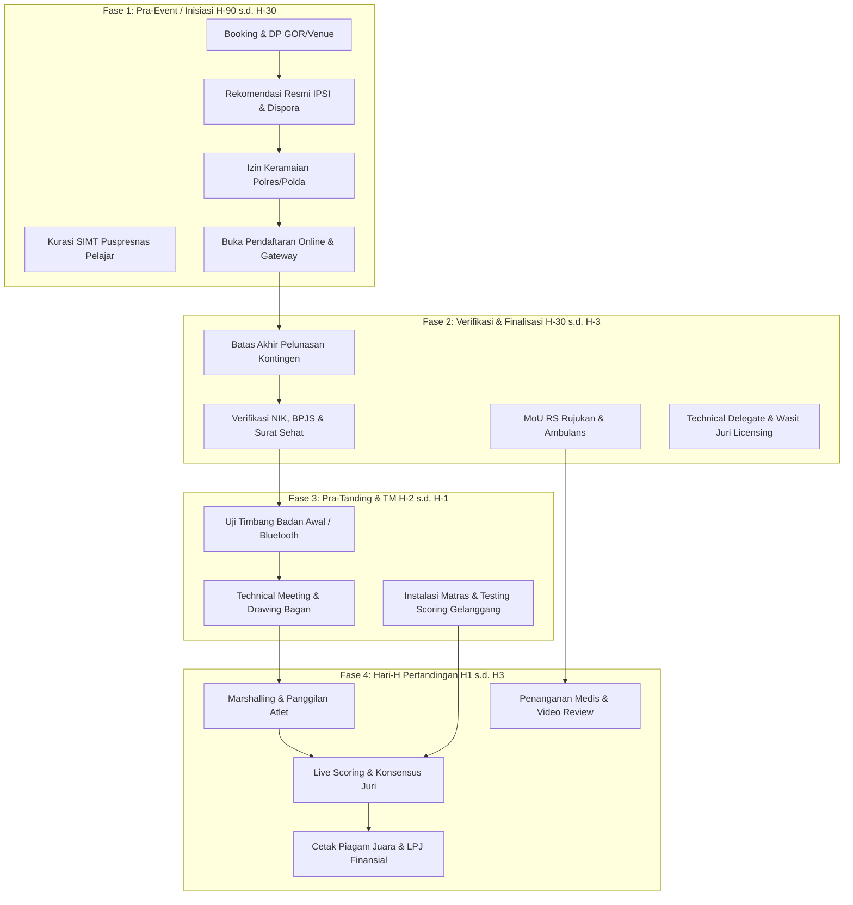
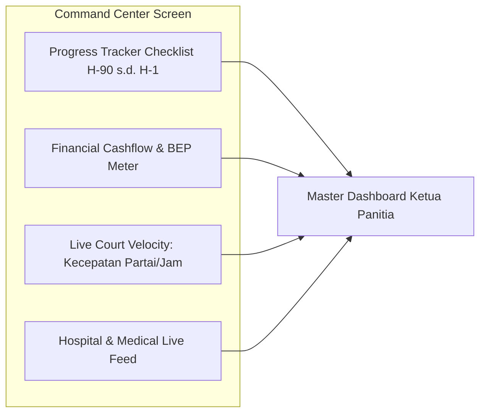

# Modul Manajemen Proyek Turnamen, Pelacak Titik Kritis & Command Center EO (Arena Silat)

Dokumen ini memuat analisis dan rancangan fitur **Manajemen Proyek Turnamen (Tournament Project Management)** di dalam aplikasi **Arena Silat SaaS**, yang memungkinkan Event Organizer (EO), Ketua Panitia, dan Pengcab/Pengprov IPSI memantau seluruh tahapan persiapan secara visual, mengidentifikasi **Titik Kritis (Critical Path & Bottlenecks)**, serta mencegah kegagalan fatal sebelum hari-H.

---

## 1. Peta 4 Fase Siklus Hidup Turnamen & Titik Kritis (Critical Points Map)



---

## 2. 7 Titik Kritis Terbesar (Top 7 Critical Failure Points) & Sistem Peringatan Dini

Aplikasi SaaS menyediakan **Early Warning System (Lampu Merah/Kuning/Hijau)** untuk 7 titik rawan gagal:

| No | Titik Kritis (Critical Bottleneck) | Batas Waktu Kritis | Dampak Jika Gagal | Pemicu Peringatan Dini di Dashboard EO (Alarm Trigger) |
|---|---|---|---|---|
| **1** | **Surat Izin Keramaian Kepolisian** | **H-21** | Acara dibubarkan polisi pada hari-H. | 🔴 *Merah jika status berkas belum "Approved" pada H-14.* |
| **2** | **Kuota Minimal Peserta vs Target Anggaran** | **H-30** | EO merugi/defisit karena sewa GOR & medali sudah dipesan. | 🟡 *Kuning jika pendaftar $< 60\%$ dari target break-even point (BEP) pada H-30.* |
| **3** | **Verifikasi BPJS & Surat Sehat Atlet** | **H-7** | Atlet cedera tidak ditanggung RS, tuntutan pidana kelalaian. | 🔴 *Merah jika ada atlet tanding yang belum terverifikasi BPJS pada saat drawing.* |
| **4** | **Technical Meeting & Drawing Approval** | **H-2** | Bagan ricuh, protes pelatih karena ada atlet satu perguruan bertemu di awal. | 🔴 *Sistem mengunci tombol mulai partai sebelum bagan di-approve TD.* |
| **5** | **Uji Koneksi Scoring & Hardware Gelanggang** | **H-1** | Sinyal router macet saat partai 1 dimulai di hadapan ribuan penonton. | 🔴 *Checklist ping latency $< 20ms$ untuk seluruh tablet juri & display TV di H-1 malam.* |
| **6** | **Timbang Badan Resmi (Weigh-In Gate)** | **Hari H Pagi** | Pertandingan molor berjam-jam karena timbang manual. | 🟡 *Status progress bar jumlah atlet tertimbang vs total peserta (Target selesai jam 08.00).* |
| **7** | **Keterlambatan Gelanggang (Court Lag)** | **Hari H Jam 14.00** | Laga berlangsung hingga larut malam/subuh. | 🔴 *Alarm menyala jika deviasi durasi gelanggang molor $> 30$ menit dari jadwal.* |

---

## 3. Fitur Command Center Dashboard untuk Ketua Panitia / EO



### 1. **Interactive Gantt & Milestone Checklist**:
- Berisi checklist baku yang otomatis disesuaikan dengan tanggal acara (contoh: *Input tanggal H = 20 Oktober 2026*, maka tanggal batas pengajuan izin kepolisian otomatis diset ke *20 September 2026*).
- Setiap divisi (Divisi Pertandingan, Divisi Medis, Divisi Wasit Juri, Divisi Konsumsi/Perlengkapan) memiliki PIC (Penanggung Jawab) dengan status tugas *To-Do, In-Progress, Verified*.

### 2. **Live Court Velocity & Delay Forecaster**:
- Menghitung kecepatan rata-rata penyelesaian partai (contoh: *Gelanggang 1: 4.8 partai/jam, Estimasi selesai: Pukul 17.30*).
- Jika ada gelanggang yang kecepatan layanannya turun menjadi *2.5 partai/jam*, sistem memberi saran aksi: **`[ REKOMENDASI: GESER 5 PARTAI KE GELANGGANG 3 ]`**.

### 3. **Medical Emergency Monitor**:
- Menampilkan jumlah pesilat yang sedang dirawat di ruang medis gelanggang dan status ambulans yang sedang menuju RSUD rujukan.

---

## 4. Skema Database Manajemen Proyek & Milestone Kritis

```sql
-- 1. Tabel Master Milestone Proyek Turnamen (Tournament Milestones)
CREATE TABLE tournament_milestones (
    id UUID PRIMARY KEY DEFAULT gen_random_uuid(),
    tournament_id UUID NOT NULL REFERENCES tournaments(id) ON DELETE CASCADE,
    milestone_phase VARCHAR(50) NOT NULL, -- 'pra_event', 'verifikasi_data', 'pra_tanding_tm', 'hari_h_laga', 'pasca_event'
    title VARCHAR(255) NOT NULL,
    description TEXT,
    deadline_days_before_event INT NOT NULL, -- misal: 45 (H-45), 21 (H-21), 2 (H-2)
    target_date DATE NOT NULL,
    is_critical_path BOOLEAN DEFAULT FALSE, -- Titik Kritis Mutlak (Jika gagal, event terancam)
    assigned_division VARCHAR(100), -- 'Divisi Perizinan', 'Divisi Wasit Juri', 'Divisi Medis', 'Divisi IT'
    assigned_pic_name VARCHAR(100),
    assigned_pic_phone VARCHAR(20),
    status VARCHAR(50) DEFAULT 'pending', -- 'pending', 'in_progress', 'completed', 'delayed', 'blocked'
    completed_at TIMESTAMP,
    verified_by VARCHAR(100), -- Ketua Panitia / EO Owner
    created_at TIMESTAMP DEFAULT CURRENT_TIMESTAMP
);

-- 2. Tabel Log Insiden & Bottleneck Lapangan (Event Bottleneck Alerts)
CREATE TABLE tournament_bottleneck_alerts (
    id UUID PRIMARY KEY DEFAULT gen_random_uuid(),
    tournament_id UUID NOT NULL REFERENCES tournaments(id) ON DELETE CASCADE,
    severity_level VARCHAR(20) NOT NULL, -- 'LOW', 'MEDIUM', 'HIGH', 'CRITICAL'
    alert_source VARCHAR(50) NOT NULL, -- 'police_permit', 'bpjs_compliance', 'court_delay', 'hardware_offline', 'financial_bep'
    title VARCHAR(255) NOT NULL,
    message TEXT NOT NULL,
    recommended_action TEXT NOT NULL,
    is_resolved BOOLEAN DEFAULT FALSE,
    resolved_by VARCHAR(100),
    resolved_at TIMESTAMP,
    created_at TIMESTAMP DEFAULT CURRENT_TIMESTAMP
);

-- Indeks Monitoring Kritis
CREATE INDEX idx_milestones_tournament ON tournament_milestones(tournament_id, status, is_critical_path);
CREATE INDEX idx_alerts_unresolved ON tournament_bottleneck_alerts(tournament_id, is_resolved, severity_level);
```
