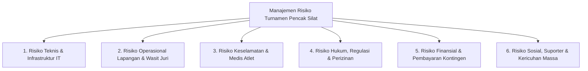
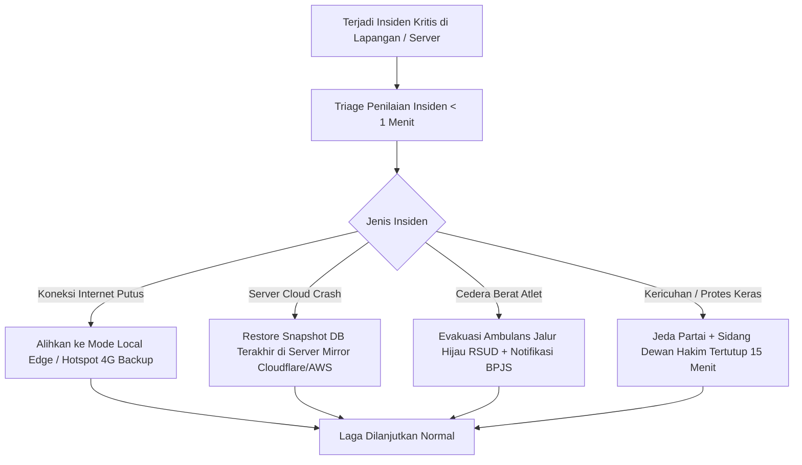

# Matriks Manajemen Risiko Komprehensif & Mitigasi Operasional Turnamen Pencak Silat (Arena Silat)

Dokumen ini memuat analisis dan pemetaan seluruh risiko potensial yang dapat terjadi dalam penyelenggaraan kejuaraan Pencak Silat dan pengoperasian platform **Arena Silat SaaS**, dikelompokkan ke dalam 6 dimensi: **Teknis & Infrastruktur IT**, **Operasional Lapangan & Wasit Juri**, **Keselamatan & Medis**, **Hukum, Regulasi & Perizinan**, **Finansial & Pembayaran**, serta **Keamanan Sosial & Kericuhan Massa**, lengkap dengan strategi mitigasi preventif dan protokol kontingensi darurat.

---

## 1. Peta Matriks Risiko & Mitigasi (Comprehensive Risk Matrix)

---

### A. Dimensi 1: Risiko Teknis, Jaringan & Infrastruktur IT

| No | Potensi Risiko | Tingkat Keparahan | Dampak pada Event | Solusi & Mitigasi Preventif Sistem Arena Silat | Rencana Kontingensi Darurat (Plan B) |
|---|---|---|---|---|---|
| **1.1** | **Koneksi Internet Venue Putus / Drop Total** | **Kritis (High)** | Tombol skor juri macet, live scoreboard freeze, pertandingan terhenti. | **Arsitektur Hybrid & Offline-First**: Aplikasi Jury Pad menggunakan Local Cache / IndexedDB dan Web Worker yang tetap mencatat skor secara lokal tanpa internet. | Pertandingan tetap berjalan di jaringan lokal router gelanggang; data otomatis di-*sync* ke cloud begitu modem backup 4G/5G menyala. |
| **1.2** | **Mati Listrik / Pemadaman Gedung GOR** | **Kritis (High)** | TV Papan skor mati, lampu arena mati, data partai yang sedang berjalan hilang. | Seluruh perangkat operasional utama (Tablet Juri, HP Kamera, Laptop KP) wajib memiliki baterai internal yang terisi 100%. | **Penyediaan Genset Otomatis (Automatic Transfer Switch - ATS)** sewa GOR + Database auto-save per *keystroke* sehingga skor detik terakhir tidak hilang saat laptop dihidupkan ulang. |
| **1.3** | **Hardware Tablet Juri Rusak / Baterai Drop** | **Sedang (Medium)** | Satu juri tidak bisa memberi nilai di ronde krusial. | **PWA Hot-Swap Session**: Juri cadangan atau smartphone panitia cukup scan QR Code sesi juri tersebut, dan langsung aktif menggantikan tablet yang rusak dalam $< 15$ detik. | Sediakan minimal 2 unit tablet/smartphone cadangan (*spare device*) per gelanggang yang selalu siaga di meja KP. |
| **1.4** | **Serangan Siber / DDoS / Manipulasi Nilai** | **Tinggi (High)** | Hacker mengubah poin skor atau merusak bagan drawing. | Penerapan **PostgreSQL Row-Level Security (RLS)**, token JWT berbatas waktu, enkripsi TLS 1.3, dan rate limiting WebSocket anti-spam. | Backup berkala database per jam (*Automated Hourly Snapshot*) ke server cloud sekunder terisolasi. |

---

### B. Dimensi 2: Risiko Operasional Lapangan & Wasit Juri

| No | Potensi Risiko | Tingkat Keparahan | Dampak pada Event | Solusi & Mitigasi Preventif Sistem Arena Silat | Rencana Kontingensi Darurat (Plan B) |
|---|---|---|---|---|---|
| **2.1** | **Wasit Juri Tidak Netral / Rekayasa Nilai (Match-Fixing)** | **Tinggi (High)** | Keputusan tidak adil, protes keras pelatih, merusak integritas kejuaraan. | **Fitur Blind Scoring**: Tablet juri tidak menampilkan akumulasi skor berjalan. Log penekanan tombol tiap juri dicatat *microsecond* untuk audit TD. | Jika terbukti curang dalam sidang dewan juri, Technical Delegate berhak menonaktifkan akun juri tersebut dan menggantinya dengan wasit juri netral. |
| **2.2** | **Wasit Juri Salah Tekan Tombol (Human Error)** | **Sedang (Medium)** | Poin tidak sengaja masuk ke sudut yang salah. | **Fitur Undo / Correction Console**: Ketua Pertandingan memiliki wewenang membatalkan poin salah tekan dalam waktu $< 5$ detik dengan log tercatat di audit trail. | Pengajuan Video Review (VR) oleh ofisial jika kesalahan juri tidak disadari oleh Ketua Pertandingan. |
| **2.3** | **Jadwal Pertandingan Molor Parah (Overtime)** | **Tinggi (High)** | Biaya sewa GOR membengkak, atlet kelelahan, komplain orang tua. | **Dynamic Court Load Balancing**: Sistem mendistribusikan sisa partai ke gelanggang yang kosong + **Live ETA Tracker** yang memprediksi jam tanding dinamis. | **Emergency Time Compression Mode**: Pemadatan durasi ronde dari 2 menit ke 1.5 menit dan istirahat 45 detik atas izin tertulis TD dan ofisial. |

---

### C. Dimensi 3: Risiko Keselamatan & Medis Atlet

| No | Potensi Risiko | Tingkat Keparahan | Dampak pada Event | Solusi & Mitigasi Preventif Sistem Arena Silat | Rencana Kontingensi Darurat (Plan B) |
|---|---|---|---|---|---|
| **3.1** | **Atlet Mengalami Cedera Fatal (Patah Tulang / Gegar Otak / K.O)** | **Kritis (High)** | Ancaman jiwa atlet, tuntutan pidana/perdata kepada panitia. | **Integrasi BPJS Ketenagakerjaan Event**: Seluruh atlet tanding wajib terdaftar asuransi/BPJS sebelum drawing. | **PKS Jalur Hijau IGD RSUD Rujukan**: Ambulans siaga membawa atlet ke RS tanpa uang muka, ditanggung 100% tanpa batas plafon oleh BPJS. |
| **3.2** | **Atlet K.O Dipaksa Main Lagi oleh Pelatih di Event Lain** | **Kritis (High)** | Kerusakan otak permanen (*Second Impact Syndrome*). | **Fitur Concussion Red-Flag Suspension**: Sistem otomatis memblokir NIK atlet selama minimal 30 hari di database seluruh kejuaraan Arena Silat. | Verifikasi surat izin medis spesialis saraf sebelum status skorsing dibuka kembali. |
| **3.3** | **Pesilat Putri Hamil Bertanding Tanding** | **Kritis (High)** | Keguguran janin dan pendarahan hebat. | Form pendaftaran mewajibkan surat pernyataan tidak hamil + cek tes kehamilan mandiri (*tespack*) saat timbang badan resmi. | Diskualifikasi medis mutlak jika terbukti positif hamil saat verifikasi fisik. |

---

### D. Dimensi 4: Risiko Hukum, Regulasi & Perizinan

| No | Potensi Risiko | Tingkat Keparahan | Dampak pada Event | Solusi & Mitigasi Preventif Sistem Arena Silat | Rencana Kontingensi Darurat (Plan B) |
|---|---|---|---|---|---|
| **4.1** | **Kejuaraan Dibubarkan Polisi / Tidak Berizin** | **Kritis (High)** | Acara batal total, kerugian finansial ratusan juta, panitia ditahan polisi. | **Modul Kepatuhan Izin (Compliance Vault)**: Checklist H-45 pengajuan izin keramaian Polres/Polda + Rekomendasi IPSI & Dispora. | Penyelenggara wajib mengantongi Surat Tanda Terima Pemberitahuan (STTP) / Izin Keramaian resmi minimal H-7 sebelum hari H. |
| **4.2** | **Piagam / Sertifikat Kejuaraan Ditolak PPDB (Tidak Diakui)** | **Tinggi (High)** | Protes massal orang tua murid, reputasi EO hancur. | **Sertifikat Anti-Fraud Ber-QR Code Terverifikasi + Kepatuhan Format SIMT Puspresnas**: Memastikan seluruh data NISN/NPSN valid sejak pendaftaran. | Panitia melampirkan SK Rekomendasi IPSI dan nomor registrasi kurasi Puspresnas pada lembar piagam resmi. |

---

### E. Dimensi 5: Risiko Finansial & Pembayaran

| No | Potensi Risiko | Tingkat Keparahan | Dampak pada Event | Solusi & Mitigasi Preventif Sistem Arena Silat | Rencana Kontingensi Darurat (Plan B) |
|---|---|---|---|---|---|
| **5.1** | **Kontingen Membayar Pakai Bukti Transfer Palsu (Struk Edit)** | **Sedang (Medium)** | Panitia tekor, atlet siluman masuk bagan. | **Automated Payment Gateway**: Verifikasi pembayaran otomatis via QRIS / Virtual Account Bank (Dana langsung tervalidasi oleh sistem tanpa cek manual). | Kontingen yang belum *Settled* otomatis tidak bisa masuk ke undian bagan pertandingan (*Auto-Locked from Drawing*). |
| **5.2** | **Kontingen Batal Tanding (Refund Claim Massal)** | **Sedang (Medium)** | Arus kas panitia terganggu setelah uang terpakai sewa GOR/medali. | Pencantuman **Syarat & Ketentuan Pembatalan (Non-Refundable Policy)** yang disetujui pelatih via checkbox digital saat checkout pendaftaran. | Kebijakan penggantian nama atlet (*athlete substitution*) diperbolehkan hingga batas akhir H-3 penimbangan tanpa pengembalian uang tunai. |

---

### F. Dimensi 6: Risiko Kericuhan Massa & Suporter Fanatik

| No | Potensi Risiko | Tingkat Keparahan | Dampak pada Event | Solusi & Mitigasi Preventif Sistem Arena Silat | Rencana Kontingensi Darurat (Plan B) |
|---|---|---|---|---|---|
| **6.1** | **Kericuhan Suporter / Ofisial Masuk ke Matras Menyerang Wasit** | **Kritis (High)** | Kerusakan sarana, korban luka, pertandingan dihentikan paksa. | **Transparansi Layar TV Scoreboard & Sistem VAR**: Keputusan yang transparan dan tayangan slow-motion mengurangi prasangka kecurangan wasit. | **Pemberlakuan Batas Barikade Gelanggang**: Hanya 1 pelatih & 1 pendamping ber-ID Card resmi yang boleh berada di sudut matras. Petugas pengamanan (Polri/Satgas) siaga di batas ring. |
| **6.2** | **Sanksi Disiplin Perguruan / Kontingen Anarkis** | **Tinggi (High)** | Kerusakan reputasi olahraga pencak silat. | **Fitur Blacklist Organisasi**: Dewan Hakim dapat menjatuhkan sanksi diskualifikasi seluruh kontingen dan mencatat sanksi di database sistem. | Koordinasi dengan Pengcab/Pengprov IPSI setempat untuk sanksi skorsing atlet/perguruan selama kurun waktu tertentu. |

---

## 2. Rencana Pemulihan Bencana & Kesiapsiagaan (Disaster Recovery Plan)

