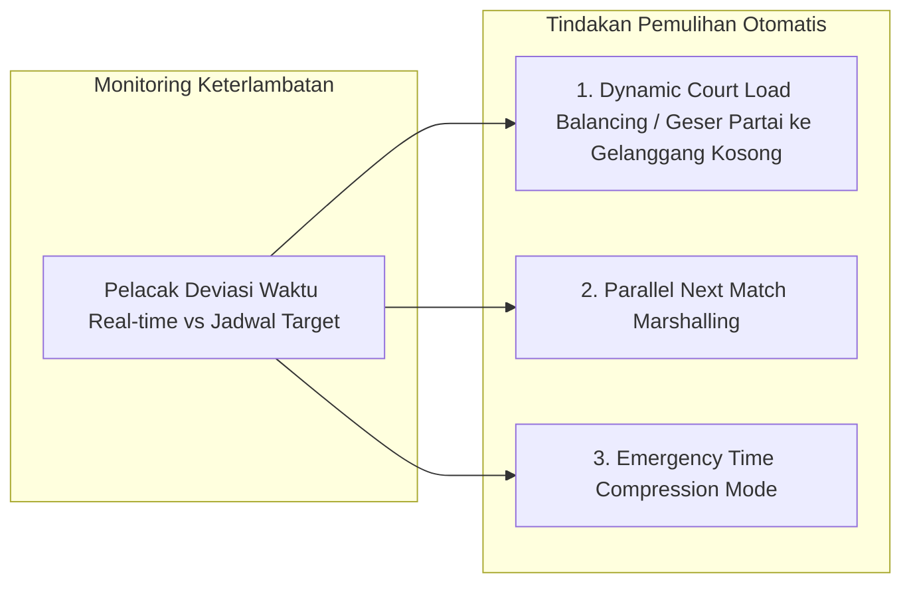

# Manajemen Waktu Molor, Mitigasi Keterlambatan & Dynamic Court Balancing (Arena Silat)

Dokumen ini memuat analisis mendalam mengenai penyebab utama keterlambatan jadwal (*waktu molor*) di kejuaraan Pencak Silat serta solusi algoritma dan fitur perangkat lunak pada **Arena Silat** untuk memitigasi, menyeimbangkan beban partai antar gelanggang (*Dynamic Court Load Balancing*), dan mempercepat durasi laga tanpa melanggar regulasi resmi.

---

## 1. Mengapa Jadwal Turnamen Silat Sering Molor? (Root Cause Analysis)

Di lapangan, turnamen yang direncanakan selesai pukul 18.00 sering kali molor hingga pukul 23.00 malam atau dini hari karena 5 faktor utama:

```mermaid
graph TD
    A[Penyebab Utama Waktu Molor di Lapangan] --> B[1. Insiden Cedera & Perawatan Medis Berulang]
    A --> C[2. Protes Ofisial & Sidang Banding yang Alot]
    A --> D[3. Panggilan Atlet Lama / Atlet Belum Siap Perlengkapan]
    A --> E[4. Partai Berakhir dengan Nilai Seri / Timbang Ulang]
    A --> F[5. Distribusi Partai Tidak Seimbang (Gelanggang A Selesai Cepat, Gelanggang B Numpuk)]
```

---

## 2. Fitur & Algoritma Penanganan Waktu Molor pada Software Arena Silat

Untuk mengatasi keterlambatan jadwal secara cerdas, aplikasi **Arena Silat** dilengkapi dengan **Smart Schedule Recovery Engine**:



---

### A. Fitur 1: Dynamic Court Load Balancing (Geser Partai Otomatis / Manual)
- **Kondisi**: Gelanggang 1 mengalami keterlambatan 45 menit (karena banyak insiden medis), sedangkan Gelanggang 2 dan 3 sudah menyelesaikan partainya lebih awal dan dalam keadaan kosong (*idle*).
- **Mekanisme Sistem**:
  - Ketua Pertandingan / Admin cukup melakukan **Drag & Drop** atau klik tombol **`[ RE-BALANCE JADWAL ]`**.
  - Partai-partai yang belum bertanding di Gelanggang 1 (misal Partai 45, 46, 47) langsung dialihkan (*hot-reassigned*) ke Gelanggang 2 atau 3.
  - Sistem otomatis mengirimkan notifikasi instan ke layar ruang tunggu *Marshalling* dan pesan bot WhatsApp ke pelatih terkait perpindahan nomor gelanggang tersebut.

---

### B. Fitur 2: Emergency Time Compression Mode (Mode Pemadatan Waktu Darurat)
Jika waktu sudah larut malam (misal melewati pukul 21.00) dan disetujui oleh *Technical Delegate (TD)* serta seluruh official kontingen:
1. **Pemberlakuan Durasi Bersih / Durasi Kotor Khusus**:
   - Meremajakan durasi ronde dari 2 menit menjadi 1.5 menit untuk partai penyisihan awal.
2. **Pemotongan Waktu Jeda Antar Ronde**:
   - Menurunkan jeda istirahat antar ronde dari 60 detik menjadi 45 detik.
3. **Penyatuan Gelanggang Final**:
   - Menggabungkan sisa partai final dari semua kategori ke gelanggang yang tersisa secara beruntun (*continuous flow*).

---

### C. Fitur 3: Predictive Delay Calculator (Prediksi Keterlambatan Real-Time)
- Sistem menghitung rata-rata durasi aktual per partai di setiap gelanggang (termasuk waktu masuk atlet, waktu tanding, dan waktu pengumuman skor).
- **Live ETA Display**: Di layar dashboard panitia dan portal publik penonton, ditampilkan perkiraan jam tanding yang dinamis:
  - *Jadwal Awal: 14.30 WIB* $\rightarrow$ *Estimasi Terkini: 15.15 WIB (Delay +45 Menit)*.
  - Menghindarkan kepanikan orang tua atlet dan pelatih karena mereka mengetahui estimasi waktu riil partai atletnya.

---

## 3. SOP Lapangan untuk Mencegah Waktu Molor (Proactive Prevention)

| Tahapan Operasional | Tindakan Panitia & Fitur Software |
|---|---|
| **Antrean Sudut Matras** | Saat Partai 10 sedang bertanding di ronde 3, atlet Partai 11 **wajib sudah berdiri di pintu masuk gelanggang** dengan body protector terpasang lengkap. Begitu wasit mengumumkan pemenang Partai 10, atlet Partai 11 langsung melangkah masuk ke matras (pergantian laga $< 45$ detik). |
| **Batasan Waktu Panggilan** | Menggunakan sistem *countdown 60 detik* di layar gelanggang. Jika pesilat tidak hadir dalam hitungan ke-60 setelah panggilan ke-3, wasit langsung mengetuk palu diskualifikasi (*Walkover/WO*). |
| **Batas Waktu Sidang Video Review (VR)** | Proses peninjauan video oleh Ketua Pertandingan dibatasi **maksimal 2 menit**. Jika video tidak menunjukkan bukti konklusif/jelas dalam 2 menit, maka keputusan wasit awal dinyatakan tetap berlaku (*call on the mat stands*). |

---

## 4. Penambahan Kolom Database untuk Manajemen Keterlambatan & Geser Gelanggang

```sql
-- 1. Tambahan Kolom Audit Estimasi Waktu pada Tabel Matches
ALTER TABLE matches ADD COLUMN estimated_start_time TIMESTAMP;
ALTER TABLE matches ADD COLUMN delay_minutes INT DEFAULT 0;
ALTER TABLE matches ADD COLUMN original_arena_id UUID REFERENCES arenas(id); -- Gelanggang asal sebelum digeser
ALTER TABLE matches ADD COLUMN is_court_reassigned BOOLEAN DEFAULT FALSE; -- Menandai partai yang digeser
ALTER TABLE matches ADD COLUMN court_reassigned_at TIMESTAMP;
ALTER TABLE matches ADD COLUMN court_reassigned_reason TEXT;

-- 2. Tabel Log Penyesuaian Waktu & Emergency Compression
CREATE TABLE match_time_adjustments (
    id UUID PRIMARY KEY DEFAULT gen_random_uuid(),
    tournament_id UUID NOT NULL REFERENCES tournaments(id) ON DELETE CASCADE,
    arena_id UUID REFERENCES arenas(id) ON DELETE CASCADE,
    adjustment_type VARCHAR(50) NOT NULL, -- 'round_duration_reduced', 'rest_time_reduced', 'court_rebalance', 'walkover_enforced'
    original_value VARCHAR(50), -- misal: '120s'
    new_value VARCHAR(50),      -- misal: '90s'
    authorized_by_td VARCHAR(100) NOT NULL, -- Technical Delegate yang mengizinkan
    reason TEXT NOT NULL,
    applied_at TIMESTAMP DEFAULT CURRENT_TIMESTAMP
);
```
