# Master Entity Relationship Diagram (ERD) & Skema Database Komprehensif (Arena Silat SaaS)

Dokumen ini memuat **Master Entity Relationship Diagram (ERD) Lengkap & Terpadu**, kamus data relasional (*Data Dictionary*), relasi kardinalitas antar-tabel (*Foreign Keys*), aturan integritas referensial (*Cascading Rules*), serta skrip DDL SQL lengkap (PostgreSQL 16) yang mencakup seluruh 35 tabel dari hulu ke hilir untuk aplikasi **Arena Silat SaaS**.

---

## 1. Master Entity Relationship Diagram (ERD Lengkap Terpadu)

```mermaid
erDiagram
    %% PILAR 1: ORGANISASI, TENANT & PENGGUNA
    ORGANIZATIONS ||--o{ TOURNAMENTS : "menyelenggarakan"
    ORGANIZATIONS ||--o{ USERS : "memiliki admin/staf"
    MARTIAL_ARTS_GUILDS ||--o{ GUILD_BRANCHES : "memiliki cabang"
    MARTIAL_ARTS_GUILDS ||--o{ GUILD_SUBSCRIPTIONS : "membayar langganan"
    MARTIAL_ARTS_GUILDS ||--o{ GUILD_OFFICIALS : "memiliki pengurus"
    MARTIAL_ARTS_GUILDS ||--o{ BELT_GRADING_SESSIONS : "mengadakan UKT"
    GUILD_BRANCHES ||--o{ GUILD_RANTINGS : "membawahi ranting"
    GUILD_BRANCHES ||--o{ ATHLETES : "menaungi atlet cabang"
    GUILD_RANTINGS ||--o{ RANTING_TRAINING_SCHEDULES : "memiliki jadwal"
    GUILD_RANTINGS ||--o{ RANTING_TRAINING_SESSIONS : "mengadakan latihan"
    USERS ||--o{ USER_SOCIAL_AUTH : "login google/sosial"

    %% PILAR 2: TURNAMEN, KATEGORI & GELANGGANG
    TOURNAMENTS ||--o{ CATEGORIES : "memiliki kategori kelas"
    TOURNAMENTS ||--o{ CONTINGENTS : "diikuti kontingen"
    TOURNAMENTS ||--o{ ARENAS : "memiliki gelanggang"
    TOURNAMENTS ||--o{ TOURNAMENT_PERMITS : "memiliki izin resmi"
    TOURNAMENTS ||--o{ TOURNAMENT_MILESTONES : "memiliki timeline H-90"
    TOURNAMENTS ||--o{ TOURNAMENT_FEE_RULES : "mengatur tarif pendaftaran"
    TOURNAMENTS ||--o{ PAYMENT_TRANSACTIONS : "menerima pembayaran"
    TOURNAMENTS ||--o{ EVENT_EXPENSES : "mencatat kas keluar LPJ"
    TOURNAMENTS ||--o{ CERTIFICATE_TEMPLATES : "memiliki template piagam"
    
    %% PILAR 3: ATLET, IDENTITAS & KEPATUHAN MEDIS
    CONTINGENTS ||--o{ ATHLETES : "mendaftarkan pesilat"
    ATHLETES ||--o{ WEIGH_INS : "timbang badan BLE"
    ATHLETES ||--o{ ATHLETE_COMPLIANCE_DOCS : "upload izin ortu/surat sehat"
    ATHLETES ||--o{ DATA_PRIVACY_CONSENTS : "memberikan izin UU PDP"
    ATHLETES ||--o{ ATHLETE_CAREER_STATS : "memiliki statistik karir"
    ATHLETES ||--o{ ATHLETE_CATEGORY_RANKINGS : "memiliki peringkat Elo"
    ATHLETES ||--o{ ATHLETE_FITNESS_TEST_SESSIONS : "mengikuti tes biomotor"
    ATHLETES ||--o{ ATHLETE_TACTICAL_EVALUATIONS : "memiliki catatan pelatih"
    ATHLETES ||--o{ STUDENT_ATTENDANCE_RECORDS : "presensi latihan ranting"
    ATHLETES ||--o{ BELT_GRADING_PARTICIPANTS : "mengikuti ujian sabuk"

    %% PILAR 4: PERTANDINGAN, BAGAN & PENILAIAN
    CATEGORIES ||--o{ CATEGORY_POOLS : "memiliki pool pemasalan"
    CATEGORIES ||--o{ BRACKET_NODES : "memiliki bagan pohon"
    CATEGORIES ||--o{ MATCHES : "mengelompokkan partai"
    ARENAS ||--o{ MATCHES : "menyelenggarakan partai"
    ARENAS ||--o{ ARENA_JURY_SESSIONS : "memiliki sesi juri QR"
    
    MATCHES ||--o{ MATCH_PARTICIPANTS : "memiliki sudut merah & biru"
    MATCHES ||--o{ MATCH_SCORES : "mencatat poin juri"
    MATCHES ||--o{ MATCH_VERIFIED_POINTS : "mencatat poin sah konsensus"
    MATCHES ||--o{ JURY_SCORING_LOGS : "mencatat raw stream juri"
    MATCHES ||--o{ MATCH_VIDEO_REVIEWS : "mencatat pengajuan VAR"
    MATCHES ||--o{ MATCH_MEDICAL_INCIDENTS : "mencatat cedera laga"
    
    MATCH_PARTICIPANTS ||--o{ TEAM_MEMBERS : "memiliki anggota ganda/regu"
    MATCH_PARTICIPANTS ||--o{ ARTISTIC_JURY_EVALUATIONS : "dinilai juri TGR/Festival"
    MATCH_PARTICIPANTS ||--o{ ARTISTIC_PENALTIES : "dikenakan penalti waktu/matras"
    MATCH_PARTICIPANTS ||--o{ MATCH_MARSHALLING : "antrean panggilan laga"
    
    %% PILAR 5: SERTIFIKAT, HASIL & KLAIM MEDIS
    MATCHES ||--o{ TOURNAMENT_CERTIFICATES : "menghasilkan piagam juara"
    MATCH_MEDICAL_INCIDENTS ||--o{ MEDICAL_HOSPITAL_REFERRALS : "rujukan IGD & klaim BPJS"
    TOURNAMENT_CERTIFICATES ||--o{ CERTIFICATE_SCAN_LOGS : "dicatat scan verifikasi QR"
```



---

## 2. Struktur Pengelompokan 35 Tabel Master Database

Database dirancang modular ke dalam 8 skema fungsional:

| Skema Modul | Daftar Tabel Terkait | Fungsi Utama |
|---|---|---|
| **1. Multi-Tenant & Auth** | `organizations`, `users`, `user_social_auth`, `security_audit_logs` | Isolasi data EO, login Google OAuth 2.0 atlet, audit trail keamanan. |
| **2. Tata Kelola Perguruan** | `martial_arts_guilds`, `guild_branches`, `guild_rantings`, `guild_officials`, `guild_subscriptions`, `guild_belt_progression_rules` | Struktur organisasi perguruan dari Pusat/DPP, Pengda, Cabang hingga Ranting. |
| **3. Turnamen & Keuangan** | `tournaments`, `tournament_permits`, `tournament_milestones`, `tournament_fee_rules`, `payment_transactions`, `payment_items`, `event_expenses`, `app_subscription_billings` | Manajemen kejuaraan, timeline H-90, perizinan POLRI, payment gateway QRIS/VA, dan LPJ kas keluar. |
| **4. Atlet & Kepatuhan PDP** | `contingents`, `athletes`, `athlete_compliance_docs`, `data_privacy_consents`, `weigh_ins` | Master pesilat, verifikasi identitas NIK/Paspor/NISN, jaminan BPJS, persetujuan UU PDP, timbangan Bluetooth BLE. |
| **5. Pertandingan & Bagan** | `categories`, `category_pools`, `arenas`, `bracket_nodes`, `matches`, `match_participants`, `team_members`, `match_marshalling` | Kategori Tanding/TGR/Festival, bagan pohon eliminasi $2^n$, antrean panggilan sudut merah & biru. |
| **6. Scoring, VAR & Medis** | `arena_jury_sessions`, `jury_scoring_logs`, `match_scores`, `match_verified_points`, `artistic_jury_evaluations`, `artistic_penalties`, `match_video_reviews`, `match_medical_incidents`, `medical_hospital_referrals` | Input tombol Jury Pad, konsensus poin mayoritas 1-2 dtk, slow-motion VAR kamera HP, timer medis 3 menit, rujukan BPJS. |
| **7. Sertifikat & Verifikasi** | `certificate_templates`, `tournament_certificates`, `certificate_scan_logs` | Visual Certificate Builder (WYSIWYG), HMAC SHA-256 digital hash, verifikasi publik anti-fraud PPDB. |
| **8. Latihan, Sabuk & Ranking** | `ranting_training_schedules`, `ranting_training_sessions`, `student_attendance_records`, `belt_grading_sessions`, `belt_grading_participants`, `athlete_career_stats`, `athlete_category_rankings`, `athlete_fitness_test_sessions`, `athlete_tactical_evaluations` | Presensi latihan ranting via QR/GPS, UKT kenaikan sabuk, Weighted-Elo ranking nasional, tes biomotorik (Speed, VO2Max). |

---

## 3. Skrip DDL SQL Master PostgreSQL 16 (Full Implementation Schema)

```sql
-- =====================================================================
-- MASTER DDL SCHEMA ARENA SILAT SAAS (POSTGRESQL 16)
-- =====================================================================

-- 0. EXTENSIONS & ENUMS
CREATE EXTENSION IF NOT EXISTS "uuid-ossp";
CREATE EXTENSION IF NOT EXISTS "pgcrypto";

CREATE TYPE tournament_status AS ENUM ('draft', 'registration', 'ongoing', 'completed', 'archived');
CREATE TYPE match_category_type AS ENUM ('tanding', 'tunggal', 'ganda', 'regu', 'festival_perorangan', 'festival_pasangan', 'festival_berkelompok');
CREATE TYPE competition_system_type AS ENUM ('single_elimination', 'pool_bracket', 'performance_ranking', 'festival_multi_awards');
CREATE TYPE age_group_type AS ENUM ('usia_dini', 'pra_remaja', 'remaja', 'dewasa', 'master', 'umum_campuran');
CREATE TYPE gender_type AS ENUM ('male', 'female', 'mixed');
CREATE TYPE corner_color AS ENUM ('red', 'blue', 'none');
CREATE TYPE match_status AS ENUM ('scheduled', 'marshalling', 'ongoing', 'paused', 'finished', 'cancelled');
CREATE TYPE win_method AS ENUM ('point', 'wmp', 'walkover', 'disqualification', 'medical', 'adjudication_jury');
CREATE TYPE guild_admin_level AS ENUM ('headquarters', 'regional_pengda', 'branch_pengcab', 'unit_ranting');

-- =====================================================================
-- 1. ORGANIZATIONS, GUILDS & USERS
-- =====================================================================

CREATE TABLE organizations (
    id UUID PRIMARY KEY DEFAULT gen_random_uuid(),
    name VARCHAR(255) NOT NULL,
    slug VARCHAR(100) UNIQUE NOT NULL,
    owner_email VARCHAR(255) NOT NULL,
    phone VARCHAR(20),
    subscription_plan VARCHAR(50) DEFAULT 'free_tier',
    subscription_expires_at TIMESTAMP,
    is_verified BOOLEAN DEFAULT FALSE,
    created_at TIMESTAMP DEFAULT CURRENT_TIMESTAMP
);

CREATE TABLE users (
    id UUID PRIMARY KEY DEFAULT gen_random_uuid(),
    organization_id UUID REFERENCES organizations(id) ON DELETE CASCADE,
    email VARCHAR(255) UNIQUE NOT NULL,
    password_hash VARCHAR(255) NOT NULL,
    full_name VARCHAR(255) NOT NULL,
    phone VARCHAR(20),
    role VARCHAR(50) NOT NULL DEFAULT 'manager_contingent',
    is_active BOOLEAN DEFAULT TRUE,
    last_login_at TIMESTAMP,
    created_at TIMESTAMP DEFAULT CURRENT_TIMESTAMP
);

CREATE TABLE user_social_auth (
    id UUID PRIMARY KEY DEFAULT gen_random_uuid(),
    user_id UUID NOT NULL REFERENCES users(id) ON DELETE CASCADE,
    provider_name VARCHAR(50) NOT NULL DEFAULT 'google',
    provider_user_id VARCHAR(255) NOT NULL,
    provider_email VARCHAR(255) NOT NULL,
    avatar_url VARCHAR(500),
    linked_at TIMESTAMP DEFAULT CURRENT_TIMESTAMP,
    CONSTRAINT unique_social_auth UNIQUE (provider_name, provider_user_id)
);

CREATE TABLE martial_arts_guilds (
    id UUID PRIMARY KEY DEFAULT gen_random_uuid(),
    guild_name VARCHAR(255) NOT NULL UNIQUE,
    slug VARCHAR(100) UNIQUE NOT NULL,
    headquarters_city VARCHAR(100),
    established_year INT,
    logo_url VARCHAR(500),
    subscription_tier VARCHAR(50) DEFAULT 'basic',
    subscription_expires_at TIMESTAMP,
    created_at TIMESTAMP DEFAULT CURRENT_TIMESTAMP
);

CREATE TABLE guild_branches (
    id UUID PRIMARY KEY DEFAULT gen_random_uuid(),
    guild_id UUID NOT NULL REFERENCES martial_arts_guilds(id) ON DELETE CASCADE,
    branch_name VARCHAR(255) NOT NULL,
    province VARCHAR(100) NOT NULL,
    city VARCHAR(100) NOT NULL,
    head_coach_name VARCHAR(100),
    contact_phone VARCHAR(20),
    created_at TIMESTAMP DEFAULT CURRENT_TIMESTAMP
);

CREATE TABLE guild_rantings (
    id UUID PRIMARY KEY DEFAULT gen_random_uuid(),
    guild_id UUID NOT NULL REFERENCES martial_arts_guilds(id) ON DELETE CASCADE,
    guild_branch_id UUID NOT NULL REFERENCES guild_branches(id) ON DELETE CASCADE,
    ranting_name VARCHAR(255) NOT NULL,
    ranting_code VARCHAR(50) UNIQUE NOT NULL,
    address_location TEXT NOT NULL,
    latitude DECIMAL(10,8),
    longitude DECIMAL(11,8),
    head_coach_user_id UUID REFERENCES users(id) ON DELETE SET NULL,
    is_active BOOLEAN DEFAULT TRUE,
    created_at TIMESTAMP DEFAULT CURRENT_TIMESTAMP
);

-- =====================================================================
-- 2. TOURNAMENTS, PERMITS & FINANCIALS
-- =====================================================================

CREATE TABLE tournaments (
    id UUID PRIMARY KEY DEFAULT gen_random_uuid(),
    organization_id UUID NOT NULL REFERENCES organizations(id) ON DELETE CASCADE,
    name VARCHAR(255) NOT NULL,
    slug VARCHAR(255) UNIQUE NOT NULL,
    rule_version VARCHAR(50) DEFAULT 'PERSILAT-2022',
    start_date DATE NOT NULL,
    end_date DATE NOT NULL,
    venue VARCHAR(255),
    event_level VARCHAR(50) DEFAULT 'nasional',
    status tournament_status DEFAULT 'draft',
    is_puspresnas_curated BOOLEAN DEFAULT FALSE,
    puspresnas_curation_number VARCHAR(100),
    ipsi_recommendation_number VARCHAR(100),
    dispora_recommendation_number VARCHAR(100),
    subscription_model VARCHAR(50) DEFAULT 'pay_as_you_earn',
    access_starts_at TIMESTAMP NOT NULL DEFAULT CURRENT_TIMESTAMP,
    access_expires_at TIMESTAMP NOT NULL,
    created_at TIMESTAMP DEFAULT CURRENT_TIMESTAMP,
    updated_at TIMESTAMP DEFAULT CURRENT_TIMESTAMP
);

CREATE TABLE contingents (
    id UUID PRIMARY KEY DEFAULT gen_random_uuid(),
    tournament_id UUID NOT NULL REFERENCES tournaments(id) ON DELETE CASCADE,
    name VARCHAR(255) NOT NULL,
    contingent_type VARCHAR(50) DEFAULT 'klub',
    contact_person VARCHAR(100),
    phone VARCHAR(20),
    created_at TIMESTAMP DEFAULT CURRENT_TIMESTAMP
);

CREATE TABLE categories (
    id UUID PRIMARY KEY DEFAULT gen_random_uuid(),
    tournament_id UUID NOT NULL REFERENCES tournaments(id) ON DELETE CASCADE,
    match_type match_category_type NOT NULL,
    competition_system competition_system_type NOT NULL DEFAULT 'single_elimination',
    age_group age_group_type NOT NULL,
    gender gender_type NOT NULL,
    class_name VARCHAR(50) NOT NULL,
    min_weight DECIMAL(5,2),
    max_weight DECIMAL(5,2),
    round_duration_sec INT DEFAULT 120,
    total_rounds INT DEFAULT 3,
    created_at TIMESTAMP DEFAULT CURRENT_TIMESTAMP
);

CREATE TABLE arenas (
    id UUID PRIMARY KEY DEFAULT gen_random_uuid(),
    tournament_id UUID NOT NULL REFERENCES tournaments(id) ON DELETE CASCADE,
    arena_number INT NOT NULL,
    name VARCHAR(100) NOT NULL,
    stream_url VARCHAR(500),
    stream_overlay_token VARCHAR(255) UNIQUE,
    is_active BOOLEAN DEFAULT TRUE,
    created_at TIMESTAMP DEFAULT CURRENT_TIMESTAMP
);

-- =====================================================================
-- 3. ATHLETES, WEIGH-IN & COMPLIANCE
-- =====================================================================

CREATE TABLE athletes (
    id UUID PRIMARY KEY DEFAULT gen_random_uuid(),
    contingent_id UUID NOT NULL REFERENCES contingents(id) ON DELETE CASCADE,
    guild_id UUID REFERENCES martial_arts_guilds(id) ON DELETE SET NULL,
    guild_branch_id UUID REFERENCES guild_branches(id) ON DELETE SET NULL,
    user_account_id UUID REFERENCES users(id) ON DELETE SET NULL,
    full_name VARCHAR(255) NOT NULL,
    gender gender_type NOT NULL,
    birth_date DATE NOT NULL,
    nationality VARCHAR(3) DEFAULT 'IDN',
    nik VARCHAR(20),
    passport_number VARCHAR(50),
    nisn VARCHAR(20),
    photo_url VARCHAR(500),
    registered_weight DECIMAL(5,2),
    belt_level VARCHAR(50),
    bpjs_type VARCHAR(50) DEFAULT 'bpjs_ketenagakerjaan',
    bpjs_number VARCHAR(50),
    bpjs_card_url VARCHAR(500),
    bpjs_is_active BOOLEAN DEFAULT FALSE,
    medical_notes TEXT,
    is_medically_suspended BOOLEAN DEFAULT FALSE,
    medical_suspension_until DATE,
    created_at TIMESTAMP DEFAULT CURRENT_TIMESTAMP,
    CONSTRAINT chk_athlete_identity CHECK (
        (nationality = 'IDN' AND nik IS NOT NULL) OR
        (nationality != 'IDN' AND passport_number IS NOT NULL)
    )
);

CREATE TABLE weigh_ins (
    id UUID PRIMARY KEY DEFAULT gen_random_uuid(),
    athlete_id UUID NOT NULL REFERENCES athletes(id) ON DELETE CASCADE,
    category_id UUID NOT NULL REFERENCES categories(id) ON DELETE CASCADE,
    actual_weight DECIMAL(5,2) NOT NULL,
    tare_weight DECIMAL(5,2) DEFAULT 0.00,
    final_counted_weight DECIMAL(5,2) NOT NULL,
    status VARCHAR(50) NOT NULL, -- 'passed', 'failed_overweight', 'failed_underweight'
    scale_device_name VARCHAR(100),
    is_bluetooth_synced BOOLEAN DEFAULT TRUE,
    weigh_in_photo_url VARCHAR(500),
    weighed_by VARCHAR(100) NOT NULL,
    weighed_at TIMESTAMP DEFAULT CURRENT_TIMESTAMP
);

-- =====================================================================
-- 4. MATCHES, BRACKETS & SCORING
-- =====================================================================

CREATE TABLE bracket_nodes (
    id UUID PRIMARY KEY DEFAULT gen_random_uuid(),
    tournament_id UUID NOT NULL REFERENCES tournaments(id) ON DELETE CASCADE,
    category_id UUID NOT NULL REFERENCES categories(id) ON DELETE CASCADE,
    round_index INT NOT NULL,
    node_index INT NOT NULL,
    is_bye_node BOOLEAN DEFAULT FALSE,
    created_at TIMESTAMP DEFAULT CURRENT_TIMESTAMP
);

CREATE TABLE matches (
    id UUID PRIMARY KEY DEFAULT gen_random_uuid(),
    category_id UUID NOT NULL REFERENCES categories(id) ON DELETE RESTRICT,
    arena_id UUID REFERENCES arenas(id) ON DELETE SET NULL,
    match_number INT NOT NULL,
    stage VARCHAR(50) DEFAULT 'preliminary',
    bracket_node_id UUID REFERENCES bracket_nodes(id) ON DELETE SET NULL,
    next_match_id UUID REFERENCES matches(id) ON DELETE SET NULL,
    status match_status DEFAULT 'scheduled',
    winner_id UUID,
    win_type win_method,
    red_vr_cards_remaining INT DEFAULT 1,
    blue_vr_cards_remaining INT DEFAULT 1,
    started_at TIMESTAMP,
    finished_at TIMESTAMP,
    created_at TIMESTAMP DEFAULT CURRENT_TIMESTAMP
);

CREATE TABLE match_participants (
    id UUID PRIMARY KEY DEFAULT gen_random_uuid(),
    match_id UUID NOT NULL REFERENCES matches(id) ON DELETE CASCADE,
    athlete_id UUID REFERENCES athletes(id) ON DELETE RESTRICT,
    team_name VARCHAR(255),
    corner corner_color NOT NULL,
    performance_order INT,
    final_score DECIMAL(6,2) DEFAULT 0.00,
    award_predicate VARCHAR(100),
    is_winner BOOLEAN DEFAULT FALSE,
    created_at TIMESTAMP DEFAULT CURRENT_TIMESTAMP
);

CREATE TABLE match_scores (
    id UUID PRIMARY KEY DEFAULT gen_random_uuid(),
    match_id UUID NOT NULL REFERENCES matches(id) ON DELETE CASCADE,
    round_number INT NOT NULL,
    jury_id UUID NOT NULL,
    corner corner_color NOT NULL,
    action_type VARCHAR(50) NOT NULL,
    points_awarded DECIMAL(5,2) NOT NULL,
    is_verified BOOLEAN DEFAULT TRUE,
    recorded_at TIMESTAMP DEFAULT CURRENT_TIMESTAMP
);

CREATE TABLE match_video_reviews (
    id UUID PRIMARY KEY DEFAULT gen_random_uuid(),
    match_id UUID NOT NULL REFERENCES matches(id) ON DELETE CASCADE,
    round_number INT NOT NULL,
    requesting_corner VARCHAR(10) NOT NULL,
    review_reason VARCHAR(100) NOT NULL,
    decision VARCHAR(50) NOT NULL, -- 'accepted', 'rejected'
    points_adjusted DECIMAL(5,2) DEFAULT 0.00,
    card_retained BOOLEAN NOT NULL,
    reviewed_by VARCHAR(100) NOT NULL,
    reviewed_at TIMESTAMP DEFAULT CURRENT_TIMESTAMP
);

CREATE TABLE match_medical_incidents (
    id UUID PRIMARY KEY DEFAULT gen_random_uuid(),
    match_id UUID NOT NULL REFERENCES matches(id) ON DELETE CASCADE,
    athlete_id UUID NOT NULL REFERENCES athletes(id) ON DELETE CASCADE,
    round_number INT NOT NULL,
    injury_body_part VARCHAR(100) NOT NULL,
    diagnosis_category VARCHAR(50) NOT NULL,
    injury_description TEXT NOT NULL,
    doctor_name VARCHAR(100) NOT NULL,
    doctor_decision VARCHAR(50) NOT NULL, -- 'fit_to_continue', 'unfit_wmp', 'refer_to_hospital'
    created_at TIMESTAMP DEFAULT CURRENT_TIMESTAMP
);

-- =====================================================================
-- 5. CERTIFICATES & ANTI-FRAUD HASH
-- =====================================================================

CREATE TABLE certificate_templates (
    id UUID PRIMARY KEY DEFAULT gen_random_uuid(),
    tournament_id UUID REFERENCES tournaments(id) ON DELETE CASCADE,
    guild_id UUID REFERENCES martial_arts_guilds(id) ON DELETE CASCADE,
    template_name VARCHAR(255) NOT NULL,
    background_image_url VARCHAR(500) NOT NULL,
    elements_layout_json JSONB NOT NULL,
    signatories_json JSONB,
    created_at TIMESTAMP DEFAULT CURRENT_TIMESTAMP
);

CREATE TABLE tournament_certificates (
    id UUID PRIMARY KEY DEFAULT gen_random_uuid(),
    tournament_id UUID NOT NULL REFERENCES tournaments(id) ON DELETE CASCADE,
    athlete_id UUID NOT NULL REFERENCES athletes(id) ON DELETE CASCADE,
    category_id UUID NOT NULL REFERENCES categories(id) ON DELETE CASCADE,
    certificate_number VARCHAR(100) UNIQUE NOT NULL,
    qr_verification_token VARCHAR(255) UNIQUE NOT NULL,
    hmac_sha256_hash VARCHAR(64) NOT NULL,
    achievement_title VARCHAR(100) NOT NULL,
    athlete_name VARCHAR(255) NOT NULL,
    pdf_file_url VARCHAR(500) NOT NULL,
    is_puspresnas_curated BOOLEAN DEFAULT FALSE,
    issued_at TIMESTAMP DEFAULT CURRENT_TIMESTAMP
);

-- =====================================================================
-- 6. PERFORMANCE RANKINGS & INDEXES
-- =====================================================================

CREATE TABLE athlete_career_stats (
    athlete_id UUID PRIMARY KEY REFERENCES athletes(id) ON DELETE CASCADE,
    total_matches INT DEFAULT 0,
    matches_won INT DEFAULT 0,
    matches_lost INT DEFAULT 0,
    win_rate_percentage DECIMAL(5,2) DEFAULT 0.00,
    gold_medals_count INT DEFAULT 0,
    silver_medals_count INT DEFAULT 0,
    bronze_medals_count INT DEFAULT 0,
    last_updated_at TIMESTAMP DEFAULT CURRENT_TIMESTAMP
);

CREATE TABLE athlete_category_rankings (
    id UUID PRIMARY KEY DEFAULT gen_random_uuid(),
    athlete_id UUID NOT NULL REFERENCES athletes(id) ON DELETE CASCADE,
    age_group age_group_type NOT NULL,
    gender gender_type NOT NULL,
    match_type match_category_type NOT NULL,
    class_name VARCHAR(50) NOT NULL,
    elo_rating INT NOT NULL DEFAULT 1200,
    accumulated_tournament_points DECIMAL(10,2) NOT NULL DEFAULT 0.00,
    national_rank_position INT,
    last_calculated_at TIMESTAMP DEFAULT CURRENT_TIMESTAMP,
    CONSTRAINT unique_athlete_rank_class UNIQUE (athlete_id, age_group, match_type, class_name)
);

-- CRITICAL PERFORMANCE INDEXES
CREATE INDEX idx_athletes_contingent ON athletes(contingent_id);
CREATE INDEX idx_athletes_guild ON athletes(guild_id, guild_branch_id);
CREATE INDEX idx_matches_arena_status ON matches(arena_id, status);
CREATE INDEX idx_scores_match_fast ON match_scores(match_id, round_number);
CREATE INDEX idx_cert_verify_fast ON tournament_certificates(qr_verification_token, hmac_sha256_hash);
CREATE INDEX idx_rankings_lookup ON athlete_category_rankings(age_group, gender, match_type, class_name, accumulated_tournament_points DESC);
```
