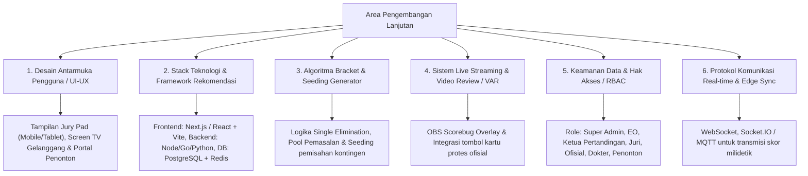

# Master Roadmap & Panduan Arsitektur Sistem Lengkap (Arena Silat SaaS)

Dokumen ini merangkum seluruh domain yang telah dianalisis serta memetakan 6 area strategis krusial yang perlu dipersiapkan untuk fase implementasi aplikasi.

---

## 1. Rangkuman Dokumen yang Telah Tersedia di `/docs`

1. **[analisis_lapangan_dan_desain_db.md](file:///c:/arenasilat/docs/analisis_lapangan_dan_desain_db.md)**:
   - Analisis kondisi lapangan, alur pertandingan, dan ERD database relasional.
   - Matriks permasalahan lapangan vs solusi database.
   - Validasi identitas kondisional (NIK untuk WNI vs Paspor untuk WNA), NISN (pelajar), dan BPJS.
   - Kategori Tanding (berbagai kelas), Seni TGR (Tunggal, Ganda, Regu), dan Festival Multi-Awards.
2. **[analisis_saas_turnamen_silat.md](file:///c:/arenasilat/docs/analisis_saas_turnamen_silat.md)**:
   - Segmentasi pasar (Tier 1 Grassroot, Tier 2 Daerah, Tier 3 Nasional/Internasional).
   - Arsitektur Hybrid On-Site (Edge Local Network) + Cloud Sync untuk ketahanan *zero-latency* dan bebas mati internet.
   - Skema Multi-Tenancy organisasi penyelenggara.
3. **[panduan_kurasi_puspresnas.md](file:///c:/arenasilat/docs/panduan_kurasi_puspresnas.md)**:
   - Persyaratan kurasi ajang talenta Kemendikdasmen melalui SIMT.
   - Standar E-Sertifikat anti-pemalsuan ber-QR Code dan ekspor format SIMT 1-klik.
4. **[panduan_administrasi_dan_perizinan.md](file:///c:/arenasilat/docs/panduan_administrasi_dan_perizinan.md)**:
   - Alur perizinan kepolisian (Polres/Polda), rekomendasi IPSI/Dispora, sewa GOR, dan MoU RS Rujukan.
   - Modul *compliance* dan verifikasi berkas atlet.
5. **[analisis_keuangan_dan_pricing_saas.md](file:///c:/arenasilat/docs/analisis_keuangan_dan_pricing_saas.md)**:
   - Struktur biaya pendaftaran kontingen/atlet.
   - Skema tarif SaaS (Pay-per-Athlete, Flat License, Sewa Hardware).
   - Laporan keuangan otomatis kepanitiaan (LPJ Kas Masuk/Keluar).
6. **[aturan_dan_rumus_penilaian_skor.md](file:///c:/arenasilat/docs/aturan_dan_rumus_penilaian_skor.md)**:
   - Logika nilai pukulan (+1), tendangan (+2), jatuhan (+3), dan hukuman (-1 s.d. diskualifikasi).
   - Algoritma consensus buffer window juri (1.0 - 2.0 detik).
   - Rumus seni TGR (kebenaran gerak, kemantapan, penalti durasi) dan lembar nilai festival (100 poin).

---

## 2. Topik Lanjutan yang Perlu Ditentukan untuk Fase Eksekusi

---

## 3. Rekomendasi Langkah Konkret Berikutnya

1. **Pemilihan Teknologi Stack (Tech Stack Selection)**:
   - Menentukan bahasa backend (Node.js/TypeScript, Go, atau Python), frontend UI (React / Next.js), dan engine WebSocket.
2. **Perancangan Desain UI/UX Wireframe**:
   - Mendesain antarmuka **Jury Pad (Mobile/Tablet)** yang ramah sentuhan cepat tanpa *lag*.
   - Mendesain tampilan **Layar Papan Skor Gelanggang (Arena Display Scoreboard)** yang kontras tinggi dan mudah terbaca dari jarak jauh.
   - Mendesain **Dashboard Penyelenggara (EO Console)**.
3. **Pembuatan Prototype Algoritma Scoring & Bracket**:
   - Membuat *Proof of Concept (PoC)* engine konsensus skoring juri dan generator bagan pohon eliminasi.
