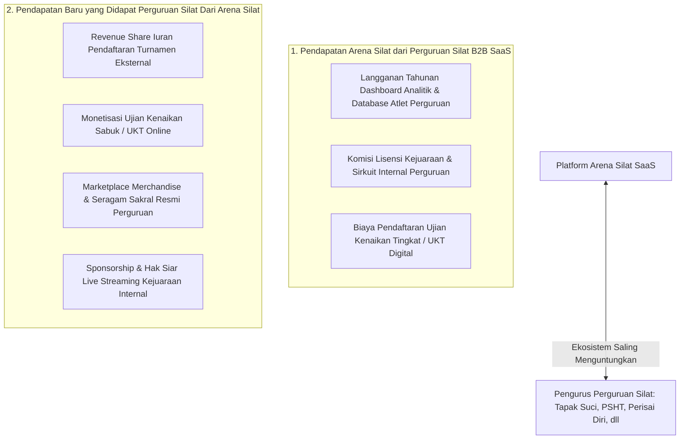

# Strategi & Model Monetisasi Khusus Perguruan Pencak Silat (Guild Monetization & Revenue Model)

Dokumen ini memuat analisis dan rancangan model bisnis dua arah (*Two-Way Monetization*): **Bagaimana platform Arena Silat SaaS memperoleh pendapatan dari Perguruan Silat (B2B SaaS Revenue)**, serta **Bagaimana Perguruan Silat itu sendiri dapat menciptakan sumber pendapatan baru (*Revenue Stream for Guilds*)** melalui ekosistem digital **Arena Silat**.

---

## 1. Peta Monetisasi Dua Arah (Two-Way Value Creation)



---

## 2. Model Monetisasi B2B: Pendapatan Arena Silat dari Perguruan

### A. Paket Langganan Tahunan Perguruan (Guild Annual SaaS Tier)

| Paket Langganan | Target Pengguna | Fitur & Kapasitas | Biaya Langganan |
|---|---|---|---|
| **Cabang / Ranting Pass** | Pengurus Cabang Kota/Kabupaten (Pengcab Perguruan) | • Database hingga 150 Atlet<br>• Analisis Taktik Radar Chart Pelatih<br>• Bulk Registration Turnamen | **Rp 750.000 / tahun** per Cabang |
| **Pengda / Wilayah Pass** | Pengurus Daerah Provinsi (Pengda Perguruan) | • Database hingga 1.000 Atlet<br>• Multi-Cabang Leaderboard & Scouting<br>• Akses Analitik Pelatda | **Rp 2.500.000 / tahun** per Wilayah |
| **Pengurus Pusat Enterprise (PB Perguruan)** | Pengurus Besar / Pusat Perguruan Nasional (Pusat Madiun, Yogyakarta, dll) | • **Unlimited Atlet se-Indonesia & Luar Negeri**<br>• Single Identity KTA Digital Atlet<br>• White-label App (Logo & Domain Perguruan)<br>• Diskon 40% Software Sirkuit Kejurnas Internal | **Rp 12.000.000 – Rp 25.000.000 / tahun** |

---

### B. Monetisasi Ujian Kenaikan Tingkat / Sabuk Digital (UKT / Pasanggiri Digital Pass)
- Perguruan silat di Indonesia mengadakan **Ujian Kenaikan Tingkat (UKT)** 2–4 kali setahun dengan puluhan ribu peserta.
- **Model Fee Platform**: Arena Silat memungut biaya administrasi sistem **Rp 3.000 – Rp 5.000 per siswa peserta UKT** untuk:
  - Pendaftaran online & verifikasi syarat jurus.
  - Form penilaian digital dewan penguji sabuk.
  - Penerbitan otomatis **E-Sertifikat Kenaikan Sabuk Ber-QR Code Anti-Pemalsuan**.

---

## 3. Bagaimana Perguruan Silat Menghasilkan Uang dari Platform Ini? (Guild Revenue Streams)

Platform Arena Silat menjadi instrumen digitalisasi finansial bagi perguruan:

### A. Iuran Kas Perguruan dari Pendaftaran Turnamen (*Affiliate Kickback*)
- Setiap atlet yang mendaftar ke kejuaraan terbuka melalui portal perguruannya, perguruan dapat menetapkan **Iuran Kas Pengembangan Atlet** (misal Rp 25.000 / atlet) yang otomatis disisihkan ke rekening kas perguruan cabang/pusat.

### B. Sirkuit Kejurnas Mandiri yang Menguntungkan (*Profitable Internal Championship*)
- Dengan biaya sewa software yang murah dan tanpa butuh server lokal, perguruan dapat mengadakan kejuaraan internal antar-cabang secara rutin dengan biaya pendaftaran Rp 200rb/atlet, menghasilkan **laba bersih puluhan hingga ratusan juta rupiah** untuk kas organisasi.

### C. Toko Merchandise Resmi Terverifikasi (Official Guild Store)
- Integrasi marketplace seragam sakral, sabuk, golok seni, dan atribut perguruan yang terverifikasi keasliannya (*anti-produk bajakan*) langsung di dashboard anggota perguruan dengan sistem bagi hasil komisi.

---

## 4. Simulasi Proyeksi Finansial (Financial Projection Contoh 1 Perguruan)

Contoh simulasi untuk 1 Perguruan Besar (misal: memiliki 5.000 anggota aktif):

| Sumber Pendapatan | Volume per Tahun | Tarif / Fee | Potensi Pendapatan Kas Perguruan | Pendapatan Platform Arena Silat |
|---|---|---|---|---|
| **Ujian Kenaikan Sabuk (UKT)** | 4.000 Peserta / th | Iuran UKT: Rp 100.000 | **Rp 380.000.000** | Rp 20.000.000 (Fee Rp 5rb/siswa) |
| **Kejurnas Internal Perguruan** | 1.000 Atlet | Biaya Reg: Rp 250.000 | **Rp 243.000.000** (Laba Panitia) | Rp 7.000.000 (Sewa Software SaaS) |
| **Langganan Dashboard Pusat** | 1 Lisensi PB Pusat | Biaya SaaS Tahunan | - | Rp 15.000.000 / th |
| **TOTAL TAHUNAN** | - | - | **Rp 623.000.000** *(Kas Perguruan)* | **Rp 42.000.000** *(ARR SaaS)* |

---

## 5. Skema Database Modul Finansial & Langganan Perguruan

```sql
-- 1. Tabel Tagihan Langganan SaaS Perguruan (Guild Subscription Billings)
CREATE TABLE guild_subscriptions (
    id UUID PRIMARY KEY DEFAULT gen_random_uuid(),
    guild_id UUID NOT NULL REFERENCES martial_arts_guilds(id) ON DELETE CASCADE,
    tier_plan VARCHAR(50) NOT NULL, -- 'branch_pass', 'regional_pass', 'national_enterprise'
    annual_fee DECIMAL(12,2) NOT NULL,
    starts_at DATE NOT NULL,
    expires_at DATE NOT NULL,
    payment_status VARCHAR(50) DEFAULT 'active', -- 'active', 'expired', 'grace_period'
    invoice_ref VARCHAR(100) UNIQUE NOT NULL,
    paid_at TIMESTAMP,
    created_at TIMESTAMP DEFAULT CURRENT_TIMESTAMP
);

-- 2. Tabel Modul Ujian Kenaikan Tingkat (Belt Grading / UKT Sessions)
CREATE TABLE belt_grading_sessions (
    id UUID PRIMARY KEY DEFAULT gen_random_uuid(),
    guild_id UUID NOT NULL REFERENCES martial_arts_guilds(id) ON DELETE CASCADE,
    guild_branch_id UUID REFERENCES guild_branches(id) ON DELETE SET NULL,
    session_name VARCHAR(255) NOT NULL, -- 'UKT Periode I 2026 Cabang Bantul'
    target_belt VARCHAR(50) NOT NULL, -- 'Sabuk Hijau ke Merah'
    registration_fee DECIMAL(10,2) NOT NULL, -- misal: 100000.00
    platform_fee_per_student DECIMAL(10,2) DEFAULT 5000.00,
    event_date DATE NOT NULL,
    is_registration_open BOOLEAN DEFAULT TRUE,
    created_at TIMESTAMP DEFAULT CURRENT_TIMESTAMP
);

-- 3. Tabel Peserta Ujian Kenaikan Tingkat (Grading Participants & Certificates)
CREATE TABLE belt_grading_participants (
    id UUID PRIMARY KEY DEFAULT gen_random_uuid(),
    grading_session_id UUID NOT NULL REFERENCES belt_grading_sessions(id) ON DELETE CASCADE,
    athlete_id UUID NOT NULL REFERENCES athletes(id) ON DELETE CASCADE,
    examiner_name VARCHAR(100), -- Nama Dewan Penguji
    movement_score DECIMAL(5,2),
    physical_score DECIMAL(5,2),
    spiritual_score DECIMAL(5,2), -- Pengetahuan mental & ke-Pencak Silat-an
    result_status VARCHAR(50) DEFAULT 'passed', -- 'passed', 'failed', 're-exam'
    belt_certificate_number VARCHAR(100) UNIQUE,
    certificate_qr_token VARCHAR(255) UNIQUE,
    is_fee_paid BOOLEAN DEFAULT FALSE,
    created_at TIMESTAMP DEFAULT CURRENT_TIMESTAMP
);

-- Indeks Finansial Perguruan
CREATE INDEX idx_guild_sub_status ON guild_subscriptions(guild_id, payment_status);
CREATE INDEX idx_ukt_session ON belt_grading_participants(grading_session_id, result_status);
```
