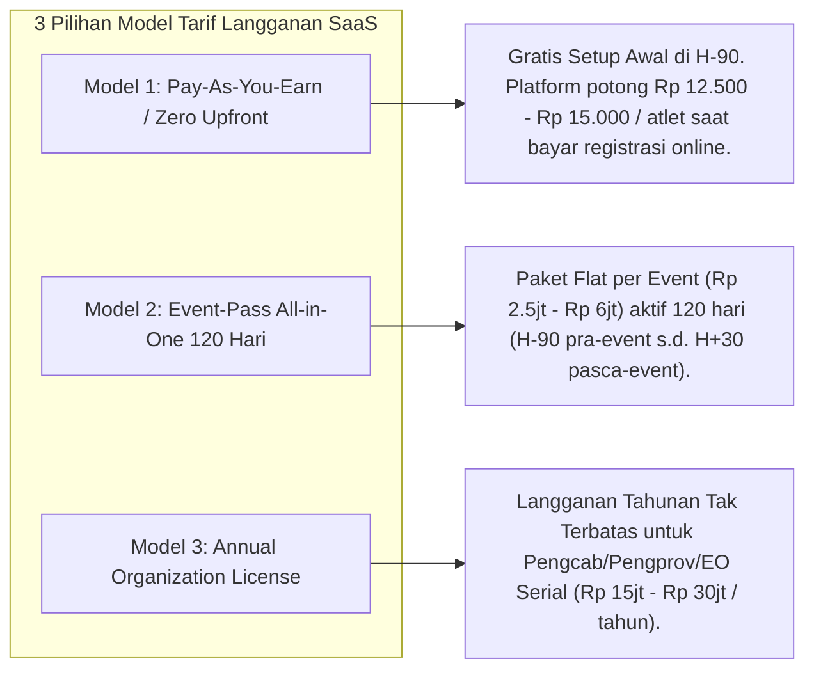
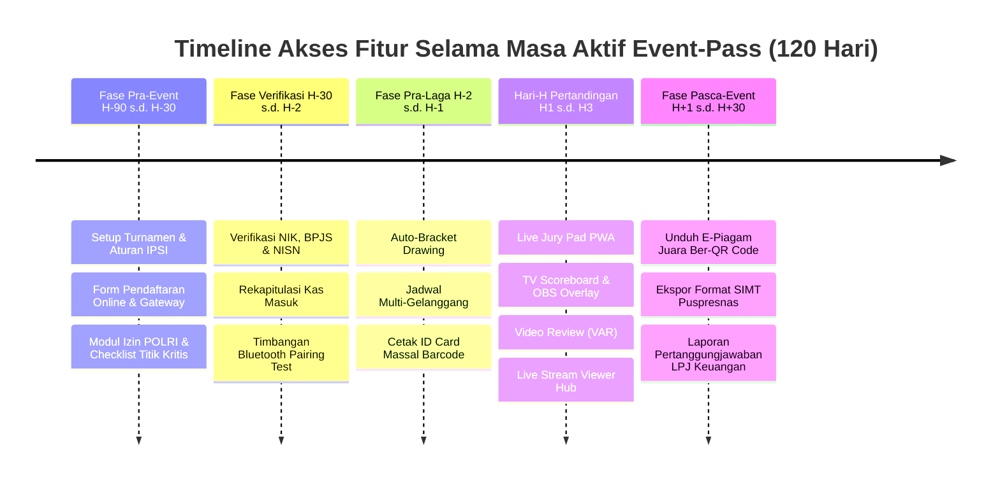

# Model Penentuan Tarif Langganan SaaS Berbasis Siklus Waktu Event (Event-Lifecycle Subscription Model)

Dokumen ini memuat analisis dan rancangan model penetapan harga (*pricing model*) untuk aplikasi **Arena Silat SaaS**, yang dirancang khusus untuk mengakomodasi pola penggunaan jangka panjang (aplikasi sudah aktif digunakan sejak **H-90 hingga H+30** pasca-event) tanpa membebani arus kas awal (*cash flow*) panitia penyelenggara.

---

## 1. Masalah Utama Model Langganan Tradisional pada Event Silat

Jika menggunakan model SaaS bulanan konvensional (misal: *Rp 1.000.000 / bulan*):
1. **Panitia Keberatan Membayar di Awal (H-90)**: Pada fase awal (3 bulan sebelum event), panitia belum memiliki pemasukan karena pendaftaran peserta belum dibuka dan uang sponsor belum cair.
2. **Potensi Putus Langganan di Tengah Jalan**: Jika panitia telat membayar tagihan bulanan ke-2, sistem terkunci dan pendaftaran atlet terganggu.
3. **Masa Pasca-Event Tetap Dibutuhkan**: Setelah acara selesai (H+1 s.d. H+30), panitia masih membutuhkan akses untuk verifikasi sertifikat PPDB, LPJ keuangan, dan ekspor data SIMT Puspresnas.

---

## 2. Solusi: Model Tarif "Event-Pass Lifecycle" & "Revenue-Share Pendaftaran"

Solusi terbaik adalah mengadopsi model **Per-Event Lifecycle Pass (Berlaku Aktif 120 Hari Penuh)** dan model **Potong Otomatis dari Uang Pendaftaran Peserta (Zero Upfront Cost)**.



---

## 3. Rincian 3 Pilihan Struktur Tarif (Pricing Packages)

### Model 1: "Pay-As-You-Earn" (Model Paling Favorit & Tanpa Modal Awal)
* **Konsep**: **Modal Awal Rp 0 (GRATIS)**. EO bisa langsung membuka turnamen, menyusun juknis, dan mengaktifkan manajemen proyek di H-90 tanpa membayar biaya sewa sepeser pun.
* **Mekanisme Biaya**:
  - Biaya platform sebesar **Rp 15.000 / atlet** dibebankan langsung ke dalam komponen biaya pendaftaran yang dibayar oleh kontingen via Payment Gateway (QRIS / VA).
  - *Contoh Perhitungan*:
    - Biaya pendaftaran yang ditetapkan panitia: Rp 250.000 / atlet.
    - Saat kontingen membayar: Rp 235.000 otomatis dialokasikan ke rekening panitia, dan Rp 15.000 otomatis menjadi fee layanan aplikasi Arena Silat.
* **Keuntungan bagi EO**:
  - **Zero Financial Risk**: Jika peserta sedikit, EO tidak rugi biaya software. Jika peserta membludak (1.000 atlet), sistem otomatis menghasilkan pendapatan bagi SaaS tanpa EO merasa terbebani.

---

### Model 2: "Event-Pass All-in-One" (Paket Sewa Flat 120 Hari)
* **Konsep**: Berlaku untuk 1 event utuh dengan masa aktif **120 Hari (H-90 Pra-Event s.d. H+30 Pasca-Event)**.
* **Pilihan Paket**:
  | Nama Paket | Kapasitas & Fitur | Masa Aktif | Biaya Sewa Event |
  |---|---|---|---|
  | **Starter Pass** | • Maksimal 2 Gelanggang<br>• Hingga 400 Atlet<br>• Scoring Tanding & TGR<br>• E-Piagam QR Code | **120 Hari Penuh** (H-90 s.d. H+30) | **Rp 2.500.000 / event** *(Bisa DP 30% di H-90, pelunasan di H-7)* |
  | **Pro Pass (Rekomendasi)** | • Hingga 4 Gelanggang<br>• Hingga 1.200 Atlet<br>• Live Scoreboard TV & OBS Overlay<br>• Video Review VAR<br>• Ekspor SIMT Puspresnas | **120 Hari Penuh** (H-90 s.d. H+30) | **Rp 4.500.000 / event** *(Bisa DP 30% di H-90, pelunasan di H-7)* |
  | **National Championship Pass** | • Multi-Gelanggang Unlimited (5 - 8+ Gelanggang)<br>• Unlimited Atlet<br>• Custom Domain (`kejurnas2026.com`)<br>• Dedicated Cloud Priority | **120 Hari Penuh** (H-90 s.d. H+30) | **Rp 8.000.000 / event** |

---

### Model 3: "Annual Unlimited License" (Untuk Pengurus IPSI & Serial EO)
* **Target**: Pengcab/Pengprov IPSI, Badan Pembina Olahraga Mahasiswa (BAPOMI), atau EO profesional yang menyelenggarakan 4–10 turnamen dalam setahun.
* **Biaya**: **Rp 18.000.000 / tahun** (Akses *unlimited event*, *unlimited atlet*, dan *unlimited gelanggang* selama 365 hari).

---

## 4. Timeline Hak Akses Fitur Berdasarkan Fase Waktu Event (120 Hari)



---

## 5. Penambahan Skema Database untuk Manajemen Masa Aktif Event-Pass

```sql
-- Perbarui Tabel Subscriptions / Event Pass
ALTER TABLE tournaments ADD COLUMN subscription_model VARCHAR(50) DEFAULT 'pay_as_you_earn'; -- 'pay_as_you_earn', 'event_pass_flat', 'annual_license'
ALTER TABLE tournaments ADD COLUMN event_pass_tier VARCHAR(50) DEFAULT 'pro_pass'; -- 'starter', 'pro', 'national', 'annual'
ALTER TABLE tournaments ADD COLUMN access_starts_at TIMESTAMP NOT NULL DEFAULT CURRENT_TIMESTAMP; -- H-90
ALTER TABLE tournaments ADD COLUMN access_expires_at TIMESTAMP NOT NULL; -- H+30 pasca tanggal end_date turnamen
ALTER TABLE tournaments ADD COLUMN fee_per_athlete DECIMAL(10,2) DEFAULT 15000.00;
ALTER TABLE tournaments ADD COLUMN flat_fee_amount DECIMAL(12,2) DEFAULT 0.00;
ALTER TABLE tournaments ADD COLUMN is_dp_paid BOOLEAN DEFAULT FALSE;
ALTER TABLE tournaments ADD COLUMN is_fully_settled BOOLEAN DEFAULT FALSE;

-- Fungsi Otomatisasi Perhitungan Masa Aktif 120 Hari (H-90 sampai H+30)
-- access_starts_at = start_date - INTERVAL '90 days'
-- access_expires_at = end_date + INTERVAL '30 days'
```
