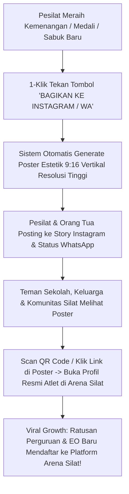

# Modul Viral Social Sharing & Dynamic Trading Card Generator (Arena Silat Social Hub)

Dokumen ini memuat analisis dan rancangan arsitektur fitur **Social Media Sharing & Dynamic Card Generator** pada aplikasi **Arena Silat SaaS**, yang memungkinkan pesilat, orang tua, dan pelatih membagikan profil prestasi, kartu statistik bertanding (*Athlete Digital Trading Card*), serta klip cuplikan kemenangan (*Victory Highlight Poster*) secara instan dan estetik ke platform media sosial (**Instagram Story, WhatsApp Status, TikTok, Facebook, dan X/Twitter**), lengkap dengan proteksi privasi UU PDP dan pelacak *viral growth* platform.

---

## 1. Mengapa Fitur Social Sharing Sangat Krusial?



---

## 2. Format Kartu Media Sosial yang Digenerate Otomatis (3 Format Visual Populer)

Sistem secara otomatis mengenerate 3 varian gambar visual siap posting tanpa perlu aplikasi desain grafis tambahan:

### A. Format 1: "Athlete Digital Trading Card" (Kartu Profil Gaya FIFA/NBA Card)
* **Ukuran**: Rasio $9:16$ ($1080\text{px} \times 1920\text{px}$) untuk Instagram Story, TikTok & WhatsApp Status.
* **Elemen Visual**:
  - Foto aksi pesilat berlatar belakang efek visual petir (*neon energy glow* Merah/Biru).
  - Peringkat Nasional (contoh: `#1 RANKED INDONESIA - KELAS C PUTRA`).
  - Badge Perguruan & Kontingen Asal.
  - Overall Rating Nilai Biomotorik (contoh: **OVR 88: Speed 92 | Power 88 | Jatuhan 95**).
  - QR Code verifikasi profil di pojok bawah.

---

### B. Format 2: "Match Victory & Champion Poster" (Poster Kemenangan Laga)
* **Ukuran**: Format Persegi $1:1$ ($1080\text{px} \times 1080\text{px}$) untuk Feeds Instagram & Facebook.
* **Elemen Visual**:
  - Teks Emas Besar: **`🏆 JUARA 1 (MEDALI EMAS)`**.
  - Skor Pertandingan Final: `SUDUT MERAH (19) vs SUDUT BIRU (14)`.
  - Nama Kejuaraan: *Kejuaraan Nasional Silat Piala Menpora 2026*.
  - Logo Resmi Perguruan & Logo Turnamen.

---

### C. Format 3: "New Belt Promotion Badge" (Lencana Kenaikan Sabuk UKT)
* **Elemen Visual**:
  - Teks Perguruan: *Tapak Suci Putera Muhammadiyah / PSHT*.
  - Visual Sabuk Baru Berputar (contoh: **LULUS SABUK MERAH TINGKAT II**).
  - Foto bersama pelatih ranting dan nomor sertifikat kelulusan resmi.

---

## 3. Tampilan Mockup Visual Trading Card (Desain Story 9:16)

```text
+-------------------------------------------------------------------+
|  ARENA SILAT • OFFICIAL ATHLETE TRADING CARD                      |
|                                                                   |
|   /=========================================================\     |
|  ||                   [ FOTO ATLET RESMI ]                  ||    |
|  ||                      BAGAS PERKASA                      ||    |
|  ||       Perguruan: Tapak Suci • Kontingen: Jawa Tengah    ||    |
|   \=========================================================/     |
|                                                                   |
|   OVERALL SCORE: 88 (ELITE FIGHTER)     NASIONAL RANK: #1 🥇      |
|   -------------------------------------------------------------   |
|   💥 POWER JATUHAN : 95/100     ⚡ SPEED TENDANGAN : 92/100       |
|   🛡️ PERTAHANAN    : 85/100     🫁 STAMINA KARDIO  : 80/100       |
|   -------------------------------------------------------------   |
|   REKOR KARIR: 18 MENANG - 2 KALAH (WIN RATE: 90%)                |
|   MEDALI     : 4x 🥇 EMAS | 1x 🥈 PERAK                           |
|                                                                   |
|   [ QR CODE ]  Scan untuk cek riwayat skor resmi di:              |
|                arenasilat.com/athlete/bagas-perkasa               |
+-------------------------------------------------------------------+
```

---

## 4. Mekanisme Teknis: Open Graph (OG Tags) & Server-Side Image Generation

Saat tautan profil atlet dibagikan melalui chat WhatsApp atau Twitter, muncul *Link Preview Card* otomatis yang kaya visual:

```mermaid
graph LR
    subgraph Link Dibagikan di WhatsApp / IG
        URL[Tautan: arenasilat.com/athlete/bagas-perkasa]
    end

    subgraph Server Metadata & Dynamic Generator
        OG[Open Graph / Twitter Card Meta Tags Engine]
        SATORI[@vercel/og / Satori HTML-to-Image Engine]
    end

    subgraph Layar WhatsApp Penerima
        PREVIEW[Tampil Gambar Poster HD Atlet + Judul + Win Rate Otomatis]
    end

    URL --> OG
    OG --> SATORI
    SATORI --> PREVIEW
```

### Integrasi Open Graph Meta Tags (HTML Header):
```html
<!-- Open Graph Metadata untuk WhatsApp & Facebook -->
<meta property="og:type" content="profile" />
<meta property="og:title" content="Bagas Perkasa • Juara 1 Emas Kejurnas Silat 2026" />
<meta property="og:description" content="Peringkat #1 Nasional Kelas C Dewasa Putra. Rekor: 18 Menang - 2 Kalah. Lihat profil & riwayat tanding resmi di Arena Silat." />
<meta property="og:image" content="https://api.arenasilat.com/og-card/athlete/bagas-perkasa.png" />
<meta property="og:url" content="https://arenasilat.com/athlete/bagas-perkasa" />

<!-- Twitter Card Metadata -->
<meta name="twitter:card" content="summary_large_image" />
<meta name="twitter:title" content="Bagas Perkasa • Atlet Pencak Silat Nasional" />
<meta name="twitter:image" content="https://api.arenasilat.com/og-card/athlete/bagas-perkasa.png" />
```

---

## 5. Kepatuhan Privasi UU PDP pada Fitur Sharing Sosial Media

Untuk menjaga kepatuhan hukum **UU Perlindungan Data Pribadi (UU PDP No. 27/2022)** saat dibagikan ke publik:
1. **NIK & Nomor Kontak TIDAK PERNAH DIMUNCULKAN**: Gambar poster yang digenerate **100% bebas dari data kependudukan pribadi** (hanya nama atlet, foto, perguruan, dan statistik olahraga).
2. **Tombol Pengaturan Privasi Atlet (Public vs Private Profile Toggle)**:
   - Atlet/Orang tua memiliki tombol kendali di dashboard:
     - 🟢 **Mode Publik (Default)**: Profil dapat dicari di Google dan dibagikan ke medsos.
     - 🔒 **Mode Privat**: Profil hanya bisa dibuka melalui tautan rahasia khusus dan tidak muncul di mesin pencari.

---

## 6. Penambahan Skema Database untuk Pelacak Social Sharing & Referral

```sql
-- 1. Tabel Log Aktivitas Social Sharing (Social Share Metrics)
CREATE TABLE athlete_social_share_events (
    id UUID PRIMARY KEY DEFAULT gen_random_uuid(),
    athlete_id UUID NOT NULL REFERENCES athletes(id) ON DELETE CASCADE,
    share_platform VARCHAR(50) NOT NULL, -- 'instagram_story', 'whatsapp_status', 'tiktok', 'facebook', 'twitter'
    card_type VARCHAR(50) NOT NULL, -- 'trading_card_9_16', 'victory_post_1_1', 'belt_badge'
    shared_at TIMESTAMP DEFAULT CURRENT_TIMESTAMP
);

-- 2. Update Tabel Athletes dengan URL Poster Media Sosial Siap Pakai
ALTER TABLE athletes ADD COLUMN social_trading_card_url VARCHAR(500);
ALTER TABLE athletes ADD COLUMN is_public_profile_enabled BOOLEAN DEFAULT TRUE;
ALTER TABLE athletes ADD COLUMN profile_views_count INT DEFAULT 0;

-- Indeks Analitik Viral Growth
CREATE INDEX idx_social_shares ON athlete_social_share_events(athlete_id, share_platform);
```
