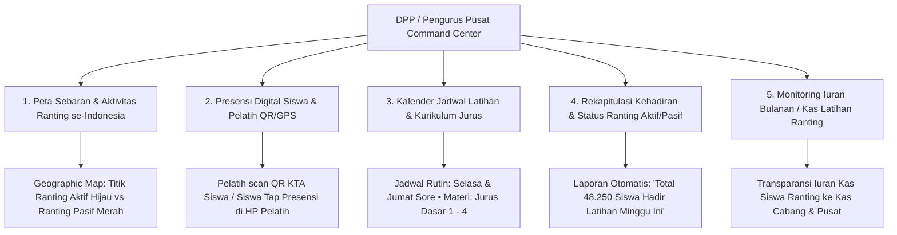
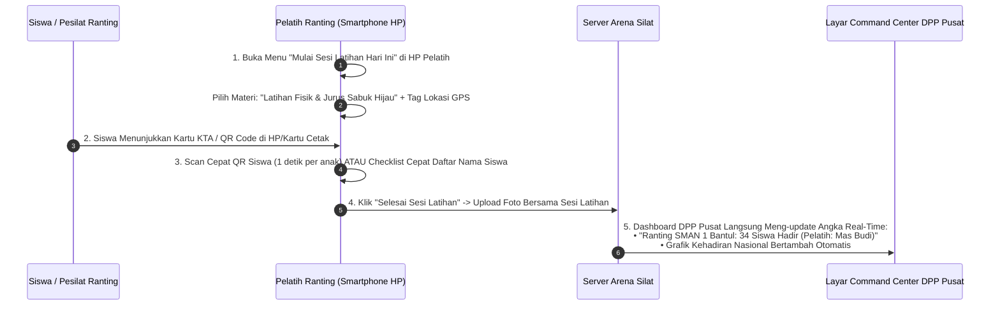

# Modul Monitoring Latihan Ranting & Presensi Digital untuk DPP / Pengurus Pusat Perguruan (National Dojo Attendance & Training Tracker)

Dokumen ini memuat analisis dan rancangan arsitektur modul **Monitoring Latihan Nasional (Dojo Training & Attendance Command Center)** pada aplikasi **Arena Silat SaaS**, yang memungkinkan **Dewan Pimpinan Pusat (DPP / PB Perguruan Silat)** memantau aktivitas latihan di ribuan cabang dan ranting/unit latihan di seluruh Indonesia secara real-time, mengetahui jumlah siswa aktif/hadir, jadwal latihan, materi kurikulum jurus, serta logistik iuran kas ranting.

---

## 1. Mengapa DPP / Pengurus Pusat Membutuhkan Monitoring Latihan Ranting?

### Masalah Klasik Perguruan Silat di Tingkat Nasional:
1. **Data Anggota Fiktif / Mati Suri**: DPP tidak tahu persis berapa jumlah siswa yang benar-benar aktif berlatih setiap minggu di ranting-ranting pelosok daerah.
2. **Keterlambatan Evaluasi Ranting Pasif**: Banyak ranting yang diam-diam tutup atau kekurangan pelatih tanpa diketahui oleh Pengcab, Pengda, apalagi DPP Pusat.
3. **Standarisasi Materi Jurus**: DPP kesulitan memastikan apakah materi jurus yang diajarkan oleh pelatih ranting sudah sesuai dengan kurikulum baku resmi perguruan.
4. **Peluang Talent Scouting Sejak Usia Dini**: DPP bisa mendeteksi siswa yang rajin hadir 100% dan memiliki bakat fisik unggul langsung dari level ranting sekolah.

---

## 2. Peta Fitur Monitoring Latihan Nasional untuk DPP



---

## 3. Cara Kerja Presensi Digital di Ranting Lapangan (Hanya 10 Detik)

Pelatih ranting di lapangan (sekolah / balai desa / padepokan) dapat melakukan presensi dengan cara yang sangat praktis dan hemat kuota:



---

## 4. Tampilan Dashboard Command Center DPP Pusat (UI/UX Mockup)

```text
======================================================================================================
  DPP COMMAND CENTER • MONITORING LATIHAN RANTING NASIONAL
  Perguruan: PERSAUDARAAN SETIA HATI TERATE / TAPAK SUCI PUTERA MUHAMMADIYAH
======================================================================================================
[ 🗺️ PETA SEBARAN NASIONAL ] [ 👥 TOTAL SISWA AKTIF: 142.500 ] [ 🥋 RANTING AKTIF HARI INI: 1.840 ]
------------------------------------------------------------------------------------------------------
RINGKASAN KEHADIRAN MINGGU INI:
• Total Siswa Hadir Latihan : 128.420 Siswa (Tingkat Kehadiran: 90.1% 🟢)
• Ranting Melaksanakan Latihan: 2.450 Ranting dari 2.600 Ranting Terdaftar
• Ranting Pasif / Butuh Perhatian: 150 Ranting (Tidak ada aktivitas latihan > 3 pekan 🔴)

AKTIVITAS LATIHAN REAL-TIME HARI INI (LIVE FEED):
1. [16:45 WIB] Ranting Sleman Kota (Yogyakarta)   : 42 Siswa Hadir • Materi: Jurus Golok Tunggal
2. [16:40 WIB] Ranting Kebayoran Baru (DKI Jakarta): 28 Siswa Hadir • Materi: Penguatan Fisik Kuda-Kuda
3. [16:30 WIB] Ranting Surabaya Timur (Jawa Timur) : 55 Siswa Hadir • Materi: Sambung / Tanding
4. [16:15 WIB] Ranting Padang Barat (Sumbar)      : 30 Siswa Hadir • Materi: Sambut Ganda Bersenjata

REKOMENDASI SISTEM UNTUK DPP:
⚠️ "Terdapat 12 Ranting di Wilayah Pengda Kalimantan Barat tidak aktif latihan selama 1 bulan terakhir. 
    Rekomendasi: Kirim instruktur pelatih bantuan dari Pengda terdekat."
======================================================================================================
```

---

## 5. Skema Database Monitoring Latihan & Presensi Ranting

```sql
-- 1. Tabel Unit Latihan / Ranting Perguruan (Guild Ranting / Dojangs)
CREATE TABLE guild_rantings (
    id UUID PRIMARY KEY DEFAULT gen_random_uuid(),
    guild_id UUID NOT NULL REFERENCES martial_arts_guilds(id) ON DELETE CASCADE,
    guild_branch_id UUID NOT NULL REFERENCES guild_branches(id) ON DELETE CASCADE,
    ranting_name VARCHAR(255) NOT NULL, -- Contoh: 'Ranting SMAN 1 Semarang', 'Ranting Padepokan Cabang'
    ranting_code VARCHAR(50) UNIQUE NOT NULL, -- Contoh: 'RNT-SMG-012'
    address_location TEXT NOT NULL,
    latitude DECIMAL(10,8),
    longitude DECIMAL(11,8),
    head_coach_user_id UUID REFERENCES users(id) ON DELETE SET NULL,
    is_active BOOLEAN DEFAULT TRUE,
    created_at TIMESTAMP DEFAULT CURRENT_TIMESTAMP
);

-- 2. Tabel Jadwal Rutin Latihan Ranting (Recurring Training Schedules)
CREATE TABLE ranting_training_schedules (
    id UUID PRIMARY KEY DEFAULT gen_random_uuid(),
    ranting_id UUID NOT NULL REFERENCES guild_rantings(id) ON DELETE CASCADE,
    day_of_week INT NOT NULL, -- 0 = Minggu, 1 = Senin, ... 6 = Sabtu
    start_time TIME NOT NULL, -- misal: '16:00:00'
    end_time TIME NOT NULL,   -- misal: '18:00:00'
    target_belt_group VARCHAR(50) DEFAULT 'all_levels', -- 'siswa_dasar', 'siswa_taruna', 'all_levels'
    curriculum_topic VARCHAR(255), -- 'Latihan Fisik & Jurus Baku'
    is_active BOOLEAN DEFAULT TRUE,
    created_at TIMESTAMP DEFAULT CURRENT_TIMESTAMP
);

-- 3. Tabel Sesi Latihan Aktual di Lapangan (Actual Training Sessions)
CREATE TABLE ranting_training_sessions (
    id UUID PRIMARY KEY DEFAULT gen_random_uuid(),
    ranting_id UUID NOT NULL REFERENCES guild_rantings(id) ON DELETE CASCADE,
    coach_user_id UUID NOT NULL REFERENCES users(id) ON DELETE CASCADE,
    session_date DATE NOT NULL,
    started_at TIMESTAMP NOT NULL DEFAULT CURRENT_TIMESTAMP,
    ended_at TIMESTAMP,
    curriculum_taught TEXT NOT NULL, -- Materi yang diajarkan hari ini
    gps_checkin_lat DECIMAL(10,8),
    gps_checkin_lng DECIMAL(11,8),
    session_photo_url VARCHAR(500), -- Foto bersama / dokumentasi sesi
    total_students_present INT DEFAULT 0,
    coach_notes TEXT,
    created_at TIMESTAMP DEFAULT CURRENT_TIMESTAMP
);

-- 4. Tabel Log Presensi Kehadiran Siswa per Sesi (Student Attendance Records)
CREATE TABLE student_attendance_records (
    id UUID PRIMARY KEY DEFAULT gen_random_uuid(),
    training_session_id UUID NOT NULL REFERENCES ranting_training_sessions(id) ON DELETE CASCADE,
    athlete_id UUID NOT NULL REFERENCES athletes(id) ON DELETE CASCADE,
    attendance_status VARCHAR(20) DEFAULT 'present', -- 'present', 'sick', 'permitted', 'absent'
    check_in_method VARCHAR(50) DEFAULT 'qr_scan', -- 'qr_scan', 'manual_checklist', 'bluetooth_beacon'
    scanned_at TIMESTAMP DEFAULT CURRENT_TIMESTAMP,
    CONSTRAINT unique_student_session_attendance UNIQUE (training_session_id, athlete_id)
);

-- Indeks Kecepatan Monitoring DPP Nasional
CREATE INDEX idx_ranting_training_date ON ranting_training_sessions(ranting_id, session_date);
CREATE INDEX idx_student_attendance ON student_attendance_records(athlete_id, attendance_status);
```

---

## 6. Hak Akses Berjenjang Monitoring Latihan (Hierarchical Visibility)

| Tingkatan Pengurus | Ruang Lingkup Monitoring Latihan | Aksi yang Diizinkan |
|---|---|---|
| **DPP / Pengurus Pusat** | **Seluruh Indonesia & Luar Negeri** | Melihat rekapitulasi nasional, peta sebaran ranting aktif/pasif, statistik pertumbuhan siswa per provinsi, audit kurikulum nasional. |
| **Pengda (Provinsi)** | 1 Provinsi (Seluruh Cabang di Provinsinya) | Memantau kehadiran siswa per kota/kabupaten, deteksi cabang yang butuh instruktur pelatih tambahan. |
| **Pengcab (Cabang)** | 1 Kota / Kabupaten (Seluruh Ranting Cabang) | Menyetujui pembukaan ranting baru, memantau kehadiran siswa & pelatih ranting setiap minggu, kelola jadwal latihan. |
| **Pelatih Ranting** | 1 Ranting Unit Latihannya | Membuka sesi latihan, scan presensi siswa, upload foto latihan, dan mencatat evaluasi perkembangan fisik siswa. |
