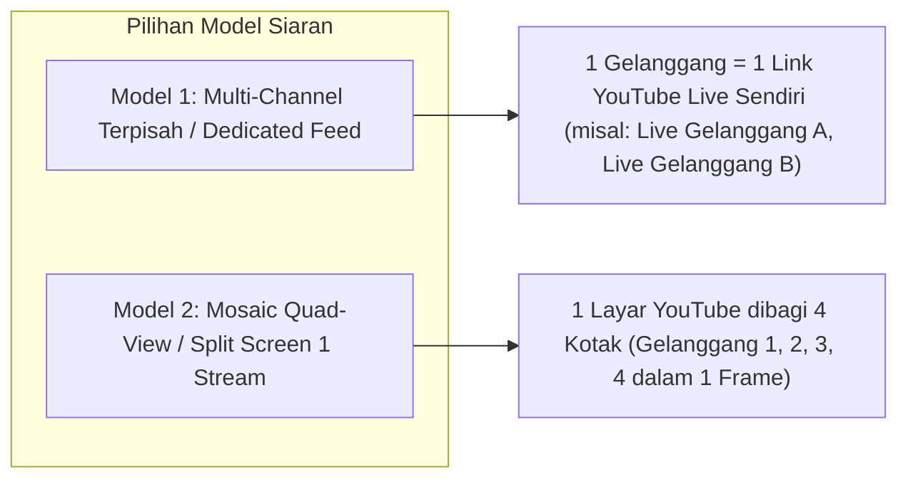
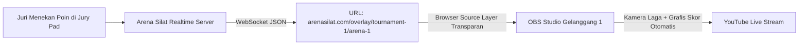

# Arsitektur Multi-Gelanggang Paralel & Multi-Stream Live Streaming (Arena Silat)

Dokumen ini memuat solusi teknis dan arsitektur siaran langsung (*Live Streaming*) untuk kejuaraan Pencak Silat yang memiliki **banyak gelanggang (Arena A, B, C, D, dst) yang bertanding secara bersamaan (paralel)**, mencakup setup hardware, efisiensi bandwidth internet, integrasi grafis overlay skor otomatis, dan portal penonton (*Multi-Court Viewer*).

---

## BAGIAN 1: Peta Arsitektur Multi-Gelanggang Paralel

Dalam kejuaraan skala menengah hingga nasional, 2 hingga 8 gelanggang berjalan serentak. Sistem **Arena Silat** menerapkan pendekatan **Distribusi Terdesentralisasi per Gelanggang**:

```mermaid
graph TB
    subgraph Gedung Olahraga / GOR (Local Venue)
        subgraph Gelanggang 1 / Matras A
            CAM1[Kamera HP / Camcorder G1]
            OBS1[Laptop Operator OBS Gelanggang 1]
            WIDGET1[Browser Overlay Skor G1]
            CAM1 --> OBS1
            WIDGET1 --> OBS1
        end

        subgraph Gelanggang 2 / Matras B
            CAM2[Kamera HP / Camcorder G2]
            OBS2[Laptop Operator OBS Gelanggang 2]
            WIDGET2[Browser Overlay Skor G2]
            CAM2 --> OBS2
            WIDGET2 --> OBS2
        end

        subgraph Gelanggang 3 / Matras C
            CAM3[Kamera HP / Camcorder G3]
            OBS3[Laptop Operator OBS Gelanggang 3]
            WIDGET3[Browser Overlay Skor G3]
            CAM3 --> OBS3
            WIDGET3 --> OBS3
        end

        ROUTER_MAIN[Router Internet Utama Venue GOR]
        OBS1 --> ROUTER_MAIN
        OBS2 --> ROUTER_MAIN
        OBS3 --> ROUTER_MAIN
    end

    subgraph Cloud Streaming & CDN Layer
        ROUTER_MAIN -->|RTMP Multi-Stream| CDN[YouTube Live Multi-Feed / Mux Video / Cloudflare Stream]
        API_SCORE[Server Real-time Skor Arena Silat]
    end

    subgraph Portal Penonton Publik
        PORTAL[Web Portal Penonton: Multi-Court Viewer]
        CDN --> PORTAL
        API_SCORE --> PORTAL
        USER[Penonton / Wali Atlet / Ofisial di Rumah / Tribun]
        PORTAL --> USER
    end
```

---

## BAGIAN 2: 2 Model Strategi Live Streaming Paralel

Penyelenggara turnamen dapat memilih antara 2 model siaran sesuai ketersediaan bandwidth internet dan budget:



### 1. Model 1: Multi-Channel Stream Terpisah (Direkomendasikan untuk Kenyamanan Penonton)
- **Cara Kerja**: Setiap laptop operator gelanggang melakukan *stream out* (RTMP) ke stream key YouTube/platform tersendiri:
  - Stream 1: `Kejurnas Silat 2026 - Gelanggang 1 (Matras A)`
  - Stream 2: `Kejurnas Silat 2026 - Gelanggang 2 (Matras B)`
  - Stream 3: `Kejurnas Silat 2026 - Gelanggang 3 (Matras C)`
- **Kelebihan**: Penonton (orang tua/pelatih) bisa fokus menonton atletnya di gelanggang spesifik dengan resolusi penuh (Full HD 1080p).
- **Kebutuhan Bandwidth Upload di GOR**: Minimal **4–5 Mbps upload per gelanggang** (Jika ada 4 gelanggang, butuh koneksi internet venue minimal **20–25 Mbps upload dedicated**).

---

### 2. Model 2: Mosaic Multi-View / Split-Screen (Hemat Bandwidth Venue)
- **Cara Kerja**: Semua feed kamera dikirim ke 1 komputer Master Switcher lokal via jaringan LAN, lalu dijadikan 1 layar *4-split grid* (seperti CCTV matriks), baru dikirim 1 stream ke YouTube.
- **Kelebihan**: Hanya butuh 1 jalur upload internet (~6-8 Mbps) untuk menayangkan 4 gelanggang sekaligus.

---

## BAGIAN 3: Integrasi Otomatis Overlay Skor (OBS Graphics Bug)

Salah satu keunggulan aplikasi **Arena Silat** adalah penyediaan URL **Browser Source Overlay** yang siap ditempel ke software streaming (OBS Studio / vMix / Streamlabs) tanpa perlu operator mendesain manual grafis skor.



### Elemen yang Otomatis Tampil di Layar Live Streaming:
1. **Papan Skor Bawah (Score Bug)**:
   - Nama Pesilat Sudut Merah & Biru beserta Logo Kontingen/Perguruan.
   - Kelas & Babak Pertandingan (contoh: *Kelas C Dewasa Putra - Babak Semifinal*).
   - Nomor Partai Pertandingan saat ini & Skor Angka Real-Time.
   - Indikator Ronde (Ronde 1, 2, 3) dan Timer Hitung Mundur Laga.
2. **Animasi Peristiwa Otomatis (Event Triggers)**:
   - Efek visual saat jatuhan berhasil: animasi **`+3 JATUHAN SAH`**.
   - Notifikasi pelanggaran: animasi **`TEGURAN I`**, **`PERINGATAN I (-5)`**.
   - Animasi **`[ VIDEO REVIEW (VAR) ]`** saat ofisial mengangkat kartu protes.
   - Tampilan Pop-up pemenang di akhir partai: **`[ WINNER: SUDUT MERAH (MENANG ANGKA) ]`**.

---

## BAGIAN 4: Halaman Penonton Multi-Court (Public Viewer Portal)

Di sisi penonton umum (orang tua, atlet, ofisial), aplikasi SaaS menyediakan halaman portal web responsif: **`arenasilat.com/live/[tournament-slug]`**.

### Fitur Halaman Multi-Court Portal:
1. **Tabs Pemilihan Gelanggang**: Tombol *Gelanggang 1*, *Gelanggang 2*, *Gelanggang 3* untuk beralih tayangan live stream secara instan.
2. **Live Match Ticker**: Di bawah video siaran langsung, terdapat informasi partai yang sedang bertanding sekarang, nama atlet berikutnya yang bersiap (*marshalling*), serta bagan jadwal partai selanjutnya di gelanggang tersebut.
3. **Switch Mode (Multi-View)**: Penonton dapat mengaktifkan mode *2-Court* atau *4-Court Grid* untuk memantau 2 atau 4 gelanggang sekaligus dalam satu layar laptop/tablet.

---

## BAGIAN 5: Penambahan Kolom Database untuk Multi-Streaming Gelanggang

```sql
-- 1. Tambahkan Konfigurasi Streaming pada Tabel Arenas
ALTER TABLE arenas ADD COLUMN stream_provider VARCHAR(50) DEFAULT 'youtube'; -- 'youtube', 'facebook', 'twitch', 'custom_rtmp'
ALTER TABLE arenas ADD COLUMN stream_url VARCHAR(500); -- Link embed YouTube Live
ALTER TABLE arenas ADD COLUMN stream_overlay_token VARCHAR(255) UNIQUE; -- Token keamanan URL overlay OBS
ALTER TABLE arenas ADD COLUMN is_streaming_active BOOLEAN DEFAULT FALSE;

-- 2. Endpoint URL Template untuk OBS Browser Source:
-- https://app.arenasilat.com/overlay/{arena_id}?token={stream_overlay_token}
```
