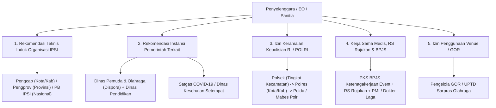

# Panduan Administrasi, Regulasi & Perizinan Penyelenggaraan Turnamen Pencak Silat

Dokumen ini memuat panduan lengkap tata kelola administrasi, perizinan kepolisian, rekomendasi induk organisasi (IPSI/PERSILAT), koordinasi instansi pemerintah, standar keselamatan medis, serta rancangan modul sistem untuk mendigitalkan kepatuhan (*compliance*) event Pencak Silat.

---

## BAGIAN 1: Peta Alur & Matriks Perizinan Resmi

Penyelenggaraan turnamen pencak silat (baik tanding, seni TGR, maupun festival) melibatkan perizinan bertingkat:



---

## BAGIAN 2: Rincian Dokumen & Syarat Perizinan

### 1. Rekomendasi Teknis IPSI (Wajib Utama)
Tanpa rekomendasi IPSI, kejuaraan dianggap ilegal (*unauthorized match*), wasit juri berlisensi dilarang memimpin, dan piagam kejuaraan tidak diakui secara resmi.

* **Syarat Pengajuan Rekomendasi IPSI**:
  1. Proposal Kegiatan & Petunjuk Teknis (Juknis/Technical Handbook) yang mencantumkan versi peraturan pertandingan (misal: PERSILAT 2022 / IPSI 2024).
  2. Susunan Panitia Pelaksana dan Struktur Dewan Wasit Juri berlisensi aktif.
  3. Surat permohonan penugasan Wasit Juri dan Delegasi Teknik (*Technical Delegate*).
  4. Surat Pernyataan Kesanggupan mematuhi Kode Etik & Standar Keamanan IPSI.
  5. Pembayaran iuran rekomendasi resmi (*sanctioning fee*) sesuai tingkatan pengurus.

---

### 2. Surat Izin Keramaian POLRI (Kepolisian Negara RI)
Berdasarkan Petunjuk Lapangan Kapolri tentang Izin Keramaian:

| Tingkatan Event | Instansi Kepolisian yang Menerbitkan Izin | Waktu Pengajuan Minimal |
|---|---|---|
| **Tingkat Kecamatan / Internal** | Polsek setempat | Minimal H-14 sebelum acara |
| **Tingkat Kota / Kabupaten / Antar-Sekolah** | Polres / Polresta | Minimal H-21 sebelum acara |
| **Tingkat Provinsi / Regional** | Polda setempat (Direktorat Intelkam) | Minimal H-30 sebelum acara |
| **Tingkat Nasional / Internasional** | Baintelkam Mabes POLRI | Minimal H-45 s.d. H-60 sebelum acara |

* **Kelengkapan Berkas Izin Keramaian**:
  - Proposal kegiatan lengkap dengan *rundown* jadwal harian.
  - Surat Rekomendasi dari Pengurus IPSI dan DISPORA.
  - Surat Izin/Sewa Pemakaian Gedung Olahraga (GOR).
  - Surat Kesiapan Pengamanan Internal (Satgas Panitia/Security) dan denah *lay-out* evakuasi darurat.
  - Fotokopi KTP dan Surat Pernyataan Penanggung Jawab Kegiatan (Ketua Panitia).

---

### 3. Izin Tempat / Venue (Dispora / Pengelola GOR)
* Surat Permohonan Pemakaian Sarana Prasarana Olahraga Daerah (GOR).
* Perjanjian Sewa-Menyewa & Pembayaran Retribusi Daerah.
* Surat Pernyataan Tanggung Jawab atas Kebersihan dan Keutuhan Fasilitas Gedung.

---

### 4. Administrasi Medis, Rumah Sakit Rujukan & BPJS
Pencak Silat adalah olahraga benturan fisik (*full-contact sports*), panitia memiliki tanggung jawab hukum (*legal liability*) atas keselamatan atlet:

* **MoU / PKS Rumah Sakit Rujukan**: Surat kesiapan RSUD/RS swasta terdekat untuk penanganan gawat darurat bedah/trauma atlet silat dengan sistem *green-line* tanpa antre.
* **Tim Medis Lapangan**: Minimal 1 Dokter Pertandingan, 2 Perawat/Fisioterapis per gelanggang, dan 1 Unit Ambulans Siaga (lengkap oksigen & tandu *cervical collar*).
* **Perjanjian Kerja Sama BPJS Ketenagakerjaan**: Pendaftaran program Bukan Penerima Upah (BPU) khusus event untuk seluruh atlet tanding selama masa kejuaraan.

---

## BAGIAN 3: Syarat Administrasi Peserta & Kontingen (Atlet & Ofisial)

Untuk mencegah manipulasi identitas dan sengketa hukum di lapangan, sistem mewajibkan verifikasi berkas:

1. **Surat Izin Orang Tua / Wali** (Bermaterai untuk peserta usia di bawah 17 tahun).
2. **Surat Keterangan Sehat dari Dokter / Puskesmas / RS** (Diterbitkan maksimal 14 hari sebelum hari H).
3. **Surat Rekomendasi Sekolah / Pengcab / Perguruan Silat Asal**.
4. **Dokumen Identitas Sah**:
   - WNI: KTP / Kartu Identitas Anak (KIA) / Kartu Keluarga (KK) & Akta Kelahiran.
   - WNA: Paspor Asli & Visa Kunjungan/Olahraga yang masih berlaku.
   - Pelajar (Puspresnas): NISN dan NPSN Sekolah.
5. **Bukti Kepesertaan Jaminan Kesehatan**:
   - Kartu BPJS Ketenagakerjaan / BPJS Kesehatan / Asuransi Internasional yang masih aktif.
6. **Surat Bebas Kehamilan** (Khusus pesilat putri kategori Dewasa tanding, dicek saat penimbangan/tes medis).

---

## BAGIAN 4: Timeline Operasional Administrasi (Roadmap Pra s.d. Pasca Event)

| Waktu | Target Administrasi & Perizinan |
|---|---|
| **H-90 s.d. H-60** | • Finalisasi Proposal & Juknis Pertandingan.<br>• Booking Tanggal & Pelunasan DP Gedung Olahraga (GOR).<br>• Pengajuan Surat Permohonan Rekomendasi ke Pengurus IPSI dan Dispora. |
| **H-45 s.d. H-30** | • Pengajuan Surat Rekomendasi Kurasi ke SIMT Puspresnas (jika kategori pelajar).<br>• Pengajuan Izin Keramaian ke Kepolisian (Polres/Polda).<br>• Membuka Pendaftaran Online Kontingen di Platform Arena Silat. |
| **H-21 s.d. H-14** | • Penutupan Pendaftaran & Pembayaran Kontingen.<br>• MoU dengan Rumah Sakit Rujukan & Pengajuan Pendaftaran BPJS Ketenagakerjaan Kolektif.<br>• Rapat Koordinasi Teknis (*Technical Delegate IPSI*). |
| **H-7 s.d. H-2** | • Verifikasi Berkas Fisik & Timbang Badan Awal.<br>• *Technical Meeting* (TM) & *Drawing* Bagan Otomatis.<br>• Briefing Wasit Juri dan Petugas Medis. |
| **Hari H (Laga)** | • Pelaksanaan Pertandingan (Live Digital Scoring & Live Broadcast).<br>• Validasi Medis & Timbang Ulang Harian. |
| **H+1 s.d. H-14** | • Laporan Pertanggungjawaban (LPJ) ke IPSI, Dispora, dan Kepolisian.<br>• Upload Rekap Juara & Sertifikat ke SIMT Puspresnas. |

---

## BAGIAN 5: Penambahan Skema Database Manajemen Administrasi & Perizinan (Compliance Module)

Untuk mendukung penyelenggara mengelola berkas perizinan dan dokumen legal secara tersentralisasi pada aplikasi SaaS:

```sql
-- 1. Tabel Dokumen Kepatuhan & Perizinan Turnamen (Tournament Permits)
CREATE TABLE tournament_permits (
    id UUID PRIMARY KEY DEFAULT gen_random_uuid(),
    tournament_id UUID NOT NULL REFERENCES tournaments(id) ON DELETE CASCADE,
    permit_type VARCHAR(50) NOT NULL, -- 'ipsi_recommendation', 'police_permit', 'dispora_permit', 'venue_contract', 'hospital_mou', 'bpjs_pks'
    issuing_authority VARCHAR(255) NOT NULL, -- misal: 'Pengprov IPSI Jabar', 'Polres Metro Jaksel', 'RSUD Cibinong'
    document_number VARCHAR(100) NOT NULL, -- Nomor Surat Resmi
    issued_date DATE NOT NULL,
    valid_until DATE,
    document_url VARCHAR(500) NOT NULL, -- Link PDF scan surat izin
    status VARCHAR(50) DEFAULT 'approved', -- 'draft', 'submitted', 'approved', 'rejected'
    notes TEXT,
    created_at TIMESTAMP DEFAULT CURRENT_TIMESTAMP
);

-- 2. Tabel Dokumen Persyaratan Atlet (Athlete Documents Compliance)
CREATE TABLE athlete_compliance_docs (
    id UUID PRIMARY KEY DEFAULT gen_random_uuid(),
    athlete_id UUID NOT NULL REFERENCES athletes(id) ON DELETE CASCADE,
    doc_type VARCHAR(50) NOT NULL, -- 'parental_consent', 'medical_clearance', 'school_recommendation', 'birth_certificate', 'pregnancy_test'
    document_url VARCHAR(500) NOT NULL,
    is_verified BOOLEAN DEFAULT FALSE,
    verified_by VARCHAR(100),
    verified_at TIMESTAMP,
    rejection_reason TEXT,
    created_at TIMESTAMP DEFAULT CURRENT_TIMESTAMP
);

-- Indexing for Fast Document Lookups
CREATE INDEX idx_permits_tournament ON tournament_permits(tournament_id, permit_type);
CREATE INDEX idx_docs_athlete ON athlete_compliance_docs(athlete_id, doc_type);
```
