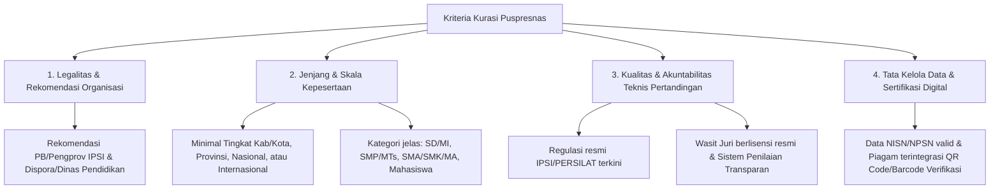
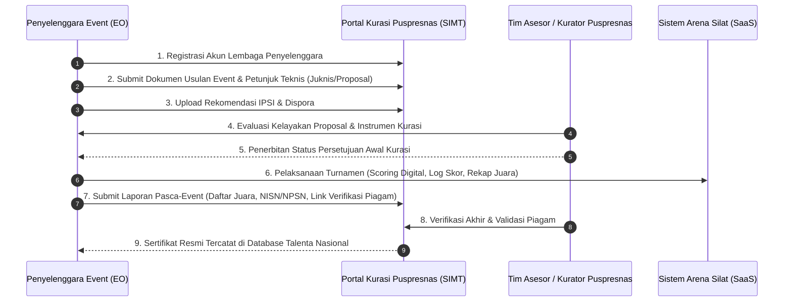

# Panduan & Strategi Kurasi Ajang Kejuaraan Pencak Silat oleh Puspresnas Kemendikdasmen (SIMT)

Dokumen ini memuat panduan komprehensif mengenai persyaratan, kriteria penilaian kurasi, alur pengajuan ke **Pusat Prestasi Nasional (Puspresnas) Kementerian Pendidikan Dasar dan Menengah (Kemendikdasmen)** melalui **Sistem Informasi Manajemen Talenta (SIMT)**, serta bagaimana sistem aplikasi **Arena Silat** dapat dirancang untuk mempermudah pemenuhan standar kurasi tersebut.

---

## BAGIAN 1: Mengapa Kurasi Puspresnas Sangat Krusial?

1. **Jalur Prestasi PPDB & Beasiswa Talenta**:
   - Sertifikat/piagam kejuaraan yang **terkurasi oleh Puspresnas** memiliki bobot resmi dan diakui secara nasional untuk jalur seleksi masuk sekolah/perguruan tinggi (PPDB Jalur Prestasi, SNBP Prestasi, Beasiswa Indonesia Maju/BIM).
2. **Daya Tarik Eksponensial bagi Peserta**:
   - Event yang berstatus *"Terkurasi Puspresnas"* akan diburu oleh ribuan atlet pelajar dan sekolah di seluruh Indonesia karena memberikan kepastian legalitas prestasi siswa.
3. **Pencatatan Portofolio Siswa di SIMT**:
   - Data juara dan peserta otomatis tercatat dalam basis data talenta nasional Kemendikdasmen.

---

## BAGIAN 2: Kriteria & Standar Kurasi Puspresnas

Puspresnas menerapkan kurasi berbasis instrumen standar yang ketat untuk ajang talenta non-pemerintah / independen:



### 1. Legalitas Penyelenggara & Rekomendasi Resmi
- **Surat Rekomendasi Pengurus Silat**: Wajib mengantongi izin/rekomendasi teknis dari Pengurus Ikatan Pencak Silat Indonesia (IPSI) sesuai tingkatannya (Pengcab untuk tingkat kota/kab, Pengprov untuk tingkat provinsi, PB IPSI untuk tingkat nasional).
- **Rekomendasi Dinas Terkait**: Rekomendasi dari Dinas Pemuda dan Olahraga (Dispora) serta Dinas Pendidikan setempat atau Kementerian.
- **Badan Hukum Penyelenggara**: Yayasan / Perkumpulan / Asosiasi / Perguruan Tinggi yang memiliki legalitas Kemenkumham.

### 2. Standar Teknis & Perangkat Pertandingan
- **Perangkat Wasit & Juri Resmi**: Wasit Juri yang bertugas harus memiliki lisensi aktif (Sertifikat Wasit Juri Daerah / Nasional IPSI).
- **Sistem Penilaian Digital yang Transparan**: Penggunaan sistem skoring digital terstandar yang meminimalisir manipulasi skor (*zero conflict of interest*).
- **Petugas Medis Standar**: Kesiapan tim medis dokter dan ambulans di lokasi kejuaraan.

### 3. Akurasi & Validitas Data Peserta Pelajar
- **Validitas Data Pendidikan**: Peserta wajib menyertakan **NISN (Nomor Induk Siswa Nasional)** dan **NPSN (Nomor Pokok Sekolah Nasional)** asal sekolah.
- **Batas Usia Baku**: Kategori tanding/seni disesuaikan dengan rentang usia resmi (Usia Dini, Pra-Remaja, Remaja, Mahasiswa).

---

## BAGIAN 3: Alur Pengajuan Kurasi ke SIMT Puspresnas

Pengajuan kurasi dilakukan oleh penyelenggara melalui portal resmi SIMT Puspresnas:



---

## BAGIAN 4: Bagaimana Aplikasi Arena Silat Mendukung Kurasi Puspresnas

Aplikasi **Arena Silat** dirancang khusus untuk memenuhi instrumen verifikasi kurasi Puspresnas secara otomatis (*compliance-ready*):

| Kebutuhan Kurasi Puspresnas | Solusi Fitur di Aplikasi Arena Silat |
|---|---|
| **Pencatatan Data Pelajar Baku** | Form registrasi wajib memvalidasi format **NISN** dan **NPSN** sekolah, serta upload scan rapor/surat aktif sekolah. |
| **Audit Penilaian Transparan** | Log *micro-timestamp* pergerakan skor dari tiap wasit/juri tersimpan aman di database sebagai bukti pertanggungjawaban teknis jika tim asesor meminta data laga. |
| **Cegah Pemalsuan Sertifikat / Piagam** | Sistem otomatis mengenerate **QR Code Verifikasi Unik** pada setiap e-sertifikat yang mengarah ke URL verifikasi resmi (`arenasilat.com/verify/[CERT_ID]`) menampilkan nama atlet, sekolah, kategori, dan detail partai. |
| **Ekspor Laporan Format SIMT Puspresnas** | Fitur 1-klik ekspor format rekapitulasi juara (Excel/CSV) yang format kolomnya sudah disesuaikan persis dengan template impor data SIMT Kemendikdasmen. |
| **Transparansi Bagan & Hasil Laga** | Portal publik real-time di mana publik dan tim kurator Puspresnas dapat memantau jalannya bagan pertandingan dan riwayat skor dari babak penyisihan hingga final. |

---

## BAGIAN 5: Penambahan Skema Database untuk Integrasi Kurasi Puspresnas

Untuk mendukung pencatatan data talenta pendidikan, tabel `athletes`, `tournaments`, dan `certificates` disempurnakan sebagai berikut:

```sql
-- 1. Tambahan Metadata Pendidikan pada Tabel Athletes
ALTER TABLE athletes ADD COLUMN nisn VARCHAR(20);
ALTER TABLE athletes ADD COLUMN npsn_school VARCHAR(20);
ALTER TABLE athletes ADD COLUMN school_name VARCHAR(255);
ALTER TABLE athletes ADD COLUMN education_level VARCHAR(20); -- 'SD', 'SMP', 'SMA', 'SMK', 'Universitas'
ALTER TABLE athletes ADD COLUMN student_id_card_url VARCHAR(500);

-- 2. Metadata Kurasi pada Tabel Tournaments
ALTER TABLE tournaments ADD COLUMN is_puspresnas_curated BOOLEAN DEFAULT FALSE;
ALTER TABLE tournaments ADD COLUMN puspresnas_curation_number VARCHAR(100); -- Nomor Registrasi Kurasi SIMT
ALTER TABLE tournaments ADD COLUMN ipsi_recommendation_number VARCHAR(100);
ALTER TABLE tournaments ADD COLUMN dispora_recommendation_number VARCHAR(100);
ALTER TABLE tournaments ADD COLUMN event_level VARCHAR(50) DEFAULT 'nasional'; -- 'kabupaten', 'provinsi', 'nasional', 'internasional'

-- 3. Tabel Certificates (Piagam Terverifikasi)
CREATE TABLE tournament_certificates (
    id UUID PRIMARY KEY DEFAULT gen_random_uuid(),
    tournament_id UUID NOT NULL REFERENCES tournaments(id) ON DELETE CASCADE,
    athlete_id UUID NOT NULL REFERENCES athletes(id) ON DELETE CASCADE,
    category_id UUID NOT NULL REFERENCES categories(id) ON DELETE CASCADE,
    certificate_code VARCHAR(100) UNIQUE NOT NULL, -- Kode unik misal: CERT-AS-2026-00891
    achievement_title VARCHAR(100) NOT NULL, -- 'Juara 1 (Emas)', 'Juara 2 (Perak)', 'Juara 3 (Perunggu)', 'Pesilat Terbaik'
    nisn VARCHAR(20),
    school_name VARCHAR(255),
    verification_token VARCHAR(255) UNIQUE NOT NULL,
    qr_code_url VARCHAR(500),
    pdf_url VARCHAR(500),
    is_synced_to_simt BOOLEAN DEFAULT FALSE,
    simt_sync_at TIMESTAMP,
    issued_at TIMESTAMP DEFAULT CURRENT_TIMESTAMP
);

CREATE INDEX idx_cert_verification ON tournament_certificates(certificate_code, verification_token);
```

---

## BAGIAN 6: Checklist Aksi Penyelenggara (Action Plan)

1. **Tahap Pra-Event (H-90 s.d. H-30)**:
   - [ ] Mengurus rekomendasi resmi Pengurus IPSI dan instansi terkait (Dispora/Dinas Pendidikan).
   - [ ] Mendaftarkan event ke portal SIMT Kurasi Puspresnas dengan melampirkan Petunjuk Teknis (Juknis) pertandingan.
   - [ ] Mengaktifkan mode **"Kurasi Puspresnas"** di sistem Arena Silat agar kolom NISN dan NPSN menjadi *mandatory*.
2. **Tahap Pelaksanaan (Hari H)**:
   - [ ] Memastikan Wasit Juri berlisensi memimpin laga menggunakan Jury Digital Scoring.
   - [ ] Menyiapkan tim medis dan dokumentasi pertandingan lengkap.
3. **Tahap Pasca-Event (H+1 s.d. H+14)**:
   - [ ] Generate e-piagam ber-QR Code untuk seluruh juara.
   - [ ] Ekspor data rekapitulasi juara berformat SIMT dari Arena Silat.
   - [ ] Upload laporan hasil turnamen ke sistem SIMT Puspresnas untuk finalisasi verifikasi sertifikat talenta.
