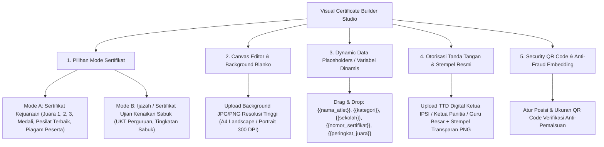

# Editor & Customizer Sertifikat Digital Visual (Visual Certificate Builder & Template Studio)

Dokumen ini memuat analisis, arsitektur teknis, serta rancangan antarmuka **Visual Certificate Builder & Template Studio** pada aplikasi **Arena Silat SaaS**, yang memungkinkan Event Organizer (EO) dan Pengurus Perguruan Silat merancang, mengunggah background desain (*custom blanko*), mengatur tata letak teks (*drag-and-drop placeholder*), tanda tangan digital, stempel hologram, serta mengonfigurasi posisi QR Code verifikasi anti-pemalsuan untuk **Kejuaraan Turnamen** maupun **Ujian Kenaikan Tingkat (UKT) Sabuk**.

---

## 1. Konsep Visual Certificate Builder (WYSIWYG Studio)



---

## 2. Fitur Kunci Halaman Pengaturan Sertifikat (Settings & Builder UI)

Halaman pengaturan sertifikat (`app.arenasilat.com/certificate-studio`) dilengkapi alat bantu visual:

### A. Fitur Canvas Drag & Drop (Pixel-Perfect Alignment)
- **Ukuran Baku Dokumen**: Mendukung format cetak standar internasional **A4 Landscape ($297\text{mm} \times 210\text{mm}$)** atau **A4 Portrait ($210\text{mm} \times 297\text{mm}$)** pada resolusi cetak tajam (300 DPI).
- **Layer & Font Selector**: Mendukung font resmi sertifikat (seperti *Cinzel, Playfair Display, Montserrat, Outfit, Merriweather*) dengan pengaturan ukuran font, warna teks, *letter spacing*, dan perataan teks (*Center / Left / Right*).

---

### B. Daftar Placeholder / Variabel Otomatis (Dynamic Variables)

Panitia dan pengurus perguruan cukup menaruh teks placeholder di atas canvas:

| Variabel Dinamis | Output Data Otomatis pada Sertifikat Kejuaraan | Output Data pada Sertifikat UKT Sabuk |
|---|---|---|
| `{{nama_peserta}}` | Bagas Perkasa | Ahmad Fauzi |
| `{{nomor_identitas}}` | NISN: 0081234567 / NIK: 3201**********0001 | No. KTA Perguruan: TS-2026-0891 |
| `{{asal_instansi}}` | Kontingen Jawa Tengah / SMA Negeri 1 Semarang | Ranting Sleman / Cabang Yogyakarta |
| `{{nama_kegiatan}}` | Kejuaraan Nasional Pencak Silat Piala Menpora 2026 | Ujian Kenaikan Tingkat Sabuk Periode I 2026 |
| `{{prestasi_tingkat}}` | **JUARA 1 (MEDALI EMAS)** | **LULUS SABUK MERAH TINGKAT II** |
| `{{kategori_nomor}}` | Tanding Kelas C Dewasa Putra (55 - 60 kg) | Jenjang Siswa Taruna |
| `{{nomor_sertifikat}}` | No: `CERT/AS-MNP/2026/08912` | No: `UKT/TS-SLM/2026/0041` |
| `{{tanggal_terbit}}` | Semarang, 28 Oktober 2026 | Sleman, 15 November 2026 |
| `{{qr_code_box}}` | Kotak QR Code Verifikasi Publik Resmi | Kotak QR Code Cek KTA & Riwayat Sabuk |

---

### C. Pengaturan Tanda Tangan Digital & Stempel (Signatures & Official Stamps)
- Pengguna dapat menambahkan hingga **4 Tanda Tangan Pejabat Resmi**:
  1. *Kejuaraan*: TTD Ketua Panitia + TTD Pengprov IPSI + TTD Kadispora / Menpora.
  2. *UKT Perguruan*: TTD Ketua Cabang + TTD Ketua Dewan Penguji + TTD Guru Besar.
- **Fitur Proteksi Stempel**: Upload stempel resmi berformat PNG transparan yang posisinya dapat diatur menimpa (*overlay*) tanda tangan digital secara otentik.

---

## 3. Tampilan Antarmuka Pengaturan (UI/UX Mockup Certificate Studio)

```text
+---------------------------------------------------------------------------------------------------------+
|  ARENA SILAT • CERTIFICATE STUDIO                                            [PREVIEW PDF]  [SIMPAN]    |
+-----------------------------------+---------------------------------------------------------------------+
| TOOLBOX & ELEMEN (Kiri)           | CANVAS PREVIEW (A4 Landscape 300 DPI)                               |
|                                   | +-----------------------------------------------------------------+ |
| [+ Upload Background Blanko]      | |  [LOGO EVENT]              [LOGO IPSI]           [LOGO SPONSOR] | |
|                                   | |                                                                 | |
| DRAG PLACEHOLDERS:                | |                      SERTIFIKAT PENGHARGAAN                     | |
| [T] {{nama_peserta}}              | |                     Nomor: {{nomor_sertifikat}}                 | |
| [T] {{prestasi_tingkat}}          | |                                                                 | |
| [T] {{kategori_nomor}}            | |                  Diberikan dengan bangga kepada:                | |
| [T] {{asal_instansi}}             | |                                                                 | |
| [T] {{nomor_sertifikat}}          | |                        {{NAMA_PESERTA}}                         | |
| [T] {{tanggal_terbit}}            | |                     Asal: {{asal_instansi}}                     | |
| [Q] {{qr_code_box}}               | |                                                                 | |
|                                   | |              Atas prestasinya meraih predikat sebagai:          | |
| TANDA TANGAN & STEMPEL:           | |                      {{PRESTASI_TINGKAT}}                       | |
| [+ Tambah Pejabat TTD]            | |                 pada kategori: {{kategori_nomor}}               | |
| • Pejabat 1: Ketua Pengprov IPSI  | |                                                                 | |
| • Pejabat 2: Ketua Panitia        | |   [TTD KETUA IPSI]            [QR VERIFIKASI]      [TTD PANITIA]    | |
| [+ Upload Stempel Transparan PNG] | |   Ketua Pengprov IPSI            Scan via HP       Ketua Panitia    | |
|                                   | +-----------------------------------------------------------------+ |
+-----------------------------------+---------------------------------------------------------------------+
| PENGATURAN TEKS TERPILIH: Font: [Playfair Display v] | Ukuran: [32 pt] | Warna: [#D97706] | Tebal: [B]  |
+---------------------------------------------------------------------------------------------------------+
```

---

## 4. Dua Engine Rendering: Web Preview (Canvas) & Server PDF (Headless Chromium)

Untuk menjamin hasil cetak PDF massal tetap tajam dan ukurannya presisi milimeter:

```mermaid
graph LR
    subgraph Di Layar Browser EO (Fase Desain)
        CANVAS[HTML5 Canvas / SVG Live Drag & Drop Editor]
        JSON_CFG[Export Konfigurasi JSON Koordinat X, Y, Font & QR]
    end

    subgraph Di Server Backend (Fase Cetak Massal)
        API[Node.js Fastify API]
        PUPPETEER[Headless Chromium / PDFKit Engine: Render 300 DPI Vector PDF]
        S3[Cloudflare R2: Simpan PDF Asli Ber-QR Code]
    end

    CANVAS --> JSON_CFG
    JSON_CFG --> API
    API --> PUPPETEER
    PUPPETEER --> S3
```

---

## 5. Skema Database Konfigurasi Template Sertifikat (Certificate Templates)

```sql
-- 1. Tabel Master Desain Template Sertifikat (Certificate Design Templates)
CREATE TABLE certificate_templates (
    id UUID PRIMARY KEY DEFAULT gen_random_uuid(),
    organization_id UUID REFERENCES organizations(id) ON DELETE CASCADE,
    tournament_id UUID REFERENCES tournaments(id) ON DELETE CASCADE, -- Nullable jika template UKT Perguruan
    guild_id UUID REFERENCES martial_arts_guilds(id) ON DELETE CASCADE, -- Nullable jika template Turnamen
    
    template_name VARCHAR(255) NOT NULL, -- Contoh: 'Template Juara 1 Emas Kejurprov 2026'
    template_type VARCHAR(50) NOT NULL, -- 'tournament_achievement', 'tournament_participant', 'belt_grading_pass'
    page_orientation VARCHAR(20) DEFAULT 'landscape', -- 'landscape' atau 'portrait'
    background_image_url VARCHAR(500) NOT NULL, -- URL Blanko Desain HD (JPG/PNG)
    
    -- Konfigurasi Koordinat & Styling Elemen JSON (X, Y, FontSize, Color, Alignment)
    elements_layout_json JSONB NOT NULL,
    -- Contoh payload:
    -- {
    --   "athlete_name": { "x": 148.5, "y": 95.0, "fontSize": 32, "fontFamily": "Cinzel", "color": "#1e293b", "align": "center" },
    --   "achievement": { "x": 148.5, "y": 125.0, "fontSize": 24, "fontFamily": "Montserrat", "color": "#d97706", "align": "center" },
    --   "qr_code": { "x": 148.5, "y": 165.0, "width": 25, "height": 25 }
    -- }
    
    -- Tanda Tangan & Stempel
    signatories_json JSONB,
    -- [
    --   { "title": "Ketua Umum PB IPSI", "name": "Letjen TNI (Purn) ...", "signature_img_url": "...", "x": 50, "y": 175 },
    --   { "title": "Ketua Panitia Pelaksana", "name": "Budi Santoso, M.Pd", "signature_img_url": "...", "x": 247, "y": 175 }
    -- ]
    
    is_default BOOLEAN DEFAULT FALSE,
    created_at TIMESTAMP DEFAULT CURRENT_TIMESTAMP,
    updated_at TIMESTAMP DEFAULT CURRENT_TIMESTAMP
);

-- 2. Relasi Kategori / Sesi UKT ke Template Tertentu
ALTER TABLE categories ADD COLUMN certificate_template_id UUID REFERENCES certificate_templates(id) ON DELETE SET NULL;
ALTER TABLE belt_grading_sessions ADD COLUMN certificate_template_id UUID REFERENCES certificate_templates(id) ON DELETE SET NULL;

-- Indeks Template
CREATE INDEX idx_templates_tournament ON certificate_templates(tournament_id);
CREATE INDEX idx_templates_guild ON certificate_templates(guild_id);
```
