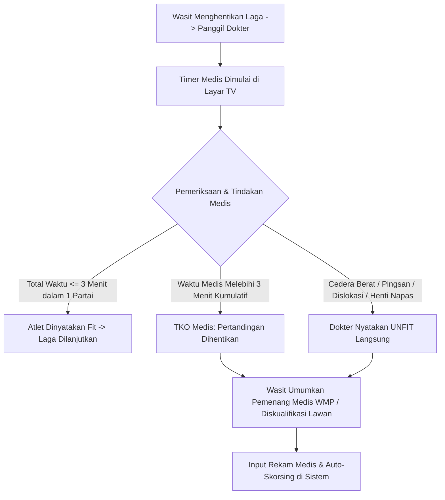
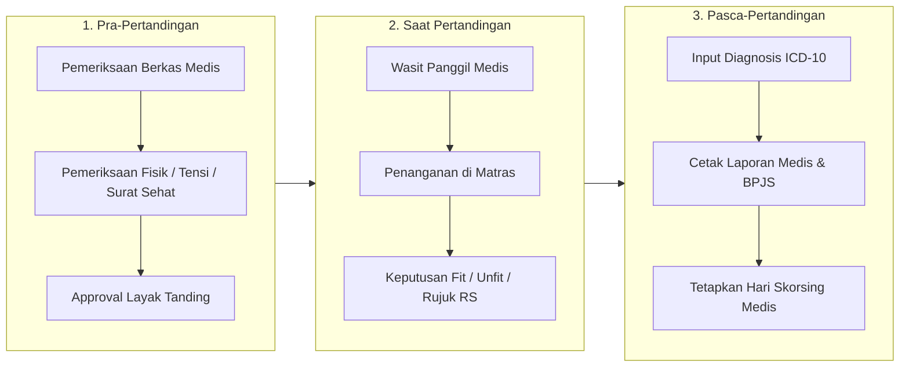

# SOP, Hak Akses & Konsol Digital Dokter / Tim Medis Pertandingan

Dokumen ini mengatur wewenang klinis, batasan waktu penanganan medis di gelanggang, konsol dashboard digital tim medis, protokol penghentian pertandingan (*Medical Stoppage*), serta masa skorsing medis (*Medical Suspension*) pesilat sesuai regulasi resmi PERSILAT dan standar keselamatan kedokteran olahraga.

---

## 1. Wewenang & Kedudukan Klinis Tim Medis

Dalam kejuaraan pencak silat, **Dokter Pertandingan (Match Doctor)** memiliki hak independensi medis mutlak:
1. **Hak Menghentikan Pertandingan (Doctor Stoppage)**:
   - Keputusan dokter pertandingan bahwa atlet tidak layak melanjutkan pertarungan (*Unfit to Fight*) bersifat **final, mengikat, dan tidak dapat diganggu gugat** oleh Wasit, Ketua Pertandingan, Pelatih, maupun Atlet.
2. **Kategori Tim Kesehatan di Lapangan**:
   - **Dokter Pertandingan (Lead Doctor)**: Berizin praktik (SIP aktif), bertugas di samping meja Ketua Pertandingan (KP).
   - **Perawat / Paramedis Gelanggang**: Tim P3K siaga di pojok gelanggang dengan tandu, tabung oksigen, bidai (*splint*), dan *ice pack*.
   - **Driver & Kru Ambulans Evakuasi**: Standby di jalur darurat (*evacuation lane*) venue turnamen.

---

## 2. Aturan Batasan Waktu Medis di Gelanggang (PERSILAT 2022)



1. **Jatah Waktu Medis Kumulatif (Maksimal 3 Menit)**:
   - Setiap atlet memiliki jatah waktu penanganan medis maksimal **180 detik (3 menit) kumulatif** dalam satu partai laga.
   - Jika dokter membutuhkan waktu perawatan melebihi 3 menit, sistem secara otomatis memberi sinyal ke meja KP untuk menghentikan partai (*Menang Medis / Walkover Medis*).
2. **Aturan "One-Touch Stop" (Kasus Pingsan / Gegar Otak / Fraktur)**:
   - Jika terjadi cedera berat (misal: patah tulang terbuka, dislokasi sendi bahu, atau kehilangan kesadaran), dokter tidak perlu menunggu batas 3 menit dan dapat langsung merekomendasikan penghentian partai laga demi keselamatan nyawa pesilat.

---

## 3. Fitur Konsol Digital Dokter (Medical Dashboard)

Tim medis dilengkapi antarmuka tablet/laptop di samping gelanggang:

```
+-------------------------------------------------------------------------------+
| 🏥 ARENA SILAT - KONSOL MEDIS GELANGGANG A                   [DR. HENDRA, Sp.KO]|
+-------------------------------------------------------------------------------+
| PARTAI: #14 - Kelas C Putra Dewasa (Semifinal)                                 |
| MERAH: Bagas Arya (Tapak Suci)  VS  BIRU: Rian Hidayat (PSHT)                 |
+-------------------------------------------------------------------------------+
| ⏱️ TIMER MEDIS GELANGGANG                                                     |
| [ SUDUT MERAH : 00:45 / 03:00 ]           [ SUDUT BIRU : 00:00 / 03:00 ]      |
| [ ▶ START TIMER ] [ ⏸ PAUSE ]            [ ▶ START TIMER ] [ ⏸ PAUSE ]       |
+-------------------------------------------------------------------------------+
| KEPUTUSAN DOKTER PERTANDINGAN:                                                |
| [ ✅ FIT TO CONTINUE ]    [ ⚠️ TKO MEDIS (UNFIT) ]    [ 🚑 EVAKUASI KE RS ]   |
+-------------------------------------------------------------------------------+
| FORMULIR DIAGNOSIS & REKAM CEDERA:                                            |
| Lokasi Cedera: [ Lutut Kanan (Ligamen)      ▼ ]                              |
| Jenis Tindakan: [ Pemasangan Elastic Bandage + Ice Pack                     ] |
| Rekomendasi Skorsing Medis: [ 14 Hari (Dilarang Bertanding)                 ] |
| Klaim Asuransi: [ [v] Trigger Otomatis Surat Rujukan PLKK BPJS-TK ]          |
|                                                                               |
| [ 💾 SIMPAN REKAM MEDIS & SELESAIKAN PARTAI ]                                  |
+-------------------------------------------------------------------------------+
```

### Fitur Kunci:
1. **Sinkronisasi Stopwatch Medis ke Scoreboard TV**:
   - Saat dokter masuk ke matras, operator menekan tombol *Start Medical Timer*. Layar display penonton menampilkan hitung mundur waktu medis sehingga pertandingan transparan dan terukur.
2. **Katalog Cedera Terstandarisasi (ICD-10 Sport Codes)**:
   - Fraktur hidung (*Nasal bone fracture*), Kontusio dada/rusuk, Robek pelipis (*Laceration*), Sprain engkel, Dislokasi siku/bahu, *Concussion* (Gegar otak ringan/sedang).
3. **Penerbitan Surat Skorsing Medis Otomatis (Anti-Sandiwara Atlet KO)**:
   - Atlet yang mengalami KO atau cedera kepala otomatis dijatuhi **Skorsing Medis 30 - 60 Hari**.
   - Sistem menandai NIK/ID atlet berstatus `isMedicallySuspended: true`, sehingga jika atlet yang sama mencoba mendaftar ke kejuaraan lain minggu depan di kota berbeda, pendaftaran otomatis ditolak oleh sistem.

---

## 4. Alur Kerja Sebelum & Sesudah Pertandingan



---

## 5. Skema Basis Data Relasional Tim Medis

```sql
-- 1. Penugasan Tim Medis di Gelanggang
CREATE TABLE tournament_medical_officers (
    id UUID PRIMARY KEY DEFAULT gen_random_uuid(),
    tournament_id UUID NOT NULL REFERENCES tournaments(id),
    user_id UUID REFERENCES users(id),
    full_name VARCHAR(120) NOT NULL,
    sip_number VARCHAR(100) NOT NULL, -- Surat Izin Praktik Dokter
    role_type VARCHAR(30) NOT NULL, -- 'lead_doctor', 'paramedic', 'ambulance_crew'
    assigned_arena_id UUID REFERENCES arenas(id),
    phone_number VARCHAR(20),
    is_active BOOLEAN DEFAULT TRUE,
    created_at TIMESTAMPTZ DEFAULT NOW()
);

-- 2. Log Tindakan Medis Lapangan (Medical Match Log)
CREATE TABLE match_medical_logs (
    id UUID PRIMARY KEY DEFAULT gen_random_uuid(),
    match_id UUID NOT NULL REFERENCES matches(id),
    athlete_id UUID NOT NULL REFERENCES athletes(id),
    doctor_id UUID NOT NULL REFERENCES tournament_medical_officers(id),
    round_number INT NOT NULL,
    intervention_start_time TIMESTAMPTZ NOT NULL,
    duration_seconds INT NOT NULL,
    cumulative_time_seconds INT NOT NULL,
    injury_category VARCHAR(50) NOT NULL, -- 'head_injury', 'joint_dislocation', 'bleeding', 'soft_tissue'
    is_unfit_to_continue BOOLEAN DEFAULT FALSE,
    requires_hospital_referral BOOLEAN DEFAULT FALSE,
    suspension_days_given INT DEFAULT 0,
    clinical_notes TEXT,
    created_at TIMESTAMPTZ DEFAULT NOW()
);
```
