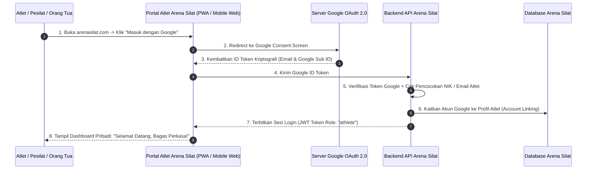
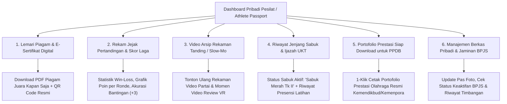
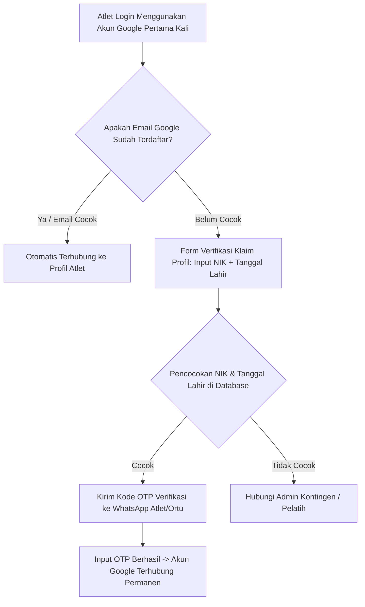

# Portal Atlet Mandiri, Login Google OAuth & Paspor Prestasi Digital (Athlete Self-Service & Digital Career Passport)

Dokumen ini memuat analisis dan rancangan fitur **Portal Atlet Mandiri (Athlete Self-Service Portal)** pada aplikasi **Arena Silat SaaS**, yang memungkinkan setiap atlet/pesilat (dan orang tua murid) login dengan mudah menggunakan **Akun Google (Google Sign-In / OAuth 2.0)** untuk meninjau seluruh rekam jejak karir, riwayat skor pertandingan, video rekaman laga, sertifikat/piagam ber-QR Code, riwayat kenaikan sabuk, hingga pembaruan data berkas pribadi secara mandiri.

---

## 1. Konsep & Arsitektur Login Google Atlet (Google OAuth 2.0 Identity)



---

## 2. Fitur-Fitur Utama di Dashboard Pribadi Atlet (Athlete Self-Service Dashboard)

Setelah login menggunakan akun Google, pesilat memiliki akses penuh ke 6 modul mandiri:



---

## 3. Tampilan Antarmuka Dashboard Mandiri Atlet (Mobile UI Mockup)

```text
======================================================================================================
  ARENA SILAT • PASPOR ATLET DIGITAL                           [👤 Akun Google: bagas@gmail.com]
======================================================================================================
[ FOTO ATLET ]   BAGAS PERKASA (21 Th)                         PERINGKAT NASIONAL: #1 🥇
                 Kontingen: Jawa Tengah • Tapak Suci           KELAS C DEWASA PUTRA (55-60 KG)
                 NIK: 3201**********0001 • NISN: 0081234567    STATUS BPJS: AKTIF 🟢
------------------------------------------------------------------------------------------------------
📊 STATISTIK KARIR BERTANDING:
• Total Partai: 20 Laga (18 Menang - 2 Kalah • Win Rate: 90.0%)
• Total Medali: 4 🥇 Emas | 1 🥈 Perak | 0 🥉 Perunggu
• Akurasi Teknik: Bantingan 95% | Tendangan 88% | Pukulan 80%

🏆 LEMARI PIAGAM & SERTIFIKAT SAYA (4 Piagam):
1. [2026] Juara 1 (Emas) - Kejurnas Silat Piala Menpora   [📥 UNDUH PDF] [🔍 LIHAT QR VERIFIKASI]
2. [2025] Juara 1 (Emas) - Porprov Jawa Tengah            [📥 UNDUH PDF] [🔍 LIHAT QR VERIFIKASI]
3. [2025] Lulus Ujian Sabuk Merah Tingkat II (UKT)        [📥 UNDUH IJAZAH SABUK]

🎬 ARSIP VIDEO TANDING SAYA:
• [Video] Final Kejurnas 2026 vs Sudut Biru (Menang 19-14) -> [▶️ Tonton Laga & Highlight]
• [Video] Momen Jatuhan Bersih di Ronde 2 -> [▶️ Tonton Slow-Mo]

📄 AKSI DOKUMEN:
[ 📑 1-KLIK CETAK PORTOFOLIO RESMI PPDB / BEASISWA ]  [ 📝 UPDATE BERKAS KESEHATAN ]
======================================================================================================
```

---

## 4. Mekanisme Penghubungan Akun Google ke Data Atlet (Account Claim & Linking)

Saat pertama kali atlet mendaftar kejuaraan via pelatih kontingen, akun Google atlet mungkin belum terhubung. Bagaimana cara menghubungkannya?



---

## 5. Fitur "1-Klik Ekspor Portofolio Prestasi PPDB / Beasiswa"

Salah satu fitur paling bermanfaat bagi atlet pelajar dan orang tua:
- **Smart Portfolio Generator**: Menggabungkan seluruh piagam juara, rekor laga resmi, nomor kurasi SIMT Puspresnas, dan surat rekomendasi IPSI ke dalam **1 Berkas PDF Portofolio Resmi Berstempel Digital**.
- **Siap Upload untuk PPDB**: Format dokumen sudah disesuaikan dengan persyaratan dokumen verifikasi jalur prestasi PPDB SMP/SMA/SMK dan beasiswa perguruan tinggi negeri (SNBP Prestasi & Beasiswa Atlet).

---

## 6. Penambahan Skema Database untuk Autentikasi Google OAuth Atlet

```sql
-- 1. Tabel Kredensial Login Sosial Media (User Social Auth Providers)
CREATE TABLE user_social_auth (
    id UUID PRIMARY KEY DEFAULT gen_random_uuid(),
    user_id UUID NOT NULL REFERENCES users(id) ON DELETE CASCADE,
    provider_name VARCHAR(50) NOT NULL DEFAULT 'google', -- 'google', 'apple', 'facebook'
    provider_user_id VARCHAR(255) NOT NULL, -- Google Subject ID unik
    provider_email VARCHAR(255) NOT NULL,
    avatar_url VARCHAR(500),
    linked_at TIMESTAMP DEFAULT CURRENT_TIMESTAMP,
    last_login_at TIMESTAMP DEFAULT CURRENT_TIMESTAMP,
    CONSTRAINT unique_social_provider_account UNIQUE (provider_name, provider_user_id)
);

-- 2. Relasi Profil Atlet ke Akun Pengguna Login
ALTER TABLE athletes ADD COLUMN user_account_id UUID REFERENCES users(id) ON DELETE SET NULL;
ALTER TABLE athletes ADD COLUMN athlete_portal_slug VARCHAR(100) UNIQUE; -- Contoh: 'bagas-perkasa-ts'
ALTER TABLE athletes ADD COLUMN is_profile_claimed BOOLEAN DEFAULT FALSE;
ALTER TABLE athletes ADD COLUMN claimed_at TIMESTAMP;

-- 3. Tabel Bookmark & Koleksi Video Highlight Atlet (Athlete Match Highlights)
CREATE TABLE athlete_saved_match_highlights (
    id UUID PRIMARY KEY DEFAULT gen_random_uuid(),
    athlete_id UUID NOT NULL REFERENCES athletes(id) ON DELETE CASCADE,
    match_id UUID NOT NULL REFERENCES matches(id) ON DELETE CASCADE,
    video_timestamp_start VARCHAR(20),
    video_timestamp_end VARCHAR(20),
    highlight_title VARCHAR(255) NOT NULL, -- 'Bantingan Ronde 2 Final', 'Tendangan T-Kick'
    created_at TIMESTAMP DEFAULT CURRENT_TIMESTAMP
);

-- Indeks Pencarian Profil Login Google
CREATE INDEX idx_social_auth_user ON user_social_auth(provider_name, provider_email);
CREATE INDEX idx_athlete_account ON athletes(user_account_id);
```
