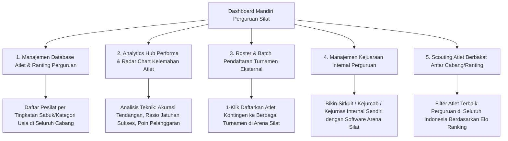

# Portal & Dashboard Analitik Mandiri Perguruan Pencak Silat (Guild / Dojo Analytics Suite)

Dokumen ini memuat arsitektur teknis, desain antarmuka, modul analisis performa atlet internal perguruan, pemantauan riwayat kejuaraan, matriks evaluasi pelatih (*Coach Evaluation Matrix*), serta skema *B2B Subscription / Freemium Access* bagi **Pengurus Pusat / Pengda / Cabang Perguruan Pencak Silat** (seperti Tapak Suci, PSHT, Perisai Diri, Merpati Putih, IKSPI Kera Sakti, Pagar Nusa, dll) di aplikasi **Arena Silat SaaS**.

---

## 1. Mengapa Perguruan Silat Membutuhkan Dashboard Mandiri?

### Kebutuhan & Masalah di Tingkat Perguruan:
1. **Pencatatan Atlet Terpencar**: Perguruan besar memiliki ribuan atlet di ratusan cabang/ranting di seluruh Indonesia, namun pengurus pusat/cabang tidak memiliki database tunggal rekam jejak prestasi atlet mereka.
2. **Evaluasi Pembinaan Berbasis Data (Data-Driven Coaching)**: Pelatih perguruan kesulitan menganalisis secara kuantitatif: *"Mengapa atlet kita sering kalah di ronde 3? Apakah karena stamina fisik drop, teknik bantingan lemah, atau sering kena teguran pelanggaran?"*.
3. **Penyaringan Atlet untuk Kejurnas Internal Perguruan**: Memudahkan perguruan saat mengadakan seleksi atlet internal menuju kejuaraan nasional perguruan (*Kejurnas Tapak Suci / Kejurnas PSHT / Kejurnas Perisai Diri*).

---

## 2. Peta Fitur Portal Analisis Mandiri Perguruan (*Guild Portal Ecosystem*)



---

## 3. Fitur Utama Analitik Pelatih & Perguruan (Coach Analytics Tools)

### A. Grafik Radar Performa Atlet (Athlete Tactical Radar Chart)
Pelatih dapat membuka profil analitik masing-masing atlet binaannya:

```text
               AKURASI PUKULAN (+1)
                     [85/100]
                        /\
                       /  \
     STAMINA RONDE 3  /    \  AKURASI TENDANGAN (+2)
         [70/100]    /      \    [90/100]
                    /   *    \
                    \        /
  KONTROL EMOSI /    \      /   SUKSES BANTINGAN (+3)
 DISIPLIN PELANGGARAN \    /       [95/100]
        [60/100]       \  /
                        \/
                PERTAHANAN / DEFENSE
                     [75/100]
```

*Insight Otomatis Sistem*:
> *"Rekomendasi Pelatih: Atlet ini memiliki eksekusi bantingan (+3) kelas elit (95%), namun sering kehilangan poin karena pelanggaran teguran I & II di ronde 3 saat stamina menurun. Fokus latihan: Kondisioning fisik & kontrol jarak."*

---

### B. Analisis Komparasi Antar Cabang / Ranting Perguruan (Branch Comparison)
Pengurus Pusat Perguruan dapat melihat ranking performa pembinaan cabang daerah:
- *Cabang A (misal: Tapak Suci Yogyakarta)*: 42 Medali Emas (Peringkat 1 Perguruan).
- *Cabang B (misal: Tapak Suci Surabaya)*: 35 Medali Emas.
- *Tingkat Kemenangan Rata-Rata Atlet Perguruan*: **74.5% Win Rate**.

---

### C. Modul Scouting Internal (Talent Scouting Engine)
Pengurus perguruan dapat mencari atlet terbaik perguruannya dengan filter:
- *Filter*: Usia Remaja (15-17 th) $\rightarrow$ Putra $\rightarrow$ Kelas D $\rightarrow$ Elo Rating $> 1.600$.
- Hasil: Menampilkan 5 atlet perguruan terbaik di seluruh Indonesia yang siap dipanggil ke pemusatan latihan (*Training Camp*).

---

## 4. Model Bisnis & Hak Akses Akun Perguruan (Guild Subscription Model)

Sistem menyediakan 2 tingkatan akun untuk perguruan:

| Fitur & Fasilitas | Akun Perguruan Gratis (Basic Tier) | Akun Perguruan Pro / Enterprise (Annual Subscription) |
|---|---|---|
| **Biaya Langganan** | **GRATIS** | **Rp 1.500.000 – Rp 3.500.000 / tahun** per Perguruan |
| **Database Atlet** | Hingga 50 Atlet | **Unlimited Atlet & Cabang Ranting** |
| **Statistik & Rekor Laga** | Statistik Dasar (Menang/Kalah/Medali) | **Full Tactical Analytics, Radar Chart & Export CSV/PDF** |
| **Pendaftaran Turnamen** | Pendaftaran Standar | **Bulk Multi-Tournament Registration + Diskon Biaya Platform** |
| **Kejuaraan Internal** | Biaya Standar Event Pass | **Diskon 30% Sewa Software untuk Kejuaraan Internal Perguruan** |
| **Akses Akun Pelatih** | 2 Akun Pelatih | **Unlimited Sub-Akun Pelatih per Ranting/Cabang** |

---

## 5. Skema Database Khusus Portal Perguruan Silat

```sql
-- 1. Tabel Master Organisasi / Perguruan Silat (Martial Arts Guilds)
CREATE TABLE martial_arts_guilds (
    id UUID PRIMARY KEY DEFAULT gen_random_uuid(),
    guild_name VARCHAR(255) NOT NULL UNIQUE, -- 'Tapak Suci Putera Muhammadiyah', 'Persaudaraan Setia Hati Terate', dll
    slug VARCHAR(100) UNIQUE NOT NULL,
    headquarters_city VARCHAR(100),
    established_year INT,
    logo_url VARCHAR(500),
    subscription_tier VARCHAR(50) DEFAULT 'basic', -- 'basic', 'pro_annual', 'enterprise'
    subscription_expires_at TIMESTAMP,
    created_at TIMESTAMP DEFAULT CURRENT_TIMESTAMP
);

-- 2. Tabel Cabang / Ranting Perguruan (Guild Branches)
CREATE TABLE guild_branches (
    id UUID PRIMARY KEY DEFAULT gen_random_uuid(),
    guild_id UUID NOT NULL REFERENCES martial_arts_guilds(id) ON DELETE CASCADE,
    branch_name VARCHAR(255) NOT NULL, -- 'Cabang Khusus Jakarta Selatan', 'Cabang Bantul', dll
    province VARCHAR(100) NOT NULL,
    city VARCHAR(100) NOT NULL,
    head_coach_name VARCHAR(100),
    contact_phone VARCHAR(20),
    created_at TIMESTAMP DEFAULT CURRENT_TIMESTAMP
);

-- 3. Relasi Atlet ke Cabang Perguruan
ALTER TABLE athletes ADD COLUMN guild_id UUID REFERENCES martial_arts_guilds(id) ON DELETE SET NULL;
ALTER TABLE athletes ADD COLUMN guild_branch_id UUID REFERENCES guild_branches(id) ON DELETE SET NULL;
ALTER TABLE athletes ADD COLUMN belt_level VARCHAR(50); -- Tingkatan Sabuk: 'Kuning', 'Hijau', 'Merah', 'Hitam / Pendekar'

-- 4. Tabel Evaluasi & Catatan Pelatih Internal (Internal Coach Notes & Tactical Analysis)
CREATE TABLE athlete_tactical_evaluations (
    id UUID PRIMARY KEY DEFAULT gen_random_uuid(),
    athlete_id UUID NOT NULL REFERENCES athletes(id) ON DELETE CASCADE,
    coach_user_id UUID NOT NULL REFERENCES users(id) ON DELETE CASCADE,
    evaluation_date DATE NOT NULL,
    punch_rating INT CHECK (punch_rating BETWEEN 1 AND 100),
    kick_rating INT CHECK (kick_rating BETWEEN 1 AND 100),
    drop_technique_rating INT CHECK (drop_technique_rating BETWEEN 1 AND 100),
    defense_rating INT CHECK (defense_rating BETWEEN 1 AND 100),
    stamina_rating INT CHECK (stamina_rating BETWEEN 1 AND 100),
    discipline_rating INT CHECK (discipline_rating BETWEEN 1 AND 100),
    tactical_notes TEXT, -- Catatan rahasia pelatih untuk strategi tanding berikutnya
    is_private_to_guild BOOLEAN DEFAULT TRUE,
    created_at TIMESTAMP DEFAULT CURRENT_TIMESTAMP
);

-- Indeks Pencarian & Filter Analitik Perguruan
CREATE INDEX idx_athletes_guild_branch ON athletes(guild_id, guild_branch_id);
CREATE INDEX idx_evaluations_athlete ON athlete_tactical_evaluations(athlete_id, evaluation_date);
```
