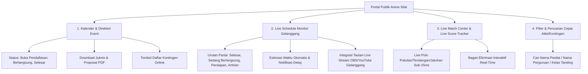

# Arsitektur & Spesifikasi Portal Publik Jadwal Kegiatan & Kalender Turnamen Pencak Silat

Dokumen ini menguraikan arsitektur teknis, struktur data, dan antarmuka **Portal Publik Kalender Event & Live Schedule** untuk platform **Arena Silat**. Portal ini dirancang untuk diakses oleh pesilat, pelatih, ofisial kontingen, orang tua atlet, pengurus federasi IPSI, dan masyarakat umum tanpa kewajiban otentikasi (akses terbuka & teroptimasi SEO).

---

## 1. Tujuan & Kebutuhan Pengguna (User Persona)

1. **Pesilat & Ofisial Kontingen**:
   - Mengetahui kapan atletnya bertanding, berada di Gelanggang mana (A/B/C), dan nomor partai ke berapa.
   - Mendapatkan estimasi jam panggilan atlet ke ruang pemanasan (*warming-up area*) dan *staging area*.
   - Menerima notifikasi *live progress* jika ada perubahan jadwal atau pergeseran partai akibat laga sebelumnya selesai lebih cepat/lambat (*auto-rebalancing*).
2. **Orang Tua & Suporter**:
   - Memantau bagan pertandingan terkini (*live bracket tree*).
   - Menonton tautan *live streaming YouTube/Twitch* per gelanggang.
3. **Calon Peserta Turnamen**:
   - Menemukan kalender kejuaraan terdekat (Piala Menpora, Kejurda, Kejurnas, Kejurkab/Kejurkot, Sirkuit Silat) lengkap dengan link unduh juknis/proposal PDF & formulir pendaftaran.

---

## 2. Fitur Utama Portal Publik Jadwal & Event



---

## 3. Skema Data Relasional & API Publik

### 3.1 DDL Skema Jadwal & Kalender Event

```sql
-- 1. Tabel Kalender Event Publik
CREATE TABLE public_tournaments (
    id UUID PRIMARY KEY DEFAULT gen_random_uuid(),
    slug VARCHAR(120) UNIQUE NOT NULL, -- contoh: 'kejurnas-piala-presiden-2026'
    name VARCHAR(255) NOT NULL,
    organizer VARCHAR(255) NOT NULL,
    sanction_level VARCHAR(50) NOT NULL, -- 'PB_IPSI', 'PENGPROV', 'PENGKAB', 'TERBUKA'
    start_date DATE NOT NULL,
    end_date DATE NOT NULL,
    venue_name VARCHAR(255) NOT NULL,
    city VARCHAR(100) NOT NULL,
    province VARCHAR(100) NOT NULL,
    status VARCHAR(30) DEFAULT 'UPCOMING', -- 'REGISTRATION_OPEN', 'ONGOING', 'COMPLETED'
    proposal_pdf_url TEXT,
    poster_banner_url TEXT,
    total_courts INT DEFAULT 3,
    registration_fee_tanding NUMERIC(12, 2),
    registration_fee_tgr NUMERIC(12, 2),
    created_at TIMESTAMPTZ DEFAULT CURRENT_TIMESTAMP
);

-- 2. Tabel Jadwal Partai Gelanggang
CREATE TABLE match_schedules (
    id UUID PRIMARY KEY DEFAULT gen_random_uuid(),
    tournament_id UUID NOT NULL REFERENCES public_tournaments(id) ON DELETE CASCADE,
    court_number INT NOT NULL, -- 1 = Gelanggang A, 2 = Gelanggang B, 3 = Gelanggang C
    match_order INT NOT NULL, -- Urutan partai #1, #2, #3 dst
    day_number INT NOT NULL, -- Hari ke-1, 2, 3
    session_name VARCHAR(50) NOT NULL, -- 'Pagi (08.00-12.00)', 'Siang (13.00-17.00)', 'Malam'
    estimated_start_time TIMESTAMPTZ NOT NULL,
    actual_start_time TIMESTAMPTZ,
    actual_end_time TIMESTAMPTZ,
    category VARCHAR(30) NOT NULL, -- 'TANDING', 'TUNGGAL', 'GANDA', 'REGU', 'SOLO_KREATIF'
    age_group VARCHAR(50) NOT NULL, -- 'USIA_DINI', 'PRA_REMAJA', 'REMAJA', 'DEWASA'
    weight_class VARCHAR(50) NOT NULL, -- 'Kelas C Putra (55-60kg)'
    round_stage VARCHAR(50) NOT NULL, -- 'Penyisihan', 'Perempat Final', 'Semi Final', 'Final'
    red_athlete_name VARCHAR(150) NOT NULL,
    red_contingent_name VARCHAR(150) NOT NULL,
    blue_athlete_name VARCHAR(150) NOT NULL,
    blue_contingent_name VARCHAR(150) NOT NULL,
    status VARCHAR(30) DEFAULT 'WAITING', -- 'WAITING', 'CALLING_WARMUP', 'ONGOING', 'FINISHED'
    winner_corner VARCHAR(10), -- 'RED' atau 'BLUE'
    score_red INT DEFAULT 0,
    score_blue INT DEFAULT 0,
    created_at TIMESTAMPTZ DEFAULT CURRENT_TIMESTAMP
);

CREATE INDEX idx_match_schedule_lookup ON match_schedules(tournament_id, court_number, match_order);
CREATE INDEX idx_match_schedule_search ON match_schedules(red_athlete_name, blue_athlete_name, red_contingent_name, blue_contingent_name);
```

---

## 4. Pola Aksesibilitas Publik & Anti-Overload (High Traffic)

Saat kejuaraan besar berlangsung, ribuan penonton dan ofisial akan me-*refresh* jadwal secara bersamaan:
1. **Edge CDN Caching (Cache 10 Detik)**:
   - Endpoint publik `/api/public/tournaments/:slug/schedule` di-cache pada level Redis & CDN (Cloudflare/CloudFront) selama 5-10 detik.
2. **WebSocket Pub/Sub Room Gelanggang**:
   - Penonton di halaman detail partai dapat subscribe ke `ws://.../public/court/A` untuk menerima update skor tanpa menembak HTTP request terus-menerus.
3. **Pencarian Cepat Client-Side (Instant Filter)**:
   - Seluruh daftar partai hari itu di-load sekali di awal, memungkinkan ofisial mencari nama atlet atau kontingen secara instan dalam 0ms.
