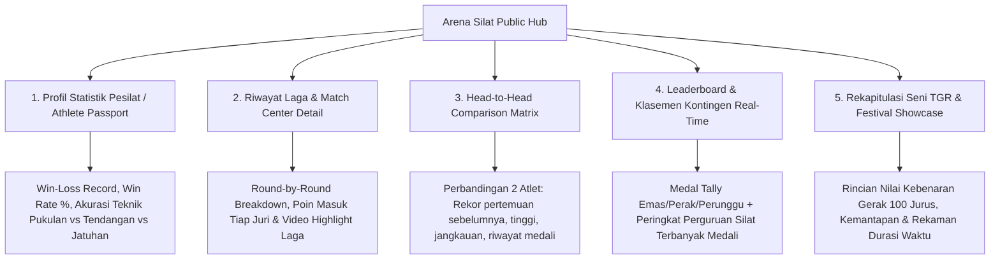

# Portal Publik Statistik, Riwayat Pertandingan & Profil Pesilat (Arena Silat Analytics Hub)

Dokumen ini memuat arsitektur teknis, desain antarmuka publik (*Public Analytics Portal*), metrik performa pesilat, rekapitulasi *Head-to-Head*, klasemen kontingen, serta strategi *caching & read-replica* untuk menangani lonjakan jutaan *traffic* penonton, orang tua, media, dan pemandu bakat (*scout*) tanpa membebani server inti pertandingan.

---

## 1. Mengapa Statistik & Riwayat Publik Sangat Berharga?

1. **Portofolio Talenta & Scouting Atlet (Talent Database)**:
   - Pelatih daerah (Pengcab/Pengprov/Pelatda/Pelatnas) dapat memantau atlet potensial berdasarkan statistik kemenangan, akurasi teknik jatuhan, dan rasio kemenangan mutlak (K.O/WMP).
2. **Keterlibatan Penggemar, Orang Tua & Komunitas (Engagement & Social Sharing)**:
   - Orang tua dan atlet dapat membagikan profil kartu statistik bertanding (*Athlete Trading Card / Match Summary Card*) ke media sosial (Instagram Story / TikTok).
3. **Analisis Taktik & Lawan (Pre-Match Tactical Insights)**:
   - Pelatih dapat mempelajari gaya bertanding lawan berikutnya (apakah lawan kidal, agresif tendangan, atau dominan bantingan).

---

## 2. Peta Fitur Portal Publik Statistik (*Public Analytics Suite*)



---

## 3. Rincian Metrik & Desain Kartu Statistik Pesilat (Athlete Passport)

Pada profil publik atlet (`arenasilat.com/athlete/[athlete-slug]`):

```text
+-------------------------------------------------------------------+
|  [FOTO ATLET]      BAGAS PERKASA (21 Th) - [KONTINGEN JAWA TENGAH]|
|                    Kelas C Dewasa Putra (55 - 60 kg)              |
|                    Perguruan: Tapak Suci Putera Muhammadiyah      |
+-------------------------------------------------------------------+
|  RECORD: 18 Menang - 2 Kalah (Win Rate: 90.0%) | 4 Emas, 1 Perak  |
+-------------------------------------------------------------------+
|  DISTRIBUSI TEKNIK ANDALAN:                                       |
|  • Jatuhan (Bantingan/Guntingan) : 48% (Penyumbang Poin Terbesar)  |
|  • Tendangan Sah (+2)            : 38%                            |
|  • Pukulan Sah (+1)              : 14%                            |
|                                                                   |
|  DISIPLIN & TINGKAT PELANGGARAN:                                  |
|  • Rata-rata Pelanggaran per Partai: 0.3 Poin (Sangat Bersih)    |
|  • Total Kemenangan WMP / K.O      : 5 Partai                     |
+-------------------------------------------------------------------+
|  RIWAYAT TURNAMEN TERAKHIR:                                       |
|  [2026] Kejurnas Silat Piala Menpora -> Juara 1 (Emas) 🏆         |
|  [2025] Porprov Jawa Tengah         -> Juara 1 (Emas) 🏆         |
|  [2025] Kejuaraan Terbuka Pelajar   -> Juara 2 (Perak) 🥈         |
+-------------------------------------------------------------------+
```

---

## 4. Rincian Tampilan Match Center Publik (Detail Riwayat Partai)

Setiap partai pertandingan memiliki halaman arsip permanen (`arenasilat.com/match/[match-id]`):

### Komponen Match Center:
1. **Skor Akhir & Jenis Kemenangan**:
   - Contoh: *Sudut Merah Menang Angka (19 - 14) vs Sudut Biru*.
2. **Grafik Aliran Skor Ronde demi Ronde (Round-by-Round Timeline)**:
   - *Ronde 1*: Merah 6 - 4 Biru.
   - *Ronde 2*: Merah 14 - 9 Biru *(Merah mencetak 2x Jatuhan +3)*.
   - *Ronde 3*: Merah 19 - 14 Biru.
3. **Log Event Penilaian (Transparansi Penuh)**:
   - Menampilkan penanda waktu menit/detik saat terjadinya pukulan, tendangan, bantingan, binaan, teguran, atau pengajuan Video Review (VR).
4. **Tombol Share Kartu Hasil Laga**:
   - Generate otomatis gambar grafis hasil skor berformat *Instagram Story / 9:16 vertical poster* siap unduh.

---

## 5. Arsitektur High-Traffic & Caching (Menangani Jutaan Pengunjung Tanpa Down)

Saat partai final atau kejuaraan besar berlangsung, ribuan orang tua dan pendukung mengakses halaman statistik secara bersamaan:

```mermaid
graph LR
    subgraph Pengunjung Publik (Penonton, Orang Tua, Media)
        USER[Ribuan Smartphone & Browser Publik]
    end

    subgraph CDN & Caching Layer
        EDGE[Cloudflare Global Edge CDN: Cache Halaman Publik 60 Detik]
        REDIS_PUB[Redis Read-Only Cache: Data Statistik Atlet & Medal Standings]
    end

    subgraph Database Utama
        REPLICA[(PostgreSQL Read-Replica Server)]
        MASTER[(PostgreSQL Master Database - Khusus Wasit Juri)]
    end

    USER --> EDGE
    EDGE -->|Cache Miss| REDIS_PUB
    REDIS_PUB -->|Cache Miss| REPLICA
    MASTER -.->|Streaming Asynchronous Replication| REPLICA
```

### Strategi Skalabilitas:
1. **Edge CDN Caching (Cloudflare)**: Halaman profil publik atlet dan klasemen medali di-cache selama **60 detik** di jaringan CDN terdekat dengan pengguna.
2. **Pemisahan Server Master & Read-Replica**:
   - Server **Master**: 100% didedikasikan untuk penekanan tombol skor wasit juri dan operator gelanggang (latensi terlindungi < 15ms).
   - Server **Read-Replica**: Melayani jutaan kueri baca (*read queries*) dari publik tanpa membebani server pertandingan.

---

## 6. Skema Database Statistik & Riwayat Pertandingan Publik

```sql
-- 1. Tabel Agregat Statistik Performa Atlet (Athlete Career Statistics)
CREATE TABLE athlete_career_stats (
    athlete_id UUID PRIMARY KEY REFERENCES athletes(id) ON DELETE CASCADE,
    total_matches INT DEFAULT 0,
    matches_won INT DEFAULT 0,
    matches_lost INT DEFAULT 0,
    win_rate_percentage DECIMAL(5,2) DEFAULT 0.00,
    
    -- Perolehan Medali
    gold_medals_count INT DEFAULT 0,
    silver_medals_count INT DEFAULT 0,
    bronze_medals_count INT DEFAULT 0,
    
    -- Rincian Teknik Poin
    total_punches_scored INT DEFAULT 0,
    total_kicks_scored INT DEFAULT 0,
    total_drops_scored INT DEFAULT 0, -- Jatuhan
    total_wmp_ko_wins INT DEFAULT 0,  -- Kemenangan mutlak
    
    -- Disiplin & Hukuman
    total_reprimands INT DEFAULT 0,
    total_warnings INT DEFAULT 0,
    
    last_updated_at TIMESTAMP DEFAULT CURRENT_TIMESTAMP
);

-- 2. Tabel Rekap Head-to-Head Pertemuan Atlet (Head-to-Head Records)
CREATE TABLE athlete_head_to_head (
    id UUID PRIMARY KEY DEFAULT gen_random_uuid(),
    athlete_a_id UUID NOT NULL REFERENCES athletes(id) ON DELETE CASCADE,
    athlete_b_id UUID NOT NULL REFERENCES athletes(id) ON DELETE CASCADE,
    total_encounters INT DEFAULT 0,
    athlete_a_wins INT DEFAULT 0,
    athlete_b_wins INT DEFAULT 0,
    last_match_id UUID REFERENCES matches(id) ON DELETE SET NULL,
    last_matched_at TIMESTAMP,
    CONSTRAINT unique_athlete_pair UNIQUE (athlete_a_id, athlete_b_id)
);

-- 3. View Statistik Publik Teroptimasi (Fast Materialized View)
CREATE MATERIALIZED VIEW mv_public_leaderboard AS
SELECT 
    c.id AS contingent_id,
    c.name AS contingent_name,
    c.tournament_id,
    COUNT(CASE WHEN mp.final_score > 0 AND mp.is_winner = TRUE THEN 1 END) AS total_wins,
    COUNT(CASE WHEN cert.achievement_title ILIKE '%Emas%' OR cert.achievement_title ILIKE '%Juara 1%' THEN 1 END) AS total_gold,
    COUNT(CASE WHEN cert.achievement_title ILIKE '%Perak%' OR cert.achievement_title ILIKE '%Juara 2%' THEN 1 END) AS total_silver,
    COUNT(CASE WHEN cert.achievement_title ILIKE '%Perunggu%' OR cert.achievement_title ILIKE '%Juara 3%' THEN 1 END) AS total_bronze
FROM contingents c
LEFT JOIN athletes a ON a.contingent_id = c.id
LEFT JOIN match_participants mp ON mp.athlete_id = a.id
LEFT JOIN tournament_certificates cert ON cert.athlete_id = a.id
GROUP BY c.id, c.name, c.tournament_id;

-- Indexing Cepat untuk Halaman Publik
CREATE INDEX idx_career_stats_wins ON athlete_career_stats(matches_won DESC, gold_medals_count DESC);
CREATE INDEX idx_h2h_pair ON athlete_head_to_head(athlete_a_id, athlete_b_id);
```
