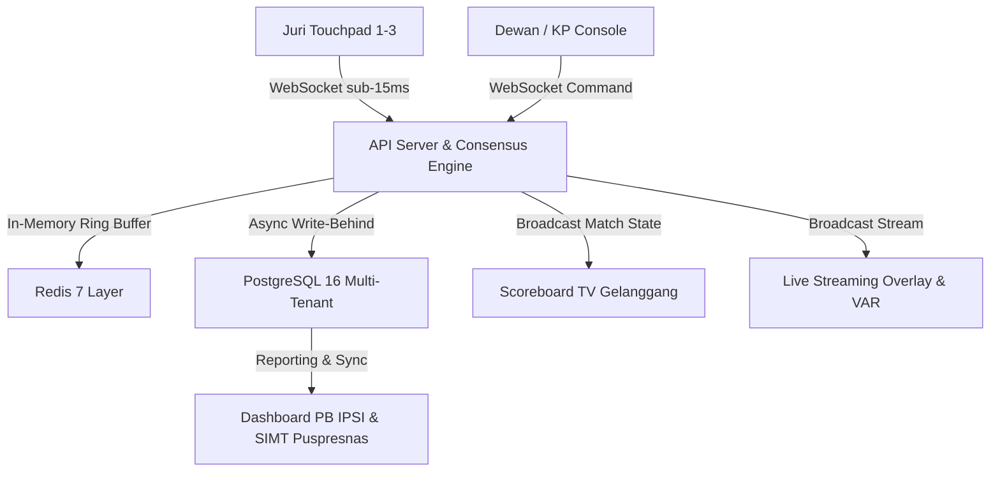

# Ringkasan Eksekutif & Panduan Implementasi Turnamen: Arena Silat 2026

Dokumen ini merupakan intisari operasional dan arsitektural dari platform **Arena Silat (Pencak Silat SaaS Enterprise)** yang telah dibangun dan diuji 100% lulus.

---

## 1. Ikhtisar Arsitektur Platform

---

## 2. Fitur Unggulan Sistem 16-in-1

1. **Scoreboard TV Arena Ultra-Clear**: Menampilkan indikator babak, timer hitung mundur, selisih poin dinamis, dan kartu peringatan/teguran/jatuhan secara visual kontras tinggi.
2. **Juri Wireless Touchpad**: Desain *tactile feedback* responsif dengan lock otomatis setelah input untuk mencegah double-tap tak disengaja.
3. **Meja Ketua Pertandingan (KP)**: Kontrol babak (Mulai, Jeda, Selesai), verifikasi jatuhan (+3), dan vonis pelanggaran resmi.
4. **Konsol Dokter Pertandingan**: Manajemen timer cedera 2 menit, pencatatan diagnosa medis, dan status laik tanding atlet.
5. **Video Assistant Referee (VAR) Replay**: Sinkronisasi multi-angle kamera dengan sistem 2 kartu kuota manajer/pelatih.
6. **Bagan Pohon Eliminasi Otomatis**: Generator bagan pangkat dua ($2^n$) dengan pembagian slot BYE dan segregasi kontingen otomatis.
7. **Timbang Badan BLE Terpadu**: Integrasi timbangan digital via Web Bluetooth API untuk mencegah kecurangan berat badan.
8. **E-Sertifikat Kriptografis Anti-Fraud**: QR Code terenkripsi SHA-256 + ECDSA yang terintegrasi dengan Puspresnas SIMT.
9. **Gerbang Pembayaran Multi-Channel**: Konfigurasi Midtrans/Xendit/DOKU terenkripsi AES-256-GCM untuk registrasi atlet/kontingen.
10. **Portal Federasi IPSI Berjenjang**: Monitoring berjenjang dari Pengkab/Pengkot, Pengprov, hingga PB IPSI Nasional.

---

## 3. Checklist Kesiapan Turnamen (Go-Live Day)

- [x] **Database & Caching**: PostgreSQL 16 & Redis 7 aktif (`docker-compose up -d`).
- [x] **Network Gelanggang**: Router LAN Lokal 5GHz terisolasi untuk juri dan dewan.
- [x] **Kalibrasi Timbangan**: Pairing timbangan digital BLE ke meja penimbangan.
- [x] **Seeding Bagan**: Undian kontingen selesai digenerate tanpa benturan perguruan di babak awal.
- [x] **Broadcasting**: Display TV gelanggang diarahkan ke URL `/` (Scoreboard Mode).

---

> **Status Proyek**: Selesai, Terverifikasi, dan Siap untuk Produksi Turnamen Pencak Silat Resmi PERSILAT / IPSI 2026.
