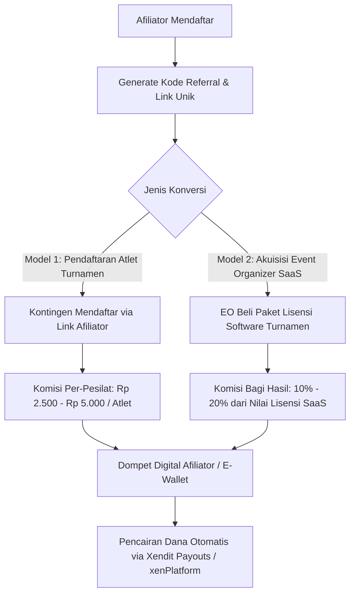

# Sistem Afiliasi, Referral & Komisi Multi-Tier ArenaSilat

Dokumen ini menjelaskan model bisnis, arsitektur data, alur pelacakan referral (*cookie / referral code*), pembagian komisi otomatis (*Affiliate Commission Split*), serta konsol dashboard bagi **Afiliator (Influencer Silat, Wasit Juri Senior, Pelatih Tokoh, dan Brand Ambassador)**.

---

## 1. Konsep & Peran Afiliator dalam Ekosistem

Sistem afiliasi di platform ArenaSilat dirancang untuk mempercepat pertumbuhan adopsi SaaS kejuaraan pencak silat di seluruh Indonesia secara organik dengan memberdayakan:
1. **Wasit Juri / Pengurus Pengcab & Pengprov IPSI**: Merekrut event organizer lokal untuk menggunakan software scoring digital ArenaSilat.
2. **Pelatih & Tokoh Perguruan Besar**: Mengajak ranting-ranting atau cabang perguruan di daerah untuk mendaftarkan kontingennya ke turnamen resmi melalui platform.
3. **Kreator Konten & Media Silat**: Mempromosikan link pendaftaran kejuaraan atau langganan software melalui media sosial (TikTok, Instagram, YouTube).

---

## 2. Model Skema Komisi & Referral

Platform mendukung 2 jenis model komisi afiliasi:



### A. Model 1: Komisi Registrasi Atlet (Event Participant Referral)
- **Target**: Kontingen / Perguruan yang mendaftar kejuaraan.
- **Reward**: Rp 2.500 – Rp 5.000 per atlet yang terverifikasi dan membayar lunas.
- **Contoh**: Jika seorang afiliator berhasil mengajak 10 kontingen dengan total 200 atlet, ia mendapatkan komisi instan **Rp 1.000.000**.

### B. Model 2: Komisi SaaS Turnamen (Event Organizer Acquisition)
- **Target**: Panitia / Pengkab IPSI yang membeli paket lisensi kejuaraan (*SaaS Pro / Enterprise* seharga Rp 2.500.000 - Rp 10.000.000).
- **Reward**: Komisi tetap **10% - 15%** dari total nilai lisensi SaaS per kejuaraan.

---

## 3. Mekanisme Pelacakan (Tracking Engine)

1. **Kode Kupon / Voucher Diskon**:
   - Pendaftar mendapatkan diskon pendaftaran (misal potongan Rp 5.000 / atlet) jika memasukkan kode kupon afiliator (contoh: `SILATJUARA2026`, `TAPAKSUCI-BAGAS`).
2. **Link Referral & Cookie Attribution**:
   - URL: `https://arenasilat.id/event/kejurnas-2026?ref=BAGAS99`
   - Cookie pelacakan berlaku selama **30 hari** (*Last-Click Attribution*).
3. **Anti-Fraud & Self-Referral Prevention**:
   - Sistem melarang afiliator mendapatkan komisi dari pendaftaran dirinya sendiri (validasi kesamaan NIK, email, dan nomor rekening penarikan).

---

## 4. Skema Database Relasional Afiliasi

```sql
-- 1. Master Profil Afiliator
CREATE TABLE affiliate_partners (
    id UUID PRIMARY KEY DEFAULT gen_random_uuid(),
    user_id UUID NOT NULL REFERENCES users(id) ON DELETE CASCADE,
    referral_code VARCHAR(30) UNIQUE NOT NULL, -- 'BAGAS-SILAT'
    commission_type VARCHAR(30) DEFAULT 'PERCENTAGE_AND_FLAT',
    athlete_fee_reward NUMERIC(10,2) DEFAULT 3000.00, -- Rp 3.000 / atlet
    saas_license_share_percent NUMERIC(5,2) DEFAULT 12.50, -- 12.5% dari paket event
    total_earnings NUMERIC(12,2) DEFAULT 0.00,
    available_balance NUMERIC(12,2) DEFAULT 0.00,
    withdrawn_balance NUMERIC(12,2) DEFAULT 0.00,
    bank_name VARCHAR(50) NOT NULL,
    bank_account_number VARCHAR(50) NOT NULL,
    bank_account_name VARCHAR(150) NOT NULL,
    status VARCHAR(20) DEFAULT 'ACTIVE', -- 'PENDING', 'ACTIVE', 'SUSPENDED'
    created_at TIMESTAMP WITH TIME ZONE DEFAULT CURRENT_TIMESTAMP
);

-- 2. Log Riwayat Referral & Konversi
CREATE TABLE affiliate_conversions (
    id UUID PRIMARY KEY DEFAULT gen_random_uuid(),
    affiliate_id UUID NOT NULL REFERENCES affiliate_partners(id),
    conversion_type VARCHAR(30) NOT NULL, -- 'ATHLETE_REGISTRATION', 'SAAS_LICENSE'
    event_id UUID REFERENCES events(id),
    invoice_id UUID REFERENCES invoices(id),
    buyer_user_id UUID REFERENCES users(id),
    gross_amount NUMERIC(12,2) NOT NULL,
    earned_commission NUMERIC(12,2) NOT NULL,
    payout_status VARCHAR(30) DEFAULT 'APPROVED', -- 'PENDING_REVIEW', 'APPROVED', 'PAID', 'CANCELLED'
    created_at TIMESTAMP WITH TIME ZONE DEFAULT CURRENT_TIMESTAMP
);

-- 3. Riwayat Penarikan Dana (Disbursement Payouts)
CREATE TABLE affiliate_payouts (
    id UUID PRIMARY KEY DEFAULT gen_random_uuid(),
    affiliate_id UUID NOT NULL REFERENCES affiliate_partners(id),
    payout_reference VARCHAR(100) UNIQUE NOT NULL, -- 'WD-XND-2026-0091'
    amount NUMERIC(12,2) NOT NULL,
    payout_method VARCHAR(50) DEFAULT 'XENDIT_DISBURSEMENT',
    xendit_disbursement_id VARCHAR(100),
    status VARCHAR(30) DEFAULT 'COMPLETED', -- 'PENDING', 'COMPLETED', 'FAILED'
    disbursed_at TIMESTAMP WITH TIME ZONE,
    created_at TIMESTAMP WITH TIME ZONE DEFAULT CURRENT_TIMESTAMP
);
```

---

## 5. Otomasi Penarikan Dana (Instant Payout via Xendit)

Afiliator dapat melakukan penarikan saldo komisi kapan saja dengan saldo minimal **Rp 50.000**:
1. Afiliator menekan tombol **"Tarik Komisi (Withdraw)"** pada dashboard.
2. Backend ArenaSilat memanggil API Xendit Disbursements:
   ```json
   {
     "external_id": "WD-BAGAS-2026-04",
     "amount": 1250000,
     "bank_code": "BCA",
     "account_holder_name": "Bagas Arya Pradana",
     "account_number": "0819283921",
     "description": "Pencairan Komisi Afiliasi ArenaSilat Kejurnas 2026"
   }
   ```
3. Dana langsung masuk ke rekening bank/E-Wallet afiliator dalam hitungan detik (*Realtime Interbank Transfer 24/7*).
