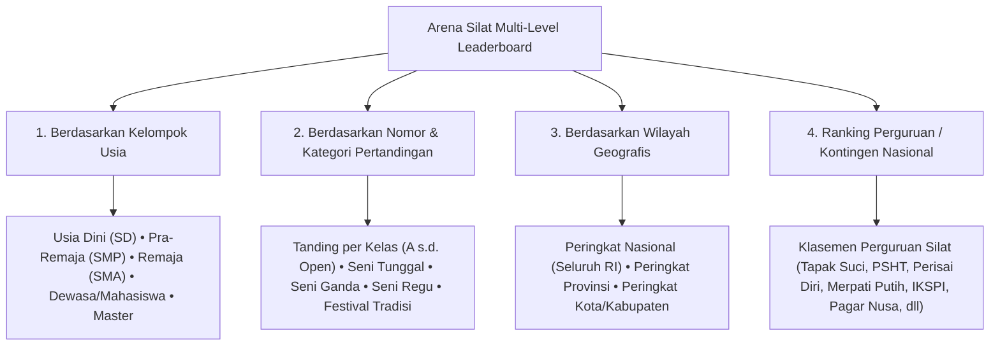

# Sistem Ranking Nasional & Multi-Level Leaderboard Pesilat (Silat Elo-Rating & Standings System)

Dokumen ini memuat analisis dan rancangan arsitektur pemeringkatan pesilat (*National & Regional Athlete Ranking System*), formula algoritma poin Elo (*Dynamic Elo-Rating for Martial Arts*), sistem pembobotan berdasarkan tingkatan kejuaraan, serta struktur leaderboard publik berbasis kategori usia, kelas tanding, nomor Seni TGR, dan kontingen/perguruan pada platform **Arena Silat SaaS**.

---

## 1. Mengapa Sistem Ranking & Leaderboard Sangat Diperlukan?

1. **Standarisasi Seeding Unggulan (Seeded Athletes in Tournaments)**:
   - Menghilangkan penentuan atlet unggulan secara subjektif saat *drawing* bagan. Pesilat peringkat 1–4 otomatis menempati posisi slot unggulan bagan (*top & bottom seed positions*).
2. **Pemanggilan Pelatda / Pelatnas & Jalur Beasiswa Olahraga**:
   - Pengurus IPSI (Pengcab/Pengprov/PB IPSI) dan Kemenpora dapat langsung melihat ranking resmi pesilat nomor 1 Indonesia di Kelas C Dewasa Putra atau Jurus Baku Tunggal Putri berdasarkan akumulasi performa objektif.
3. **Motivasi Berkelanjutan bagi Pesilat & Perguruan (Gamification & Engagement)**:
   - Atlet dan perguruan silat termotivasi untuk aktif mengikuti sirkuit turnamen demi mendongkrak peringkat nasional mereka.

---

## 2. Struktur Multi-Level Leaderboard Publik

Sistem menyediakan filter multi-dimensi pada halaman publik `arenasilat.com/rankings`:



---

## 3. Algoritma Perhitungan Poin Ranking (Silat Weighted-Elo Engine)

Sistem menggunakan formula perolehan poin yang mengombinasikan **Poin Prestasi Kejuaraan (Tournament Weighting)** dan **Dynamic Elo Rating per Pertandingan**:

### A. Bobot Tingkatan Kejuaraan (Tournament Tier Multiplier)
Setiap tingkatan turnamen memiliki koefisien pengali bobot yang berbeda:

| Tingkatan Kejuaraan (Event Tier) | Bobot Poin ($T_{tier}$) | Keterangan & Standar Sanction |
|---|---|---|
| **Tier 1: Kejuaraan Dunia / SEA Games / PON** | **1.00 (Maksimal)** | Event Elit Resmi Terakreditasi PERSILAT / KONI |
| **Tier 2: Kejurnas / POMNAS / POPNAS / Kejurprov** | **0.75** | Event Resmi Pengprov IPSI / BAPOMI / BAPOPSI |
| **Tier 3: Kejurcab / Kejuaraan Nasional Terbuka (Open)** | **0.50** | Event Terbuka Resmi Pengcab IPSI / Dispora |
| **Tier 4: Kejuaraan Antar Pelajar / Ranting Lokal** | **0.25** | Event Grassroot / Pemasalan Lokal |

---

### B. Formula Poin Perolehan Medali ($P_{medal}$)
$$\text{Poin Prestasi} = P_{\text{base}} \times T_{\text{tier}}$$
* **Juara 1 (Medali Emas)**: $P_{\text{base}} = 1.000\text{ Poin}$
* **Juara 2 (Medali Perak)**: $P_{\text{base}} = 600\text{ Poin}$
* **Juara 3 Bersama (Medali Perunggu)**: $P_{\text{base}} = 350\text{ Poin}$
* **Peserta Lolos Perempat Final (8 Besar)**: $P_{\text{base}} = 150\text{ Poin}$
* **Pesilat Terbaik (Best Athlete Bonus)**: $+200\text{ Poin Tambahan}$

---

### C. Formula Dynamic Match Elo Rating (Poin Duel Head-to-Head)
Setiap kali pesilat memenangkan sebuah partai laga:
$$R_{\text{new}} = R_{\text{old}} + K \times (S - E)$$
* $K$ = Faktor bobot laga ($K = 32$ untuk final, $K = 24$ untuk penyisihan).
* $S$ = Skor hasil laga ($1$ jika menang, $0$ jika kalah).
* $E$ = Ekspektasi probabilitas menang berdasarkan selisih rating sebelumnya.
* **Bonus Kemenangan Telak**: Jika menang secara **K.O / WMP (Wasit Menghentikan Pertandingan)**, pesilat mendapat bonus $+5$ poin Elo tambahan.

---

## 4. Tampilan Antarmuka Leaderboard Publik (UI/UX Mockup)

```text
======================================================================================================
  ARENA SILAT NATIONAL RANKINGS • TAHUN 2026
  Filter: [DEWASA] • [PUTRA] • [TANDING: KELAS C (55-60 KG)] • [SKALA: NASIONAL]
======================================================================================================
Rank   Nama Pesilat           Kontingen / Perguruan              Rating Elo   Total Poin   Rekor Laga
------------------------------------------------------------------------------------------------------
 #1 🥇 Bagas Perkasa          Jawa Tengah (Tapak Suci)             1,842       3,450 pts    18-2 (90%)
 #2 🥈 Fauzan Azhim           DKI Jakarta (Persinas ASAD)          1,790       3,120 pts    16-3 (84%)
 #3 🥉 Rian Hidayat           Jawa Barat (Perisai Diri)            1,735       2,890 pts    15-4 (78%)
 #4    Dimas Arya             Jawa Timur (PSHT)                    1,680       2,600 pts    14-5 (73%)
 #5    M. Rizky Pratama       Sumatera Barat (Merpati Putih)       1,610       2,250 pts    12-4 (75%)
======================================================================================================
```

---

## 5. Skema Database Leaderboard & Dynamic Ranking

```sql
-- 1. Tabel Master Peringkat Pesilat per Kategori (Athlete Category Rankings)
CREATE TABLE athlete_category_rankings (
    id UUID PRIMARY KEY DEFAULT gen_random_uuid(),
    athlete_id UUID NOT NULL REFERENCES athletes(id) ON DELETE CASCADE,
    age_group age_group_type NOT NULL,
    gender gender_type NOT NULL,
    match_type match_category_type NOT NULL, -- 'tanding', 'tunggal', 'ganda', 'regu'
    class_name VARCHAR(50) NOT NULL, -- 'Kelas C', 'Jurus Tunggal Baku', dll
    
    -- Metrik Poin & Rating
    elo_rating INT NOT NULL DEFAULT 1200, -- Rating awal standar catur/martial arts
    accumulated_tournament_points DECIMAL(10,2) NOT NULL DEFAULT 0.00,
    national_rank_position INT,
    regional_rank_position INT, -- Ranking tingkat provinsi
    
    -- Riwayat Prestasi di Kategori Ini
    total_gold INT DEFAULT 0,
    total_silver INT DEFAULT 0,
    total_bronze INT DEFAULT 0,
    total_matches_played INT DEFAULT 0,
    
    last_calculated_at TIMESTAMP DEFAULT CURRENT_TIMESTAMP,
    CONSTRAINT unique_athlete_ranked_class UNIQUE (athlete_id, age_group, match_type, class_name)
);

-- 2. Tabel Log Riwayat Perubahan Poin Ranking (Ranking History Logs)
CREATE TABLE ranking_history_logs (
    id UUID PRIMARY KEY DEFAULT gen_random_uuid(),
    athlete_id UUID NOT NULL REFERENCES athletes(id) ON DELETE CASCADE,
    tournament_id UUID REFERENCES tournaments(id) ON DELETE CASCADE,
    match_id UUID REFERENCES matches(id) ON DELETE SET NULL,
    change_type VARCHAR(50) NOT NULL, -- 'match_win', 'match_loss', 'tournament_gold', 'season_decay'
    points_delta DECIMAL(8,2) NOT NULL, -- Perubahan poin (+50, -12, dll)
    new_total_points DECIMAL(10,2) NOT NULL,
    new_elo_rating INT NOT NULL,
    recorded_at TIMESTAMP DEFAULT CURRENT_TIMESTAMP
);

-- 3. Tabel Klasemen Perguruan Silat Nasional (School/Guild Leaderboard)
CREATE TABLE martial_arts_guild_rankings (
    id UUID PRIMARY KEY DEFAULT gen_random_uuid(),
    guild_name VARCHAR(255) NOT NULL UNIQUE, -- 'Tapak Suci', 'PSHT', 'Perisai Diri', 'Merpati Putih', dll
    total_active_athletes INT DEFAULT 0,
    total_gold_all_time INT DEFAULT 0,
    total_silver_all_time INT DEFAULT 0,
    total_bronze_all_time INT DEFAULT 0,
    national_prestige_points DECIMAL(12,2) DEFAULT 0.00,
    rank_position INT,
    last_updated_at TIMESTAMP DEFAULT CURRENT_TIMESTAMP
);

-- Indeks Kecepatan Render Leaderboard Publik
CREATE INDEX idx_rankings_query ON athlete_category_rankings(age_group, gender, match_type, class_name, accumulated_tournament_points DESC);
CREATE INDEX idx_elo_query ON athlete_category_rankings(elo_rating DESC);
```

---

## 6. Fitur Penurunan Poin Musiman (Annual Rating Decay)

Untuk menjaga agar ranking tetap relevan dan adil (mencegah atlet tidak aktif terus berada di peringkat 1):
* **Siklus 12 Bulan (Annual Decay)**: Poin turnamen yang diperoleh lebih dari 12 bulan lalu akan terdepresiasi sebesar **25% per kuartal** jika atlet tidak aktif mengikuti turnamen resmi baru dalam kurun waktu 1 tahun.
