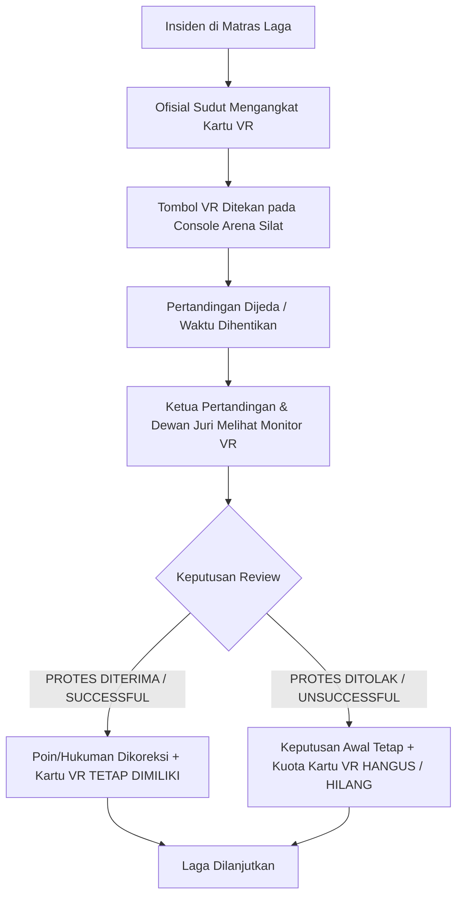
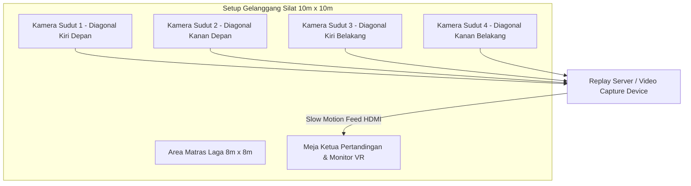

# Sistem Video Assistant Referee (VAR) / Video Review (VR) pada Pencak Silat

Dokumen ini menjelaskan secara komprehensif mengenai penerapan sistem **Video Assistant Referee (VAR)** atau dalam regulasi resmi PERSILAT / IPSI disebut **Video Review (VR)**, mencakup dasar aturan, alur pengajuan protes kartu ofisial, aspek teknis perangkat kamera, tata cara pengambilan keputusan oleh Dewan Juri, serta integrasi modul perangkat lunak pada aplikasi **Arena Silat**.

---

## BAGIAN 1: Apa itu VAR / Video Review dalam Pencak Silat?

Dalam kejuaraan Pencak Silat modern (berdasarkan Aturan Pertandingan PERSILAT 2022 / Standar IPSI terkini), **Video Review (VR)** adalah instrumen teknologi yang memungkinkan **Ofisial Sudut (Pelatih/Pendamping)** atau **Ketua Pertandingan (KP)** meminta peninjauan ulang rekaman video gerakan lambat (*slow-motion instant replay*) atas suatu insiden penting yang diragukan kebenarannya di atas matras gelanggang.

Tujuan utama VR adalah:
1. **Menghilangkan Kesalahan Manusia (*Zero Human Error*)**: Memastikan poin sah yang terlewat oleh juri atau pelanggaran fatal yang luput dari penglihatan wasit dapat dikoreksi secara adil.
2. **Mencegah Kericuhan & Protes Anarkis**: Menyediakan saluran banding yang resmi, terukur, dan transparan sehingga keputusan akhir tidak dapat diganggu gugat.
3. **Meningkatkan Martabat & Profesionalitas Silat**: Menjadikan Pencak Silat setara dengan cabang olahraga Olimpiade (seperti Taekwondo, Karate, Anggar, dan Sepakbola).

---

## BAGIAN 2: Aturan & Kuota Pengajuan Kartu Protes VR



### 1. Kuota Kartu VR per Partai
- Setiap sudut (Merah dan Biru) diberikan **1 Kartu VR (atau 2 Kartu tergantung tingkatan kejuaraan)** di awal pertandingan.
- **Aturan Kepemilikan Kartu**:
  - Jika protes yang diajukan **DITERIMA (Benar)** oleh Dewan Juri, maka **kuota kartu VR TIDAK BERKURANG** (sudut tersebut masih berhak mengajukan VR lagi di ronde berikutnya).
  - Jika protes yang diajukan **DITOLAK (Salah/Tidak Terbukti)**, maka **kartu VR HANGUS / HILANG** untuk sisa pertandingan tersebut.

---

### 2. Batasan Hal yang Boleh & Tidak Boleh Diajukan VR

| Boleh Diajukan Video Review (Eligible) | TIDAK Boleh Diajukan Video Review (Non-Eligible) |
|---|---|
| **1. Sah / Tidaknya Poin Jatuhan**: Apakah bantingan diawali tarikan terlarang, apakah ada 3 langkah tangkapan, atau anggota tubuh penyerang jatuh duluan. | **1. Keputusan Wasit Terkait Aba-aba**: Pertanyaan subjektif kapan wasit harus meneriakkan *"TIADA"* atau *"BERHENTI"*. |
| **2. Serangan Masuk**: Tendangan atau pukulan telak yang tidak dinilai oleh juri (kurang konsensus). | **2. Waktu yang Sudah Lewat Jauh**: Protes insiden di ronde 1 yang baru diajukan saat ronde 2/3 sedang berjalan. |
| **3. Pelanggaran Serius**: Memukul wajah/leher/kemaluan, menggigit, atau menyerang saat wasit sudah menghentikan laga (*hit after break*). | **3. Keputusan Medis**: Penentuan apakah atlet mampu bertanding atau tidak oleh dokter pertandingan. |
| **4. Jatuh Sendiri vs Dijatuhkan Lawan**. | **4. Tindakan Tidak Terkait Poin**: Sikap/perilaku penonton atau ofisial di luar matras. |

---

## BAGIAN 3: Spesifikasi Hardware & Posisi Sudut Kamera VAR

Agar peninjauan video akurat dari segala sudut pandang tanpa titik buta (*blind spot*), sistem VAR di gelanggang silat minimal menggunakan **2 hingga 4 Kamera High-Frame-Rate (60 fps / 120 fps)**:



### Komponen Perangkat VAR:
1. **Opsi 1: Kamera Profesional PTZ / Camcorder (1080p 60fps / 4K)**:
   - Ditempatkan di sudut luar matras dengan kabel HDMI/SDI ke Video Capture Card.
2. **Opsi 2: Smartphone / HP Android & iPhone (Sangat Memungkinkan & Efisien)**:
   - Menggunakan kamera HP (1080p 60fps) yang dipasang pada tripod di sudut matras.
   - Mengirim video feed secara real-time ke laptop/server replay lokal melalui:
     - **Protokol NDI (Network Device Interface)**: Menggunakan aplikasi seperti *NDI HX Camera / DroidCam OBS / Iriun 4K* via Wi-Fi 5GHz/6GHz lokal.
     - **Kabel USB Tethering / Type-C Direct Capture**: Memberikan latensi terendah (< 50ms) dan pengisian daya baterai tanpa henti (*continuous charging*).
     - **WebRTC / RTSP Local Stream**: Membuka browser kamera pada HP langsung terkoneksi ke server lokal Arena Silat.
3. **Replay Controller & Software**:
   - Laptop / Mini PC Operator dengan software instant replay (seperti OBS Studio Replay Plugin, vMix, atau modul web-replay bawaan Arena Silat).
   - Kontrol maju-mundur *slow-motion frame-by-frame* menggunakan keyboard shortcut atau jog-wheel.
4. **Monitor Khusus Ketua Pertandingan (21 - 27 inch)**:
   - Layar tertutup menghadap KP dan Dewan Hakim.

---

## BAGIAN 4: Integrasi Modul Video Review pada Software Arena Silat

Aplikasi **Arena Silat** mencatat riwayat kartu VR secara real-time pada database pertandingan dan menampilkan status kartu di Layar Papan Skor Gelanggang (*Arena Display Scoreboard*):

```sql
-- 1. Tambahan Kolom Status Kuota Kartu VR pada Tabel Matches
ALTER TABLE matches ADD COLUMN red_vr_cards_remaining INT DEFAULT 1;
ALTER TABLE matches ADD COLUMN blue_vr_cards_remaining INT DEFAULT 1;

-- 2. Tabel Log Pengajuan Video Review (Match Video Reviews)
CREATE TABLE match_video_reviews (
    id UUID PRIMARY KEY DEFAULT gen_random_uuid(),
    match_id UUID NOT NULL REFERENCES matches(id) ON DELETE CASCADE,
    round_number INT NOT NULL,
    requesting_corner VARCHAR(10) NOT NULL, -- 'red' atau 'blue'
    review_reason VARCHAR(100) NOT NULL, -- 'drop_technique', 'strike_point', 'foul_head_strike', 'out_of_bounds'
    video_timestamp_mark VARCHAR(50), -- Penanda waktu di video replay, misal: '00:02:14.350'
    decision VARCHAR(50) NOT NULL, -- 'accepted', 'rejected'
    points_adjusted DECIMAL(5,2) DEFAULT 0.00, -- Poin yang ditambahkan/dibatalkan pasca review
    penalty_given VARCHAR(50), -- Hukuman yang diberikan pasca review jika ada
    card_retained BOOLEAN NOT NULL, -- TRUE jika protes diterima (kartu kembali), FALSE jika hangus
    reviewed_by VARCHAR(100) NOT NULL, -- Nama Ketua Pertandingan / Dewan Hakim
    reviewed_at TIMESTAMP DEFAULT CURRENT_TIMESTAMP
);

-- Indeks untuk pencarian cepat audit review
CREATE INDEX idx_vr_match ON match_video_reviews(match_id, round_number);
```

---

## BAGIAN 5: Tampilan Indikator VAR di Layar Gelanggang (Scoreboard Display)

Pada antarmuka layar LED / TV Papan Skor Gelanggang yang ditonton publik:
1. **Ikon Kartu VR Aktif**: Muncul di samping nama pesilat sudut Merah dan Biru (berwarna hijau/terang jika kartu masih ada, berwarna abu-abu gelap/silang jika kuota habis).
2. **Status Layar Saat Review Aktif**:
   - Seluruh papan skor berganti tampilan animasi: **`[ VIDEO REVIEW IN PROGRESS - SUDUT MERAH ]`**.
   - Waktu pertandingan otomatis di-*freeze* (*stop timer*).
3. **Pengumuman Hasil Keputusan**:
   - Tampilan grafis hasil akhir review: **`[ VR DECISION: PROTEST ACCEPTED / POIN +3 JATUHAN SAH ]`** atau **`[ VR DECISION: PROTEST REJECTED / NO POINT ]`**.
