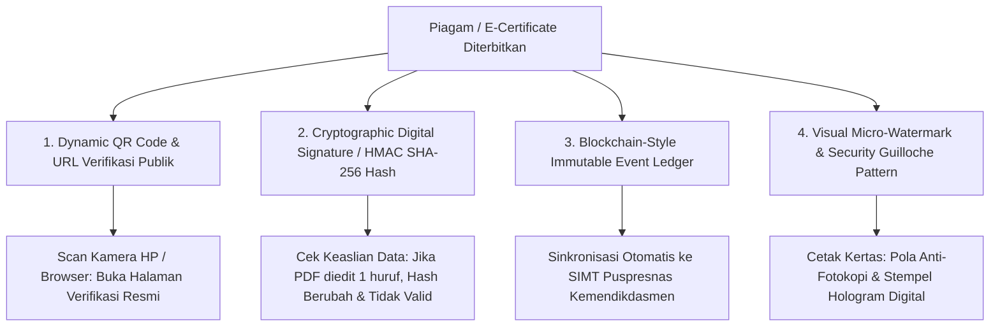
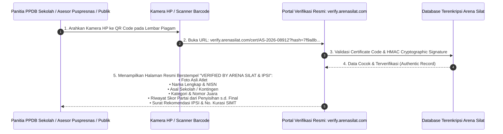

# Sistem Verifikasi Keaslian Sertifikat & Piagam Kejuaraan (Anti-Fraud Certificate Verification System)

Dokumen ini memuat arsitektur teknis, standar keamanan kriptografi, alur verifikasi publik, integrasi portal verifikasi PPDB/Puspresnas, serta mekanisme pencegahan pemalsuan piagam kejuaraan Pencak Silat pada platform **Arena Silat SaaS**.

---

## 1. Mengapa Pemalsuan Piagam Silat Sangat Rawan & Berbahaya?

### Masalah di Lapangan:
1. **Manipulasi Jalur Prestasi PPDB & SNBP**: Banyak oknum mengedit file PDF piagam (mengubah nama atlet, asal sekolah, atau nomor juara dari Juara Harapan menjadi Juara 1 Emas) agar lolos masuk SMP/SMA/PTN favorit.
2. **Piagam Palsu Event Fiktif**: Beredarnya sertifikat kejuaraan silat bodong yang tidak pernah mengantongi rekomendasi resmi IPSI atau izin Dispora.
3. **Kesulitan Panitia Sekolah / Asesor**: Panitia PPDB sekolah tidak punya waktu untuk menelepon panitia kejuaraan satu per satu untuk mengecek keabsahan berkas fisik.

---

## 2. Solusi Kriptografi 4 Lapis Anti-Pemalsuan (4-Layer Anti-Fraud Architecture)

Sistem **Arena Silat** menerapkan 4 pilar pengamanan sertifikat digital:



---

## 3. Alur Verifikasi Piagam oleh Panitia PPDB / Publik (Zero Login Required)



---

## 4. Tampilan Halaman Verifikasi Publik (Public Verification Page UI)

Saat QR Code dipindai, layar HP asesor menampilkan **Halaman Bukti Otentik (Single Source of Truth)**:

### Elemen yang Ditampilkan:
1. **Badge Status Keaslian**:
   - 🟢 **`[ VALID & TERVERIFIKASI RESMI ]`** (Berwarna Hijau Terang dengan Waktu Penerbitan).
   - 🔴 **`[ SERTIFIKAT PALSU / TIDAK DITEMUKAN ]`** (Jika QR Code hasil rekayasa atau hash tidak cocok).
2. **Data Identitas Lengkap Pesilat**:
   - Nama Pesilat, Foto Asli saat Timbang Badan, NIK/Paspor, dan NISN.
   - Asal Kontingen, Sekolah/Kampus, dan Tingkat Pendidikan (SD/SMP/SMA).
3. **Detail Pertandingan & Riwayat Laga (Match Audit Trail)**:
   - Nama Kejuaraan: *Kejuaraan Nasional Pencak Silat Piala Kemenpora 2026*.
   - Kategori: *Tanding Kelas C Remaja Putra*.
   - Peringkat: *Juara 1 (Medali Emas)*.
   - **Rekapitulasi Skor Partai**:
     - *Babak 1*: Menang 18 - 6 vs Kontingen Jawa Timur.
     - *Semifinal*: Menang WMP (Ronde 2) vs Kontingen DKI Jakarta.
     - *Final*: Menang 15 - 12 vs Kontingen Jawa Barat.
4. **Legalitas Kejuaraan**:
   - Nomor Rekomendasi PB/Pengprov IPSI.
   - Nomor Izin Keramaian Kepolisian.
   - Nomor Registrasi Kurasi SIMT Puspresnas Kemendikdasmen (siap klik untuk cek langsung di portal Kemendikbud).

---

## 5. Skema Database & Kriptografi Hash Sertifikat

```sql
-- 1. Tabel Master Sertifikat & Piagam Digital (Issued Certificates)
CREATE TABLE tournament_certificates (
    id UUID PRIMARY KEY DEFAULT gen_random_uuid(),
    tournament_id UUID NOT NULL REFERENCES tournaments(id) ON DELETE CASCADE,
    athlete_id UUID NOT NULL REFERENCES athletes(id) ON DELETE CASCADE,
    category_id UUID NOT NULL REFERENCES categories(id) ON DELETE CASCADE,
    match_participant_id UUID REFERENCES match_participants(id) ON DELETE SET NULL,
    
    -- Identifier & Keamanan Unik
    certificate_number VARCHAR(100) UNIQUE NOT NULL, -- Contoh: 'CERT/AS-JBR/2026/08912'
    qr_verification_token VARCHAR(255) UNIQUE NOT NULL, -- UUIDv4 / Random Secure String
    hmac_sha256_hash VARCHAR(64) NOT NULL, -- Hash Kriptografi dari (athlete_id + category_id + rank + tournament_id + secret_key)
    
    -- Data Prestasi
    achievement_title VARCHAR(100) NOT NULL, -- 'Juara 1 (Emas)', 'Juara 2 (Perak)', 'Juara 3 Bersama', 'Penampil Terbaik I'
    athlete_name VARCHAR(255) NOT NULL,
    athlete_nisn VARCHAR(20),
    school_name VARCHAR(255),
    contingent_name VARCHAR(255) NOT NULL,
    
    -- Legalitas & Sinkronisasi
    is_puspresnas_curated BOOLEAN DEFAULT FALSE,
    simt_achievement_id VARCHAR(100), -- ID Prestasi di database SIMT Kemendikbud
    pdf_file_url VARCHAR(500) NOT NULL, -- Link download PDF sertifikat asli
    
    -- Audit Log Verifikasi
    total_verification_scans INT DEFAULT 0,
    last_scanned_at TIMESTAMP,
    issued_at TIMESTAMP DEFAULT CURRENT_TIMESTAMP
);

-- 2. Tabel Log Pemindaian QR Code (Certificate Scan Audit Trail)
CREATE TABLE certificate_scan_logs (
    id UUID PRIMARY KEY DEFAULT gen_random_uuid(),
    certificate_id UUID NOT NULL REFERENCES tournament_certificates(id) ON DELETE CASCADE,
    scanned_ip VARCHAR(45),
    scanned_user_agent TEXT,
    scanned_city VARCHAR(100),
    scanned_at TIMESTAMP DEFAULT CURRENT_TIMESTAMP
);

-- Indeks Kecepatan Validasi Pemindaian QR Code (< 50ms)
CREATE INDEX idx_cert_token ON tournament_certificates(qr_verification_token);
CREATE INDEX idx_cert_hash ON tournament_certificates(hmac_sha256_hash);
```

---

## 6. Contoh Implementasi Pembuatan Hash & Verifikasi (Node.js Crypto)

```typescript
import crypto from 'crypto';

const SECRET_SALT = process.env.CERTIFICATE_SECRET_KEY || 'arena-silat-secret-salt-2026';

/**
 * 1. Membuat HMAC SHA-256 Hash saat Piagam Diterbitkan
 */
export function generateCertificateHash(
  certNumber: string,
  athleteId: string,
  categoryId: string,
  achievement: string,
  tournamentId: string
): string {
  const payload = `${certNumber}|${athleteId}|${categoryId}|${achievement}|${tournamentId}`;
  return crypto.createHmac('sha256', SECRET_SALT).update(payload).digest('hex');
}

/**
 * 2. Memverifikasi Keaslian Piagam saat QR Code Dipindai Asesor
 */
export function verifyCertificateIntegrity(
  certNumber: string,
  athleteId: string,
  categoryId: string,
  achievement: string,
  tournamentId: string,
  incomingHash: string
): boolean {
  const expectedHash = generateCertificateHash(certNumber, athleteId, categoryId, achievement, tournamentId);
  return crypto.timingSafeEqual(Buffer.from(incomingHash), Buffer.from(expectedHash));
}
```
