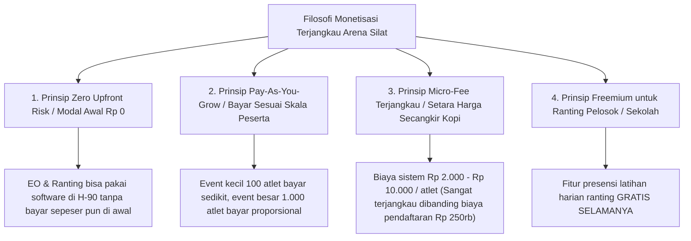
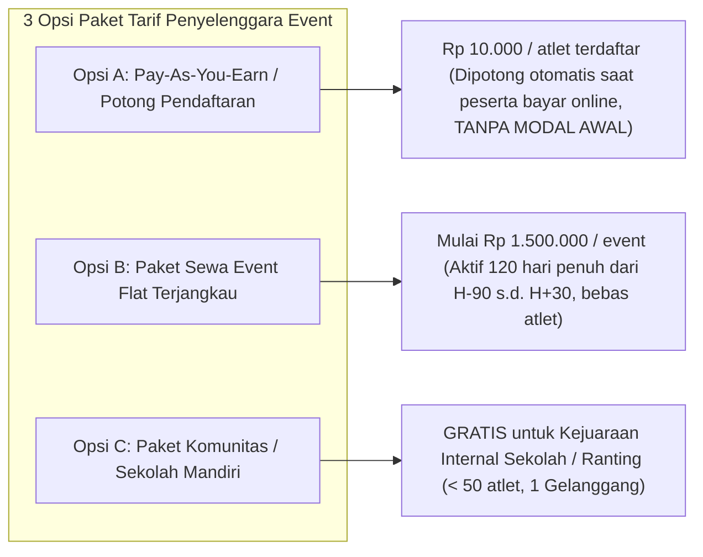
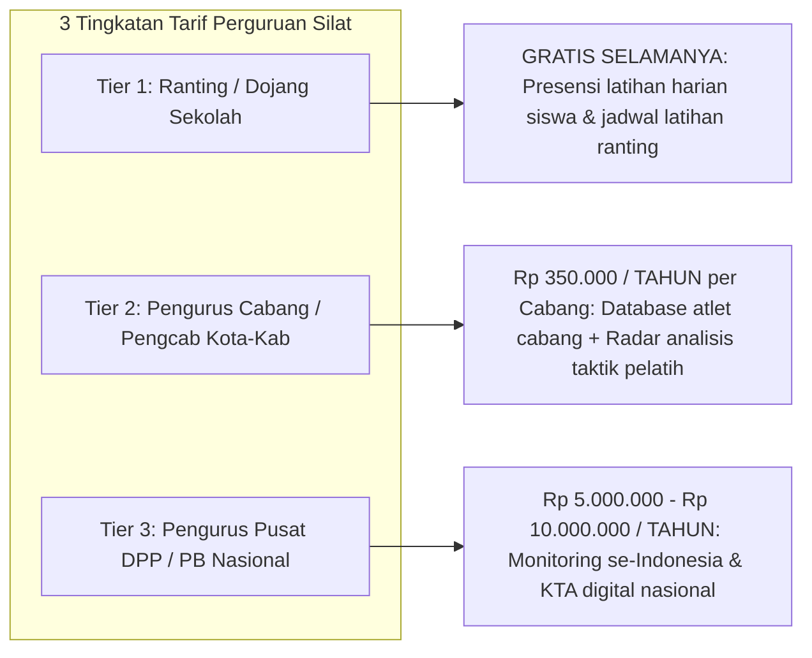

# Skema Monetisasi Terjangkau, Inklusif & Berkeadilan (Affordable & Inclusive Pricing Strategy) Arena Silat SaaS

Dokumen ini memuat analisis dan rancangan struktur harga (*pricing structure*) yang **sangat terjangkau, adil (*fair*), tanpa modal awal (*Zero Upfront Cost*), dan ramah anggaran (*budget-friendly*)** bagi seluruh tingkatan **Penyelenggara Event (EO Grassroot s.d. Nasional)** maupun **Perguruan Pencak Silat (Tingkat Ranting Sekolah, Cabang Daerah, hingga Pengurus Pusat DPP)** di seluruh Indonesia.

---

## 1. Filosofi & Prinsip Penetapan Harga Inklusif

---

## 2. Struktur Tarif Terjangkau untuk Penyelenggara Event Turnamen (EO)

Penyelenggara turnamen silat (sekolah, klub, pengcab) sering kali memiliki modal terbatas. Oleh karena itu, disediakan skema yang tidak mengganggu arus kas (*cash flow*):

### Rincian Paket Penyelenggara Event (EO):

| Paket Event | Target Pengguna | Kapasitas & Fitur | Biaya Layanan SaaS |
|---|---|---|---|
| **Komunitas / Sekolah (Free Tier)** | Kejuaraan Antar-Kelas / Ranting Internal | • 1 Gelanggang • Hingga 60 Atlet • Scoring Digital Tanding/TGR • Cetak Bagan Manual | **GRATIS (Rp 0)** *(Bentuk kontribusi sosial Arena Silat untuk pembinaan silat usia dini)* |
| **Pay-As-You-Earn (Paling Populer)** | Kejuaraan Terbuka / Open Pelajar / Kejurcab | • Multi-Gelanggang (Bebas) • Pendaftaran Online QRIS/VA • Auto-Bracket & Seeding • Jury Pad PWA & TV Scoreboard • E-Piagam QR Code Anti-Pemalsuan | **Rp 10.000 / atlet** *(Dipotong otomatis dari biaya pendaftaran peserta Rp 250rb - Rp 300rb)* **MODAL AWAL: Rp 0** |
| **Sewa Flat Event Pass (120 Hari)** | Pengcab / Pengprov IPSI / EO Profesional | • Unlimited Atlet & Kategori • Masa Aktif 120 Hari (H-90 s.d. H+30) • Video Review VAR & OBS Stream Overlay • Ekspor Format SIMT Puspresnas | **Mulai Rp 1.500.000 – Rp 3.500.000 / event** *(Bisa DP Rp 500rb di H-90)* |

---

## 3. Struktur Tarif Terjangkau untuk Perguruan Pencak Silat (Guild / Dojo)

Untuk mendukung digitalisasi ribuan perguruan silat tradisional di Indonesia tanpa memberatkan kas:

### Rincian Paket Perguruan Silat:

| Tingkatan Perguruan | Target Pengguna | Fitur yang Diperoleh | Biaya Langganan |
|---|---|---|---|
| **Ranting / Dojang (Free Tier)** | Pelatih Ranting Sekolah / Padepokan Desa | • Presensi Siswa via Scan QR Code HP • Jadwal Latihan Rutin Mingguan • Catatan Materi Jurus Latihan | **GRATIS SELAMANYA (Rp 0)** |
| **Cabang Daerah (Pengcab)** | Pengurus Cabang Kota / Kabupaten | • Database seluruh atlet se-Kota/Kab • Radar Taktik & Analisis Kelemahan Atlet • Pendaftaran Massal Turnamen 1-Klik • Akses Approval Ujian Kenaikan Sabuk | **Rp 350.000 / tahun** *(Hanya ~Rp 29.000 / bulan, sangat terjangkau bagi kas cabang)* |
| **Pengurus Daerah (Pengda)** | Pengurus Tingkat Provinsi | • Multi-Cabang Leaderboard Provinsi • Scouting Atlet Berbakat Pelatda • Monitoring Ranting se-Provinsi | **Rp 1.500.000 / tahun** per Provinsi |
| **Pengurus Pusat (DPP / PB)** | Dewan Pimpinan Pusat Perguruan Nasional | • **Peta Monitoring Latihan se-Indonesia** • Master Database Siswa & Sabuk Nasional • KTA Digital Ber-QR Code Terpusat • Modul Kejurnas Internal Perguruan | **Rp 5.000.000 – Rp 10.000.000 / tahun** *(Sangat murah untuk mengelola puluhan ribu anggota se-Indonesia)* |

---

## 4. Skema Mikro-Fee Ujian Kenaikan Tingkat (UKT / Sabuk Digital): Hanya Rp 2.500 / Siswa

Saat perguruan menggelar Ujian Kenaikan Sabuk (UKT):
- **Biaya Layanan Sistem**: Hanya **Rp 2.500 – Rp 3.500 / siswa peserta UKT**.
- **Nilai yang Didapat Perguruan & Siswa**:
  - Pendaftaran ujian online & cetak nomor ujian.
  - Form input nilai digital untuk dewan penguji sabuk di lapangan.
  - Penerbitan otomatis **E-Sertifikat Ijazah Kenaikan Sabuk ber-QR Code Anti-Pemalsuan** yang tersimpan permanen di akun siswa.
- **Sangat Terjangkau**: Jika iuran UKT siswa adalah Rp 75.000 – Rp 150.000, biaya sistem Rp 2.500 hanya mengambil **$< 3\%$** dari total iuran!

---

## 5. Simulasi Perbandingan Biaya Tradisional vs Menggunakan Arena Silat

### A. Untuk Penyelenggara Turnamen (Event 500 Atlet):
* **Sistem Manual / Cetak Kertas Jadul**:
  - Cetak piagam & ID card: Rp 3.500.000
  - Kertas bagan & ATK timbang: Rp 750.000
  - Jasa pembuatan bagan manual: Rp 1.500.000
  - Sewa hardware scoring manual jadul: Rp 4.000.000
  - **Total Biaya Tradisional: Rp 9.750.000**
* **Menggunakan Arena Silat (Model Pay-As-You-Earn)**:
  - Biaya SaaS (500 atlet x Rp 10.000): **Rp 5.000.000** *(Dipotong otomatis dari uang pendaftaran, tanpa modal awal di H-90)*.
  - **Panitia HEMAT Rp 4.750.000 (Hemat 48%) + Mendapatkan Sistem Digital Real-time, VAR Kamera HP, dan Sertifikat Anti-Fraud!**

---

### B. Untuk Pengurus Cabang Perguruan Silat (1 Tahun):
* **Biaya Langganan Arena Silat**: **Rp 350.000 / tahun**.
* **Keuntungan**:
  - Menghemat jutaan rupiah biaya cetak blangko sertifikat sabuk.
  - Mencegah kebocoran dana iuran ujian sabuk oleh ranting ilegal.
  - Memiliki database digital seluruh pesilat cabang yang rapi dan profesional.
