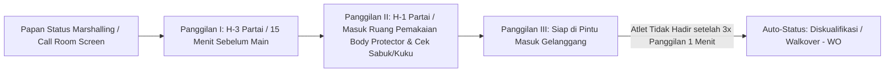
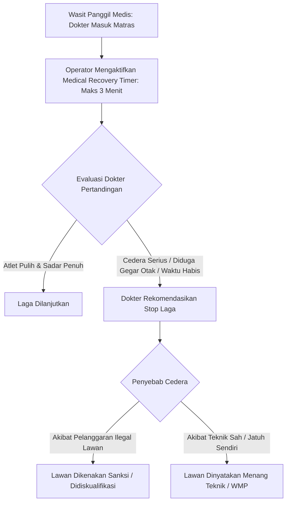
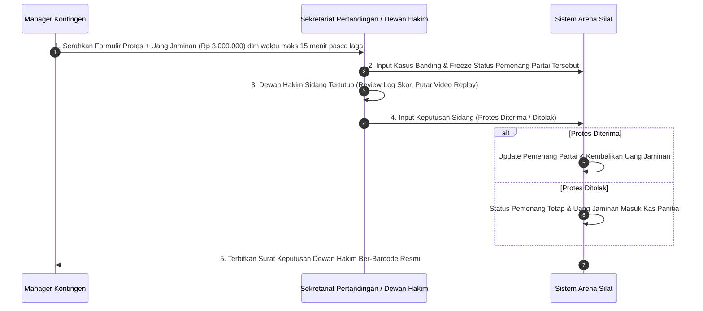

# Audit Operasional Spesifik Lapangan & SOP Eksepsional Turnamen Pencak Silat (Arena Silat)

Dokumen ini memuat analisis dan rancangan penanganan untuk 5 kondisi lapangan kritis yang sering terjadi di turnamen Pencak Silat: sistem panggilan atlet (*Marshalling*), penanganan pesilat cedera & protokol gegar otak (*Concussion Protocol*), sidang banding sengketa wasit (*Jury Dispute Protocol*), formula penentuan Pesilat Terbaik & Juara Umum, serta mekanisme pencetakan massal ID Card & Sertifikat offline.

---

## 1. Sistem Pemanggilan Atlet & Ruang Tunggu (Marshalling & Call Room)

### Permasalahan Lapangan:
Partai pertandingan sering tertunda karena pesilat belum memakai perlengkapan pelindung (*body protector*, pelindung kemaluan/cup, pelindung tulang kering) atau masih berada di tribun/luar gedung saat nomor partainya dipanggil.

### Solusi Sistem di Arena Silat:


- **Fitur Notifikasi WhatsApp / Telegram Otomatis ke Manager Kontingen**: Mengirim pesan bot saat partai atletnya kurang 3 partai lagi (*"Pesilat Ahmad Sudut Merah harap segera menuju Ruang Marshalling Gelanggang 2"*).
- **Tabel `match_marshalling`**:
  ```sql
  CREATE TABLE match_marshalling (
      id UUID PRIMARY KEY DEFAULT gen_random_uuid(),
      match_participant_id UUID NOT NULL REFERENCES match_participants(id) ON DELETE CASCADE,
      call_1_at TIMESTAMP,
      call_2_at TIMESTAMP,
      call_3_at TIMESTAMP,
      is_equipment_verified BOOLEAN DEFAULT FALSE, -- Cek body protector, deker, pelindung gigi
      status VARCHAR(50) DEFAULT 'waiting' -- 'waiting', 'in_call_room', 'ready_at_court', 'walkover_no_show'
  );
  ```

---

## 2. Protokol Medis Khusus, Timer Pemulihan & Penanganan Gegar Otak (Concussion Protocol)

### Permasalahan Lapangan:
Saat atlet terkena pukulan/tendangan telak atau benturan kepala, wasit menghentikan laga dan memanggil tim medis. Ada batasan waktu penanganan medis yang ketat sebelum wasit memutuskan apakah laga dilanjutkan atau atlet dinyatakan tidak layak tanding (*Medical Disqualification/WMP*).



- **Timer Khusus Medis di Scoreboard**: Layar arena menampilkan hitung mundur waktu perawatan medis (standar 3 menit kumulatif per partai).
- **Red-Flag Medical Suspension**: Jika pesilat kalah K.O benturan kepala/gegar otak, sistem otomatis menandai profil atlet di tabel database: `athletes.medical_suspension_until = NOW() + INTERVAL '30 days'` (atlet dilarang didaftarkan ke turnamen lain selama 30 hari demi keselamatan otak).

---

## 3. Tata Cara Sidang Banding Sengketa Resmi (Official Dispute & Protest Protocol)

Jika sebuah kontingen merasa dirugikan dan mengajukan protes resmi tertulis ke Dewan Hakim:



---

## 4. Formula Perhitungan Juara Umum & Pesilat Terbaik (Piala Bergilir Engine)

Aplikasi SaaS secara otomatis menghitung klasemen kontingen dan peraih gelar individu tanpa perdebatan manual:

### A. Klasemen Perolehan Medali Kontingen (Medal Tally Standings)
Urutan peringkat dihitung berdasarkan:
1. Jumlah **Medali Emas** terbanyak.
2. Jika emas sama, dihitung jumlah **Medali Perak** terbanyak.
3. Jika perak sama, dihitung jumlah **Medali Perunggu** terbanyak.
4. Jika seluruh medali identik, dihitung kontingen dengan **jumlah pesilat terbanyak yang dikirim**.

### B. Formula Pesilat Terbaik Putra & Putri (Best Athlete Algorithm)
Dihitung otomatis berdasarkan skor agregat performa:
$$\text{Score Pesilat Terbaik} = (\text{Total Poin Masuk Laga}) - (2 \times \text{Poin Pelanggaran}) + (\text{Bonus K.O/WMP} \times 10)$$
*(Pesilat dengan rasio kemenangan telak dan disiplin pelanggaran terminimal mendapat predikat Pesilat Terbaik).*

---

## 5. Mode Cetak Massal Offline (High-Volume Batch Generator)

Untuk turnamen besar dengan 1.500+ atlet:
- **Batch Generator ID Card**: Menghasilkan 1 file PDF gabungan berisi seluruh ID Card peserta per kontingen (format siap potong A4/A6 dengan foto, barcode presensi, dan QR Code gelanggang).
- **Dynamic Certificate Auto-Fill**: Begitu partai final selesai dan wasit mengangkat tangan pemenang, e-piagam juara 1, 2, dan 3 langsung ter-*generate* detik itu juga dan dapat langsung dicetak oleh tim sekretariat di venue atau diunduh langsung oleh pelatih dari dashboard HP mereka.
