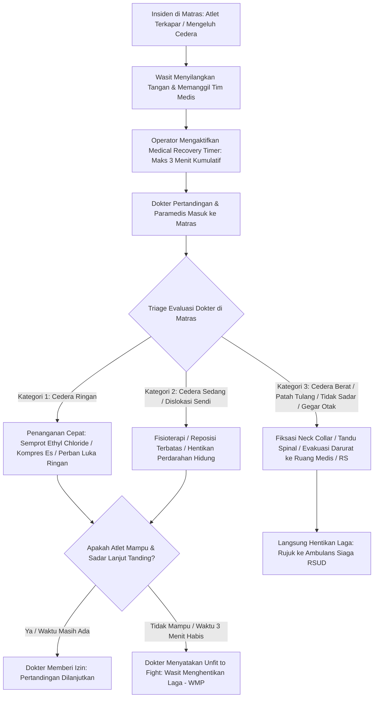
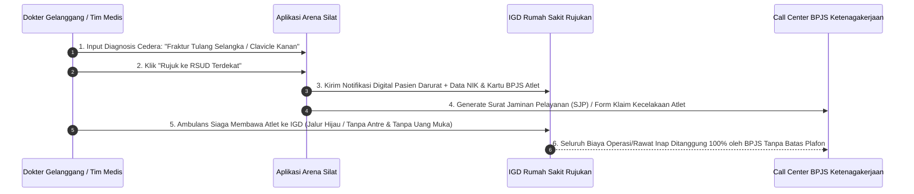

# Standar Operasional Prosedur (SOP) & Integrasi Sistem Penanganan Atlet Cedera (Arena Silat)

Dokumen ini memuat panduan lengkap tata kelola medis darurat di lapangan, klasifikasi tingkat keparahan cedera pesilat, aturan timer medis regulasi IPSI/PERSILAT, alur rujukan evakuasi rumah sakit, integrasi klaim asuransi/BPJS Ketenagakerjaan otomatis, serta skema basis data rekam medis atlet di aplikasi **Arena Silat**.

---

## 1. Alur & Protokol Tanggap Darurat Medis di Gelanggang (On-Mat Medical Flow)

Saat terjadi benturan keras atau atlet terjatuh dan tidak dapat bangkit:



---

## 2. Klasifikasi Cedera & Keputusan Pemenang Regulasi Silat

Dokter pertandingan bertindak independen tanpa intervensi pelatih/panitia. Status kemenangan pasca cedera ditentukan oleh **kausalitas (penyebab) cedera**:

| Jenis & Penyebab Cedera | Keputusan Wasit & Dewan Juri | Status Pemenang Laga |
|---|---|---|
| **A. Akibat Pelanggaran Ilegal Lawan** (contoh: Memukul muka sengaja, mematahkan sendi saat kuncian terlarang, menendang kemaluan) | Lawan dikenakan **Peringatan II (-10)** atau **Diskualifikasi (Disq)**. | **Atlet yang cedera dinyatakan MENANG DISKUALIFIKASI**. |
| **B. Akibat Teknik Serang Sah Lawan** (contoh: Kena tendangan sah ke dada lalu sesak nafas / terkena sapuan sah lalu pingsan) | Wasit melakukan hitungan 1 s.d. 10 $\rightarrow$ Wasit Menghentikan Pertandingan (WMP). | **Lawan dinyatakan MENANG TEKNIK / WMP / K.O**. |
| **C. Cedera Sendiri / Kram / Keseleo** (contoh: Kuda-kuda salah saat melangkah, otot paha robek sendiri) | Diberikan waktu rawat 3 menit $\rightarrow$ jika menyerah / mundur. | **Lawan dinyatakan MENANG MUNDUR / WALKOVER (WO)**. |
| **D. Dokter Menyatakan Keduanya Tidak Layak Tanding** (Benturan kepala bersamaan) | Pertandingan dihentikan seketika. | Pemenang ditentukan dari **akumulasi skor angka tertinggi sampai detik laga dihentikan**. |

---

## 3. Integrasi Klaim BPJS Ketenagakerjaan & Rujukan Rumah Sakit (Fast-Track Hospital Referral)

Pencak Silat adalah olahraga berisiko tinggi. Sistem **Arena Silat** mengintegrasikan data medis ke jaringan Rumah Sakit Rujukan dan BPJS Ketenagakerjaan:



---

## 4. Perlindungan Atlet: Skorsing Medis Otomatis (Concussion Red-Flag Suspension)

Demi keselamatan jangka panjang atlet (khususnya usia dini dan remaja):
- **Kasus K.O Benturan Kepala / Gegar Otak Ringan**:
  - Dokter mengaktifkan status `concussion_ko = TRUE` di aplikasi.
  - Sistem secara otomatis menerapkan **Masa Skorsing Medis (Medical Suspension)** selama **minimal 30 hari** (atau 60 hari untuk K.O berulang).
  - **Dampak pada Sistem SaaS**: Selama masa skorsing, NIK atlet tersebut **otomatis ditolak / diblokir** jika didaftarkan oleh pelatih ke turnamen silat lain di platform Arena Silat, sampai ada surat izin medis baru dari dokter spesialis saraf.

---

## 5. Skema Database Rekam Medis & Penanganan Cedera (Medical Incident Logs)

```sql
-- 1. Tabel Insiden Medis Pertandingan (Match Medical Incidents)
CREATE TABLE match_medical_incidents (
    id UUID PRIMARY KEY DEFAULT gen_random_uuid(),
    match_id UUID NOT NULL REFERENCES matches(id) ON DELETE CASCADE,
    athlete_id UUID NOT NULL REFERENCES athletes(id) ON DELETE CASCADE,
    round_number INT NOT NULL,
    injury_timestamp_in_round VARCHAR(20), -- Menit/detik ronde saat terjadi
    injury_body_part VARCHAR(100) NOT NULL, -- 'kepala', 'leher', 'rusuk', 'lutut', 'bahu_clavicle', 'kemaluan', 'engkel'
    diagnosis_category VARCHAR(50) NOT NULL, -- 'contusion_bruise', 'sprain_strain', 'dislocation', 'fracture', 'concussion_head', 'wound_laceration'
    injury_description TEXT NOT NULL,
    treatment_given TEXT NOT NULL, -- Tindakan penanganan pertama
    total_treatment_seconds INT DEFAULT 0, -- Total waktu penanganan (maks 180s)
    doctor_name VARCHAR(100) NOT NULL,
    doctor_decision VARCHAR(50) NOT NULL, -- 'fit_to_continue', 'unfit_wmp', 'refer_to_hospital'
    created_at TIMESTAMP DEFAULT CURRENT_TIMESTAMP
);

-- 2. Tabel Rujukan Rumah Sakit & Klaim Asuransi (Hospital Referrals & Insurance Claims)
CREATE TABLE medical_hospital_referrals (
    id UUID PRIMARY KEY DEFAULT gen_random_uuid(),
    incident_id UUID NOT NULL REFERENCES match_medical_incidents(id) ON DELETE CASCADE,
    athlete_id UUID NOT NULL REFERENCES athletes(id) ON DELETE CASCADE,
    hospital_name VARCHAR(255) NOT NULL,
    ambulance_call_time TIMESTAMP DEFAULT CURRENT_TIMESTAMP,
    ambulance_depart_time TIMESTAMP,
    insurance_type VARCHAR(50) NOT NULL, -- 'bpjs_ketenagakerjaan', 'bpjs_kesehatan', 'private_insurance', 'contingent_cash'
    insurance_claim_number VARCHAR(100),
    admission_status VARCHAR(50) DEFAULT 'in_transit', -- 'in_transit', 'admitted_igd', 'surgery', 'outpatient', 'discharged'
    final_medical_cost DECIMAL(12,2),
    created_at TIMESTAMP DEFAULT CURRENT_TIMESTAMP
);

-- 3. Update Kolom Medical History pada Tabel Master Athletes
ALTER TABLE athletes ADD COLUMN is_medically_suspended BOOLEAN DEFAULT FALSE;
ALTER TABLE athletes ADD COLUMN medical_suspension_until DATE;
ALTER TABLE athletes ADD COLUMN suspension_reason VARCHAR(255);

-- Indeks Pencarian Riwayat Medis Atlet
CREATE INDEX idx_medical_athlete ON match_medical_incidents(athlete_id);
CREATE INDEX idx_hospital_referrals ON medical_hospital_referrals(athlete_id, admission_status);
```
