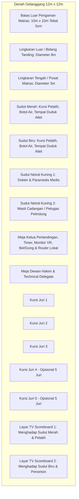
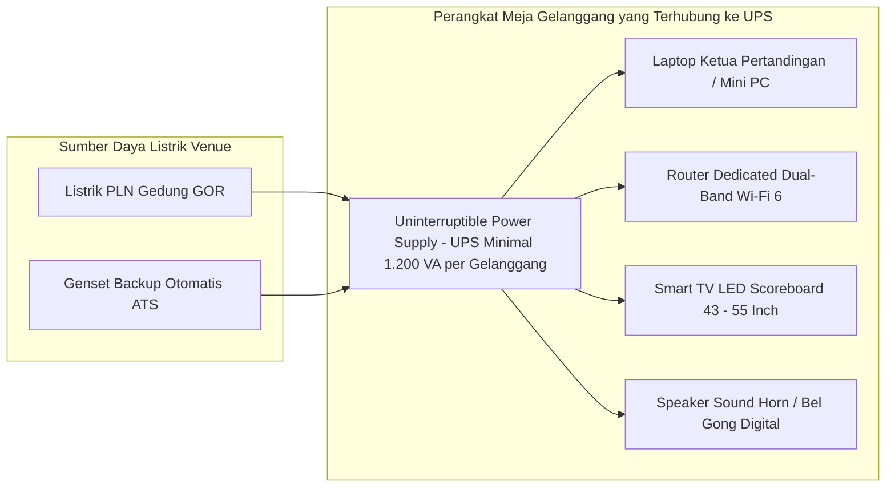

# Standar Kebutuhan Sarana Fisik Gelanggang, Tata Letak Matras & Checklist Logistik (Arena Silat)

Dokumen ini memuat panduan komprehensif mengenai **Standar Kebutuhan Fisik Lapangan (Physical Infrastructure Standards)**, tata letak gelanggang (*Mat Layout & Spatial Zoning*), spesifikasi perangkat audio/visual, kebutuhan daya listrik & UPS, serta checklist logistik perlengkapan pertandingan Pencak Silat.

---

## 1. Denah Tata Letak Gelanggang Standar PERSILAT / IPSI (Court Spatial Zoning)

Setiap gelanggang silat membutuhkan area steril minimal **12 meter x 12 meter** dengan matras pertandingan berukuran **10 meter x 10 meter**:

---

## 2. Spesifikasi Matras & Perlengkapan Standar Resmi

| Komponen Fisik | Standar Spesifikasi Regulasi IPSI / PERSILAT | Fungsi & Catatan Lapangan |
|---|---|---|
| **Matras Pertandingan (Tatami)** | • Ukuran: $10\text{m} \times 10\text{m}$ (100 lembar puzzle $1\text{m} \times 1\text{m}$). • Tebal: **Minimal 5 cm (EVA Foam Density Tinggi)**. • Warna: Hijau (dasar), Merah & Biru (sudut), Putih/Kuning (garis batas). | Meredam benturan keras saat teknik bantingan/jatuhan agar atlet tidak cedera punggung/kepala. |
| **Body Protector (Pelindung Badan)** | • Standar IPSI warna hitam dengan sabuk sudut Merah dan Biru. • Dilengkapi bantalan busa peredam di area dada, perut, dan rusuk. | Disediakan panitia minimal 4 pasang per gelanggang (2 Merah, 2 Biru) untuk perputaran antrean tanding. |
| **Pelindung Kemaluan (Genital Protector / Cup)** | • Bahan plastik tebal / logam dengan bantalan karet (Putra & Putri). | Wajib dipakai atlet di dalam celana sebelum masuk matras. |
| **Pelindung Tulang Kering (Shin Guard)** | • Deker busa elastis pelindung tulang kering dan kura-kura kaki. | Mencegah retak tulang saat terjadi benturan tendangan antar tulang kering. |
| **Senjata Seni Baku (Golok & Toya)** | • Golok/Parang: Logam tidak tajam / tidak runcing (tumpul). • Toya/Tongkat: Rotan asli panjang $150 - 180\text{ cm}$ diameter $2.5 - 3.5\text{ cm}$. | Diperiksa oleh petugas pengawas senjata sebelum pesilat nomor Seni tampil. |

---

## 3. Infrastruktur Kelistrikan, Audio & Hardware IT per Gelanggang

Untuk menjamin sistem digital scoring, VAR, dan TV Scoreboard tidak mati mendadak saat pertandingan berlangsung:

### Kebutuhan Listrik & IT per Gelanggang:
1. **1 Unit UPS (Minimal 1.200 VA)** di bawah meja Ketua Pertandingan (memberikan daya cadangan 20–30 menit jika listrik padam).
2. **2 Unit TV LED / Smart TV (Ukuran 43 – 55 Inch)**:
   - TV 1: Ditempatkan di sisi kiri menghadap sudut Merah dan tribun.
   - TV 2: Ditempatkan di sisi kanan menghadap sudut Biru dan pelatih.
3. **1 Unit Sound Horn / Speaker Aktif Meja**: Untuk membunyikan suara bel ronde, peluit digital, dan buzzer peringatan wasit yang terdengar jelas di tengah kebisingan penonton GOR.
4. **1 Unit Router Wi-Fi 6 Dedicated (SSID Khusus Tersembunyi)**: Khusus menghubungkan Tablet Juri dan HP Kamera VAR tanpa interferensi sinyal HP penonton di tribun.

---

## 4. Master Checklist Logistik & Perlengkapan H-1 (Day-Before Audit)

- [ ] **Area Matras**: 100 lembar matras puzzle terpasang rata, bersih, dan tidak licin.
- [ ] **Perlengkapan Sudut**:
  - [ ] 2 Ember / Tempat Sampah sudut (Merah & Biru).
  - [ ] 2 Kursi pelatih sudut Merah & 2 Kursi pelatih sudut Biru.
  - [ ] 2 Botol semprotan air & 2 lap kanebo/kain pel pengering matras.
- [ ] **Perangkat Digital Scoring**:
  - [ ] 5 Tablet Juri + 2 Tablet Cadangan (Baterai 100% & Charger tersambung).
  - [ ] 1 Laptop KP + 1 Monitor Eksternal Review VAR.
  - [ ] 2 Unit Smart TV / Monitor Scoreboard terpasang kokoh pada standing bracket.
  - [ ] 1 Timbangan Badan Digital Bluetooth di Ruang Timbang (telah dikalibrasi).
- [ ] **Peralatan Medis Lapangan**:
  - [ ] 1 Tandu Spinal Board + Cervical Neck Collar (Penyangga Leher).
  - [ ] 1 Tabung Oksigen Portabel + Tas P3K (Kasa, Perban, Ethyl Chloride Spray, Es Batu).
  - [ ] 1 Unit Mobil Ambulans Siaga lengkap dengan supir di pintu darurat GOR.
- [ ] **Kelengkapan Wasit Juri**:
  - [ ] Seragam resmi wasit juri (Baju putih celana putih sabuk kuning).
  - [ ] Peluit cadangan & 1 buah Gong/Bel manual cadangan jika listrik mati.
  - [ ] Bendera Merah, Biru, dan Kuning cadangan di meja KP.
