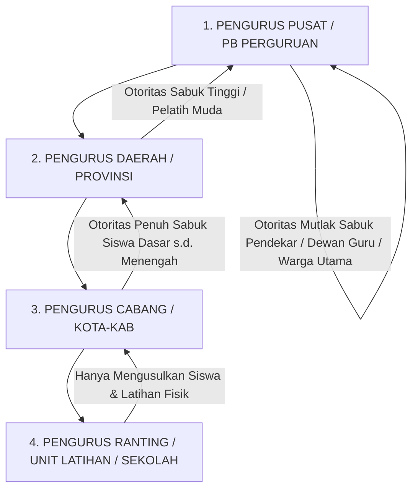
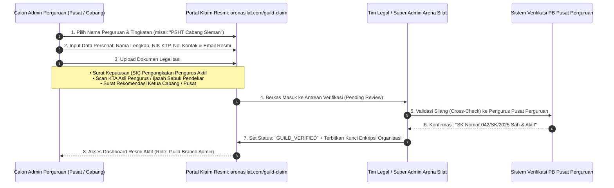
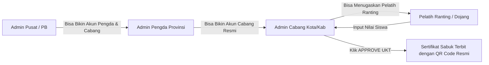
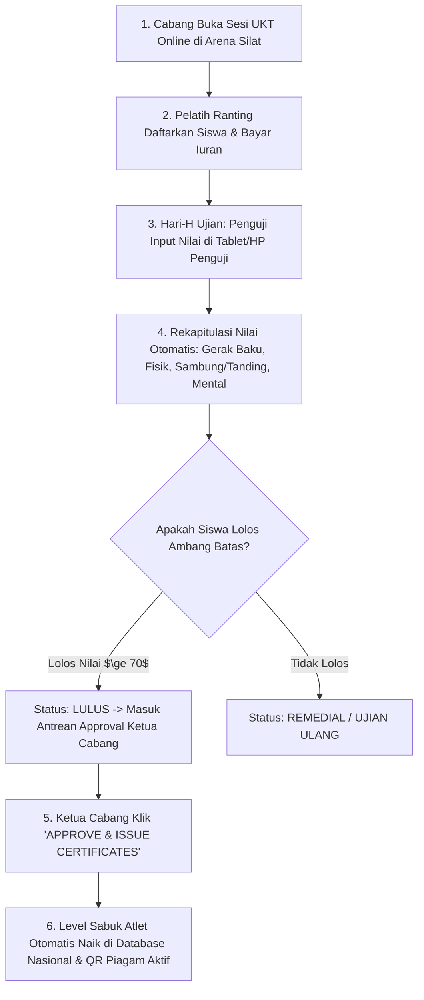

# Tata Kelola Hirarki Sabuk, Otoritas Hak Akses & Mekanisme Klaim Perguruan Pencak Silat (Guild Belt Governance & Verification)

Dokumen ini memuat analisis dan rancangan arsitektur mengenai: **Hirarki Otoritas Kenaikan Sabuk (Ranting vs Cabang vs Pengda vs Pusat)**, **Mekanisme Klaim Hak Akses Pengurus Resmi**, **Proses Verifikasi Legalitas & Surat Keputusan (SK)**, serta **Alur Kerja Ujian Kenaikan Tingkat (UKT) Digital** pada platform **Arena Silat SaaS**.

---

## 1. Hirarki Otoritas Leveling Sabuk (Belt Leveling Authority Matrix)

Di dalam tradisi perguruan Pencak Silat di Indonesia (seperti Tapak Suci, PSHT, Perisai Diri, Merpati Putih, dll), **tidak semua tingkatan pengurus berhak mengesahkan kenaikan sabuk**. Ada batasan yurisdiksi yang ketat:



### Matriks Kewenangan Penerbitan & Approval Sabuk:

| Tingkatan Sabuk / Jenjang | Tingkat Penguji Lapangan | Pengurus yang Berhak Mengesahkan (Approval Authority) | Tanda Tangan Resmi pada E-Sertifikat |
|---|---|---|---|
| **Sabuk Siswa Dasar / Pemula** (contoh: Kuning / Hijau / Putih Dasar) | Pelatih Ranting / Dewan Penguji Cabang | **Pengurus Cabang (Cabang / Pengcab)** | Ketua Cabang & Ketua Dewan Pendekar Cabang |
| **Sabuk Siswa Lanjutan / Tingkat Taruna** (contoh: Merah / Biru / Tingkat 1) | Tim Penguji Khusus Cabang / Gabungan | **Pengurus Cabang / Pengda** | Ketua Cabang & Pengda Wilayah |
| **Sabuk Pelatih Muda / Calon Warga** (contoh: Kader Dasar / Tingkat Hijau Lanjutan) | Tim Penguji Pengda Provinsi | **Pengurus Daerah (Pengda / Provinsi)** | Ketua Pengda & Dewan Guru Wilayah |
| **Sabuk Pendekar / Warga / Dewan Pendekar** (contoh: Sabuk Hitam, Melati, Pendekar Utama) | Majelis Guru Besar / Dewan Pusat | **PENGURUS PUSAT / BESAR (PB) PUSAT MUTLAK** | Ketua Umum PB & Guru Besar Perguruan |

---

## 2. Mekanisme Klaim Hak Akses & Verifikasi Pengurus Resmi (Claim & Verification Flow)

Untuk mencegah akun bajakan / pengurus palsu / ranting liar yang mengatasnamakan perguruan:



---

## 3. Struktur Hak Akses Berjenjang (Guild Multi-Tier RBAC)

Setelah terverifikasi, sistem menerapkan hak akses hierarkis di dalam dashboard perguruan:



### 1. Hak Akses Admin Pusat (PB Perguruan):
- Melihat peta sebaran seluruh cabang, ranting, dan siswa di seluruh dunia.
- Menentukan kurikulum standar jurus & acuan nilai UKT nasional perguruannya.
- Mengesahkan kenaikan sabuk tingkat Pendekar / Warga Utama.
- Membekukan (*freeze/suspend*) cabang atau ranting yang melanggar AD/ART perguruan.

### 2. Hak Akses Admin Cabang (Pengcab Perguruan):
- Membuat sesi pendaftaran UKT Cabang.
- Mengesahkan kenaikan sabuk siswa tingkat dasar hingga menengah.
- Menugaskan Dewan Penguji ke unit-unit latihan/ranting.
- Menerbitkan E-Sertifikat Sabuk Resmi ber-QR Code atas nama Pengurus Cabang.

### 3. Hak Akses Pelatih Ranting (Unit Latihan / Sekolah):
- Mendaftarkan siswa binaannya ke sesi UKT Cabang.
- Mengisi nilai mentah ujian gerak/fisik (sebagai *Examiner Input*).
- **TIDAK BISA** menerbitkan atau mengesahkan sertifikat sabuk sendiri (wajib menunggu tombol *Approval* dari Admin Cabang).

---

## 4. Alur Kerja Ujian Kenaikan Tingkat (UKT) Digital di Lapangan



---

## 5. Skema Database Hirarki Hak Akses & Klaim Perguruan

```sql
-- 1. Tabel Hirarki Tingkatan Pengurus Perguruan (Guild Administrative Levels)
CREATE TYPE guild_admin_level AS ENUM ('headquarters', 'regional_pengda', 'branch_pengcab', 'unit_ranting');

CREATE TABLE guild_officials (
    id UUID PRIMARY KEY DEFAULT gen_random_uuid(),
    guild_id UUID NOT NULL REFERENCES martial_arts_guilds(id) ON DELETE CASCADE,
    branch_id UUID REFERENCES guild_branches(id) ON DELETE SET NULL, -- Null jika pengurus pusat
    user_id UUID NOT NULL REFERENCES users(id) ON DELETE CASCADE,
    admin_level guild_admin_level NOT NULL,
    position_title VARCHAR(100) NOT NULL, -- 'Ketua Umum PB', 'Ketua Cabang', 'Ketua Dewan Penguji', 'Pelatih Ranting'
    sk_number VARCHAR(100) NOT NULL, -- Nomor Surat Keputusan Pengangkatan
    sk_document_url VARCHAR(500) NOT NULL, -- Scan Surat Keputusan Resmi
    belt_level_rank VARCHAR(50) NOT NULL, -- Tingkatan Sabuk Pengurus (misal: 'Pendekar Muda')
    can_approve_basic_belts BOOLEAN DEFAULT FALSE,
    can_approve_master_belts BOOLEAN DEFAULT FALSE,
    is_verified BOOLEAN DEFAULT FALSE,
    verified_by VARCHAR(100),
    verified_at TIMESTAMP,
    created_at TIMESTAMP DEFAULT CURRENT_TIMESTAMP
);

-- 2. Tabel Permohonan Klaim Hak Akses Perguruan (Guild Access Claims)
CREATE TABLE guild_access_claims (
    id UUID PRIMARY KEY DEFAULT gen_random_uuid(),
    guild_id UUID NOT NULL REFERENCES martial_arts_guilds(id) ON DELETE CASCADE,
    applicant_user_id UUID NOT NULL REFERENCES users(id) ON DELETE CASCADE,
    claimed_level guild_admin_level NOT NULL,
    branch_name VARCHAR(255),
    applicant_nik VARCHAR(20) NOT NULL,
    applicant_phone VARCHAR(20) NOT NULL,
    sk_document_url VARCHAR(500) NOT NULL,
    id_card_photo_url VARCHAR(500) NOT NULL,
    claim_status VARCHAR(50) DEFAULT 'pending', -- 'pending', 'verified', 'rejected'
    rejection_reason TEXT,
    reviewed_by VARCHAR(100), -- Super Admin / PB Pusat
    reviewed_at TIMESTAMP,
    created_at TIMESTAMP DEFAULT CURRENT_TIMESTAMP
);

-- 3. Tabel Konfigurasi Skema Urutan Sabuk per Perguruan (Guild Belt Progression Rules)
CREATE TABLE guild_belt_progression_rules (
    id UUID PRIMARY KEY DEFAULT gen_random_uuid(),
    guild_id UUID NOT NULL REFERENCES martial_arts_guilds(id) ON DELETE CASCADE,
    belt_order_index INT NOT NULL, -- 1 = Kuning Dasar, 2 = Kuning Lanjutan, 3 = Hijau...
    belt_name VARCHAR(100) NOT NULL, -- 'Siswa Polos', 'Siswa Jambon', 'Siswa Hijau', 'Siswa Putih', 'Warga Tk 1'
    belt_category VARCHAR(50) NOT NULL, -- 'basic_student', 'intermediate', 'advanced', 'master_citizen'
    min_training_months INT DEFAULT 3, -- Syarat masa latihan minimal
    approval_required_level guild_admin_level NOT NULL, -- 'branch_pengcab' atau 'headquarters'
    created_at TIMESTAMP DEFAULT CURRENT_TIMESTAMP,
    CONSTRAINT unique_guild_belt_order UNIQUE (guild_id, belt_order_index)
);

-- Indeks Keamanan & Otoritas
CREATE INDEX idx_guild_officials_auth ON guild_officials(guild_id, admin_level, is_verified);
CREATE INDEX idx_claims_status ON guild_access_claims(guild_id, claim_status);
```
