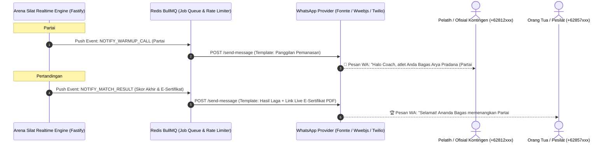

# Arsitektur WhatsApp Gateway Automation, Webhook & Notifikasi Turnamen

Dokumen ini mendefinisikan arsitektur otomatisasi notifikasi WhatsApp untuk **Arena Silat Enterprise**. Sistem ini dirancang untuk mengirimkan notifikasi instan, tiket digital ber-QR Code, pemberitahuan panggilan partai ($N-2$), serta pengumuman hasil laga langsung ke nomor WhatsApp pelatih kontingen, orang tua atlet, dan atlet secara otomatis tanpa intervensi manual panitia.

---

## 1. Urgensi & Skenario Penggunaan Lapangan

Di arena turnamen dengan ratusan peserta, masalah klasik yang sering terjadi adalah:
1. **Atlet Terlambat / Diskualifikasi (Walkover / W.O)**: Pesilat dan ofisial tidak mendengar pengeras suara saat berada di luar gedung GOR atau di ruang pemanasan.
2. **Kepanikan Orang Tua**: Orang tua tidak mengetahui anaknya berada di partai nomor berapa dan jam berapa perkiraan bertanding.
3. **Distribusi E-Sertifikat & Rekam Medali**: Pembagian sertifikat fisik sering hilang atau memakan waktu berhari-hari.

---

## 2. Diagram Alur WhatsApp Gateway Event-Driven Webhook



---

## 3. Template Pesan WhatsApp Resmi (Format Interaktif)

### Template 1: Tiket Registrasi & ID Card QR Code (H-1 Turnamen)
```text
🥋 *ARENA SILAT - TIKET ELEKTRONIK & VERIFIKASI RESMI*
Halo *Bagas Arya Pradana*, Anda telah terdaftar pada:

🏆 *Kejurnas Pencak Silat Emas PERSILAT 2026*
📍 *Venue*: GOR Amongrogo, D.I. Yogyakarta
🥋 *Kategori*: Tanding Dewasa - Kelas C Putra (55-60kg)
🛡️ *Kontingen*: Tapak Suci Solo
⚖️ *Status Timbang BLE*: ✅ VALID (58.4 kg)
🩺 *Status Medis/BPJS*: ✅ PROTECTED (PLKK Cashless)

📲 *Unduh ID Card Digital & Jadwal Lengkap*:
https://arenasilat.id/ticket/tnt-2026-ath-001

_Harap simpan pesan ini untuk scan gate masuk atlet._
```

---

### Template 2: Notifikasi Panggilan Persiapan Partai ($N-2$ Warm-up Alert)
```text
🔔 *PERINGATAN PANGGILAN GELANGGANG (H-15 MENIT)*
Kepada Pelatih *Tapak Suci Solo*, atlet Anda:

🥋 *Pesilat*: Bagas Arya Pradana
🏟️ *Gelanggang*: GELANGGANG A
🔢 *Partai*: #15 (Babak Semi Final)
🥊 *Sudut*: 🔴 MERAH (VS Rian Hidayat - PSHT)
⏱️ *Estimasi Masuk*: 10:45 WIB

⚠️ *Instruksi*: Harap pesilat segera memakai body protector dan memasuki Staging Area Gelanggang A sekarang untuk menghindari sanksi W.O.
```

---

### Template 3: Hasil Pertandingan & Link E-Sertifikat Kriptografis
```text
🏆 *HASIL RESMI PERTANDINGAN - ARENA SILAT*
Pertandingan Partai #14 Gelanggang A telah selesai:

🔴 Sudut Merah: *Bagas Arya Pradana* (14 Poin)
🔵 Sudut Biru: *Rian Hidayat* (11 Poin)

🏅 *Pemenang*: Sudut Merah (*Bagas Arya Pradana*) dengan kemenangan *Angka Mutlak*.

📜 *E-Sertifikat Terverifikasi SIMT Puspresnas*:
https://arenasilat.id/verify/cert-99812-ecdsa.pdf

_Terima kasih atas sportivitas dan semangat ksatria pencak silat!_
```

---

## 4. Keamanan & Anti-Banned Rate Limiting (Redis Queue)

WhatsApp memiliki batasan *Spam Detection*:
1. **Redis BullMQ Throttle**: Pengiriman dibatasi maksimal **2 pesan per detik per nomor gateway** dengan jeda dinamis 500-1500ms acak.
2. **Webhook Inbound Handler**: Menerima balasan dari pelatih (e.g. ketik *"JADWAL"* atau *"BAGAN"*) yang dijawab otomatis oleh **AI Bot Assistant Arena Silat**.
