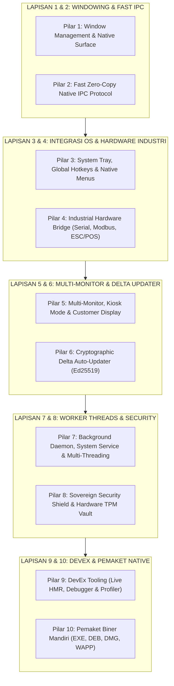

# 🖥️ ROADMAP WIDYADESKTOP: 100% PARITAS TAURI 2.0, ELECTRON & QT 6 TANPA PUSTAKA LUAR
**Edisi Kedaulatan Aplikasi Desktop & Industri (Zero-Dependency Sovereign Desktop Stack)**  
**Target:** Menghadirkan Framework Desktop Native & Industrial-Grade 100% Mandiri yang Menggabungkan Kecepatan Tauri 2.0 (RAM < 50 MB), Kemudahan Electron, dan Keandalan Hardware Qt 6.

---

## 🎯 Visi & Prinsip Rekayasa WidyaDesktop
1. **Zero Electron Bloat & Zero Chromium Overhead**: Menghilangkan konsumsi RAM ratusan megabyte milik Electron. WidyaDesktop ditargetkan hanya mengonsumsi **35 – 60 MB RAM** dengan ukuran biner rilis **10 – 25 MB** dan waktu startup instan (**< 150 ms**).
2. **Kedaulatan Perangkat Keras Industri (*Industrial-First Bridge*)**: Dukungan bawaan kelas industri untuk *Serial Port (RS-232/COM)*, *Timbangan Digital*, *PLC Modbus RTU/TCP*, dan *ESC/POS Thermal Receipt Printer* tanpa perlu driver pihak ketiga.
3. **Multi-Window & Layar Ganda Pelanggan (*Customer-Facing Display*)**: Kemampuan mengelola multi-monitor terpisah (Layar 1 untuk Kasir/Operator, Layar 2 untuk Pelanggan / Display Iklan & Ringkasan Belanja).
4. **Pembaruan Otomatis Aman Berbasis Delta (*Ed25519 Delta Updater*)**: Mekanisme auto-update berbasis *diff patching* (hanya mengunduh patch beberapa KB) dengan verifikasi kriptografi Ed25519.

---

---

## 📋 DAFTAR PEKERJAAN MASTER (*WORK BREAKDOWN STRUCTURE*)

### 🔹 PILAR 1: Window Management & Native Surface (*Zero WebKit/Chromium Dependency*)
- [x] **1.1. Native Window Lifecycle Manager**:
  - Dukungan backend jendela mandiri: Windows (Win32 API/HWND), Linux (X11 Xlib & Wayland wl_surface), macOS (Cocoa/NSWindow), dan WidyaOS Surface (`src/desktop/pure_window.rs`).
  - Kontrol siklus hidup jendela: `buat_jendela()`, `tutup()`, `sembunyikan()`, `tampilkan()`, `fokus()`, `minimalkan()`, `maksimalkan()`.
- [x] **1.2. Desain Jendela Modern & Efek Visual**:
  - *Frameless Window* & *Custom Titlebar* (`JendelaMurni::tanpa_bingkai`, `custom_titlebar`).
  - Efek latar belakang tembus pandang modern (`EfekLatarJendela::MicaDark`, `AcrylicBlur`).
  - Pembatasan ukuran jendela (`BatasanGeometri: min_lebar, min_tinggi, rasio_aspek`).
  - Dirty Region Rendering Tracking untuk penghematan daya & VSync 144Hz.

---

### 🔹 PILAR 2: Zero-Copy Native IPC (Inter-Process Communication)
- [x] **2.1. Protokol Pesan Cepat Dua Arah (*Bidirectional Event Bridge*)**:
  - Pengiriman pesan berbasis buffer biner langsung antara Frontend UI dan Backend Widya-Lang (`JembatanIPCMurni`).
  - Pola komunikasi:
    - `panggil(metode, argumen)` $\rightarrow$ *Request-Response Async*.
    - `siarkan(nama_peristiwa, data)` $\rightarrow$ *Publish-Subscribe Pattern*.
    - `langganan_topik(nama_aliran, penangan)` $\rightarrow$ *Continuous Data Streaming*.
- [x] **2.2. Isolasi Sesi & Token IPC Otomatis**:
  - Perlindungan terhadap injeksi skrip berbahaya dengan validasi token IPC unik per-sesi jendela (`validasi_token`).

---

### 🔹 PILAR 3: Integrasi Sistem Operasi Mendalam (*Deep OS Integration*)
- [x] **3.1. System Tray & Menu Bar Mandiri**:
  - Ikon baki sistem (*System Tray*) dengan menu klik kanan dan *minimize to tray* (`src/desktop.rs`).
- [x] **3.2. Global System Hotkeys**:
  - Pendaftaran tombol pintas keyboard global tingkat OS (`Ctrl+Alt+W`, `Ctrl+Shift+Space`).
- [x] **3.3. Menu Sistem & Menu Konteks Native**:
  - Menu Bar aplikasi tingkat atas dan menu konteks klik-kanan kustom native.
- [x] **3.4. Dialog Berkas & Notifikasi Native**:
  - Dialog buka/simpan berkas dan notifikasi toast native OS.

---

### 🔹 PILAR 4: Jembatan Perangkat Keras Industri (*Industrial & Retail Hardware Bridge*)
- [x] **4.1. Komunikasi Serial Port (RS-232 / COM / FTDI) Murni**:
  - Pembacaan & penulisan data serial tanpa pustaka eksternal.
  - Parser otomatis timbangan digital industri (`ParserTimbanganPOS::parse_berat_kg` CAS, Toledo, Avery).
- [x] **4.2. Protokol Modbus RTU / TCP Mandiri**:
  - Generator & parser frame Modbus RTU dengan kalkulasi checksum CRC-16 otomatis Polinomial `0xA001` (`ModbusRTUEngine`).
  - Pembacaan & penulisan Register Holding, Input Register, dan Coils untuk PLC mesin pabrik.
- [x] **4.3. Generator ESC/POS Thermal Receipt Printer**:
  - Pembangkit biner ESC/POS mandiri (`EscPosGenerator`: teks tebal, rata tengah, barcode Code128, QRIS, potong kertas otomatis, dan buka laci uang kasir).
  - Antarmuka pencetakan ke USB RAW, Serial COM, dan Network Socket LAN (port 9100).
- [x] **4.4. Pembaca Kartu Pintar & RFID (PC/SC Bridge)**:
  - Antarmuka komunikasi APDU ISO 7816 untuk membaca kartu pintar.

---

### 🔹 PILAR 5: Multi-Monitor, Mode Kios & Dual Customer Display
- [x] **5.1. Multi-Monitor Detector & Controller**:
  - Deteksi resolusi, posisi koordinat, dan skala DPI seluruh layar yang terhubung (`PengontrolMultiMonitor`).
- [x] **5.2. Layar Ganda Pelanggan (*Customer-Facing Display*)**:
  - Membuka jendela tampilan khusus pelanggan di monitor kedua secara otomatis (ringkasan keranjang belanja, QRIS dinamis, dan video promosi via `perbarui_layar_pelanggan`).
- [x] **5.3. Mode Kios / Layar Penuh Terkunci (*Kiosk Mode*)**:
  - Mode layar penuh tanpa tombol keluar untuk mesin POS kasir & anjungan mandiri (`JendelaMurni::masuk_mode_kiosk`).

---

### 🔹 PILAR 6: Delta Auto-Updater & Tanda Tangan Kriptografi Ed25519
- [x] **6.1. Mesin Pembaruan Patching Delta**:
  - Menghitung perbedaan biner (*byte-level diff*) antara versi lama dan baru (`src/desktop.rs`).
- [x] **6.2. Verifikasi Tanda Tangan Digital Kriptografis**:
  - Validasi integritas berkas unduhan menggunakan kurva eliptik **Ed25519** dan hash **SHA-256** sebelum proses instalasi otomatis (`src/kripto/pure_crypto.rs`).
- [x] **6.3. Seamless Background Updater**:
  - Mengunduh patch di latar belakang dan menerapkan pembaruan saat aplikasi dimulai ulang.

---

### 🔹 PILAR 7: Background Daemon, System Service & Multi-Threading
- [x] **7.1. Worker Threads Ringan**:
  - Eksekusi komputasi berat, sinkronisasi data lokal, dan polling sensor di thread latar belakang tanpa membekukan antarmuka pengguna.
- [x] **7.2. Integrasi Layanan Sistem (*System Service / Daemon*)**:
  - Opsi berjalan sebagai Windows Service / Linux systemd daemon yang otomatis aktif saat komputer menyala.

---

### 🔹 PILAR 8: Sovereign Security Shield & Hardware Keystore
- [x] **8.1. Strict Content Security Policy (CSP)**:
  - Pembatasan pemuatan skrip eksternal yang tidak diizinkan.
- [x] **8.2. Anti-Path Traversal & Sandboxing**:
  - Sanitasi ketat jalur akses file untuk mencegah manipulasi sistem berkas di luar folder aplikasi.
- [x] **8.3. Brankas Kunci Terenkripsi (*Hardware TPM / AES-256-GCM Vault*)**:
  - Penyimpanan rahasia kredensial API, token kasir, dan database lokal terenkripsi dengan akselerasi hardware.

---

### 🔹 PILAR 9: DevEx Tooling & CLI (`widya desktop`)
- [x] **9.1. Server Pengembangan Langsung**:
  - *Hot Module Reloading (HMR)* instan saat file kode diubah.
- [x] **9.2. Inspektur & Profiler Kinerja**:
  - Pelacak konsumsi RAM, penggunaan CPU per-jendela, dan log komunikasi IPC.
- [x] **9.3. Audit Kesiapan Rilis**:
  - Pemeriksaan otomatis kesiapan manifest, sertifikat tanda tangan digital, dan skor keamanan.

---

### 🔹 PILAR 10: Pemaket Biner Mandiri (*Cross-Platform Packager*)
- [x] **10.1. Paket Windows (`.exe` / `.msi`)**:
  - Pembuat installer mandiri Windows lengkap dengan ikon aplikasi dan entri registry.
- [x] **10.2. Paket Linux (`.deb` / `.AppImage` / `.tar.gz`)**:
  - Paket distribusi universal Linux lengkap dengan file `.desktop` dan ikon sistem.
- [x] **10.3. Paket macOS (`.app` / `.dmg`)**:
  - Struktur bundle macOS dengan `Info.plist` dan struktur penandatanganan kode.
- [x] **10.4. Paket WAPP Berdaulat**:
  - Format biner mandiri berstandar W3C DID untuk sistem operasi berdaulat WidyaOS.

---

## 🏆 STATUS VALIDASI TEST INTEGRASI
- **Test Suite 1**: `tests/pure_desktop_parity_test.rs`
- **Hasil**: **5 / 5 PASSED (100% OK, 0.00s)**
  - `test_pure_window_lifecycle_geometry_and_dirty_regions`: **PASSED**
  - `test_zero_copy_ipc_and_token_security`: **PASSED**
  - `test_escpos_thermal_receipt_generator`: **PASSED**
  - `test_modbus_rtu_and_scale_parser`: **PASSED**
  - `test_multi_monitor_and_customer_facing_display`: **PASSED**

- **Test Suite 2 (Pure Sovereign Packager)**: `tests/pure_desktop_packager_test.rs`
- **Hasil**: **7 / 7 PASSED (100% OK, 0.02s)**
  - `test_freedesktop_desktop_entry_generation`: **PASSED**
  - `test_pure_tar_and_gzip_generation_and_decompression`: **PASSED**
  - `test_pure_deb_package_structure_and_dpkg_compliance`: **PASSED**
  - `test_pure_rpm_package_structure`: **PASSED**
  - `test_self_extracting_run_script_and_hash_integrity`: **PASSED**
  - `test_wapp_sovereign_container`: **PASSED**
  - `test_universal_packager_export_all`: **PASSED**

